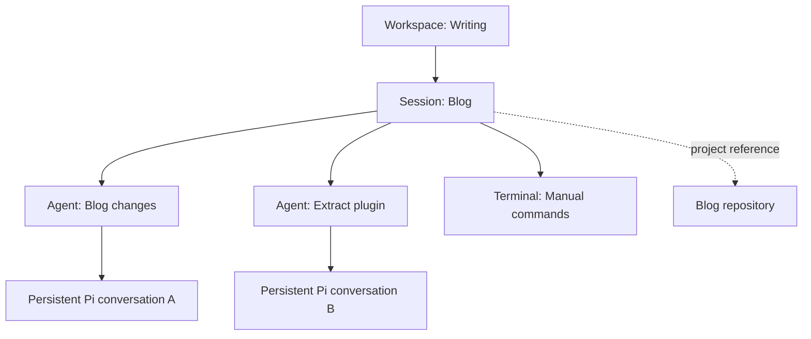
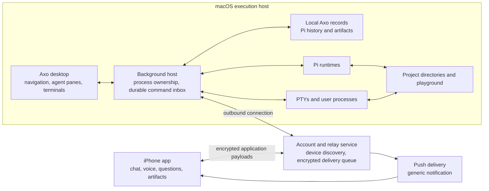
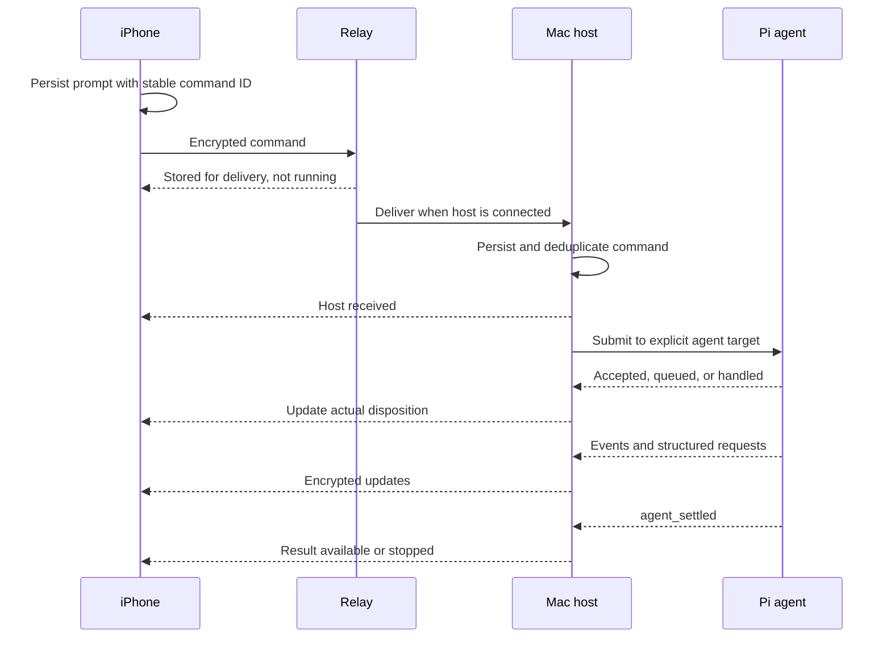

# RFD0001 - Axo: continuous agent workspaces

- Feature Name: `axo-continuous-agent-workspaces`
- Status: Draft
- Start Date: 2026-10-08
- Updated: 2026-10-08
- Document Type: Proposal

## Summary

Build Axo, a macOS working environment and iPhone companion for managing ongoing agent-assisted work. Axo replaces terminal tabs as the user's memory of unfinished work with persistent, searchable sessions grouped into workspaces. Each session contains one or more Pi agents and optional real terminals. A shared attention view surfaces unresolved questions, blockers, and unread results. The iPhone can continue conversations or start new sessions by text or voice while execution happens on the Mac. An account service connects the devices across networks and queues messages when the Mac is unavailable. Conversation history remains authoritative on the Mac initially; a cloud transcript archive, additional execution machines, and filesystem snapshots are not required for the first version.

Axo is named after the axolotl, with a corresponding mascot envisioned. The applications must be native to macOS and iOS, the macOS terminal must use libghostty, and the service must be Cloudflare-native TypeScript developed/deployed with the new `cf` CLI. Swift with Apple's native UI frameworks is the recommended client stack; GitHub sign-in is the initial authentication preference. This remains a proposal, not a finished implementation.

## Motivation

The current workflow spans roughly twenty project tabs on one laptop and another ten or more on another. Most tabs have the same structure: one or more Pi agents on the left, and one or more ordinary terminals on the right. The terminals support Vim, tests, package publication, and development servers. Tabs are generally named after projects, not individual tasks.

The immediate difficulty is finding a project and catching up on the state of everything running. Today that requires visiting tabs one by one. Repeated projects across tabs and computers make recognition harder.

The deeper issue is that tabs serve as reminders. Conversation loss is not the primary concern: Pi can resume conversations. Terminal history is also available independently. Some tabs contain processes that must stay alive, but many remain open because closing them risks forgetting the work exists.

The user describes difficulty retaining awareness of work that is no longer visible. Axo should accommodate that workflow through persistent visibility, fast navigation, and explicit state. It is not a medical intervention, a productivity scoring system, or a demand that the user maintain a task board.

Three needs must coexist:

1. **Continuity:** return to work without reconstructing its identity, history, or status.
2. **Hands-on access:** inspect and edit the actual files, use Vim, and run commands beside the agent.
3. **Remote participation:** dictate an idea from the metro, answer a question from the phone, and return to work already underway on the Mac.

Research has an additional quality criterion: its result should teach. A useful research deliverable explains the problem, exploration, solution, drawbacks, and remaining uncertainty, with diagrams where helpful. Completion alone does not establish understanding.

## Decisions established through discussion

- Initial platforms are **macOS and iPhone**, with genuinely native applications rather than web-wrapper application shells.
- Swift is the initial client-language preference. Rust with native bindings was raised as an alternative to investigate, not selected as a requirement.
- The macOS terminal must use **libghostty**.
- The service must be **Cloudflare-native TypeScript**, using the new **`cf` CLI**.
- **GitHub sign-in** is the initial authentication preference.
- Pi is the initial agent integration; different models remain Pi's concern.
- Axo should replace Ghostty for this workflow, not require navigation between two applications.
- Desktop sessions retain real interactive terminals. The phone does not need a raw terminal.
- A workspace groups related work for the user; it does not imply agent coordination.
- An Axo session can contain multiple agents and terminals. It is not synonymous with a Pi session.
- Starting a new conversation creates a new Axo session, potentially attached to an existing project or workspace. Adding another agent within an existing session is a separate action.
- The first agent is the initial default agent, not a supervisor with special authority.
- The phone must support creating new sessions, not merely resuming desktop-created ones.
- Ideas may begin in a playground before a project directory or repository is chosen.
- Remote access is the default. Do not introduce separate local-only and remote-enabled product modes.
- An account should make the user's devices easy to connect across networks. End-to-end encryption is the preferred security direction.
- Full conversation storage on the server is not required initially.
- Closing processes must not erase the work's discoverable history. Terminal and filesystem restoration are not promised.
- The user wants token/cost accounting and a view of where their own time has gone.
- Agent behavior determines when work ends. Axo must not add a compulsory goal loop or a separate work-mode selector.
- The desired autonomy includes installation, local and hosted repository creation, and publishing. Spending money is the explicit approval boundary; its precise scope remains unresolved.

The architecture below is a proposal for meeting these requirements. Unverified technical choices are called out separately.

## Goals

- Recognize running, waiting, finished, and inactive work without opening every session.
- Find a session or workspace through fuzzy search and stable navigation.
- Preserve the familiar agent-and-terminal workbench on macOS.
- Continue the same agent conversation across desktop and phone.
- Make questions easy to answer with taps, text, or voice.
- Start with an idea rather than requiring a directory first.
- Keep inactive work visible and resumable over months, subject to local data retention.
- Distinguish human foreground activity, agent activity, and resource consumption.
- Make offline delivery, interrupted execution, and unresolved requests explicit.

## Non-goals

- Linux, Windows, Android, or additional execution machines in the first version.
- A raw iPhone terminal or remote desktop.
- Cloud execution of agents.
- Automatic collaboration between agents because they share a workspace.
- Rebuilding Pi's planning, retry, model-selection, or autonomous completion policies.
- Exact restoration of shells, processes, files, network services, or machine state.
- A mandatory task tracker, reminders about neglected work, or automated productivity judgments.
- A server-side conversation backup or recovery guarantee after losing the Mac.
- Seamless compatibility with every existing Pi TUI extension before feasibility testing.

## Guide-level explanation

### Mental model

| Concept | Meaning |
| --- | --- |
| Workspace | A named group of related sessions, such as eval-kit and TypeSafe work. |
| Session | A persistent workbench containing agents and optional terminals. |
| Agent | A durable conversation binding plus a replaceable Pi runtime. |
| Project | A reference to the files/repository being worked on, not another mandatory navigation layer. |
| Playground | A configured area for work without an established project. Each new scratch session gets its own directory. |
| Terminal | A live interactive shell/process surface associated with a session. |
| Attention item | An unresolved request, blocker, or unread result linked to an agent and its session. |
| Execution host | The Mac running the work; one host initially. |

A project can be referenced by multiple sessions. A session has a primary working directory but may concern other repositories. Workspace membership neither shares model context nor determines filesystem access.

### Returning to ongoing work

The front door answers **what needs my attention?** A stable sidebar and fuzzy search also answer **where is my work?** Clearing an attention item does not remove its session from navigation.

An example workspace overview:

| Work | Status | Action |
| --- | --- | --- |
| Build the reporter | Waiting for your output-format choice | Open the question and choose |
| Investigate flaky evals | Running; recent activity available | Inspect if desired |
| Compare scoring approaches | Stopped; research document available | Open the result/document |
| Development server | Running | Open its local address on the Mac |

Do not equate agent termination with successful completion. When no verified success signal exists, prefer “stopped” or “response ready” over “done.” A document link can identify an available artifact without certifying its quality.

The desktop session presents agents beside ordinary terminals, normally agents on the left and shells on the right. Users may add agents or terminals without creating another workspace. Exact layout controls remain a design detail.

### Attention is not a review workflow

There are two different obligations:

- **Unread information:** an agent stopped and has a result. Opening that conversation clears the currently visible unread result. There is no separate “reviewed” button.
- **Unresolved interaction:** the agent needs an answer or cannot proceed. Opening the conversation does not resolve this. An accepted answer, explicit cancellation, or actual resolution does.

Transient errors that Pi recovers from should not produce user-facing failure alerts. A final failure or unexpected runtime exit should.

A session can contain a running agent, an unread result from another agent, and a server simultaneously. Its overview must preserve those facts instead of forcing the entire session into one state.

### Starting from the phone

1. Sign in and open Axo on the iPhone.
2. Create a session from a workspace/project, or use a general new-conversation action.
3. Type or dictate an idea. Show the destination and delivery state.
4. If no project is chosen, start in a per-session playground directory on the Mac.
5. The agent determines whether to stay there, use an existing project, or create a new one. It asks when intent is ambiguous.
6. Setup may include creating a directory/repository, installing dependencies, or publishing within the user's configured authority.
7. The session gains a recognizable name and project association without losing the initial conversation.
8. The agent works according to Pi's own behavior. Axo surfaces questions and settled results.
9. Opening the same session on the Mac exposes the conversation alongside real terminals.

A new session may belong to existing work. Routing must not silently merge a new conversation into an unrelated existing agent's history.

A dedicated global router agent is not required initially. The proposed simpler design gives each new session's initial agent a setup phase and explicit host operations for selecting/provisioning its working directory. This preserves one conversational thread. A universal router remains an alternative, not a settled requirement.

### Stopping and returning later

Navigating away or closing a window does not stop work. Explicitly closing a terminal stops that terminal; explicitly stopping an agent stops its runtime, not its history. A deliberate session-close action can stop its owned processes and mark it inactive, with clear disclosure of running services. It does not delete the record.

Inactive sessions remain discoverable in the sidebar and search. Reopening one restores its conversation and starts an agent when needed. The first/default agent has no supervisory role; if unavailable, another existing agent can become the default, or a runtime can be started. Previously addressed messages retain their original recipient.

Fresh terminals use the saved working directory if it still exists. If it is missing, Axo opens the conversation and asks the user to locate the project or select the playground before executing new work. It does not silently substitute a directory and run old commands there.

## Reference-level explanation

### Architecture and boundaries

The background host, not an individual window, owns agent processes, terminal lifetimes, and authoritative local state. Closing the desktop UI must not terminate those resources. A per-user background-service mechanism is a candidate; packaging and macOS lifecycle behavior require testing.

The relay authenticates accounts/devices, connects endpoints across networks, and temporarily stores encrypted undelivered commands. It does not run Pi or maintain an authoritative full transcript archive. Local desktop operation should continue during a relay outage; phone access cannot.

The iPhone uses structured conversation data and interactions. It does not receive a terminal screen as its primary interface. Artifact viewing must render long Markdown documents and diagrams legibly; generated content is untrusted and must not execute arbitrary scripts in a privileged view.

### Native clients and libghostty

**Recommendation:** Swift for both applications. Use SwiftUI for application structure and shared presentation where appropriate, AppKit for macOS-specific window/input/terminal integration, and UIKit bridges on iOS where needed. Native UI is the requirement; it does not mathematically require Swift, but Swift follows the upstream terminal implementation and avoids an additional Rust-to-Apple-framework layer.

Ghostty source inspected at commit `7ec9e26a29399b30ef78f06985fc75045b3cecb6` establishes:

- Its macOS application uses SwiftUI and AppKit, not a Rust application shell.
- The shared terminal core is written in Zig, with Metal rendering on macOS.
- Its Swift application imports `GhosttyKit` and calls the `ghostty_*` C interface.
- `src/build/GhosttyXCFramework.zig` packages the full library and `ghostty.h` as `GhosttyKit.xcframework` for the Swift application.
- Separately, `libghostty-vt` exposes terminal parsing/state functionality. The Swift VT example is not by itself a complete rendered interactive terminal.
- The repository is MIT-licensed; distribution still needs the appropriate notices and dependency-license review.
- The upstream README warns that library API signatures are still changing and no libghostty version has been tagged. Pin a source revision and compatible build toolchain rather than assuming a stable binary SDK.

Use the full Ghostty embedding path as the starting point for Axo's macOS terminal. Do not assume the VT library alone supplies native rendering, input, clipboard, accessibility, or PTY management. Validate those capabilities with a small Swift/AppKit terminal prototype before building the workbench around it.

A particularly important integration risk is process ownership: embedding a surface does not prove that its shell survives destruction of the view or exit of the UI process. Test surface detachment, window closure, host-owned PTYs, and reattachment explicitly. If the full embedding API cannot separate those lifetimes, revise the integration architecture while retaining libghostty; do not silently weaken the continuity requirement.

Rust remains an option for a bounded host subsystem if a demonstrated requirement warrants it. A Rust native application is not inherently impossible, but is not what Ghostty does on macOS and currently offers no established simplification for Axo. Pi remains a separate runtime; native clients do not imply rewriting the agent in Swift.

### Cloudflare service and development tooling

The service is TypeScript on Cloudflare. A small proposed product combination is:

- **Workers:** HTTPS API, GitHub authentication callback, device enrollment endpoints, authenticated routing, and push-notification integration.
- **SQLite-backed Durable Objects:** per-account device coordination, live WebSocket routing, delivery acknowledgments, and a bounded encrypted offline-command inbox. WebSocket hibernation is a candidate to avoid paying continuously for idle coordination.

These are proposed service boundaries, not deployed resources. A Durable Object may persist encrypted commands without becoming a full transcript archive. Keep payload decryption on enrolled devices. Hibernation resets in-memory state, so pending delivery state and necessary connection metadata must be recoverable. Cloudflare-side hibernation does not wake a sleeping Mac or keep an iPhone app executing in the background.

Do not add D1, KV, R2, Queues, or Workflows by default. Add a service only when account lookup, payload size, retention, or background delivery requirements demonstrate the need. Review current product limits/pricing before choosing account partitioning, queue bounds, or notification retry behavior. Apple's push delivery remains an external platform dependency, even though Axo's service code runs on Cloudflare.

The new **Cloudflare CLI (`cf`)** entered beta on September 28, 2026. Current official documentation specifies `cloudflare.config.ts`, `cf init`, `cf dev`, `cf build`, and `cf deploy`. It also exposes `cf cli search` for command discovery. The development environment already has `cf v1.0.0-beta.10` installed; only the version command was run during this research.

Use `cf` as the project's developer/deployment interface and pin the selected version for reproducibility. Do not scaffold a Wrangler-first configuration contrary to this constraint. `cf` can delegate build/dev work to supported tooling, including Wrangler internally; the requirement does not imply that Wrangler can never appear as an implementation dependency. The CLI's beta status means configuration and Build Output compatibility must be checked when upgrading.

### GitHub sign-in

Use GitHub as the initial identity provider, with browser-based authorization initiated by the native clients (for example through `ASWebAuthenticationSession`) and an Axo service callback. The exact GitHub application type and authorization flow remain to be selected against current provider documentation. Never ship a client secret in either native binary.

Request only the identity access needed to sign in. Repository creation/publication permissions for an executing agent are a separate capability: signing into Axo must not implicitly grant broad GitHub repository access. Bind accounts to GitHub's stable user identifier rather than a changeable login name.

GitHub authentication establishes account identity, not end-to-end encryption keys. Device enrollment, possession of device keys, and revocation still need their own design. Use the same account to discover devices without allowing an unverified device to obtain conversation keys automatically. Confirm the intended iPhone distribution route and any applicable App Store login requirements before promising GitHub as the only sign-in option.

### Pi integration: verified capabilities and proposed use

The installed `@earendil-works/pi-coding-agent` package reports version `1.1.0`. Its local documentation and examples were inspected while drafting. These are documented capabilities, not runtime tests of an Axo integration:

- SDK integration can create and resume persistent conversations and subscribe to lifecycle events.
- RPC provides a long-lived subprocess interface with commands, events, model controls, and session inspection.
- `agent_end` may precede automatic recovery or queued work. `agent_settled` is the documented final boundary for automatic work in the session-level run.
- RPC supports select, confirmation, text-input, and editor requests with correlated responses.
- RPC does not support all custom terminal UI capabilities. Some extension UI methods are unavailable or degraded.
- Pi persists conversation trees, not only linear transcripts. Session history, active branch, and model context are distinct.
- RPC supports entries and durable history cursors, as well as full-session token/cost statistics.
- A prompt sent during a run must explicitly choose steering or follow-up behavior.

**Proposed baseline:** use one supervised Pi RPC runtime per live agent, with structured Axo agent panes and independent embedded terminals. This is language-independent and fits both desktop and phone controls without screen scraping. An SDK adapter is the fallback if required host control is unavailable through RPC.

This proposal does not claim a stock Pi TUI can simultaneously be driven through RPC. Preserving the exact current TUI would require a different integration, such as a verified extension bridge. Before acceptance, compare the baseline against the user's actual extensions and workflow. Do not quietly remove essential Pi functionality.

Use a supported Pi version and an explicit adapter contract. Pi owns conversation-format semantics; Axo owns workspace membership, process ownership, attention state, and delivery records. One runtime owns writes to a Pi conversation at a time, including when importing conversations previously used outside Axo.

Axo observes settled runs but does not judge whether the user's goal was achieved, force continuations, or impose a research/coding work mode. A deliberately aborted run is reported as aborted, not successful.

### Project setup and changing directories

Changing a session's working directory must update tool roots, resource discovery, context instructions, and future shell defaults consistently. Running `cd` in one tool call does not accomplish that.

The SDK documents runtime/session replacement and service recreation for a target directory. Preservation of one conversation across a playground-to-project move still requires a focused integration test; no generic RPC `change_directory` command is assumed here.

A safe transition must quiesce the affected runtime, preserve conversation identity/history, resolve project trust and resources for the target, rebind event subscriptions, and commit the association only after successful startup. If the move fails, retain the original association and show the failure. Existing unrelated terminals do not silently change directories.

Multiple agents can work in the same checkout, matching current practice, but this provides no edit isolation. Display the directory/branch clearly and surface simultaneous use. Automatic worktrees, merging, or cross-agent coordination are not initial requirements.

### Durable records and ownership

The exact storage engine and wire schemas are implementation choices. The following identities and relationships are required:

| Record | Required meaning |
| --- | --- |
| Workspace | Stable ID, name, ordering, session membership |
| Session | Stable ID, name, workspace association, host, project/directory references, active/inactive visibility, timestamps |
| Agent | Stable ID, session ownership, Pi conversation reference, model configuration, runtime generation |
| Terminal | Session ownership, launch directory and live process identity; no promise of restorable process state |
| Attention item | Stable ID, source agent/run/request, kind, revision, unresolved/read state |
| Command | Stable client-generated ID, explicit destination, payload, delivery/acceptance state |
| Artifact | Session/agent ownership, local file reference, media type, availability/version information |
| Activity/usage record | Timestamped attribution with a defined measurement source and deduplication identity |

Separate execution state from attention state and navigation visibility. A session becoming inactive is not evidence that its pending question was answered.

Initially the Mac is authoritative. The phone may maintain a bounded cache, but cache retention is a security decision, not an implicit cloud backup. Losing local session files can lose history. Pi compaction must not be mistaken for deletion of raw history.

### Attention and interaction contract

- A settled run produces at most one corresponding result/termination attention item, unless an unresolved question/blocker already represents that outcome.
- Structured requests remain actionable until answered, cancelled, expired, or invalidated by runtime replacement. Expiry is not consent.
- Treat plain-text questions as conversation content unless an explicit request mechanism identifies them as unresolved. Reliable actionable questions need an Axo/Pi elicitation integration, not punctuation heuristics.
- Reading acknowledges only the results included in the viewed revision. A result arriving concurrently remains unread.
- Resolving a question on either device propagates to the other. Only one answer is accepted; later conflicting answers receive an already-resolved/stale response.
- Pi dialog IDs are associated with their originating runtime generation. Never deliver a stale answer to a replacement runtime or a different agent.
- A request interrupted by a crash becomes interrupted, not silently approved. Re-establish it explicitly on recovery when needed.
- Notifications carry generic content by default; the app retrieves/decrypts details. Notification delivery is not authoritative state.
- Deduplicate notifications and avoid alerts for routine tool output or recoverable retry events.

### Delivery, concurrency, and recovery

Transport is retried with stable command IDs. The host durably records receipt before acknowledging it. Duplicate network delivery must not create duplicate sessions or prompts.

Do not claim exactly-once external effects. A crash between submitting a prompt and recording acceptance creates an ambiguous state unless the adapter can reconcile it against persisted Pi history or an integration marker. Mark that command uncertain and reconcile; do not blindly replay a publish/install operation.

A message bound to an agent is never silently redirected when the default agent changes. A generic session prompt resolves its target before submission. Concurrent desktop/phone prompts are ordered by the host. The UI must distinguish an immediate prompt, a steering message, and a follow-up; the default interaction needs usability testing.

When the relay is unreachable, retain outgoing messages on the originating device. When the Mac is unavailable, the relay can hold encrypted commands. Distinguish locally queued, relay stored, host received, Pi accepted/queued, running, and settled states. Cancellation and command expiration must be designed so stale offline work does not unexpectedly execute months later.

If a Pi process exits, preserve its history and report interruption. Axo may start a replacement runtime on the next interaction, but does not automatically replay an uncertain task. A normal settled run is not a process crash and need not destroy the runtime.

### Availability and wake behavior

The user expects a connected, always-on Mac to begin work from a phone prompt without another manual step. A locked display is not the same as an offline execution host.

Waking a sleeping Mac across arbitrary networks is not established by account login or a push notification. Initial feasibility work must test the supported power/network configuration and background-service behavior. Do not advertise universal remote wake until demonstrated.

If execution cannot begin, retain the prompt and show it as queued. A powered-off Mac cannot execute work. After restart and host availability, delivery resumes; login requirements and pre-login limitations must be disclosed. No server-side execution fallback is assumed.

### Human activity and resource usage

Track three separate measures:

1. **Foreground interaction time:** time attributed to the visible, active Axo session, excluding a defined idle interval. This is an estimate of interaction, not a measurement of thought or all work done elsewhere.
2. **Agent activity:** runtime/run activity, including work performed while the user is absent.
3. **Resource usage:** Pi-reported tokens and cost, with provider/model attribution and unavailable prices labeled honestly.

A view such as “5% of tracked foreground time was spent on eval-kit” must state its denominator and time window. Background agents must not inflate human time. Switching devices must not double-count overlapping foreground intervals.

Prefer Pi's full-session accounting when available rather than summing only the visible branch. It includes some usage beyond main assistant messages. Do not add cumulative snapshots repeatedly or count the same conversation twice when aggregating sessions, projects, and workspaces. Rich analytics can follow basic correct accounting; punitive reminders and automatic resurfacing are not implied.

### Security and privacy

Remote participation is enabled by default, without separate conversation modes. The design should use end-to-end encrypted application payloads between enrolled devices, with TLS in addition. The relay may observe account/device identifiers, routing, timing, payload sizes, and push tokens; encryption does not hide all metadata.

Before remote release, define device-key enrollment, authentication, revocation, key rotation, recovery, and offline key storage. Same-account login is a discovery experience, not by itself a complete proof of device trust. Avoid inventing an unaudited cryptographic protocol. Do not silently fall back to plaintext delivery.

Do not log prompt bodies, transcripts, code, audio, secrets, or decrypted notifications on the relay. Bound encrypted queue retention and remove acknowledged payloads according to a specified policy. Product-content logs on devices should also be opt-in/redacted where possible.

Voice input creates another data path. Prefer device-side dictation where available; any external transcription, audio retention, or provider transfer must be explicit. “End-to-end encrypted relay” does not describe what a speech or model provider receives.

The user has work restrictions. Remote-by-default is the requested product model, but suitability for work content remains a deployment-policy question. Encryption alone does not establish employer approval. Do not represent Axo as approved for restricted work before that is resolved.

Agents run with available host permissions. The playground is a convenience, not a sandbox. Publishing and installation can have irreversible consequences even when free. Show destinations and actions in history, respect existing organizational/tool policies, and use scoped credentials where practical.

**Spending boundary:** the user wants approval before spending money. Ordinary configured model consumption, paid hosted resources, subscriptions, and usage-billed infrastructure need an explicit distinction. A prompt instruction or shell-command pattern matcher cannot guarantee this boundary when an agent has arbitrary shell/network access and billing-capable credentials. Enforce it through scoped capabilities/provider limits where possible and document residual risks. This is a pre-acceptance policy decision, not a solved safeguard.

### Invariants

- Axo session identity is independent of process lifetime and Pi conversation identity.
- Each accepted command has a stable destination; default-agent changes cannot retarget it.
- A single owner writes a Pi conversation at a time.
- Opening a conversation never counts as answering an unresolved question.
- Read acknowledgments cannot erase newer unseen results.
- An agent stopping is not proof that a user goal succeeded.
- Axo does not add an automatic continuation loop above Pi.
- Queue acceptance is never presented as execution.
- Agent/process exits do not delete conversations or silently archive work.
- Restoring history does not imply restoring a filesystem or shell.
- The relay is not the authoritative transcript store in the initial design.
- Workspace membership grants no new tool permissions or agent coordination.
- Telemetry must not label agent runtime as human attention.

### Compatibility and migration

The repository was empty when this RFD was drafted: no existing application, RFD convention, migrations, or test/lint setup was present. This document establishes the initial numbered RFD location.

Start with new Axo sessions and an explicit import/link flow for selected existing Pi conversations. Do not assume Ghostty exposes importable live split layouts or process ownership. Existing servers and shells may need to be recreated manually. Avoid editing an imported Pi conversation concurrently from a standalone Pi process.

Keep Pi history in its supported format and store Axo-specific grouping separately. Verify backup/export and version-upgrade behavior before depending on long-term resumption. Import must preserve branches and avoid treating only current model context as the complete conversation.

### Rollout and validation

Sequence implementation around evidence rather than building all three applications at once:

1. **Feasibility:** prove terminal embedding, the actual Pi extension experience, background process ownership, project-directory transitions, and supported Mac availability behavior.
2. **Local vertical slice:** create a workbench, run Pi and Vim side by side, surface a question/result, close the UI without killing work, and resume an inactive session.
3. **Remote vertical slice:** enroll an iPhone, dictate a prompt, deliver it outside the LAN, answer a structured question, and observe offline queuing/reconnection.
4. **Durability and accounting:** test old histories, artifacts, interrupted requests, usage aggregation, and foreground-time measurement.

Acceptance scenarios:

- With twenty named sessions, find a known project through fuzzy search without visiting each session.
- See unresolved requests and unread results across sessions without opening each agent.
- Open a result and clear its unread state; open a question and leave it pending until answered.
- Run two agents and a Vim terminal in one session without conflating their conversations.
- Close the desktop window while an agent/server continues; reopen and reconnect.
- Create a new playground session from the iPhone on a different network and continue it on the Mac.
- Associate that session with an existing project or create a repository without losing the initial prompt/history.
- Queue while the Mac is offline and deliver once, with truthful status and duplicate-delivery tests.
- Answer the same request from both devices and reject the stale second answer.
- Recover from a process crash without losing history or blindly repeating external side effects.
- Reopen an inactive session whose directory is missing without executing in an unintended location.
- View a long research document and diagram on the iPhone.
- Show foreground activity separately from unattended agent time and reconcile usage without duplicate totals.
- Confirm relay logs and push payloads contain no conversation content; test device revocation and voice-data handling.

The first local slice can operate without remote access while the security/availability work is unresolved. Do not ship a misleading remote guarantee to satisfy a milestone.

## Drawbacks

- This is three connected surfaces plus a background host, not merely a nicer tab bar.
- A high-quality embedded terminal is significant engineering work. Ghostty supplies a verified Swift-to-C/XCFramework integration pattern, but Axo's embedding, PTY lifetime separation, accessibility, and build/distribution integration remain untested. Its changing library API creates maintenance risk.
- Native Swift clients, a Zig terminal dependency, the Pi runtime, and a TypeScript service create a multi-toolchain project. The `cf` CLI is still in beta.
- A structured Pi client can lose TUI-specific extension behavior and requires ongoing adapter maintenance.
- Phone continuity introduces remote-execution risk, device-key management, notification complexity, and offline ambiguity.
- Local authoritative history reduces cloud exposure but leaves backup and host availability as user-visible limitations.
- Broad autonomy makes mistakes consequential; an unsandboxed host cannot guarantee safety through UI affordances alone.
- Attention views can become another overwhelming list. Stable navigation, deduplication, and restraint matter more than adding more alerts.
- Shared checkouts allow conflicting agent/user edits; this proposal does not solve that problem.
- Foreground-time estimates are incomplete and can be misleading without careful labeling.

## Rationale and alternatives

### Proposed design

Separate durable work identity, live execution, and attention. Preserve terminal access on desktop while using structured conversations on the phone. Keep one execution host initially, but avoid making a window or local network the boundary of a conversation.

### Simpler local organizer

A launcher/sidebar over Ghostty and Pi could improve naming, fuzzy navigation, and resumption quickly. It would be a useful prototype of discoverability. It would not by itself provide shared attention state, structured phone replies, or creation of sessions from outside the local network. Keeping two navigation systems also conflicts with the desired single desktop environment.

### Terminal multiplexer and SSH

Multiplexers preserve live terminals and SSH reaches other machines. These are useful process-lifetime lessons and possible implementation aids. Terminal screens alone do not expose durable questions/results or provide comfortable phone conversations. Do not claim every multiplexer lacks these features; the issue is what a terminal-only design would leave Axo to add.

### Web chat only

A structured chat UI suits the iPhone but is insufficient as the entire desktop product. The user explicitly needs Vim, ordinary commands, and access to the real working directory. Structured agent panes beside embedded terminals remain compatible with that requirement, subject to Pi fidelity testing.

### Full cloud execution and transcript archive

This could improve availability and machine-loss recovery but introduces additional trust, credentials, billing, filesystem synchronization, and environment questions. It is unnecessary for the first always-on-Mac workflow and exceeds the requested initial scope.

### Separate global router agent

A concierge can classify ideas and provision projects, but adds a handoff and another conversation to manage. A setup phase in the new session's own agent is the proposed narrower starting point. Revisit if directing messages to many existing conversations becomes a central interaction.

### Exact environment snapshots

Snapshots could improve reproducibility but require filesystem/process/environment ownership that the user explicitly does not expect. Preserve conversations and directory references first; report missing environments honestly.

### Do nothing

Continue keeping tabs open as reminders and scanning them one by one. Pi resumption remains available, but it does not address the attention/navigation problem or phone participation described here.

## Prior art and evidence

- **The user's current Ghostty workbenches:** demonstrate that agents and manual terminals belong together and that project names are effective recognition cues. The failure is aggregate discovery and attention, not lack of a shell.
- **Pi session persistence:** provides durable conversations, branches, resumption, and usage information. Axo should build on those semantics rather than reconstruct history from terminal scrollback.
- **Pi RPC and SDK:** establish a documented structured integration path. RPC's dialog protocol maps naturally to phone choices, but its TUI limitations constrain desktop fidelity.
- **Terminal multiplexing:** separates process lifetime from the currently visible terminal, a useful principle for Axo's background host. It is not evidence that a full attention product already exists.

Pi sources consulted are the installed package's complete relevant documentation and examples, version `1.1.0`. Upstream links below are navigation references and can change; validate against the version selected for implementation:

- [SDK](https://github.com/earendil-works/pi/blob/main/packages/coding-agent/docs/sdk.md)
- [CLI integration](https://github.com/earendil-works/pi/blob/main/packages/coding-agent/docs/cli-integration.md)
- [RPC protocol](https://github.com/earendil-works/pi/blob/main/packages/coding-agent/docs/rpc.md)
- [RPC commands](https://github.com/earendil-works/pi/blob/main/packages/coding-agent/docs/rpc-commands.md)
- [RPC extension UI](https://github.com/earendil-works/pi/blob/main/packages/coding-agent/docs/rpc-extension-ui.md)
- [JSON events](https://github.com/earendil-works/pi/blob/main/packages/coding-agent/docs/json.md)
- [Session format](https://github.com/earendil-works/pi/blob/main/packages/coding-agent/docs/session-format.md)
- [Message types](https://github.com/earendil-works/pi/blob/main/packages/coding-agent/docs/message-types.md)
- [Extensions](https://github.com/earendil-works/pi/blob/main/packages/coding-agent/docs/extensions.md)
- [Security](https://github.com/earendil-works/pi/blob/main/packages/coding-agent/docs/security.md)
- [RPC client example](https://github.com/earendil-works/pi/blob/main/packages/coding-agent/examples/rpc-client.ts)
- [RPC UI example](https://github.com/earendil-works/pi/blob/main/packages/coding-agent/examples/rpc-extension-ui.ts)
- [Session runtime example](https://github.com/earendil-works/pi/blob/main/packages/coding-agent/examples/sdk/13-session-runtime.ts)

Additional sources consulted:

- [Ghostty architecture and libghostty status](https://github.com/ghostty-org/ghostty/blob/7ec9e26a29399b30ef78f06985fc75045b3cecb6/README.md)
- [Ghostty Swift application bridge](https://github.com/ghostty-org/ghostty/blob/7ec9e26a29399b30ef78f06985fc75045b3cecb6/macos/Sources/Ghostty/Ghostty.App.swift)
- [Ghostty AppKit terminal surface](https://github.com/ghostty-org/ghostty/blob/7ec9e26a29399b30ef78f06985fc75045b3cecb6/macos/Sources/Ghostty/Surface%20View/SurfaceView_AppKit.swift)
- [GhosttyKit XCFramework build](https://github.com/ghostty-org/ghostty/blob/7ec9e26a29399b30ef78f06985fc75045b3cecb6/src/build/GhosttyXCFramework.zig)
- [Swift VT-only example](https://github.com/ghostty-org/ghostty/blob/7ec9e26a29399b30ef78f06985fc75045b3cecb6/example/swift-vt-xcframework/README.md)
- [Ghostty license](https://github.com/ghostty-org/ghostty/blob/7ec9e26a29399b30ef78f06985fc75045b3cecb6/LICENSE)
- [Cloudflare CLI beta announcement](https://developers.cloudflare.com/changelog/post/2026-09-28-cloudflare-cli-beta/)
- [Cloudflare CLI](https://developers.cloudflare.com/cf/)
- [Cloudflare CLI project commands](https://developers.cloudflare.com/cf/projects/)
- [Durable Objects](https://developers.cloudflare.com/durable-objects/)
- [Durable Object WebSocket hibernation](https://developers.cloudflare.com/durable-objects/best-practices/websockets/)

Ghostty's upstream implementation pattern and the `cf` CLI's existence/version were verified, but no Axo terminal build, wake mechanism, mobile encryption implementation, or end-to-end performance result has been tested. Cloudflare resources were not provisioned.

## Unresolved questions

### Before acceptance

1. Can the selected libghostty revision support Axo's required rendering, input, accessibility, and view-independent process lifetime through the full embedding API? What adaptation is needed while retaining the required libghostty foundation?
2. Does a structured RPC-backed desktop agent pane preserve the essential current Pi experience, or is the stock TUI/extension bridge required?
3. Can a conversation move from playground to project with correct tools, resource discovery, history, and trust semantics?
4. What Mac power/network configuration actually supports the expected start-from-phone behavior, and what wake capability can be promised?
5. What device enrollment, end-to-end encryption, key recovery, and phone-cache design is appropriate?
6. Is remote access acceptable for the intended work content under applicable employer policy?
7. What counts as approved model operating cost versus a new spending decision, and what can be enforced with available credentials and providers?

### During implementation

- SwiftUI/AppKit/UIKit boundaries, shared Swift modules, native app distribution, and background-host packaging; native applications and Cloudflare hosting are already constraints.
- GitHub authorization flow/application type, minimum scopes, account recovery, and applicable iPhone distribution/login requirements.
- Cloudflare Worker/Durable Object partitioning, supported `cf` build tooling, and pinned CLI version.
- Durable local storage, command schemas, encryption libraries, and relay retention limits.
- Default steering/follow-up behavior for prompts sent during active runs.
- Read-cursor reconciliation, stale-question recovery, and offline command expiration/cancellation.
- Voice transcription location, supported languages, and audio retention policy.
- Initial import experience for existing Pi histories and project discovery boundaries.
- Foreground idle threshold, cross-device overlap attribution, and accounting presentation.
- Artifact access/versioning and behavior when a local file has moved or disappeared.
- Notification grouping and suppression while the user is already viewing a conversation.

### Out of scope

- Scheduling work across laptops, Linux hosts, and a Mac Studio.
- Moving running work between hosts or executing it on the relay.
- Full environment snapshots and cloud backup.
- Agent-to-agent orchestration, automatic worktrees, and merge coordination.
- Supporting agent runtimes other than Pi.

## Future possibilities

Additional enrolled machines could later appear as execution targets when creating a session. The same phone interface could then start work on a machine chosen for its capabilities. This is a natural extension of the host boundary, not a first-version commitment.

Optional encrypted history backup, richer attention-history views, a global idea router, service previews on the phone, and additional agent adapters may become useful. None is necessary to justify the initial design: persistent workbenches, an honest attention view, real desktop terminals, and phone-to-Mac conversation continuity.
