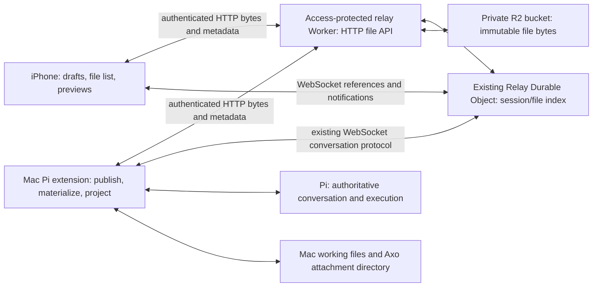

# RFD0002 - Axo: shared session files

- Feature Name: `axo-shared-session-files`
- Status: In progress — local implementation checkpoint validated; production approval pending
- Start Date: 2026-10-09
- Updated: 2026-10-09
- Document Type: Proposal

## Summary

Add explicitly shared, immutable file snapshots to Axo's Mac/iPhone conversation. Store file contents in a private Cloudflare R2 bucket and their session-scoped index in the existing SQLite-backed relay Durable Object. Upload and download bytes over authenticated HTTP; use WebSockets for bounded references and change notifications. Open conversations with a small recent window and lazily fetch older history only as the user scrolls back, rather than restoring the entire conversation. Both devices can publish files, and iOS can list and open already uploaded files while the Mac is offline. Pi remains authoritative for conversation history and execution; the relay does not archive session JSONL, synchronize the working filesystem, or queue prompts. This proposal introduces durable cloud content into the current non-E2EE prototype and requires an explicit privacy, retention, and spending decision before provisioning or deployment.

## Motivation

A screenshot should be as easy to discuss from the phone as a text prompt. A document or image produced on the Mac should be available on the phone without copying its contents into chat or keeping the Mac online merely to download it.

Today a Mac filesystem path is meaningful only on the Mac. Dropping a file into the terminal inserts a shell-escaped path; it does not transfer that file. The phone receives bounded text/tool projections, not downloadable attachments. Tool output pagination solves a different problem: inspecting recorded execution output on the active Pi branch.

The conversation is already large. Opening or reconnecting must not load its entire history, even through a sequence of individually bounded pages. Adding attachments makes eager history restoration more costly. The user explicitly wants the last few messages first, with older content loaded only while scrolling back in time.

The user wants files shared from the Mac conversation to appear in the same conversation on iOS, and proposes R2 behind the relay as the storage backend. This RFD narrows that requirement to **explicitly shared snapshots**, rather than automatic publication of everything an agent reads or writes.

Examples:

- Pick a screenshot on iOS, ask Pi what is wrong with the interface, and see the same attachment on the Mac.
- Ask Pi to write a research document on the Mac, explicitly publish it, and read the uploaded document on iOS after the Mac disconnects.
- Share a PDF from the phone; Pi can access a local copy on the Mac, while both devices refer to the same uploaded snapshot.

## Relationship to the existing design

[RFD0001](RFD0001-axo-continuous-agent-workspaces.md) proposes durable work identity, local authoritative conversations, native artifact viewing, and eventual E2EE. It says not to add R2 without a demonstrated requirement. Cross-device file availability independent of the Mac is that requirement.

The implemented [first slice](../first-slice.md) is narrower than RFD0001: one workbench, one Mac execution host, and one Pi conversation at a time, protected by Cloudflare Access. This RFD extends that implementation rather than assuming the larger account/workspace/background-host design already exists.

Verified current behavior:

| Area | Baseline before this RFD | Proposed change |
| --- | --- | --- |
| Relay | `service/src/index.ts` forwards live validated frames; rejects phone commands while the Mac is offline | Add an HTTP file API, durable file index, and file notifications; preserve offline prompt rejection |
| Durable Object | `service/cloudflare.config.ts` configures SQLite storage; the relay currently uses storage for credential-expiry alarms, not a content index | Persist file/session records and cleanup state in this object |
| Authentication | `service/src/access.ts` verifies the configured Access user or Mac service identity; `Principal` carries role and expiry | Reuse these identities on every HTTP operation and derive workbench scope server-side |
| Pi bridge | `bridge/extension.ts` calls `sendUserMessage`, persists command IDs in custom entries, and validates the active Pi session ID | Resolve attachment IDs, materialize local inputs, and persist durable attachment references |
| Transcript | `bridge/projection.ts` reconstructs the active branch; images and custom attachment rows are not currently projected | Project attachment cards from persisted Pi records, not diagnostic events |
| Protocol | `shared/protocol.ts` accepts text-only prompts and bounds frames to 256 KiB | Add bounded attachment references and file-index notifications, not file bytes |
| Mac drop | `apple/AxoMac/TerminalView.swift` inserts file paths into the terminal | Preserve this behavior; add a separate explicit publish operation |
| Native clients | `apple/AxoCore/` manages WebSocket conversation state; `apple/AxoPhone/` renders chat | Add authenticated HTTP transfer, draft attachment state, a file list, and safe previews |
| History loading | `ConversationClient.restoreHistory()` automatically requests older pages after snapshots until history is exhausted; `ConversationView` also has a manual earlier-history button | Remove automatic full backfill; load a small recent window and request older pages only on backward-scroll demand |

The code paths above are repository-relative from the root. This document describes a proposal, not implemented APIs or provisioned resources.

## Goals

- Publish a file from either device and identify the same snapshot on both devices.
- Send screenshots as actual Pi image input when the selected model supports them.
- Give Pi local access to uploaded documents without exposing arbitrary Mac paths to the relay.
- List and download ready session files while the Mac is offline.
- Preserve stable attachment identity through reconnect, history paging, and extension reload.
- Open/reconnect with only a small recent transcript window, then lazy-load earlier pages as the user scrolls backward without losing their reading position.
- Show a directly accessible **Back to bottom** button while reading older content, returning to the newest message without traversing intervening pages.
- Make upload progress, publication, prompt submission, and Pi consumption distinct states.
- Bound cloud storage, transfer requests, model inputs, and local caches.
- Make publication and deletion explicit, with truthful privacy and availability information.

## Non-goals

- Uploading or backing up Pi session JSONL or full transcripts.
- Automatic workspace synchronization, directory watching, or uploading every tool input/output.
- Editing a remote attachment in place or reconciling concurrent filesystem changes.
- Running Pi, parsing all documents, or executing code on the relay.
- Offline prompt delivery, remote Mac wake, or a background execution host.
- Multi-user collaboration, public links, or additional execution machines.
- Multipart/resumable uploads, large videos, audio uploads, or unbounded file sizes in the first version.
- End-to-end encryption implementation as part of this slice; accepting a sensitive-content release without E2EE is not implied.
- Full Mermaid/HTML document rendering or a general remote filesystem browser.

## Local implementation checkpoint (2026-10-09)

- Implemented authenticated file HTTP operations, private R2 streaming/integrity checks, SQLite ownership/idempotency/quota state, tombstones, alarm reconciliation, and separate read/write rollout controls. Both production controls remain `false`; the R2 binding declaration is **not** approval to provision or deploy it.
- Implemented explicit Mac publication, consented phone publication, durable local drafts, three concurrent phone uploads, verified local materialization, file inventory, lazy native previews/export, and attachment-only prompts. Selecting a phone file stages it locally; only confirming publication starts uploads. Declining keeps the draft.
- Implemented a 20-rendered-block recent window, bidirectional demand pages, branch/view fencing, bounded decoded history, and visible Back to bottom. No eager history restoration loop remains.
- File metadata is validated at decoding boundaries. Native media/origin/transfer states and server HTTP operations have explicit domain types; reservation, transfer, recovery, and preview work are named operations rather than large mixed-responsibility branches.
- Local validation: 42 TypeScript tests, 27 AxoCore tests, 10 iOS 27 simulator UI tests, bridge/service builds, and Mac build passed. Voice regression validation passed 18 tests; one real-speech/asset-install test remains opt-in and was skipped. UI HTTP fixtures are synthetic and in-process; these tests do not claim a deployed-cloud/device loop.
- No production provisioning, deployment, phone installation, or running-Mac restart/reload was performed.

### Conservative recovery invariant

Elapsed time plus a missing R2 `HEAD` cannot prove that a previously admitted writer has stopped. The upload handler records quiescence only after both the pipe and R2 promises settle. Reconciliation can also prove completion by observing the single immutable conditional write. Otherwise it retains the attempt key and reserved capacity, including during deletion; a late write remains tracked and cannot resurrect a deleted file. Maintenance processes at most 80 records per pass and rotates checked records to avoid starvation.

A crashed handler whose object never appears may therefore retain capacity indefinitely. Resolving that operational condition requires a proven provider write-lifetime/termination policy or an explicit operator recovery procedure before activation; silently freeing capacity or dropping the key is not safe. This is a deliberate fail-closed prototype behavior, not a claim that every orphan is automatically resolved after five minutes.

### Remaining release gates

Privacy/work-policy and spending approval, actual account ingress limits, log/header-redaction review, protected-origin HTTP/device validation, native prepend-offset stress tests, publication-tool consent/reload tests, and uncertain-submission crash drills remain open. Production rollback should leave storage/read/delete enabled while disabling `FILE_STORAGE_WRITES_ENABLED`, which also rejects attachment prompts as a whole. The protected-origin rename remains a separate coordinated change.

## Guide-level explanation

### Mental model

A **shared file** is a snapshot associated with a conversation, not a live pointer to the Mac filesystem.

| Concept | Meaning |
| --- | --- |
| Local file reference | A path on the Mac; no upload or phone availability is implied |
| Shared file | An immutable uploaded snapshot with an opaque file ID and session ownership |
| Draft attachment | A file selected for a prompt; selecting or uploading it does not submit that prompt |
| Transcript reference | A durable Pi record identifying where a shared file entered the active conversation branch |
| Session file list | The relay's durable index of explicitly uploaded snapshots, independent of transcript availability |
| Local materialization | A verified copy downloaded into an Axo-owned directory so Pi can use it |

Editing the original `report.md` does not change the shared copy. Publishing the edited file creates a new file ID. The first version needs no revision graph: distinct snapshots with timestamps are enough.

A file card shows its display name, type, size, origin, and availability. It never presents “uploaded” as “Pi has read this.” A local-only path is visibly different from a downloadable attachment.

### Opening a long conversation

Open at the latest messages with a small recent window, not the entire conversation. The proposed default is 20 rendered transcript blocks; text, thinking, tools, and file cards all count toward that limit. Byte budgets may make the window smaller. The exact count is tunable, but lazy loading is a requirement, not an optional optimization.

Scrolling toward the oldest loaded content requests one earlier page and prepends it without moving the message the user is reading. Stop fetching when that immediate scroll demand is satisfied. Opening, receiving a live update, reconnecting, or returning from the background must not start a loop that retrieves every earlier page. A **Load earlier messages** button remains an explicit alternative and retry action, not the only way to browse older history.

While browsing older messages, show a floating **Back to bottom** button within the conversation, above the composer and outside any menu. It stays accessible while scrolling, respects the keyboard/safe area, and does not obscure the input controls. Tapping it returns directly to the newest message and resumes following live output; hide it once the viewport reaches the bottom. New output arriving while reading older messages does not itself move the reader.

Show attachment cards from the loaded messages without downloading all referenced files. Fetch previews only when needed for visible content, and full files when opened/exported or required for a submitted Pi prompt. Opening a chat does not enumerate every session file or hydrate every document.

### Sharing a screenshot from iOS

1. Open the conversation and choose a photo or file from the composer's **+** menu.
2. Axo stages a local copy and uploads it, showing progress and a cancel action.
3. A completed upload is associated with the selected session and appears in its file list. It remains a draft input until the user sends.
4. Type or dictate “What is wrong with this layout?” and send the prompt with the ready file ID.
5. The Mac validates the destination, downloads/verifies the file, and submits structured image content to Pi along with the text.
6. Durable Pi records let both transcript renderers show the same attachment after reconnect or reload.
7. If submission fails, retain the draft and uploaded file reference. Do not silently replay it later.

If the Mac is offline, uploading a file can succeed but sending the prompt cannot. Show “File uploaded; Mac offline. Prompt not sent.” There is no new offline command queue. An unsupported image/model combination similarly leaves the input intact with an actionable error.

### Publishing a Mac artifact

Pi writes `research.md` in the working directory. The user explicitly publishes it through a proposed `/axo-share <path>` command, or approves a proposed `axo_share_file` tool call. Axo snapshots and uploads the file, records its ID in Pi's durable history, and renders a file card. The phone can open the shared Markdown document or export the original bytes.

These command/tool names are proposed additions, not existing Pi built-ins. A user-invoked publish command is explicit consent. Agent-initiated publication requires confirmation of the file and cloud destination in the first version; an ordinary `read`, `write`, or successful tool result is not consent to upload.

Dropping a file into the Mac terminal continues to insert its path. It does not silently become a publish action.

### Viewing files while the Mac is offline

The phone remembers the last selected Pi session ID after a valid snapshot and can fetch that session's file list directly from the relay. Already uploaded files do not depend on a live host connection.

The file list is available even when transcript history cannot be refreshed. A cached transcript can show cards already received, but the relay cannot reconstruct missing chat. A fresh installation without a remembered session needs an online Mac to establish its destination in this slice; cloud session discovery is not promised.

An uploaded file can exist without a transcript reference, for example after a prompt submission fails. Such a file remains visible in the session file list, labeled as not yet attached to a recorded message where that status is known. It must not be fabricated into the conversation by the relay.

## Reference-level explanation

### Architecture and ownership

- **Pi** owns the conversation tree, active branch, finalized messages, tool results, and submission deduplication.
- **The Mac** owns execution and local paths. Only the host materializes inputs or resolves a path for publication.
- **R2** holds uploaded bytes. A published key is never overwritten with a different snapshot.
- **The Durable Object** owns file availability, session association, quotas, upload reservations, idempotency records, and deletion/cleanup state. These records must survive restart and WebSocket hibernation.
- **The Worker** authenticates/authorizes each operation and streams bytes using an R2 binding. It never accepts a client-selected bucket key or local path.
- **Native clients** own drafts, bounded caches, and presentation. A local cache is not authoritative availability or a conversation backup.

No D1, KV, Queues, or additional Durable Object is required initially. Bulk file bytes do not enter Durable Object storage or WebSocket messages. The existing single-workbench object is a deliberate prototype scope, not a multi-user partitioning design.

### Identity, session registration, and authorization

Use the current verified Access user identity for phone requests and the verified Access service identity for Mac requests. HTTP requests must use the same protected origin and suitable native credentials: the phone's saved Access session and the Mac's service credentials. Neither client receives R2/S3 credentials.

The HTTP authorization boundary must recognize the two verified identities and derive their role and configured workbench scope. Do not infer authorization from a JSON `role`, a filename, an opaque ID, or an internal forwarding header supplied by a public caller. The current `Principal` is not an account or enrolled-device model; implementing one is outside this RFD.

Before allowing phone uploads into a session, the authenticated host registers that Pi session ID with the workbench, either through a new control operation or as part of authenticated snapshot handling. Registering a session stores only identity/minimal routing metadata, not its transcript or working-directory path. A previously registered session remains a valid file destination while the host is offline.

Every reserve/list/read/delete operation verifies that the session and file belong to this workbench. A phone cannot register arbitrary sessions. A file ID is a locator, not an access capability. Within this one-user workbench, the configured user and host may access its registered sessions; there is no claimed per-session user ACL.

Validate active session identity again on the Mac before downloading prompt inputs and immediately before dispatch. Capture a runtime/session generation for asynchronous work. A session switch or reload invalidates the operation rather than attaching the file to the new conversation. A registered old session may still be browsed; it does not become the prompt destination automatically.

### Records and proposed interfaces

The following is a semantic contract; exact TypeScript/Zod and Swift shapes remain implementation work.

| Record | Required information |
| --- | --- |
| Registered session | Server-derived workbench scope, Pi session ID, registration timestamp |
| Shared file | Server-issued opaque file ID, owning session, bounded display name, validated media type, byte length, verified SHA-256, origin role, creation timestamp, availability state |
| Upload reservation | Client-generated request ID, immutable declared attributes, server-issued file ID/private key, reserved bytes, expiry, attempt/lease state |
| Transcript attachment reference | File ID, Pi session/branch anchor, originating command or tool-call identity, bounded display metadata |
| Local materialization | File ID, verified checksum, Axo-owned destination, local availability; absolute path stays on the Mac |

Keep internal R2 keys out of the client contract. A key may be derived from server-owned workbench/session/file identifiers, but user filenames must not determine storage paths. SHA-256 describes content integrity, not authorization or a global deduplication key; R2 ETags must not be assumed to be SHA-256 values.

File availability is a tagged state, not several contradictory flags:

- `pending`: reservation exists, contents are not available to the workbench yet.
- `ready`: verified bytes and metadata are committed and available through the file API.
- `deleting`: new reads are denied; physical removal is pending/retrying.
- `deleted`: tombstone remains; bytes have been removed.

A failed/expired pending reservation is cleaned up and never becomes `ready`. Transfer progress and Pi submission state are separate client/command states.

Proposed logical HTTP operations, all under the existing Access-protected origin:

| Operation | Proposed route | Contract |
| --- | --- | --- |
| Reserve upload | `POST /files/sessions/:sessionId/uploads` | Request ID, filename, media type, length, SHA-256; returns the stable reservation/file ID |
| Upload bytes | `PUT /files/sessions/:sessionId/uploads/:fileId/content` | Raw streamed bytes for the existing reservation; returns ready metadata only after verification/commit |
| Check reservation/file | `GET /files/sessions/:sessionId/files/:fileId` | Recover authoritative state after an interrupted request; no implicit prompt submission |
| List session files | `GET /files/sessions/:sessionId/files?cursor=...` | Bounded, stable cursor pages independent of host presence; include deletion state needed for reconciliation |
| Download | `GET /files/sessions/:sessionId/files/:fileId/content` | Stream ready content with safe headers; reject pending/deleted or wrong-session files |
| Delete/cancel | `DELETE /files/sessions/:sessionId/files/:fileId` | Idempotently tombstone a ready file or cancel a pending reservation |

Route names are proposals, not an invitation to add unauthenticated endpoints. Return bounded typed errors for invalid input, authentication expiry, wrong ownership, unsupported content, quota exhaustion, stale/conflicting operations, and temporarily unavailable storage. Do not reflect secrets, internal paths, or raw provider exceptions.

Extend the prompt contract with a bounded list of file IDs. Accept text, attachments, or both; an attachment-only prompt is valid. The Mac resolves every ID through the owning session's file API, never from a phone-supplied local path. A prompt containing an unavailable input fails as a whole before dispatch, rather than silently omitting an attachment.

Transcript pages carry bounded file-card metadata/references and include it in existing encoded-byte budgets. File-only rows must not be discarded by the current empty-text filtering. Add a small relay-originated `files_changed` invalidation carrying session identity and a monotonic index revision; clients fetch metadata over HTTP. Notifications are hints, not the durable index, and may be lost or coalesced. Refresh on reconnect/app foreground and when opening the file list; discard responses for an obsolete selected session. Do not reset conversation connection backoff merely because file HTTP requests succeed.

### Upload lifecycle and crash recovery

R2 and Durable Object SQLite do not form one transaction. Publication needs an explicit staged protocol, not an assumption of atomicity across both stores.

1. Stage a stable local snapshot and compute its length/checksum. A concurrently changing Mac source must not produce a mismatch between declared metadata and uploaded bytes.
2. Reserve capacity in the Durable Object with a stable request ID. Reusing that ID with the same attributes returns the same reservation; conflicting attributes are rejected. Concurrent pending uploads count against quota.
3. Admit one live attempt for a reservation. Use an attempt-specific staging key and generation/lease so a stale uploader cannot overwrite or publish bytes after cancellation, expiry, or a newer attempt.
4. Stream the request to R2 with actual byte-count enforcement and checksum verification. Do not buffer/base64 the whole upload in the Worker or trust `Content-Length` alone. Use documented R2 checksum support or a proven bounded streaming verification approach.
5. Commit ready metadata only if verification succeeds and the reservation/attempt remains valid. A ready record points to one immutable verified object. Broadcast invalidation after durable commit.
6. Return ready metadata. If the response is lost, query/retry the same reservation; do not allocate another file or blindly replace ready bytes.

If R2 succeeds but metadata commit fails, the staging object is not downloadable. Reconciliation can verify the recorded attempt and finish the valid commit, or clean up the orphan. If the upload is incomplete or cancelled, expire/clean it up. Cleanup must never delete the object selected by a successful ready commit.

Serialize short metadata transitions in the Durable Object, not the whole network upload. Physical staging objects, expired attempt leases, and reserved capacity require bounded reconciliation. Use the existing alarm mechanism for scheduled maintenance, combining its next deadline with credential expiry rather than replacing that alarm responsibility. A lifecycle rule for a dedicated staging namespace can be a backstop, but must not expire ready objects; choose key layout/commit strategy accordingly during implementation.

User cancellation requests server-side invalidation as well as aborting the local transfer. If cancellation races with a successful commit, report the recovered ready state and offer deletion; never claim the upload was removed merely because the local HTTP task stopped.

### Pi input, persistence, and transcript projection

After all requested files are ready and verified locally, preserve the existing prompt-submission contract: record the command before dispatch, submit through Pi's supported API, steer if busy, and never auto-replay uncertain work.

- For supported screenshot formats/models, use Pi's `sendMessage` with a displayed `axo.attachments` custom message containing actual `ImageContent` and text blocks, plus `triggerTurn: true` and the existing steering policy. A cloud URL or path string alone is not image input. Pi can persist the image in its local history; this is not relay transcript storage.
- For documents, supply a safe local materialization reference and bounded descriptive text. Do not claim that PDF or arbitrary file bytes are native model inputs, or eagerly inline the whole document. Pi uses suitable host tools to inspect it.
- Verify all inputs before dispatch. Model capability/type/size errors preserve the draft and do not run a reduced prompt.
- Model-input conversion/resizing must be explicit. Keep the original shared snapshot unchanged; a derived image is a separate local/model representation. Photo formats such as HEIC require a tested conversion policy, not a renamed MIME type.

Persist input content and attachment associations together in one supported Pi `custom_message` entry with custom type `axo.attachments`; its `details` contain the command ID, display text, and validated file references. The recorded entry ID is the transcript identity. This avoids guessing a user-message anchor or splitting associations from image content. A publication tool returns structured file metadata in its durable result; direct publication uses an `axo.shared_file` custom entry. Both have Pi TUI rendering and native projection.

An upload is not automatically a finalized user message. `axo.submitted` is only a pre-dispatch deduplication marker, never a transcript card or proof of execution. Pi records the custom message when it consumes a queued steering input; until then acknowledgment means submission to Pi, not durable recording or execution. Duplicate/uncertain commands are rejected with a check-the-conversation warning and are never replayed automatically. Deterministic real-TUI tests cover actual image input, attachment-only steering during a live run, and durable custom-message content/details. Crash-between-marker-and-dispatch and concurrent local-input drills remain explicit rollout gates; no successful row is invented for a missing recorded entry.

Reconstruct transcript cards from the active branch, preserving stable IDs through pagination and reload. A card for `axo_share_file` belongs to its existing stable tool row; avoid a second duplicate tool row. A direct publish command can produce a dedicated durable attachment row. Do not rely on ephemeral diagnostic events for either.

The relay's session file list includes all explicitly uploaded snapshots for that Pi session, including drafts and files referenced on abandoned branches. This is a file inventory, not the active conversation. Branch navigation changes transcript visibility, not cloud ownership or deletion. Same-file Pi forks need an explicit copy/reassociation policy before support; the first version rejects inherited references whose owner session differs, instead of silently granting cross-session attachment access.

### Demand-driven conversation history

Replace the current automatic `restoreHistory()` loop in `apple/AxoCore/Sources/AxoCore/ConversationClient.swift`. The current per-page bounds do not solve whole-conversation loading because the client repeatedly fetches pages until `hasEarlierMessages` becomes false. Keep that flag as an availability hint; it is not an instruction to fetch.

The bridge returns a small recent window in the initial/live snapshot, with a proposed default of 20 rendered blocks. History requests also return a bounded earlier page. Retain the existing 80-block hard protocol ceiling and character/encoded-byte protections; the normal page target is smaller. Attachment metadata counts toward the same bounds, and no original image/base64 payload is projected into a transcript page. Full tool output remains separately requested through the existing output API.

In `apple/AxoPhone/ConversationView.swift`, trigger earlier-history loading when user-driven scrolling approaches the oldest loaded content, not merely because a top sentinel exists or was laid out. Use a narrow viewport prefetch threshold and at most one in-flight history request per view. Loading a page does not itself authorize the next page: further requests need continuing backward navigation. Suppress initial-layout/reconnect triggers, deduplicate overlapping demand, and stop automatic attempts after an error until a retry or renewed user action. A manual button fetches one page.

Capture the visible message ID and its relative position before prepending a page, then preserve that anchor. New assistant/tool updates must not jump a reader to the bottom while they are browsing older content. Follow live output only while the user is already at the latest position, or after an explicit **Back to bottom** action. Keep file-card/preview layout stable enough that late thumbnail loads do not invalidate the scroll anchor.

Derive **Back to bottom** visibility from the actual viewport/latest position, not from whether every history page has loaded. Present it as a persistent-in-viewport, accessible button whenever the user is away from the newest content; the existing menu-only **Jump to latest** action is insufficient. If the latest range is cached, jump directly to its newest message. If it has been evicted, request only a fresh bounded latest snapshot, then jump there: never fetch the intervening history or animate through thousands of rows. Correlate that request with the current session/view and show a bounded loading/error state if offline. Do not discard the reader's current range until the target is available; a failed jump leaves their position intact. A successful jump cancels obsolete backward-prefetch demand and re-enables following live output.

Correlate history requests and replies by request ID, session ID, history-view generation, and `beforeId`. Define a history-view generation that changes on tree navigation/session replacement, not on every appended message. Reject replies from an abandoned view and reset its cursors. Do not infer a branch switch solely because two small latest windows have no overlapping IDs; a reader may have missed many ordinary new messages. Exact generation plumbing is a coordinated protocol change to verify during implementation.

Reconnect supplies the small latest window and fresh view identity without walking backward to reconstruct missing history. Already cached pages can be retained only when their session/branch identity is validated; their existence must not trigger remote backfill. If the previous reading position cannot safely be restored from cache, make that limitation explicit rather than downloading the entire gap invisibly.

A lazy native view does not by itself bound decoded message storage. Establish a loaded-page/message byte budget, retain the visible range and a small adjacent cache, and release out-of-window previews/large output. Define how evicted ranges are revisited and how **Back to bottom** refreshes the recent window without a full traversal. Pi may keep the authoritative history locally; bounded phone rendering/transfer does not truncate or compact it. Benchmark large synthetic branches separately for host projection cost; this RFD does not promise that Pi's own session loading becomes lazy.

The session file list is independently paged. Fetch it when opened, and load further inventory pages on list-scroll demand; a `files_changed` hint invalidates cached pages but does not force a full inventory crawl. A visible transcript card can query its named file without loading the entire index. Both history browsing and file viewing remain read-only and never dispatch prompts.

### Safe local files and previews

Use an Axo-owned attachment directory outside tracked project files, organized by opaque session/file IDs. Keep the original filename as display metadata; never interpret it as a destination path. Download to a temporary file, verify length/checksum, and atomically install into the owned destination. Do not overwrite a working file or follow attacker-controlled symlinks. Remote requests cannot choose arbitrary read/write paths.

Mac publication resolves the chosen path locally, confirms its resolved destination, and snapshots only regular files. Reject directories, devices, sockets, and ambiguous/changing sources. Sensitive-path checks are defense in depth, not a guarantee that arbitrary file contents contain no secrets. Explicit consent is still required.

Initial preview scope: PNG/JPEG, plain text/Markdown, and PDF through appropriate native components; other permitted files can be downloaded/exported without an inline preview. Markdown must not execute HTML/scripts or automatically fetch external images. Bound text length, decoded image dimensions/memory, PDF work, and preview caches. Treat filenames, media types, and all uploaded content as untrusted. Use attachment download disposition for unsupported/active types, safe filename encoding, and `X-Content-Type-Options: nosniff`.

### Retention, deletion, and resource bounds

Proposed first-version defaults, subject to acceptance:

| Resource | Proposed bound/policy |
| --- | --- |
| One uploaded file | 25 MiB |
| One prompt | At most 8 files and 50 MiB total original bytes; separate model-image limits also apply |
| One workbench | 1 GiB of ready plus reserved bytes, including unremoved failed/staging attempts; reject new reservations at capacity, do not evict published files |
| Initial transcript window / earlier page | Target 20 rendered blocks, bounded further by byte budgets; no automatic full-history backfill |
| Loaded transcript cache | Bounded pages/bytes around the reading viewport; concrete budget and eviction/refetch behavior required before rollout |
| File-list page | At most 80 bounded metadata records, with an encoded-response budget; additional pages only on list-scroll demand |
| Pending reservation | 24-hour expiry; release capacity and remove staged/orphan bytes through retryable cleanup |
| Ready files | Retain until explicit deletion; no silent age-based expiry in the initial design |
| Local preview/materialization caches | Explicit byte limits and eviction; retain unsent draft sources until sent or discarded |

Also cap file/reservation counts, metadata lengths, in-flight uploads, and request rates; a byte quota alone does not bound zero-byte files, tombstones, or operation charges. Exact count/rate/model/cache limits must be documented and tested before rollout. Verify the actual Cloudflare account request-body limits and the pinned `cf` binding/configuration API; do not equate R2's object limit with the HTTP ingress limit.

Deletion first durably marks the file `deleting` and denies new downloads, then removes R2 bytes with retries and records `deleted`. Keep a minimal tombstone so old transcript references can show “Deleted” rather than silently vanish. Coordinate deletion with in-flight uploads: stale completion cannot resurrect a cancelled/deleted file. A stream already authorized and begun may finish; deletion is not retroactive revocation of bytes already delivered.

Deleting from Axo removes the shared cloud copy and best-effort managed caches after reconciliation. It does not erase the original Mac source, an exported phone copy, images already stored in Pi JSONL, or data already sent to a model provider. UI confirmation must disclose this distinction. Deleting a Pi JSONL file outside Axo does not automatically delete its cloud files. Closing/hiding a session is not deletion. Provide an explicit file-list delete action in this slice; session-wide deletion can be added with session management.

Capacity should only be reusable when the corresponding physical storage is removed or otherwise safely accounted for. Reconciliation includes lost upload responses, orphan objects, deletion failures, and quota repair without scanning an unbounded inventory in one request. Metadata/tombstone compaction must not let stale requests resurrect old IDs; its retention policy is an implementation decision.

### Security, privacy, and observability

This is a material trust change: the current relay briefly forwards readable content; this design stores readable file contents and metadata. Cloudflare Access plus TLS is not E2EE. Server-side storage protection does not stop the Worker/account operator from reading files.

Keep the R2 bucket private: no `r2.dev`, public custom domain, public listing, or S3 credentials in clients. Route every upload, status lookup, list, download, and delete through Worker authorization. Do not use shared/public caches for private responses; send appropriate `Cache-Control: private, no-store`. Reuse the protected origin rather than introducing an unguarded file host. Expired authentication requires sign-in/credential renewal, not bypass or a public download fallback. Define admission/expiry behavior for long-running transfers and bound their lifetime.

Do not introduce presigned URLs in the first version. They could later improve large transfers, but turn an authorized operation into a bearer capability with separate lifetime/revocation behavior. Worker streaming is the simpler boundary at the proposed sizes.

Log operation kind, opaque request IDs, outcome, byte counts, and timing, not filenames, file bodies, paths, checksums, Access tokens, or prompt content. Opaque session/file identifiers can still reveal activity patterns and should have limited log retention. Review existing Worker observability settings and R2 access-log settings; default request tracing must not leak content or credential headers.

RFD0001's E2EE direction remains unchanged. This proposal does not invent a crypto protocol, downgrade an encrypted mode, or establish employer approval. Use non-sensitive playground files until E2EE/work-policy decisions are made. If plaintext cloud storage is unacceptable, block deployment and design client-side encryption separately; encrypted bytes would need device-key enrollment, recovery, integrity, cache, and deletion semantics.

R2 Standard storage is the proposed class. The documentation consulted on 2026-10-09 lists storage at $0.015/GB-month, Class A operations at $4.50/million, Class B operations at $0.36/million, and no R2 Internet egress charges. Its Standard free tier includes 10 GB-month, 1 million Class A, and 10 million Class B operations monthly. These are account-wide allowances, not a free-service guarantee; Worker/Durable Object charges and unrelated account usage remain relevant. Recheck pricing and obtain approval for any R2 subscription/billable provisioning before creating resources. Application quotas and rate limits reduce risk, but do not establish a hard provider billing cap.

### Invariants

- Pi remains the authoritative transcript; a file index is not a transcript archive.
- A local path and a shared file ID are different concepts. Reading or writing a file does not publish it.
- Ready bytes are immutable and verified; publishing changed content creates a different file ID.
- Workbench/session authorization is checked on every operation; knowledge of an ID grants no access.
- A file is downloadable only after a valid upload attempt and durable ready commit.
- R2/SQLite partial failure, stale completion, or cleanup cannot overwrite ready content or resurrect deletion.
- A prompt's attachments resolve completely in its captured session before Pi dispatch; no silent omissions or retargeting.
- Upload success, durable transcript association, prompt submission, and model consumption are not interchangeable acknowledgments.
- Uncertain prompts are not automatically replayed. File transfers never create an offline command queue.
- Active-branch transcript cards come from persisted Pi records, not the cloud list or diagnostics.
- Initial load, live snapshots, and reconnect do not trigger full-history restoration; older-page requests require backward-navigation demand or an explicit one-page action.
- Prepending history and updating live content preserve the reader's visible anchor unless they explicitly tap **Back to bottom**.
- **Back to bottom** is visible when away from the newest content and reaches it directly, with at most a bounded latest-window refresh, never a traversal of intervening pages.
- Attachment previews/file contents and session-file inventory are not eagerly hydrated merely because a conversation opened.
- Remote filenames and IDs cannot select arbitrary local paths or R2 keys.
- File bytes do not consume WebSocket frame budgets; reference metadata does.
- Deletion does not claim to erase original/exported files, Pi history, or provider-held data.

### Compatibility and rollout

No historical paths or tool outputs are automatically uploaded. Existing conversations continue as text/tool history; only explicit new publication creates shared files. Do not migrate the session JSONL into R2 or manufacture attachment associations from old text.

Roll out coordinated protocol changes: file storage/API and matching relay schemas first, rebuilt Mac bridge second, matching native apps third. Keep actionable mismatch errors rather than adding an indefinite compatibility fallback. The protected-origin rename to `relay.axo.leostera.dev` is a separate coordinated change and is not required by this RFD.

Sequence the work around the vertical slice:

1. Resolve the acceptance questions below, verify R2/`cf` configuration and account limits, and approve provisioning.
2. Replace eager history restoration with a small recent window and scroll-driven pages; verify scroll anchoring, stale-view rejection, and bounded caches against a large synthetic conversation before adding attachment weight.
3. Implement the private file API/index and fault-injection tests for upload/commit/delete/reconciliation. Keep existing forwarding, expiry, and offline rejection tests.
4. Add explicit Mac publication and durable Pi references; demonstrate a phone download after disconnecting the Mac.
5. Add iOS pick/upload/draft handling, host materialization, and supported image input; demonstrate screenshot discussion with deterministic model tests before an explicit real-provider check.
6. Add safe lazy previews/file-list reconciliation and perform physical-device acceptance checks.

Rollback disables new file writes and attachment submission while preserving ready data and authenticated read/delete access where safe. Do not automatically purge R2 on a code rollback or silently drop attachment IDs from prompts. Record any operations left uncertain and reconcile them explicitly.

### Validation and acceptance criteria

- Open/reconnect a synthetic conversation with thousands of blocks: receive only the configured recent window, issue no earlier-history requests while idle at the latest messages, and start no whole-history backfill.
- Scroll backward: fetch bounded earlier pages on demand, preserve the visible message/offset while prepending, and prevent duplicate requests or a page-arrival-driven fetch loop. Manual load/retry requests one page.
- Stream new output while reading earlier messages, interrupt/reconnect, and change Pi branches: do not jump the reader, misclassify a non-overlapping latest window as a branch change, or accept stale history replies.
- Browse far back: demonstrate a bounded decoded-history/preview cache and usable refetch of evicted ranges without walking the whole conversation.
- Scroll away from the bottom: the visible **Back to bottom** button is reachable without opening a menu, including with the keyboard shown. Tap it to reach the newest message, hide the button at the bottom, and resume live following. Repeat with an evicted latest range and verify only a bounded latest snapshot is fetched; offline failure preserves the old reading position.
- Open a conversation containing many attachments: no original-file downloads, full inventory crawl, or offscreen preview hydration occurs merely on opening; visible preview work is bounded.
- Explicitly share a PNG from the Mac; the phone shows its card, downloads matching bytes, and can reopen it with the Mac offline.
- Upload a screenshot from iOS; a deterministic Pi integration test receives actual image content, and both devices reconstruct the attachment after reload/history paging. Use synthetic fixtures, not private session contents.
- Upload a Markdown document and PDF; Pi receives safe local references, supported previews open, and unsupported types remain exportable without execution.
- Send an attachment-only prompt and a busy-run steering prompt without losing or duplicating references.
- Disconnect the Mac before send: upload can remain ready, the prompt stays unsent, and reconnect does not auto-dispatch it.
- Navigate the Pi tree: attachment cards follow the active branch while the independent session file inventory remains accurate.
- Switch sessions/reload during a download: reject stale dispatch and do not write into an unrelated project.
- Lose a reservation/upload response, repeat a request, overlap attempts, cancel during commit, and crash between R2 write and metadata commit: recover one snapshot or a truthful failure, never duplicate/overwrite ready content.
- Restart/hibernate the Durable Object: retain file inventory, cleanup deadlines, quota accounting, and credential-expiry enforcement.
- Reject unauthenticated/expired requests, host credentials in user-only login flows, forged workbench/session ownership, malformed metadata, checksum mismatch, excess count/bytes, and oversized streams regardless of declared length.
- Exercise malicious filenames, symlinks, MIME mismatches, huge decoded images, active Markdown/HTML, and unsupported model inputs without path escape, script execution, or unbounded memory use.
- Delete a file while another device is disconnected: new reads are denied, later reconciliation shows a tombstone, physical cleanup retries, and original/local Pi copies are not falsely reported erased.
- Demonstrate bounded storage/count/rate limits and ensure logs contain no content, filenames, paths, or credentials.
- Build/typecheck/test TypeScript and shared Swift packages, then validate native flows on physical devices. Simulator UI testing is not a prerequisite for this proposal.

## Drawbacks

- The relay becomes a durable content holder, increasing privacy exposure, retention obligations, and incident impact before E2EE exists.
- Upload staging, R2/SQLite reconciliation, deletion tombstones, and local caches are more complex than forwarding bytes while the Mac is connected.
- The same image can occupy cloud storage, local attachment storage, and Pi history. Removing one copy does not remove all copies.
- File availability while the Mac is offline can be mistaken for offline execution or cloud transcript backup; the UI must keep those guarantees distinct.
- Immutable snapshots are predictable but may surprise users expecting a live document. New publication creates another item and consumes capacity.
- Native previewing and model-format conversion introduce additional untrusted-content handling and platform-specific behavior.
- Scroll-driven history needs reliable anchors, branch identity, cache eviction, and stale-response handling. Replacing eager restoration can make an uncached older reading position unavailable after reconnect; this must be reported honestly.
- Storage/operations can incur charges, and application limits are not a provider-enforced spending guarantee.
- The single-workbench index is intentionally not sufficient for a future multi-account/device product.

## Rationale and alternatives

### Proposed design

Use R2 for bytes and the existing Durable Object for metadata because the user needs persistent, cross-device file availability and the relay already provides the coordination/authentication boundary. Keep conversation authority local and publish snapshots explicitly to avoid expanding the problem into cloud backup or filesystem synchronization.

### Stream directly from the Mac

A host-backed file-download request over HTTP or paged WebSocket data is a narrower implementation and could avoid durable cloud copies. It still requires a live Mac, cannot retain phone uploads independently, and does not meet the offline-viewing acceptance criterion. Keep host-local tool-output pagination for its existing purpose instead of treating it as shared storage.

### Store bytes in Durable Object SQLite

This would put metadata and small content in one store, simplifying some commits. File bodies would enlarge the coordination database and couple transfer/storage behavior to the live relay. R2 is the dedicated object-storage boundary; SQLite keeps the small authoritative index.

### R2-only metadata or an additional database

R2 object listings/custom metadata could serve a minimal file gallery, but are a weaker place for reservation transitions, idempotency, tombstones, and quota admission. A separate D1 database could support broader querying later; there is no demonstrated need to add it to the current single-workbench design.

### Direct S3/presigned transfers

Direct upload/download can reduce Worker involvement and support larger files. It adds signing credentials, capability expiry, revocation, and potentially browser CORS concerns. At the proposed sizes, authenticated Worker streaming is a smaller coherent security boundary.

### Automatic folder synchronization or transcript backup

These solve broader continuity/recovery problems but publish substantially more content, create conflict/versioning obligations, and blur Pi's ownership. Neither is necessary to make one intentionally shared screenshot or report available on both devices.

### Do nothing

Continue sending text, copying snippets, and referring to Mac-only paths. This avoids a new cloud content store but leaves screenshot prompts and offline artifact viewing unsolved.

## Prior art and evidence

- **RFD0001:** separates durable work identity from live execution and already anticipates artifact availability/version information. This proposal adds a specific file-storage requirement without claiming that its larger architecture is implemented.
- **Pi session entries and tool results:** support durable extension state and branch-relative `details`. Use them for attachment identity instead of another conversation format.
- **Current transcript projection/history paging:** demonstrates why durable branch projection and bounded reference payloads are preferable to diagnostic-event reconstruction or embedding large bodies in snapshots. Its automatic client backfill also demonstrates that bounded individual pages are insufficient: demand must bound the number of pages fetched.
- **Current tool-output reader:** restricts requests to saved active-branch tool calls and validates spool access. Apply the same principle here: a named, authorized resource is not an arbitrary path-read capability.
- **Current Mac drag/drop:** follows terminal path-insertion semantics. Preserve that prior behavior instead of making a familiar gesture silently publish files.
- **R2 Workers API:** documents binding-based object access and streaming request bodies; application authorization is still required. R2 does not supply Axo's session index or cross-store commit protocol.

Repository evidence: `bridge/extension.ts`, `bridge/projection.ts`, `bridge/tool-output.ts`, `shared/protocol.ts`, `service/src/index.ts`, `service/src/access.ts`, `service/cloudflare.config.ts`, and the native paths listed above. Inspect these relative to the repository root.

Pi documentation/examples consulted are the installed `@earendil-works/pi-coding-agent` version `1.1.0`: `docs/extensions.md`, `docs/sdk.md`, `docs/message-types.md`, `docs/session-format.md`, `examples/extensions/send-user-message.ts`, and `examples/extensions/todo.ts`. Exact message-anchor handling still needs implementation tests. Upstream navigation references:

- [Pi extensions](https://github.com/earendil-works/pi/blob/main/packages/coding-agent/docs/extensions.md)
- [Pi message types](https://github.com/earendil-works/pi/blob/main/packages/coding-agent/docs/message-types.md)
- [Pi session format](https://github.com/earendil-works/pi/blob/main/packages/coding-agent/docs/session-format.md)

Cloudflare documentation consulted on 2026-10-09:

- [R2 Workers API](https://developers.cloudflare.com/r2/get-started/workers-api/)
- [Use R2 from Workers](https://developers.cloudflare.com/r2/api/workers/workers-api-usage/)
- [Upload objects](https://developers.cloudflare.com/r2/objects/upload-objects/)
- [R2 limits](https://developers.cloudflare.com/r2/platform/limits/)
- [R2 pricing](https://developers.cloudflare.com/r2/pricing/)

Additional implementation references to verify before building:

- [R2 Workers API reference, conditions, ranges, and checksums](https://developers.cloudflare.com/r2/api/workers/workers-api-reference/)
- [Workers request/body limits](https://developers.cloudflare.com/workers/platform/limits/)
- [R2 object lifecycles](https://developers.cloudflare.com/r2/buckets/object-lifecycles/)
- [Cloudflare CLI](https://developers.cloudflare.com/cf/)

No resources were provisioned, files uploaded, native flows exercised, or file-storage fault tests run while drafting this RFD. Current build/test results for the existing prototype do not establish the proposed attachment guarantees.

## Unresolved questions

### Before acceptance

1. Is plaintext file storage acceptable for non-sensitive prototype use, or must client-side encryption precede any deployment? What content/work policy is allowed?
2. Approve or revise the proposed 25 MiB/file, 8 files/50 MiB per prompt, 1 GiB/workbench, 24-hour pending expiry, and retain-until-delete policy. What storage/operation budget is approved before enabling R2?
3. Is per-publication confirmation the right initial policy for agent-initiated sharing? This proposal recommends it and does not enable automatic publication.
4. Confirm that offline file-list/download access is required but cloud transcript storage, prompt queuing, live sync, and same-file cross-session forks are deferred.

### During implementation

- Pinned `cf` R2 binding/provisioning API, account activation/billing requirements, and actual Worker ingress limits.
- Verified streaming checksum strategy, attempt leases, orphan reconciliation, and combined maintenance/credential-expiry alarm scheduling.
- Durable Pi prompt-to-attachment association across steering, local input, crashes, compaction, and tree navigation; block rollout until proved.
- Concrete Zod/Swift reference schemas, history-view generation and cursor semantics, file-list revisions, error codes, and encoded budgets.
- Recent-window/page tuning, user-scroll demand detection, prepend anchoring, reconnect reading-position behavior, decoded cache budgets, and eviction/refetch without eager traversal.
- **Back to bottom** placement/accessibility, viewport-derived visibility, bounded latest refresh, and behavior during offline or stale-view failures.
- Native Access HTTP credential behavior and expiry handling, transfer progress/cancellation, picker lifecycle, and foreground reconnection.
- PNG/JPEG/HEIC conversion and selected-model image capability checks; separate model-input size limits.
- Native preview components, materialization roots/permissions, local cache/count/request-rate bounds, tombstone retention, and explicit draft cleanup.
- Proposed publish command/tool names and TUI/native card rendering without duplicate transcript rows.

### Out of scope

- Multi-user ACLs, enrolled-device keys/revocation, E2EE, and encrypted account recovery.
- Session/workspace discovery, same-file forks/reassociation, and session-wide deletion UI.
- Public sharing, large/resumable transfers, automatic synchronization, remote execution, and transcript backup.

## Future possibilities

Encrypted object contents could preserve offline file access while keeping plaintext on enrolled devices. That requires a separate key-management design, not merely encrypting before `put` with an undocumented key.

Session/workspace navigation could expose file collections across conversations and support explicit reassociation or session deletion. Larger transfers might justify multipart/presigned access, and immutable snapshots could gain a user-visible version relation. Rich document/diagram viewing may follow safe basic previews. None of these is needed for the initial contract: explicitly share a snapshot, discuss it with Pi, and open the same file from either device.
