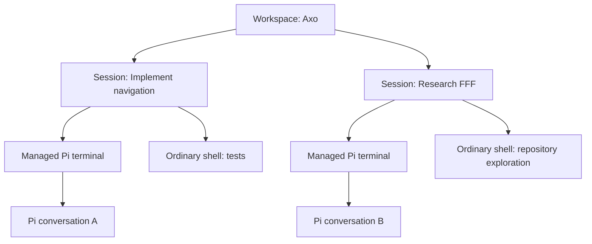

# RFD0003 - Axo: workspaces, sessions, splits, and search

- Feature Name: `axo-workspaces-sessions-and-search`
- Status: Draft
- Start Date: 2026-10-09
- Updated: 2026-10-09
- Document Type: Proposal

## Summary

Extend the single-workbench prototype into a native Mac workspace manager and a matching iPhone navigation menu. A workspace groups named Axo sessions; a session owns a persistent Pi conversation binding and a tree of real Ghostty terminal panes. Command-N creates a workspace, Command-T creates a session, Command-D and Command-Shift-E add ordinary terminal splits, and Command-K or Command-P opens a searchable command palette. The Mac owns work records, terminal lifetimes, conversation bindings, and a private FFF-backed search index. The relay distributes a bounded metadata catalog and routes commands to explicit conversations instead of broadcasting them to every Pi process. The phone can create and switch workspaces/sessions and search conversations through the online Mac. Pi remains vanilla with an installable Axo extension: no source patches, replacement CLI, private runtime APIs, cloud transcript archive, or new automatic prompt replay. This is the next product priority before executor-style service/tool integrations, not a claim that multi-session operation is already implemented.

## Motivation

One conversation is no longer enough for developing Axo while investigating other projects. Independent work should run concurrently without replacing the active Pi conversation, restarting the current terminal, or requiring the user to remember which shell contains each task.

The requested desktop model is familiar but more discoverable than ordinary tabs:

- Always-visible vertical workspace/session navigation on the left.
- A new session for a new conversation, not a split of the old agent.
- Ordinary shells beside Pi for Vim, tests, servers, and manual work.
- A keyboard-first palette that searches names and terminal/conversation text.
- The same hierarchy on the phone, with creation, selection, and conversation search.

For example, the user can leave an Axo implementation running in one session, open a research session with Command-T, split a shell for reading a repository, and later find either conversation by a phrase rather than scanning tabs. The phone should select the intended session, not whichever Pi most recently broadcast a snapshot.

## Relationship to existing RFDs and current code

[RFD0001](RFD0001-axo-continuous-agent-workspaces.md) establishes the larger persistent-workspace direction. This proposal narrows its next implementation slice to navigation, parallel conversations, ordinary splits, explicit routing, and search. It retains the **real interactive Pi TUI**, rather than adopting RFD0001's unimplemented RPC-first desktop recommendation. Multiple managed agents inside one Axo session, a view-independent background execution daemon, and attention analytics remain deferred.

[RFD0002](RFD0002-shared-session-files.md) establishes immutable shared files, Pi transcript authority, and bounded history. Its initial storage/deployment sections describe an older checkpoint: production now uses private R2 with direct signed uploads. This RFD does not revert that deployed contract, rename the protected origin, or change file retention.

Verified baseline on 2026-10-09:

| Subsystem | Current implementation | Required change |
| --- | --- | --- |
| Mac application | `apple/AxoMac/AxoMacApp.swift` retains one window and one terminal; closing the window hides it, quitting stops its terminal | Retain workspace/session controllers and all live panes independently of selection |
| Terminal creation | `apple/AxoMac/TerminalView.swift` always launches `scripts/run-pi.sh`; that script uses one `local/playground/session.jsonl` | Separate managed-Pi and ordinary-shell launch specifications; allocate per-session storage |
| Ghostty callbacks | `apple/AxoMac/GhosttyRuntime.swift` returns false for all actions and ignores surface-close callbacks | Handle split, navigation, title, working-directory, and close actions through Axo's model |
| Relay | `service/src/index.ts` admits one host, caps total sockets at five, and broadcasts host/phone frames | Add host coordination, catalog replication, and destination-scoped routing/subscriptions |
| Protocol | `shared/protocol.ts` uses `sessionId` to mean **Pi conversation ID**; `sync` has no destination, and acknowledgements lack one | Separate Axo session identity from conversation identity and correlate every routed reply |
| Pi extension | `bridge/extension.ts` connects directly to the relay and owns one active Pi conversation/view | Connect each plugin instance to a local host broker with an explicit binding |
| Phone | `ConversationClient.swift` and `ConversationView.swift` hold one selected snapshot/file client; top-left opens connection settings | Add a catalog/navigation owner and independent per-conversation state/drafts |
| Search | No global workspace, transcript, or terminal search index | Add a local, bounded, rebuildable index and remote search requests |

The phone-versus-terminal steering parity issue remains open. This RFD does not call custom-message rendering equivalent to native pending-queue behavior or authorize patching Pi to solve it. Parallel-session release must validate supported steering and metadata identity together.

## Goals

- Run independent Pi conversations and ordinary shells concurrently.
- Keep all open workspaces and sessions recognizable in native navigation.
- Implement the requested shortcuts without sending application commands into the shell or Pi editor.
- Preserve processes when switching workspaces, sessions, and panes.
- Create and select workspaces/sessions from either device with explicit, stable destinations.
- Use FFF for searchable names and text, including ordinary terminals on the Mac and conversations from the phone.
- Preserve drafts, reading positions, history bounds, and attachment ownership across selection changes.
- Recover saved work identity and Pi history without pretending that arbitrary processes survived a restart.
- Continue to support unmodified Pi plus the Axo extension.

## Non-goals

- Executor-style tools, service connections, new elicitation flows, or agent orchestration.
- A raw phone terminal, remote keystroke injection, or exposing ordinary shell output on iOS.
- Multiple managed Pi agents in one Axo session in the first release.
- Multi-host scheduling, worktree isolation, automatic merging, or shared multi-user workspaces.
- Cloud transcript/terminal backup, server-side full-text indexing, or offline prompt/create-command queues.
- Restoring running shells, servers, editor state, or terminal scrollback after app/process termination.
- A launchd/background-host lifetime guarantee after quitting Axo.
- Patching Pi, scraping its TUI as the conversation model, or depending on undocumented entry identifiers.
- E2EE implementation, a protected-origin rename, or revised R2 deletion/retention policy.

## Guide-level explanation

### Mental model

| Concept | Meaning |
| --- | --- |
| Workspace | Named, ordered group of Axo sessions; optional project association |
| Axo session | Named workbench containing one managed Pi binding and a terminal split tree |
| Pi conversation | Pi-owned persistent history/tree, identified separately from the Axo session |
| Terminal pane | One Ghostty surface and its running command; either the managed Pi terminal or an ordinary shell |
| Runtime generation | One live instance of a conversation binding; changes on restart/replacement |
| View generation | Pi active-branch/history view; already distinct from ordinary message arrival |
| Catalog | Bounded workspace/session names, relationships, and availability—not conversation history |
| Search document | Disposable local text projection pointing back to a catalog item, Pi entry, or terminal snapshot |

A split does not create a new conversation or another managed agent. Its ordinary shell can run any normal terminal program, including vanilla Pi manually, but such a process is not automatically a second phone-addressable agent. Supporting additional managed bindings is a separate extension of this model.

A workspace may reference a project, and multiple sessions can use the same checkout. This grants no isolation, additional tool permissions, or automatic coordination.

### Mac navigation and commands

The left sidebar remains visible while a session is selected. It lists workspaces and, within each, named sessions with restrained availability/activity indicators. Names can be changed without changing IDs. Selecting an item changes what is visible; it does not stop the previously selected work.

| Shortcut | Action |
| --- | --- |
| Command-N | Create and select a new workspace, with an initial session |
| Command-T | Create and select a new session in the selected workspace |
| Command-D | Add an ordinary shell to the right of the focused pane |
| Command-Shift-E | Add an ordinary shell below the focused pane |
| Command-K / Command-P | Open the same command/search palette |

These are Axo bindings. In the pinned Ghostty source, macOS's default downward split is Command-Shift-D, not Command-Shift-E. Axo must deliberately install the requested binding; do not assume it is inherited. Command-N means a workspace, not an additional OS window. Additional windows are deferred.

The split tree supports resizing, focusing, and closing individual panes. The session controller retains every live surface, including occluded panes. Closing a running pane or session requires a clear stop confirmation. Closing the app window hides it, preserving existing behavior; quitting still stops app-owned processes after confirmation.

The palette mixes explicit actions with search results. Merely opening it, typing a query, or highlighting a result cannot execute an action. Enter/click on a search result selects/focuses its destination. An action such as New Session executes only after explicit selection and any required input/confirmation.

### Phone navigation

The top-left button opens a native navigation drawer/menu headed **Axo**. It contains search, workspace rows, each workspace's sessions, and explicit New Workspace/New Session actions. Connection settings move into a settings entry; they are not removed.

Selecting a session opens its managed Pi conversation. Running, waiting, stopped, and host-offline are distinct facts; opening a session does not answer a question, start a stopped agent, or create a new conversation.

A pending create operation is not a real session row until the Mac confirms durable creation. If the Mac is offline, the form can remain a local draft, but the UI says that nothing was created or queued.

Composer text, selected/uploading attachments, voice transcripts, pending submissions, and reading state belong to their original conversation, not the globally selected row. During recording/transcription, switching requires an explicit decision: stay, stop into the original draft, or cancel recording while preserving its existing draft. A late photo/file/voice callback cannot publish or send into the newly selected session.

### Search experience

The Mac palette searches workspace/session/pane names and the text of open terminals and Pi conversations. A Conversations/Open Work/All Saved scope can make coverage explicit. The phone's search searches names and conversations; ordinary terminal content remains Mac-only.

Results identify workspace, session, source kind, and a bounded snippet. Names rank ahead of incidental content matches, with deterministic tie-breaking. Queries are cancellable and older replies cannot replace a newer query's results.

On the Mac, a conversation result focuses its Pi terminal and can show a read-only context preview. This proposal does **not** promise a programmatic jump inside Pi's TUI to an arbitrary JSONL entry: a supported API for that has not been established. Terminal results focus the correct pane; exact scrollback highlighting requires a Ghostty extraction/search spike. Expired terminal snapshots are reported, not represented as current output.

On the phone, a conversation result selects the explicit conversation and requests a bounded window around its stable transcript anchor. It does not fetch every intervening history page. A result on an obsolete branch requires explicit recovery/branch selection, not an automatic Pi tree change.

When the Mac is offline, the phone can search cached catalog names and explicitly cached conversation content only. It labels that limited coverage. The relay does not acquire full conversation text to make offline search appear complete.

## Reference-level explanation

### Mac ownership and persistence

Introduce an application-scoped `WorkspaceController`, durable `WorkspaceStore`, session controllers, and a local `HostBroker`. Names are proposals, not existing classes.

A session controller owns its split tree, focused pane, live `TerminalView` instances, managed Pi launch specification, and runtime state. SwiftUI/AppKit views reference these objects; view recomposition must not recreate a terminal. Removing a view from the selected hierarchy must not free its surface.

Use named domain records and enums rather than positional tuples and ambient global selection:

- Distinct `WorkspaceID`, `AxoSessionID`, `PaneID`, `ConversationID`, `HostID`, and `RuntimeGeneration`.
- `PaneLaunch` with managed-Pi and ordinary-shell cases, not a boolean that rewrites one hardcoded command.
- A recursive split tree of pane leaves and axis/ratio nodes with validated ratios.
- Separate saved visibility, live runtime status, connection availability, and unread/pending-interaction state.
- Captured command/search destinations, never a late lookup of the currently selected session.

A local transactional store owns IDs, names/order, memberships, primary conversation references, split layouts, approved directory references, and creation-operation results. SQLite is the recommended implementation; it must not store a competing transcript. Schema migration and atomic writes precede process launch.

A managed session gets its own Pi session file and launch directory. Fresh scratch directories are under an Axo-owned playground root keyed by session ID; existing project directories use host-approved directory references. Do not rewrite the existing prototype's `local/playground/session.jsonl` or implicitly copy its history into newly created sessions.

Restart restores records and layouts as **stopped**. It does not relaunch shells, servers, or uncertain agent work automatically. Explicit resume opens the recorded Pi conversation with its saved directory/trust configuration. A missing directory prompts for repair before execution, rather than silently changing to another project.

### Ghostty integration

The pinned full Ghostty C interface already exposes `ghostty_surface_split`, split focus/resize/equalize operations, title/pwd actions, search actions, and `ghostty_surface_read_text`/`ghostty_surface_free_text`. Its macOS application uses these callbacks to change an application-owned split tree. Axo must implement its own corresponding ownership and UI; the core does not manufacture Axo's navigation hierarchy.

Route Ghostty actions by the originating surface/pane identity. Implement action handling, close handling, focus, occlusion, resize propagation, and retained userdata lifetimes. App shortcuts and Ghostty callbacks should call the same typed commands so a key does not create two splits. Search/sidebar navigation must restore keyboard/IME focus without inserting text into the terminal.

Ordinary splits inherit a validated working directory from the focused pane when available, otherwise the session's approved launch directory. A terminal title/pwd escape sequence is untrusted display metadata, not permission to read arbitrary files or run commands remotely. Bound/sanitize titles and validate directory existence/type. Neither a search query nor a title becomes shell source.

Upstream's `SurfaceView_AppKit.swift` demonstrates extraction of screen text with `GHOSTTY_POINT_SCREEN` and matching free calls. Exact scrollback coverage, alternate-screen behavior, extraction cost, and stale-result navigation remain spike requirements. Do not introduce PTY keystroke recording or assume a screen snapshot is complete shell history.

### Host broker and vanilla Pi extension

Keep one authenticated Mac-host connection to the relay. Each Pi extension instance connects locally to the broker and registers its actual Pi conversation ID, runtime/view generations, and binding. The broker multiplexes independent streams and owns workspace/session creation even when the selected Pi is busy or absent.

Use a private Unix-domain socket or an equivalently authenticated local channel. Verify the OS user and a host-issued binding capability; do not expose an unauthenticated localhost remote-execution endpoint. Cap frames and local connections. A pane-associated capability binds registration to its owning session, so a plugin cannot claim whatever workspace the phone selected most recently. Same-user agent processes are not a sandbox; this is defensive routing, not isolation from malicious local code.

The Axo extension remains separately installable into vanilla Pi. Axo-managed launches can supply broker/binding configuration, but independently launched Pi plus the plugin must have an explicit pairing flow rather than require Axo's private CLI. An external runtime's ownership and UI limitations must be visible. It cannot be adopted as a second writer of an already-live conversation.

Pi owns model selection, steering, tools, conversation trees, and persistence. Use documented events and APIs. A broker restart or app selection change cannot trigger prompt replay, a hidden continuation, or a Pi source rewrite. Fail explicitly when a supported API cannot preserve a required guarantee.

The broker rejects duplicate live writers for a conversation. A runtime restart changes its generation, not its conversation or Axo session ID. Phone prompts resolve a binding once; answer/cancel/history/tool-output operations include the appropriate generation/view/request identities and never fall back to the selected or default runtime.

### Catalog and relay routing

Retain the existing authenticated single-user workbench scope for this slice. Multiple workspaces do not imply multiple Cloudflare accounts or execution hosts. The Mac is authoritative for workspace/session records; the existing SQLite Durable Object stores a **metadata replica** with monotonic catalog revisions and tombstones.

Catalog fields include bounded names, opaque IDs, workspace membership/order, conversation bindings, revision, and availability summaries. They exclude absolute paths, session JSONL, terminal text, full prompts/results, audio, credentials, and search corpora. Offline availability can be derived from a lost host connection; do not persist stale `running` as proof that a disconnected process is still executing.

Proposed logical operations:

| Operation | Destination and result |
| --- | --- |
| Catalog page/delta | Workbench-scoped, revision/cursor-bound metadata |
| Subscribe conversation | Explicit Axo session/conversation and subscription generation; receive only that stream |
| Create workspace/session | Host control plane, stable command ID, typed directory reference; durable result from Mac |
| Select/open | Subscription/navigation only; no execution or runtime replacement |
| Resume/stop | Explicit host lifecycle operation, with required confirmation and generation |
| Prompt/answer/cancel/history/tool output | Exact conversation binding, request ID, runtime/view/run/question identities as applicable |
| Search | Host search plane, query ID, scope, bounded cursor/limit, optional target workspace/session |
| Search result context | Explicit conversation/view/anchor, bounded window; read-only |

All request/reply envelopes identify their target and correlation ID, including acknowledgements and errors. `sync` must distinguish catalog synchronization from a conversation snapshot. There is no destination-free broadcast prompt. A session switch invalidates the old subscription but not its original pending command or draft.

The relay authenticates the role before parsing/routing and verifies registered ownership. The host validates the binding again before dispatch. Opaque IDs locate records; they grant no access. Old runtime generations are rejected. Unknown subscriptions cannot cause a new Pi process to start.

Persist catalog transitions and socket attachments needed for recovery. After hibernation, reconstruct catalog state and authenticated subscriptions from durable state/serialized attachments, not an in-memory selected-session variable. Existing credential expiry and file-maintenance deadlines must continue sharing the object's alarm. Host control/catalog mutations use a lease/boot generation to reject delayed updates from an obsolete connection.

The current one-host rule becomes one **host broker**, not one Pi process. Multiple phone clients can independently select different conversations. A live snapshot goes only to subscribers; catalog summaries can fan out to all authorized phones. An error or authentication expiry affects the relevant connection/scope, not another conversation's buffers.

### Creation, concurrency, and recovery

1. Phone or Mac creates a command ID and an explicit workspace/directory intent.
2. Relay forwards only to the online authenticated host; offline requests receive `not created; nothing queued`.
3. Mac transactionally allocates IDs and records the creation result before launching.
4. The session creates its initial managed-Pi pane; plugin registration establishes the live binding.
5. Host publishes the catalog revision and returns the same allocated IDs on a repeated identical creation request.
6. A launch failure leaves a discoverable stopped/error session with retry/remove controls. It does not duplicate the workspace or silently choose another directory.

Do not hold a database transaction across process launch or network I/O. Reusing an ID with different arguments is a conflict. Lost acknowledgements are reconciled by the stored creation result; they are not an invitation to create another session. A browser selection operation does not dispatch a prompt. Resuming a session may start its saved Pi runtime, but not replay its previous user command.

Rename/reorder/move operations use an expected catalog revision and host serialization. A concurrent edit returns a conflict with current metadata. Archiving hides a record without deleting its Pi file or R2 data. Stopping owned processes and deleting records/files are distinct operations with explicit confirmations. Existing file deletion remains independently available.

### File ownership and scoped phone state

Existing file routes and `SharedFile.sessionId` refer to **Pi conversation IDs**. Preserve those values and existing R2 keys. An Axo session links to a conversation; it does not retroactively rename that conversation's files into workspace-owned objects. Moving a session between workspaces changes catalog membership only.

File clients, upload destinations, preview caches, draft sources, questions, pending submissions, history views, and reading anchors are keyed by conversation/binding. Navigation does not cancel unrelated uploads or retarget their completion. Limit aggregate retained caches across sessions, not only each conversation's individual cache; do not retain one 200-message history window for every catalog row.

Copying/forking a Pi conversation does not automatically grant its new ID ownership of old files. Explicit reassociation/copy policy remains deferred. An attachment prompt resolves every input in its captured conversation and rejects the entire prompt on stale/disabled/unavailable input, retaining its original draft.

### FFF-backed local search

The investigated project is [dmtrKovalenko/fff](https://github.com/dmtrKovalenko/fff), reached through its `fff.nvim` repository alias. Confirm this is the user's intended FFF before dependency acceptance. Research inspected commit `65119f965d39a657020daf9198a657f6d1f718fd`.

Verified at that revision:

- MIT license; `fff-c` package version `0.11.0`, producing both static and dynamic libraries.
- A versioned C creation-options structure (version 2), filesystem-root indexing, fuzzy file/path search, and plain/regex/fuzzy content grep.
- Explicit content-cache budgets, optional watcher, optional query-history/frecency database paths, and separate result/payload destruction functions.
- A Node/Bun wrapper, `@ff-labs/fff-node`, over the same C library.

These APIs are file-oriented, not a verified arbitrary in-memory terminal-document API. Do not feed raw Pi JSONL or scan every project checkout by default. Build a **private, disposable search corpus**:

- Catalog documents containing searchable workspace/session/pane titles and stable IDs mapped through a manifest.
- Sanitized conversation text documents from Pi's actual active branch: user/assistant/public thinking and bounded tool text, never redacted thinking, opaque signatures, base64 images, or credentials from configuration.
- Bounded ordinary-terminal screen/scrollback snapshots from the supported Ghostty extraction path, marked with pane ID, snapshot revision, coverage, and capture time.

Files use opaque/generated names under an Axo-owned cache root; display titles remain metadata rather than user-chosen filesystem paths. FFF content-fuzzy search can find names within catalog documents; fuzzy path search alone cannot search human names if filenames are UUIDs. Result mapping must retain exact document-to-destination identity.

Recommend an `AxoSearch` Swift wrapper over the C ABI, with one actor/serial owner for handles and off-main-thread query work. Copy borrowed strings/ranges before freeing results, free both the outer result and its specific payload, and validate UTF-8 ranges before Swift highlighting. Pin the header/library revision and include license notices. Disable query-history/tracing by default and set explicit nonzero budgets instead of relying on `0 = auto`.

The native integration, arbitrary-name corpus ranking, content-index update/deletion behavior, cancellation granularity, and Apple Silicon/Intel packaging are **not yet built or benchmarked**. A Node search helper using the verified wrapper is an alternative if the Swift C bridge materially complicates ownership, not a requirement to change Pi. Do not silently replace FFF without revisiting the decision.

Conversation extraction uses supported Pi history access or the existing projection semantics, not regex over serialized provider payloads. A search reader does not acquire write ownership or change Pi's branch. Local JSONL loading may be eager under Pi's API; indexing is asynchronous and transfer/result windows remain bounded. Branch replacement invalidates obsolete index documents. Live updates cannot repeatedly rebuild every saved conversation.

A query result includes query/index generation, kind, stable workspace/session/conversation or pane ID, branch/snapshot revision, and an anchor/snippet. Revalidate it before opening. Highlight offsets are not stable transcript identities. Indexing cannot invent missing/deleted transcript rows. Ordinary terminal snapshots are not a durable transcript or an execution log.

The phone sends conversation/name searches through the broker. Relay forwarding of queries/results is transient and authenticated; it does not persist a content index. Ordinary terminal text is not included in the phone's search scope. Offline search is limited to clearly labeled local caches. A fresh phone cannot full-text-search uncached Mac histories while the Mac is unavailable.

### Resource bounds and observability

Initial proposal values, to revise after the spike rather than claim measured capacity:

| Resource | Proposed bound |
| --- | --- |
| Durable catalog | 100 workspaces / 1,000 Axo sessions; reconcile with existing file-session limits |
| Live execution | 32 managed Pi runtimes / 128 terminal surfaces per Mac; explicit admission failure, never implicit eviction |
| Relay topology | One host broker plus up to four phone clients; Pi-local connections do not consume phone socket slots |
| Catalog page | 50 records and an encoded-byte budget; demand paging, not eager traversal |
| Search | 512-character query; 50 results and at most 64 KiB per reply |
| Search corpus | 256 MiB total, 4 MiB projected text per indexed conversation, 256 KiB per terminal snapshot; disclose partial coverage |
| FFF content cache | 128 MiB with explicit file-count/per-file caps; separate from corpus/manifest/drafts |
| Query scheduling | At most one active query per client; bounded worker queue and coalesced/debounced typing |
| Terminal sampling | Only while text search is in use or an explicitly bounded background policy; no every-keystroke recording |

Preserve existing 256-KiB frame and history/file budgets. All wire count limits need byte limits; all per-session caches need a global limit. Index truncation and corpus eviction must report coverage, not silently return `no matches` as if every conversation was searched. An index can be discarded/rebuilt without losing Pi history.

Log operation kind, opaque IDs, durations, count/byte budgets, revision mismatch, and outcome. Do not log names, queries, snippets, paths, terminal text, prompt bodies, signed URLs, tokens, or source files. Track search latency, index lag, capacity rejection, stale replies, duplicate writers, and misrouting rejection with synthetic inputs.

### Security and privacy

The catalog adds durable names/relationships to the relay. TLS/Access remains non-E2EE, and project names themselves can be sensitive. Obtain explicit approval for the metadata retention/content policy before deployment; earlier approval for non-sensitive file prototypes is not a blanket approval for all new catalog data.

Keep the local corpus/manifest private, atomically written, rebuildable, excluded from repository tracking and cloud publication, and free of arbitrary-path traversal. Search can reveal text already present in a terminal, including accidental secrets; it must not silently upload those snapshots or retain unlimited shell output. Provide index disable/clear controls and disclose snapshots' retention. Disable library query-history and content logging by default.

Creation is a remote execution capability. Phone directory selection uses approved host directory IDs or a typed playground intent, not command strings or arbitrary remote paths. A name must never become shell syntax. Catalog membership does not expand filesystem or file-read authority.

## Invariants

- Workspace, Axo session, Pi conversation, pane, runtime, and view identities are distinct.
- Exactly one live writer owns a Pi conversation; ordinary shell splits are not new managed conversations.
- Selection, palette opening, search, and read-only history do not execute or stop work.
- Switching views retains live Ghostty surfaces and restores focus without inserting keystrokes.
- Every command and asynchronous completion retains its original destination; no global-selection fallback.
- Pi remains vanilla, authoritative, and responsible for steering/execution/history semantics.
- Catalog/search replicas are not transcript authorities or cloud backups.
- Saved layout/history does not imply saved live process or terminal scrollback state.
- Creation retries return durable allocated IDs; uncertain prompt execution is never automatically retried.
- File ownership remains conversation-scoped across workspace moves and navigation.
- Search results are revision-scoped; stale anchors cannot change a Pi branch or execute an action.
- History, search, file previews, and per-conversation caches remain globally bounded and demand-driven.
- Catalog names and terminal content cannot become paths, shell commands, authorization grants, or log payloads.

## Compatibility, rollout, and validation

### Migration

Import the current workbench as one named workspace/session referencing its **existing** Pi file/conversation. Persist the association without rewriting JSONL, changing R2 ownership, or restarting the current process during documentation/research. Test adoption separately from normal startup; do not assume a live Ghostty surface can be moved between owners without a lifecycle spike.

The new catalog and addressed protocol are coordinated changes, not a long-term dual-protocol fallback. Deploy the matching relay, broker/plugin, and native clients under a versioned capability handshake. Reject old destination-free commands with an actionable upgrade message. Preserve authenticated file read/delete operations and old Pi history during rollback. A rollback cannot safely merge several live conversations into the legacy one-host broadcast protocol; stop new admission and keep existing histories/drafts recoverable.

### Implementation sequence

1. **Ghostty/local model spike:** ordinary-shell creation, both split axes, resize/focus/close, retained surfaces across sidebar switches, and safe adoption of the current workbench.
2. **Registry and Mac navigation:** durable workspaces/sessions, exact shortcuts, palette actions/name search, independent launch specs and per-session Pi files. Confirm no native Pi source modification.
3. **Broker/plugin routing:** two real vanilla Pi runtimes in parallel, local registration/capability checks, single-writer enforcement, explicit generations, and verified steering semantics.
4. **Relay/catalog:** durable metadata replication, addressed commands/replies/subscriptions, hibernation recovery, concurrent phone selections, and offline creation rejection.
5. **Phone navigation/state:** menu, creation/selection, per-conversation drafts/uploads/voice/history, global cache bounds, and stale-response tests.
6. **FFF/search spike and release:** C/Swift integration, projected corpus, name/content ranking, ordinary-terminal coverage, remote conversation search, around-anchor history, privacy controls, and resource/latency benchmarks.

Palette/name-search research and the FFF spike can inform earlier phases; terminal/conversation full-text search is not claimed complete merely because a catalog filter ships. Do not deploy or relaunch applications just because this proposal is written.

### Acceptance scenarios

- Create two workspaces and at least three sessions; the sidebar/menu retains names, ordering, and selection across normal app restart.
- Command-N/T/D/Shift-E/K/P perform exactly the requested action; none inserts text/newlines into Pi or ordinary shells, including under IME input.
- Keep a test server and two Pi runs alive while rapidly switching sessions/workspaces and resizing splits.
- New split launches an ordinary shell in the validated directory, not another copy of the hardcoded prototype Pi session.
- Restart one Pi runtime and retain its conversation ID/history while invalidating old generation-bound answers/cancels.
- With two phones selecting different sessions, snapshots, questions, outputs, acknowledgements, file notifications, and errors cannot leak into another destination.
- Create from the phone during another session's long-running tool; creation does not depend on interrupting that Pi.
- Lose/repeat a create acknowledgement, crash around launch, and submit conflicting IDs: create one durable session or a truthful failure, never duplicate work.
- Switch during voice capture, transcription, paste, photo staging/upload, or attachment preparation; original drafts survive and callbacks never retarget.
- Demonstrate bounded history caches and direct latest/around-anchor navigation without full-session hydration.
- Find titles with typos and content phrases across Pi sessions and ordinary terminals; results identify their exact source and open the correct destination.
- Search public thinking/tool text without indexing opaque signatures, redacted payloads, image base64, or config credentials.
- Reorder, rename, change branches, clear a terminal, evict the index, and close a pane during search; stale results are rejected or labeled, not misattributed.
- Cancel/replace queries and verify older replies cannot overwrite newer results; exercise Unicode highlight bounds and FFF handle/result lifetime failures.
- With Mac offline, show metadata/cached-search limitations, allow existing file reads/deletes, and create/execute nothing implicitly.
- Hibernate/restart the relay and expire authentication without losing catalog/tombstones, misrouting subscriptions, or breaking file-maintenance alarms.
- Benchmark 1/10/20 live sessions and a large synthetic corpus; record resource/latency/coverage results rather than claiming upstream benchmarks apply to Axo.
- Validate Mac behavior locally and phone navigation on simulator before explicitly approved physical installation. No Access/Accessibility bypasses or surprise Mac/Pi restarts.

## Drawbacks

- This introduces process/pane ownership, a local broker, catalog replication, and searchable derived text—not merely a sidebar.
- Retaining hidden Ghostty surfaces preserves work but consumes memory/GPU/process resources; a view-dependent implementation can accidentally terminate them.
- FFF adds a Rust/C build and foreign-memory boundary to a Swift application. Its file-oriented APIs require a projection adapter and may not suit arbitrary-name ranking without additional design.
- Search duplicates selected private text locally and can expose sensitive terminal content. Bounds reduce coverage; honest partial-result UI is necessary.
- Addressed routing, generations, and concurrent phone selection substantially increase protocol and race-test complexity.
- The app still owns live terminals: quitting does not provide RFD0001's eventual background-service continuity.
- Shared checkouts remain vulnerable to conflicting parallel edits; navigation does not solve isolation.
- Native terminal navigation cannot promise arbitrary Pi-message jumps or complete terminal history recovery.

## Rationale and alternatives

### Proposed design

Make work identity and execution ownership explicit on the Mac, mirror only the bounded catalog remotely, and preserve native terminals and vanilla Pi. Use a broker so adding Pi runtimes does not turn the relay into a destination-free fan-out mechanism. Put FFF over an explicit private corpus so the search scope and privacy contract remain reviewable.

### Smaller local-only sidebar

This is a useful first implementation phase and reduces immediate risk. It is not the finished feature: the user explicitly requests phone creation/selection and search, and the current relay cannot safely address multiple Pi sessions. Do not ship parallel Pi connections with broadcast routing as an interim substitute.

### One relay socket per Pi instance

Scoped per-conversation sockets could be implemented sooner, but creation/search/catalog still need a host control plane independent of Pi. It multiplies authenticated connections, fragments lifecycle ownership, and retains the current host-limit problem. A local broker centralizes the invariant rather than choosing the most recently connected Pi.

### Pi session switching in one terminal

This preserves one runtime but cannot run several independent conversations concurrently. It also risks retargeting drafts and attachment preparation. It does not meet the user's split/session/workspace distinction.

### Structured RPC desktop instead of Pi TUI

RFD0001 considers this architecture. It would simplify some event routing but would replace the current TUI/extension experience and is not required for this slice. Keep a documented extension integration into vanilla Pi.

### Server-side full-text archive

It would enable richer offline phone search but would store all conversation/terminal content, change privacy/retention obligations, and conflict with local transcript authority. Not justified for navigation and online search.

### Simple custom matcher or FFF Node helper

A small title matcher is easier than a C bridge, but does not meet the requested FFF-backed content-search investigation. The official Node wrapper is a viable bounded host-search alternative if the native wrapper spike fails. Neither permits rewriting Pi or silently broadening corpus scope.

### Do nothing

Keep one conversation and manual terminal/application navigation. This blocks parallel project work and leaves phone commands tied to whichever single session is active.

## Prior art and evidence

- RFD0001 separates workspaces, sessions, agents, terminals, and conversation authority; this slice makes its navigation model concrete without adopting all background-host/analytics proposals.
- RFD0002 demonstrates why durable identity, scoped asynchronous operations, and demand-driven transfer matter. A catalog is no more a transcript than its file inventory is.
- Ghostty's pinned macOS frontend owns split layout while libghostty supplies terminal surfaces/actions. Hiding a retained surface is not the same as freeing it.
- FFF supplies a MIT-licensed, budget-configurable file/content engine with a real C ABI and Node wrapper. Its existence is evidence of an integration path, not an Axo benchmark or an iOS support guarantee.

Research sources:

- [Ghostty header, pinned revision](https://github.com/ghostty-org/ghostty/blob/7ec9e26a29399b30ef78f06985fc75045b3cecb6/include/ghostty.h)
- [Ghostty macOS action routing](https://github.com/ghostty-org/ghostty/blob/7ec9e26a29399b30ef78f06985fc75045b3cecb6/macos/Sources/Ghostty/Ghostty.App.swift)
- [Ghostty AppKit text extraction](https://github.com/ghostty-org/ghostty/blob/7ec9e26a29399b30ef78f06985fc75045b3cecb6/macos/Sources/Ghostty/Surface%20View/SurfaceView_AppKit.swift)
- [Ghostty configured bindings](https://github.com/ghostty-org/ghostty/blob/7ec9e26a29399b30ef78f06985fc75045b3cecb6/src/config/Config.zig)
- [FFF overview and SDK/C-library documentation](https://github.com/dmtrKovalenko/fff/blob/65119f965d39a657020daf9198a657f6d1f718fd/README.md)
- [FFF C ABI and ownership contract](https://github.com/dmtrKovalenko/fff/blob/65119f965d39a657020daf9198a657f6d1f718fd/crates/fff-c/include/fff.h)
- [FFF C package/features](https://github.com/dmtrKovalenko/fff/blob/65119f965d39a657020daf9198a657f6d1f718fd/crates/fff-c/Cargo.toml)
- [FFF MIT license](https://github.com/dmtrKovalenko/fff/blob/65119f965d39a657020daf9198a657f6d1f718fd/LICENSE)
- [Pi public extension API](https://github.com/earendil-works/pi/blob/main/packages/coding-agent/docs/extensions.md)
- [Pi session format](https://github.com/earendil-works/pi/blob/main/packages/coding-agent/docs/session-format.md)

Pi references were checked against the installed vanilla `1.1.0` declarations/docs. Ghostty evidence comes from the repository's pinned vendor source. FFF was cloned for source research only; no dependency installation, native FFF build, new app feature, resource provisioning, or deployment was performed while drafting.

## Unresolved questions

### Before acceptance

1. Confirm one managed Pi conversation per Axo session initially, with ordinary shell splits and additional managed agents deferred.
2. Confirm split directions: Command-D right, Command-Shift-E down; Command-N creates a workspace with an initial session, not an OS window.
3. Confirm `dmtrKovalenko/fff` is the intended library and approve the native-C integration/corpus spike before selecting a dependency revision.
4. Approve durable relay catalog names/relationships and their retention under the current non-E2EE prototype policy.
5. Confirm ordinary terminal text remains Mac-only, and full uncached phone conversation search requires an online Mac.
6. Validate vanilla Pi steering/metadata guarantees and live-session adoption before enabling parallel phone dispatch; no source patch is an acceptable resolution.

### During implementation

- Exact local store schema and stable catalog ordering/revision conflict UI.
- Unix-socket framing, local pairing, external-plugin binding, and host credential storage.
- Ghostty surface retention/occlusion, process-exit/close callbacks, split accessibility, and real text-extraction coverage/cost.
- C ABI packaging versus Node helper, index cache budgets, incremental projection, ranking, cancellation, and Unicode range semantics.
- Around-anchor history protocol and preview behavior when Pi cannot jump to a message in its native TUI.
- Aggregate draft/history/index quotas, stopped-session search coverage, and explicit resume/trust behavior.
- Version/capability rollout and a recovery path that does not regress to broadcast routing.

### Out of scope

- Multiple managed agents per session, multiple execution hosts, cloud search/archive, E2EE, and a view-independent background execution service.
- Executor-style service tools/elicitation, worktree automation, agent coordination, terminal process checkpoints, and arbitrary remote shell access.

## Future possibilities

Once independent sessions are reliable, executor-style integrations can be investigated and implemented in separate sessions without hijacking ongoing work. Additional managed agents, host-independent process ownership, cross-host navigation, and optional encrypted search/archive can build on the explicit identity model. They are not necessary to justify or accept this proposal.
