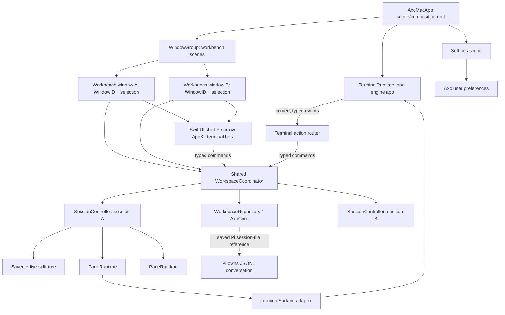

# RFD0004 - Axo: macOS application architecture

- Feature Name: `axo-macos-architecture`
- Status: Draft
- Start Date: 2026-10-09
- Updated: 2026-10-09
- Document Type: Proposal

## Summary

This RFD proposes a maintainable native architecture for Axo's macOS application. Axo should keep its own workspace/session model and Pi integration, while making ownership boundaries explicit: the app composition root owns one terminal-engine runtime and declares explicit SwiftUI scenes; a shared workspace coordinator owns durable navigation state and session controllers; each window owns only its viewport state; each session controller owns its live panes and split state; a pane runtime owns one terminal surface and its process lifecycle; and views render and forward user intent without owning terminal resources. Primary workbench windows share one workspace/session catalog and may select the same or different sessions without cloning runtimes. A typed command path serves menus, toolbars, keyboard shortcuts, and terminal-engine callbacks. The proposal is an incremental refactor of `AxoMac`, not a replacement of the terminal engine, Pi, or existing workspace data model. It also adopts desktop-native scene, sidebar, settings, build, and validation practices while keeping AppKit at the narrow specialized edges Axo needs.

## Motivation

Axo combines native application lifecycle, workspace navigation, durable metadata, terminal surfaces, shell/Pi process launch, split management, focus, occlusion, and terminal-engine callbacks. These concerns are already beginning to interact: selecting a session changes which surfaces are hosted, but must not stop the old processes; terminal actions originate from a surface but may need to mutate workspace state; and a split must persist layout while starting an ordinary shell rather than re-running the parent Pi command. The next workbench also needs multiple windows over shared sessions, a dedicated settings surface, reliable sidebar selection, discoverable menu/toolbar commands, and a safe build/debug loop. Without explicit scene and window-state ownership, those additions risk turning AppKit window objects or SwiftUI view reconstruction into accidental sources of session and process truth.

The current implementation has solid foundations—stable workspace/session/pane identifiers, an atomic validated local registry, retained live surfaces, reused split-layout primitives, and a synthetic native smoke test—but important responsibilities converge in `WorkspaceController`. It also directly owns both AppKit navigation UI and application policy. `AxoMacApp` owns launch, window, menu, and application events, while `TerminalView` directly wraps the terminal engine's C surface API. As more lifecycle and product behavior is added, a change in one concern risks affecting unrelated code, and unit testing can require constructing native views or a real terminal runtime.

Axo is not a terminal emulator with tabs. It has a durable workspace/session hierarchy and distinct Pi conversation semantics. Each workbench window is a viewport over that shared hierarchy, not an owner of its selected session. The RFD proposes Axo's own ownership and adapter boundaries; terminal-vendor comparisons are confined to Prior art.

## Goals

- Make ownership of the terminal-engine runtime, surfaces, child processes, workspace records, split layouts, and per-window viewport state explicit.
- Declare a native primary-window scene and a separate Settings scene; support multiple workbench windows over one shared workspace/session catalog.
- Prefer a persistent desktop sidebar/detail layout, discoverable menu/toolbar commands, stable selection, system-adaptive controls, and standard window behavior.
- Keep SwiftUI as the source of truth for scene, selection, and observable state; use focused AppKit bridges for terminal hosting and other behaviors SwiftUI cannot express cleanly.
- Keep terminal/process lifetime independent of SwiftUI recomposition and transient AppKit view attachment.
- Give terminal-engine callbacks, menus, and view controls one typed, destination-aware command path.
- Reduce the responsibilities of `WorkspaceController` and `AxoMacApp` without introducing speculative frameworks or excessive indirection.
- Preserve the native AppKit/SwiftUI experience, the current full-featured terminal integration, the interactive Pi TUI, and current workspace/session behavior.
- Make session and pane lifecycle transitions testable without launching Pi or requiring a visible window.
- Keep the Mac app compatible with the existing durable `AxoCore` workspace records and Pi-owned conversation files.
- Keep Mac development shell-first, observable, and testable, while distinguishing local builds from app restart, packaging, signing, and notarization.

## Non-goals

- Replacing the current terminal engine with a custom terminal or another terminal library.
- Replacing Pi's interactive TUI with RPC/SDK, changing Pi's ownership of conversation history, or forking Pi.
- Redesigning the relay, phone UI, shared-file system, or workspace/session product semantics already covered by RFD0003.
- Moving process ownership into a background daemon in this implementation. RFD0001's longer-term host direction remains a separate product/availability decision; this design should avoid making such a move impossible.
- Promising restoration of live shells, servers, terminal scrollback, or running terminal surfaces after application termination.
- Adding a third-column inspector without a demonstrated secondary-information/action need; preserve room for terminal work and keep this an optional future scene/view capability.
- Importing another terminal application's window/tab controllers or reproducing its app-specific configuration and notification systems.
- Introducing a general-purpose dependency-injection container, event bus, or Redux-style architecture without a demonstrated need.

## Guide-level explanation

### Mental model

Axo has six related kinds of state with different owners:

| State | Owner | Examples |
| --- | --- | --- |
| Durable work identity | `AxoCore` workspace repository | Workspace/session names and IDs, pane membership, saved split layout; legacy single-window selection used only to seed the first window |
| Live session state | Mac session controller | Which panes are running, focused, stopped, or awaiting explicit resume |
| Terminal resource state | Pane runtime and terminal adapter | Surface handle, child process status, current title/directory observations, input and rendering |
| App-wide state | App composition root and shared coordinator | One terminal runtime, workspace/session catalog, session controllers, command services |
| Window state | One workbench scene/window | Selected workspace/session/pane, sidebar presentation, frame/restoration, inspector visibility if later added |
| Presentation state | SwiftUI views plus narrow AppKit adapters | Temporary dialogs, hover/drag feedback, visible layout, terminal input/rendering |

These are related, but not interchangeable. A persisted pane is not proof of a live process. A view disappearing is not a request to stop a terminal. Selecting a session is not a restart. A title or working-directory report from a shell is observed metadata, not authorization to read a path or execute a command.

A single app-level terminal runtime serves the Mac application. Each Axo session has a controller that owns the session's current pane tree and live pane runtimes. Each workbench window has independent selection and presentation state, while every window observes the same workspace/session catalog. Different windows may select different sessions; the same session may be selected in more than one window without launching another Pi or shell. The terminal-surface API must be validated before promising simultaneous same-pane interactive rendering. The split renderer uses the existing split-layout primitives, but mutations go through Axo commands and update Axo's saved layout.

The primary UI is a desktop sidebar/detail workbench with persistent, explicit selection. A `WindowGroup` is the leading SwiftUI scene choice for workbench windows, and app preferences belong in a separate `Settings` scene. Menus, toolbar actions, and keyboard shortcuts expose the same typed commands. Use system sidebar materials, semantic/adaptive colors, and standard controls by default. Keep the terminal's specialized rendering surface as a narrow AppKit edge. An inspector is optional: add it only when a real secondary-information or action need outweighs the terminal space it consumes.

### Example: open the same workbench in two windows

1. The user opens another primary workbench window. It shows the same workspace/session catalog as the first.
2. Each window may independently select a different session, or both may select the same session. Selection updates window-local state; renaming or creating a session updates shared state.
3. Both windows route actions through the same coordinator using their own `WindowID` and stable session/pane target. Neither window owns or restarts the selected session.
4. If the terminal engine cannot render one live surface in both windows, Axo exposes only a tested transfer or read-only mirror behavior. It never launches a second process to imitate shared state.

### Example: make a split from either UI or a terminal binding

1. The user presses Axo's Split Right menu shortcut, or the terminal engine reports a split action from a surface.
2. The UI or callback adapter converts the intent into the same typed command, targeting the captured `AxoSessionID` and `PaneID`.
3. The session controller verifies that the pane still belongs to that session, checks limits and working-directory validity, and constructs the new split layout.
4. The repository commits the pane record and layout. The pane runtime factory creates an ordinary shell in the validated directory, inheriting only the terminal configuration that Axo intends to preserve.
5. The view layer renders the new tree and restores focus to the new pane after it is attached.

If the selected session changes between steps 1 and 4, the command still targets its original session or is rejected as stale; it must not silently create a split in whichever session happens to be selected later. If shell launch fails after the layout commit, the pane remains discoverable as stopped and can be retried. Existing panes keep running.

### Architecture diagram



## Reference-level explanation

### Architecture and boundaries

This is a logical architecture first. The initial refactor may keep source files in the existing `AxoMac` target and `AxoCore` package; additional Swift packages or Xcode targets are justified only when they enforce a real compile-time boundary or materially improve tests.

#### 1. Application composition and lifecycle

The app composition root owns the one process-wide `TerminalRuntime`, shared workspace coordinator, and native scene declarations. Prefer a SwiftUI `App` entry with a `WindowGroup` for primary workbench windows and a separate `Settings` scene for durable app preferences. A menu-bar extra or utility window is a separate product choice, not a default scene. AppKit lifecycle/delegate hooks may be attached narrowly where the terminal host, activation policy, first responder, or native menu behavior requires them.

A window scene composes a desktop sidebar/detail workbench and carries a stable `WindowID` plus window-scoped selection and presentation state. Store only UI preferences in `@AppStorage`; keep window-local selection/restoration in scene-owned state or `@SceneStorage` where appropriate; keep durable workspace/session records in `AxoCore`. Every scene reads and mutates the same shared catalog/coordinator. Window creation or restoration never creates a session or process. Closing a window releases that viewport only.

The app root should not contain workspace mutation rules, terminal-engine C callback logic, terminal launch policy, or split-tree algorithms. Those are delegated to their owners. If the current hand-built `NSWindow` implementation cannot adopt SwiftUI scenes without a behavior regression, retain a small window coordinator as a transitional bridge and record the specific limitation; do not spread `NSWindow` ownership through view code or keep both SwiftUI and AppKit as competing selection sources.

#### 2. Terminal runtime and platform adapter

`TerminalRuntime` owns the one process-wide terminal-engine application handle, engine initialization/configuration, C runtime callbacks, and event-loop ticks. It reports runtime initialization and shutdown failures through typed errors. It does not own workspace records, selected-session state, or window layout.

A narrow `TerminalSurface` adapter owns one terminal-engine surface handle and translates between the C API and Axo's native terminal host. It handles surface creation/freeing, content scale/size, visibility, focus, and terminal input operations. `TerminalView` remains an `NSView`/`NSTextInputClient` adapter for AppKit events and rendering attachment; it should not be the owner of the session registry or workspace policy.

The C boundary has explicit lifetime rules:

- Copy borrowed C strings/arrays into Swift-owned values before returning from callbacks.
- Resolve the originating surface to a stable pane/session identity while that association is valid.
- Do not assume that a surface's `NSView.window` identifies its owner during reparenting.
- Do not perform structural surface destruction while the terminal engine is executing a callback; enqueue a command for the owner to process after the callback returns.
- Keep any C userdata token alive for exactly the period in which the engine may call back with it; unregister it before releasing the associated surface. Do not rely on an unretained pointer surviving merely because the view is usually retained.
- Constrain terminal-engine and AppKit calls to their supported executor/thread. The default proposal is `@MainActor` for UI-facing terminal ownership, with callback trampolines copying values and hopping to the main actor when necessary. Confirm this against the pinned C API's callback guarantees rather than assuming every callback originates on the main thread.

The embedding adapter is Axo's compatibility seam to the pinned terminal-engine revision. The engine API and build toolchain are pinned together; updating the vendor revision remains deliberate work, not an automatic binary upgrade.

#### 3. Workspace coordinator and durable repository

`WorkspaceCoordinator` owns the in-process map of stable `AxoSessionID` values to `SessionController` instances, the shared workspace catalog, and application-level commands that span sessions. It exposes observable, value-oriented state to the views. It does not own one global selected session or individual C surface handles. Each workbench window owns its own selected workspace/session/pane presentation state and sends explicit targets to the shared coordinator.

`WorkspaceRepository` is the application-facing boundary over `AxoCore.WorkspaceStore`. `WorkspaceStore` remains the authority for durable local workspace/session/pane identity and saved layout. It keeps its current validation and private atomic-commit guarantees unless a later RFD changes them. It never stores terminal output, process claims, Pi transcripts, credentials, or ephemeral focus/visibility facts as if they were durable process state.

Repository operations are serialized. Disk work should not block interactive rendering. The implementation may use an actor or a narrow serial executor, but commits must be ordered and callers must receive the committed value/revision or a typed failure. The UI must not optimistically report a durable change before the repository has accepted it. Do not hold a store transaction open while launching a process or awaiting user confirmation.

#### 4. Session and pane ownership

Each `SessionController` owns the live resources for one `AxoSessionID`:

- A session-local pane/layout projection, built from persisted stable IDs and layout.
- A map from `PaneID` to live `PaneRuntime` objects.
- Live status and terminal-resource ownership for panes in that session. A window's selected/focused pane is its own viewport state, not one session-global focus value; the active key window/first responder determines which terminal surface currently receives native input.
- The launch/resume/stop/close transitions for those panes.
- The mapping between live terminal surfaces and stable Axo pane identity.

A `PaneRuntime` owns a terminal surface and its lifecycle observations. Its conceptual state is explicit, for example `stopped`, `launching`, `running`, `childExited`, and `failed`. Durable workspace/session/pane identity, session directory and Pi session-file references, pane kind, conversation binding, and saved layout are persisted; ephemeral runtime state is reconstructed as stopped after app restart. A state machine must prevent duplicate launches, reject close/resize operations for panes that are no longer owned, and make failed launches retryable without creating duplicate durable records.

Pane launch intent should be represented as a domain type (managed Pi versus ordinary shell, with explicit directory and session-file information) rather than inferred from view type or assembled ad hoc in UI actions. A terminal-engine adapter translates that specification to the pinned API. Continue validating directories at the boundary and preserve safe argument quoting; terminal titles and PWD reports are untrusted observations.

A session may have an empty layout and no live panes. This means stopped/empty, not deleted. Resume or open-shell UI is an explicit command. Selecting or rendering that session does not start a process.

#### 5. Command and event routing

All user actions that mutate work state flow through typed Axo commands. Representative commands include `selectSession(windowID:sessionID:)`, `selectPane(windowID:sessionID:paneID:)`, `createWorkspace`, `createSession`, `splitPane`, `resizeSplit`, `focusPane(windowID:sessionID:paneID:)`, `closePane`, `resumePane`, and `renameSession`. Commands that affect a viewport carry `WindowID`; commands that affect shared work carry stable workspace/session/pane IDs. No command resolves its target from mutable global selection after asynchronous work begins.

All ingress routes converge on that command path:

- App menu and sidebar actions.
- Keyboard shortcuts.
- Split-view gesture callbacks.
- Terminal-engine actions and close callbacks.
- Test harness commands.

Terminal-engine callbacks are first converted to typed events or commands by a small adapter. The callback router maps the source surface to its owning session and pane, copies transient payloads, validates supported action tags, and then dispatches. Unsupported actions return the engine's unhandled result. A captured action from a pane that was closed, moved, or made stale before dispatch is rejected rather than applied to a replacement pane.

Commands that change durable data use the repository and then update the owning session controller. Commands that change only transient presentation state need not write to the workspace repository; per-window state may be persisted by the separate `WindowPresentationStore`. Focus and visibility are derived from that window's selection and actual AppKit key-window/first-responder/occlusion state. They are not synonyms and must be sent to the terminal engine independently.

The RFD does not mandate a generic CQRS/event-sourcing system. A small closed Swift `enum` for commands/events and direct owner methods are preferable until actual scale justifies a broader mechanism.

#### 6. Presentation layer

Use a persistent desktop sidebar/detail composition for the workbench. Prefer SwiftUI `NavigationSplitView` when it fits the existing session-navigation behavior; retaining the current native AppKit outline/source-list is acceptable if that is the smaller, more reliable bridge. Do not migrate a working native sidebar solely to use one framework. Keep workspace/session selection explicit and stable, with each window passing its own selected destination into a session detail view. Do not turn the Mac workbench into iOS-style push navigation.

Keep sidebar rows lightweight and scannable—normally one leading symbol, a primary title, and at most one short secondary line. Put richer metadata and secondary actions in the selected-session detail or, only when justified, an optional inspector. The default sidebar and root-window surfaces use system-provided backgrounds/materials, semantic colors, and standard controls. Avoid opaque custom fills or card-heavy rows that fight the system source-list appearance. Custom styling remains appropriate where Axo has a strong product need, especially inside the terminal work surface.

Use SwiftUI scene `commands`, command menus, toolbars, and keyboard shortcuts for discoverable desktop actions. Menus, palette, toolbar, and shortcuts must all invoke the same typed command path. Use focused values or explicit `WindowID`/session/pane targets when an action is contextual; never resolve a late command against mutable global selection. The main workbench remains usable by keyboard and pointer. An inspector is not part of the initial architecture requirement; if later added, its visibility is window-local and its controls route through the same command boundary.

SwiftUI remains the source of truth for selection, observable models, and scene state. Use a narrow `NSViewRepresentable`, `NSViewControllerRepresentable`, or focused `NSWindow` helper only for a named gap in AppKit terminal hosting, IME/text input, first-responder behavior, open/save panels, menu validation, or other desktop-only capabilities. A representable coordinator is lifecycle/delegate glue, not a second app architecture. Preserve stable native terminal hosting while allowing SwiftUI to recompose the surrounding split tree.

Views receive values or observable read models and emit intent. They do not create terminal applications/surfaces, write the workspace file directly, or decide which Pi session a late callback belongs to. `PaneHostView` remains a stable native leaf that can host either a live terminal view or a stopped-pane placeholder. Structural identity must remain explicit when replacing SwiftUI split trees; view recomposition must not recreate a pane runtime.

#### 7. Scene and window-state policy

`WindowGroup` is the proposed primary scene because the workbench is a repeatable viewport, not a singleton inspector. Each instance receives a distinct `WindowID` and owns frame/restoration state, sidebar presentation, selected workspace/session, and any future inspector visibility. Those values are not copied into session records or shared as one global selection. The workspace catalog, session controllers, Pi conversations, pane runtimes, and process lifetimes remain app-shared.

A dedicated `Settings` scene holds user preferences such as shortcuts, appearance/config import choices, and notification/voice defaults. Durable preferences may use `@AppStorage` or Axo's local settings model; they must not be confused with the workspace repository. No menu-bar extra is proposed now: add one only if Axo gains a concrete always-available task that does not duplicate the main-window command surface.

Use standard window restoration/placement behavior where useful. Restore each window's frame and selected-session viewport without claiming to restore live processes. Opening a new primary window should use sensible desktop placement and preserve user resizing/zoom behavior; do not hard-code a single display size or manually style title bars without a product need. If a future custom chrome removes the standard drag/title region, replace that affordance accessibly and test it.

#### 8. Lifetime policy

The app process owns its terminal runtime and live panes in this scope. The following distinctions remain mandatory:

- Hiding or closing one workbench window changes that viewport's visibility, not pane ownership.
- Switching sessions in one window changes only that window's presentation and focus, not process lifetime or another window's selection.
- Closing a pane is an explicit lifecycle operation; if the child is alive, cancellation leaves both its durable record and runtime untouched.
- Quitting the app may stop its app-owned processes after the existing confirmation policy.
- App restart restores metadata, layout, and eligible per-window viewport state only; it does not claim to restore processes or terminal scrollback.

If Axo later requires process continuity past application termination, put process ownership behind a host interface and decide how that host starts, authenticates, persists, and shuts down in a separate proposal. Do not try to get daemon-like behavior by keeping terminal views or windows hidden.

### Data model and interfaces

The existing core types remain the durable vocabulary: `WorkspaceID`, `AxoSessionID`, `PaneID`, `WorkspaceRecord`, `WorkSession`, `PaneRecord`, and `PaneLayout`. Add a distinct `WindowID` and window-scoped presentation record containing selected workspace/session/pane plus sidebar and restoration state; it references, but does not own or duplicate, workspace/session/pane records. Persist that presentation state separately from the workspace/session schema unless a later migration proposal explicitly changes the store. The current `WorkspaceRegistry.selectedSession` and `WorkSession.focusedPane` remain backward-compatible bootstrap defaults for the first new window only; they are not the source of truth for other windows and must not be rewritten on ordinary per-window selection or focus changes. A new window copies its initial selection/focused pane from its creating window or, if none exists, from the legacy defaults. The macOS runtime layer adds distinct ephemeral identities/state only where required; it must not conflate an Axo session with a Pi conversation, a pane with a view, or a process with its persisted pane record.

The principal interfaces should be narrow and domain-shaped:

```swift
struct WorkbenchWindowState {
    let id: WindowID
    var selectedWorkspaceID: WorkspaceID?
    var selectedSessionID: AxoSessionID?
    var selectedPaneID: PaneID?
    var sidebarPresentation: SidebarPresentation
    var restoration: WindowRestorationState
}

@MainActor
protocol TerminalSurfaceOwner {
    func setFocus(_ focused: Bool)
    func setVisible(_ visible: Bool)
    func close() async throws
}

protocol WorkspaceRepository {
    func load() async throws -> WorkspaceRegistry
    func commit(_ command: WorkspaceMutation) async throws -> WorkspaceRegistry
}

protocol WindowPresentationStore {
    func loadWindows() async throws -> [WorkbenchWindowState]
    func save(_ state: WorkbenchWindowState) async throws
}
```

These are illustrative contracts, not required source signatures. In particular, the repository interface should expose meaningful operations or validated mutations rather than arbitrary closure mutation if closures make serialization, testing, or concurrency unclear. Window presentation persistence is a separate local concern, not another owner of workspaces/sessions. The surface protocol should stay small and should not expose the terminal engine's entire C API to workspace/UI code.

The app-facing commands/events should use named associated values and stable IDs. Borrowed terminal-engine C structs must not escape the callback boundary. A command such as `splitPane(windowID:sessionID:paneID:direction:)` is preferable to a handler that reads a global `selectedSession` midway through asynchronous execution.

### Lifecycle and failure semantics

- **Startup:** construct the terminal runtime, load/validate the registry, build stopped session projections, then present the restored or default workbench window. If the terminal engine cannot initialize, report the startup error without partially launching Pi. If the registry is corrupt, do not overwrite it with an empty registry.
- **Open/restore window:** create or restore one viewport with its own `WindowID` and selected-session state over the shared catalog. Do not launch or clone a session because a window was opened or restored.
- **Open Settings:** present the dedicated preferences scene; changing a preference does not mutate workspace/session identity unless the specific setting explicitly controls that behavior.
- **Create session/workspace:** commit stable identity before launching its initial Pi pane. A launch failure leaves a stopped, retryable session. A retry reuses the same IDs and conversation file; it does not create another session or replay an uncertain prompt.
- **Create split:** validate current pane ownership and launch directory, commit the tree/pane record, then create the shell surface. On creation failure the saved pane remains stopped and retryable. Do not roll back or close existing processes to hide a failed new launch.
- **Resume:** reject if the pane already has a live runtime; validate that its recorded directory is available; create only Axo-owned scratch directories. A missing imported/project directory requires repair rather than silent fallback.
- **Select/reparent:** change only the originating window's selection/focus presentation while retaining runtime ownership. Restore native terminal focus only after attachment and only if the originating `WindowID`/session/pane is still current in that window.
- **Close:** capture the exact session/pane before showing confirmation. Cancellation is a no-op. After confirmation, revalidate that the target remains owned before removing the persisted pane and freeing its surface.
- **Child exit:** mark live runtime status as exited and refresh presentation. Preserve the pane/session identity and Pi transcript; explicit user action decides whether to resume or close.
- **Callback races:** if a delayed title/PWD/close/split event arrives after pane removal or session change, ignore or reject it using the captured surface-to-pane ownership mapping. It must never target whichever pane is now focused.
- **Shutdown:** stop/free surfaces in a defined order while callbacks can no longer resolve their userdata. Tear down the terminal application only after all its surfaces. Do not rely on arbitrary SwiftUI deallocation order for process shutdown.

### Invariants

- One process-wide terminal-engine runtime exists per AxoMac process.
- Every live terminal surface has exactly one owning `PaneRuntime`, which belongs to one `SessionController` and stable `PaneID`.
- Presentation hierarchy and AppKit `window` attachment do not define resource ownership.
- Durable pane/layout records do not assert that a process or surface is alive.
- Selecting, hiding, showing, and resizing views never implicitly create, stop, or replace a child process.
- Each workbench window has distinct `WindowID`, selected-session, and selected-pane presentation state but shares one workspace/session catalog and one owner per live pane runtime. Legacy global selection fields are bootstrap fallbacks only; ordinary navigation/focus in one window never changes another window's selection.
- Every workspace mutation has an explicit stable destination and is serialized through the repository.
- Settings/preferences are distinct from workspace/session data; one window's navigation state cannot overwrite another window's selection.
- Every terminal-engine action is attributed to its originating surface before it can mutate Axo state.
- Cancellation of a close confirmation cannot stop a process or remove its record.
- No borrowed C pointer/string/array outlives the callback that supplied it.
- A stale callback cannot be retargeted to the currently selected session or a newly created pane.
- Pi remains the authoritative owner of its conversation tree and JSONL transcript.
- User-visible failures preserve existing live work and leave new launches in a truthful stopped/retryable state.

### Compatibility and migration

This proposal does not change `workspaces.json` schema, pane IDs, Pi session-file paths, bridge invocation, or phone protocol. The existing `WorkspaceStore` validation and atomic persistence are retained. A separate private window-presentation store holds per-window selection/focus/restoration; the current global `selectedSession` and per-session `focusedPane` fields remain read-only compatibility defaults for first-window seeding and are not updated on ordinary per-window navigation. No existing Pi JSONL is rewritten or implicitly adopted as a different Axo conversation.

Refactor behind current behavior in small steps. Existing `WorkspaceController` can initially act as a façade while responsibilities are extracted. Keep current navigation, shortcuts, close confirmations, stopped-pane restoration, ordinary shell splits, and terminal-layout tests working throughout while introducing multiple independent workbench windows over shared state. Do not combine an architecture refactor with unrelated visual redesign or an unapproved restart of the installed/running app.

### Security, privacy, and observability

The architectural split is also a trust boundary. UI and persisted display metadata do not authorize filesystem access or command execution. Directory validation and shell-command construction belong at the process-launch boundary. Terminal-provided title and working-directory reports are bounded, validated observations. Workspace metadata remains private local application data; Pi contents and terminal output do not enter the workspace registry or diagnostic logs.

Use Apple's unified logging through `Logger` with a stable app subsystem and focused categories such as `Windowing`, `Sidebar`, `Commands`, `Settings`, `Runtime`, and `Import`. Log high-signal lifecycle/action boundaries—window open/close, selection changes, command invocation, background load, and recovery—not every view update. Keep logs concise and filterable via `log stream`; do not log prompts, JSONL contents, environment values, credentials, clipboard data, terminal screen contents, raw C callback payloads, or private config contents. User-facing errors should identify the failed operation and recovery path without dumping sensitive process data.

### Native macOS design references

The native shell recommendations below adapt two OpenAI Codex use-case guides to Axo's existing terminal/workspace constraints; they are design guidance, not authoritative API specifications. Verify SwiftUI/AppKit availability and behavior against Apple's documentation and Axo's macOS 14 deployment target before implementation.

- [Build for macOS](https://learn.chatgpt.com/use-cases/native-macos-apps.md) recommends choosing explicit scene roots, favoring a shell-first Xcode/Swift workflow, using desktop conventions, keeping AppKit interop narrow, adding high-signal runtime logging, testing the smallest useful scope, and separating local build success from signing/notarization readiness. Accessed 2026-10-09.
- [Build a Mac app shell: sidebar, detail, and inspector](https://learn.chatgpt.com/use-cases/macos-sidebar-detail-inspector.md) recommends stable sidebar selection, a persistent sidebar/detail composition, lightweight native sidebar rows, menus/toolbars/shortcuts for important actions, a dedicated Settings scene, window-scoped presentation state, and narrow AppKit bridges. Accessed 2026-10-09.

Axo adopts explicit `WindowGroup`/`Settings` scene ownership, stable window-local selection, shared session ownership, native sidebar/detail and command affordances, system-adaptive UI defaults, shell-first validation, and structured logging. Axo does **not** adopt the example's inspector by default: the terminal is the primary detail surface, and an inspector would consume scarce terminal area without a demonstrated need. Likewise, upstream examples that kill and relaunch a process as part of a one-command build/run loop do not override Axo's explicit no-unapproved-restart safety policy. Axo already has the project-local `scripts/build-mac.sh` packaging path; keep package/build separate from launching the Finder `.app` bundle, and never launch a raw GUI executable or silently replace/restart the live process. Local build/package, app launch/restart, and distribution signing/notarization remain separate operations. When shipping becomes in scope, maintain both a manual Xcode archive path and a repeatable scripted archive/notarization path; inspect the app bundle, entitlements, and hardened-runtime/signature state with the appropriate `codesign`, `plutil`, and Gatekeeper checks. App Store Connect CLI tooling is relevant only if Axo chooses that upload route.

### Rollout and validation

Refactor in narrow, reversible phases:

1. **Write characterization tests and ownership assertions.** Extend existing workspace smoke-test coverage for selection, reparenting, stale actions, process retention, close cancellation, and no automatic restart.
2. **Define the command/event and launch-spec vocabulary.** Route menus, shortcuts, toolbar actions, palette actions, and terminal-engine actions through typed operations while `WorkspaceController` still owns the implementation.
3. **Extract the terminal surface adapter.** Move C API calls and callback userdata/lifetime rules out of workspace/navigation policy. Keep input, IME, clipboard, accessibility, and resize behavior covered.
4. **Extract session ownership.** Introduce one `SessionController` per live session, moving pane-runtime ownership, split operations, focus, visibility, and launch/close transitions out of the broad workspace controller.
5. **Introduce explicit scenes and window state.** Adopt a primary `WindowGroup` (or a documented equivalent if a specific AppKit constraint prevents it), add the dedicated Settings scene, and keep each window's `WindowID` and selection independent over one shared coordinator. Do not move durable work identity into scene storage.
6. **Make the shell desktop-native.** Prefer a persistent sidebar/detail layout, native system sidebar/materials, scene commands, menus, toolbars, and keyboard shortcuts. Keep an inspector optional and use it only for a demonstrated secondary-information need. Keep SwiftUI as selection/state authority and bridge AppKit narrowly for terminal/text-system behavior.
7. **Add a shell-first validation and observability loop.** Use `xcodebuild`/`swift test` and the existing project build/package script; run the smallest relevant target first, classify failures (compile, link, test assertion, crash, signing, environment), and verify high-signal `Logger` events with `log stream`. A build/package command must not silently kill or relaunch a live Axo/Pi process. Keep local launch, replacement/restart, archive, signing, and notarization as explicit distinct operations.
8. **Evaluate module boundaries after extraction.** Move platform-neutral records/algorithms into `AxoCore` only when they have no AppKit/terminal-engine dependency; create a Mac runtime package only if its build/test boundary proves useful.

Validation should include:

- Existing AxoCore registry/layout tests and all reused split-tree tests.
- Unit tests for session transitions with fake repository and fake terminal-surface driver; no terminal process required.
- Native macOS smoke tests against the real pinned terminal framework and synthetic shell command.
- Tests that switch sessions rapidly while processes continue producing output, and assert each surface remains owned by the same pane/session.
- Tests for source-surface action attribution, callback payload copying, stale callback rejection, deferred close, cancellation, child exit, and launch failure/retry.
- Focus/IME/input/copy/paste/drop, window occlusion, backing-scale changes, accessibility labels, split resize/equalize, and keyboard shortcuts.
- Open multiple workbench windows and verify a shared catalog, independent session selection, stable command targeting, and no duplicate Pi/shell ownership when they select the same session.
- Restore window frame and selected-session presentation without starting processes; close one window while another remains usable and its selected session continues.
- Open Settings independently and verify preference changes do not become workspace mutations or change another window's selection.
- Check sidebar readability, standard macOS background/material behavior, menu/toolbar/shortcut parity, and keyboard accessibility; validate the inspector only if a real product use case is accepted.
- Verify selected lifecycle and command logs with `log stream` without exposing transcripts or other sensitive payloads.
- Reopen with saved workspace/layout data and assert every process remains stopped until explicitly resumed.
- A bounded multi-pane/multi-session resource smoke test before increasing current admission limits. Record measured behavior rather than assuming hidden surfaces are free.

Acceptance criteria:

- `AxoMacApp` no longer contains workspace/split/process rules, and `WorkspaceController` no longer directly owns terminal-engine C handles or implements every session lifecycle operation.
- The main workbench has an explicit multiwindow scene model and a separate Settings scene; selection and window presentation are independent per window while the workspace/session catalog and live resources are shared.
- Views do not create/destroy terminal resources through incidental construction/deallocation.
- Menu, keyboard, split-view, and terminal action paths converge on typed, explicitly targeted commands.
- The map from terminal surface to Axo session/pane remains valid through selection and reparenting and is removed before surface teardown.
- Existing product behavior and persisted records survive the refactor without data migration or process restart.
- The synthetic native test and focused unit tests can verify the key invariants deterministically.

### Relationship to related RFDs

[RFD0003](RFD0003-workspaces-sessions-and-search.md) defines the workspace/session/pane product model, its current local implementation checkpoint, and its still-incomplete phone/relay foundation. This RFD addresses the internal architecture of the native Mac client that hosts that model; it does not declare RFD0003 complete or alter its acceptance criteria.

[RFD0001](RFD0001-axo-continuous-agent-workspaces.md) proposes a future background host with process ownership independent of the desktop UI. This RFD keeps a seam for that possibility but continues the current app-process ownership contract. A background execution service requires its own accepted lifecycle, packaging, authentication, and recovery design.

[RFD0005](RFD0005-axo-native-workbench-feature-set.md) proposes the product-level feature set, including shared multiwindow sessions, voice, notifications, a command palette, URL handling, and config migration. This RFD supplies the native scene, ownership, command-routing, and window-state architecture needed to support those proposals; it does not resolve the terminal API's same-pane multiwindow rendering feasibility gate or claim those features are implemented.

## Drawbacks

- Extracting owners and typed commands adds types and indirection to a working prototype; it will slow some short-term UI changes.
- AppKit, SwiftUI, and terminal-engine C lifecycles remain inherently complex. A cleaner object graph does not remove callback, IME, GPU, or process-management risks.
- A `SessionController` per session may retain many terminal surfaces and GPU resources when sessions are hidden. Ownership is more explicit, but resource budgets and profiling remain necessary.
- `@MainActor` is a simplifying default for AppKit integration, not proof that all terminal-engine operations are main-thread-safe or must be main-threaded. The actual C API threading contract must be verified.
- Abstracting storage and terminal-surface operations for testing risks generic interfaces that obscure behavior if the seams are broader than their current use.
- The ideal long-term host/process lifetime remains unsettled. Keeping an in-process owner is consistent with current behavior but does not deliver RFD0001's background continuity.
- There is a migration cost in maintaining behavioral parity across a multi-step refactor, particularly for keyboard handling, IME composition, clipboard policy, and focus restoration.

## Rationale and alternatives

### Proposed design

Adopt explicit application, workspace, session, pane-resource, and presentation ownership. Keep the process-wide terminal runtime distinct from session/window controllers, and keep split rendering distinct from the owner that mutates the tree. Add an Axo-specific typed command boundary because Axo's commands need workspace/session identity and durable mutations that the terminal engine does not own.

This design stays close to the current code: the existing repository remains, the same split primitives remain, and the app stays native Swift/AppKit/SwiftUI. It improves testability and lifecycle reasoning without replacing working terminal/input code or depending on another product's private app architecture.

### Keep the current controller and only add tests

This is the lowest-risk option and may be appropriate if the Mac app remains a small prototype. It does not address the growing mixed responsibilities or create a clean seam for testing pane lifecycle without AppKit or a real terminal runtime. The proposed phased approach retains this option at every phase: stop extracting if a boundary does not improve correctness or clarity.

### Make the window own every session resource

A window-local owner can simplify focus and split management when all terminals are children of one terminal window. Axo's durable sessions and retained panes outlive changes to the selected presentation, so tying their ownership to a window risks stopping work during navigation or makes future window changes into resource transfers. Keep window-specific behavior at the window boundary, while session ownership remains explicit.

### One global observable app model for all concerns

Putting all observable state, menus, windows, terminal callbacks, and persistence in one application object resembles a simple MVVM prototype. It reduces initial setup, but repeats the current concentration of responsibility in another type and makes live process ownership harder to reason about. It is not the target.

### Actors for every subsystem

Moving every controller, surface, and callback into separate actors could make isolation look explicit, but AppKit view operations and much of the current terminal bridge are main-thread-oriented. Broad actor conversion would create pervasive hops without proving safety. Use explicit main-actor ownership for UI-facing resources and isolate serialized disk work; expand concurrency only where an operation has a clear non-UI owner and tested thread contract.

### Move terminal processes into a daemon now

A separate host can outlive the UI and better match RFD0001's long-term continuity goal. It also adds IPC, process discovery, authentication, crash recovery, packaging, and independent terminal-renderer attachment problems. It is not a prerequisite for making the current app architecture maintainable and should be decided in its own proposal.

### Do nothing

Continue extending `WorkspaceController`, `AxoMacApp`, and `TerminalView` in place. The existing tests and boundaries may be sufficient for the current scale, but more features will make changes harder to isolate and regressions more difficult to localize. If workbench/session ownership remains stable and new tests make the lifecycle reliable, the project can defer some or all of this refactor.

## Prior art

- **Ghostty's process-wide app and terminal window controllers:** `macos/Sources/Ghostty/Ghostty.App.swift` owns one `ghostty_app_t` and runtime callbacks; `macos/Sources/Features/Terminal/BaseTerminalController.swift` owns a terminal window's focused surface and split tree. This separation is useful. Ghostty's code also has substantial app-specific app-delegate and notification behavior; it is not a mandate to copy those mechanisms.
- **Ghostty's `SurfaceView_AppKit.swift`:** demonstrates a dedicated AppKit adapter with explicit IME, input, process/surface state, selection, accessibility, and rendering concerns. Axo should retain its own terminal host and avoid leaking C API details into workspace UI.
- **Ghostty's `TerminalSplitTreeView.swift`:** treats the split tree as input to a renderer and emits resize/drop operations back to an owner. Axo already adapts this direction in `PaneSplitTreeView.swift` and should carry it through for menu and callback commands.
- **Axo's current `WorkspaceStore`:** already separates bounded, validated, atomic durable records from Pi transcript storage. The architecture should preserve this useful boundary rather than move all state into a view model.
- **[RFD0003](RFD0003-workspaces-sessions-and-search.md):** describes the intended separation between saved Axo identity, session controllers, live surfaces, and view hierarchy, and accurately notes the local-only foundation is not complete multi-device support.

Source references at the pinned Ghostty revision used by Axo:

- [`Ghostty.App.swift`](../../vendor/ghostty/macos/Sources/Ghostty/Ghostty.App.swift)
- [`BaseTerminalController.swift`](../../vendor/ghostty/macos/Sources/Features/Terminal/BaseTerminalController.swift)
- [`TerminalController.swift`](../../vendor/ghostty/macos/Sources/Features/Terminal/TerminalController.swift)
- [`SurfaceView_AppKit.swift`](../../vendor/ghostty/macos/Sources/Ghostty/Surface%20View/SurfaceView_AppKit.swift)
- [`TerminalSplitTreeView.swift`](../../vendor/ghostty/macos/Sources/Features/Splits/TerminalSplitTreeView.swift)
- [`Axo's Ghostty source-reuse notes`](../../apple/AxoMac/Ghostty/README.md)

## Unresolved questions

### Before acceptance

- Is the proposed target that the Mac app remains the owner of processes until quit, with a future host daemon explicitly separate, or should this architecture RFD itself establish UI-independent process continuity as a requirement? RFD0001 and RFD0003 presently describe different time horizons.
- Should the session controller own a reconstructed live `SplitTree` alongside the persisted `PaneLayout`, or should the tree become a shared platform-neutral value model with a separate view projection? The answer should avoid two independently mutable layout truths.
- Does the pinned terminal C API guarantee the thread/executor for wakeup, action, and close callbacks, and which operations must be marshalled before touching AppKit or freeing surfaces?
- What simultaneous same-session/same-pane view behavior can the pinned terminal API actually support? Validate the options in RFD0005's feasibility spike; this RFD requires one shared pane owner but does not guess at a renderer capability.
- Which private local format/store should hold stable `WindowID`-to-viewport restoration data, and how should older global selection/focused-pane fields seed initial windows without remaining competing state?
- Is a small injectable terminal-driver seam worth maintaining in production code, or can lifecycle tests use a smaller fake around the pane factory without abstracting each surface operation?

### During implementation

- Concrete names and file/target placement for the coordinator, session controller, pane runtime, and typed command types.
- Whether the serialized registry remains synchronous behind a queue or gains an async actor façade, subject to performance and test evidence.
- Exact representation of terminal-engine userdata tokens and surface-to-pane lookup, verified against callback and teardown semantics.
- How runtime launch failures and repeated close/child-exit callbacks map to the existing stopped-pane UI and retry flow.
- Whether AppKit sidebar components and SwiftUI split components should move into dedicated files/modules after responsibilities have been extracted.
- The concrete `WindowGroup` identifier/restoration strategy and the exact split between scene-owned ephemeral state and persisted per-window viewport state, with macOS 14 API availability checked.
- What small-scale pane/session count and GPU-memory budget should gate any increase to current capacity limits.

### Out of scope

- The relay/phone catalog and command-routing architecture, detailed in RFD0003.
- Pi RPC/SDK migration or changing the terminal-based Pi integration.
- Durable terminal process snapshots, shell scrollback restoration, arbitrary external-terminal adoption, or multi-host scheduling.
- Search/indexing implementation and the command-palette UI. The command boundary must support these actions, but RFD0005 owns their product and rollout details.
- Split dragging between windows and cross-window terminal ownership transfer.
- Background host/daemon implementation and launch-at-login policy.

## Future possibilities

Once ownership is explicit, Axo can consider a separately supervised host process, cross-window pane transfer, richer terminal-pane types, or additional Pi runtime adapters without making SwiftUI view lifetime the accidental process boundary. Those are possible evolutions, not reasons to accept this RFD, and each needs independent lifecycle, security, and product decisions.
