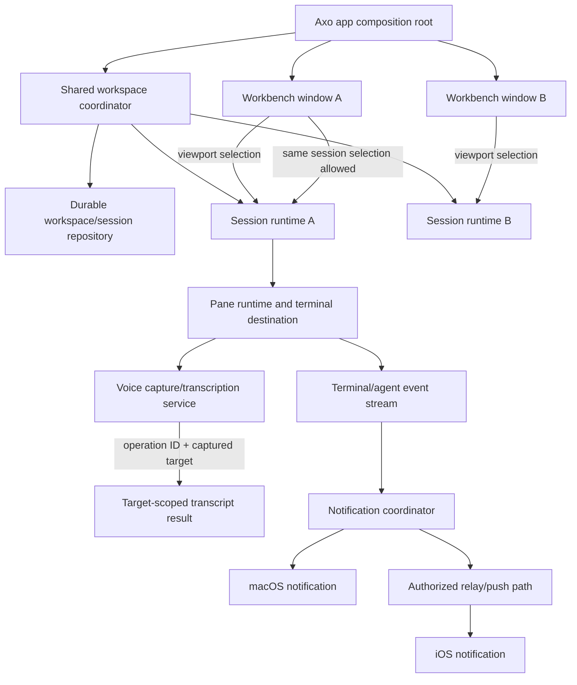

# RFD0005 - Axo: native workbench feature set

- Feature Name: `axo-native-workbench-feature-set`
- Status: Draft
- Start Date: 2026-10-09
- Updated: 2026-10-09
- Document Type: Proposal

## Summary

This RFD proposes the next native Axo workbench capabilities: multiple independent windows over one shared workspace/session catalog; stronger pane management; a command palette and configurable key bindings; safe terminal URL recognition/opening; destination-scoped asynchronous voice dictation; and terminal/agent notifications on macOS and iOS. Terminal appearance settings should migrate by copying a supported subset from an existing Ghostty configuration into Axo-owned configuration, leaving the original untouched. A window is a viewport into shared Axo state, not a new workspace or agent runtime. A voice operation captures its session/pane destination before recording and remains bound to it through transcription, even if the user switches sessions or starts another dictation. This is a future-feature proposal: it does not claim the phone relay, same-session multi-window rendering, or Mac voice experience is already implemented.

## Motivation

Axo has an initial native Mac workbench with workspaces, sessions, terminal panes, and a shared iPhone companion. The user wants the app to grow beyond a single window without fragmenting that model: every window should show the same workspace list, independently select a session, and be able to open the same session as another window. The session is the work; a window is only another place to view it. Sessions already serve the organizing role that tabs would provide, so a second terminal-tab hierarchy is not wanted.

The workbench should also reduce interaction overhead. The user wants a command palette, configurable shortcuts, clearer terminal URL interactions, and notifications that can reach either device. Voice dictation is especially time-sensitive: today the user has to wait for a voice tool to finish decoding and pasting before moving to another agent. Axo should stop recording promptly, transcribe asynchronously, and keep each result attached to the session or pane where recording began.

The existing architecture direction in [RFD0004](RFD0004-axo-macos-application-architecture.md) is a prerequisite: long-lived session/pane ownership must not be coupled to one window's view hierarchy. [RFD0003](RFD0003-workspaces-sessions-and-search.md) already defines workspace/session identity and defers the command palette/search until its foundation is complete. This proposal adds the chosen future capabilities and calls out where its decisions supersede or extend that earlier proposal.

## Goals

- Support multiple Mac workbench windows sharing the same workspace and session identities.
- Allow each window to select a different session, or the same session, without duplicating the Pi conversation or launching duplicate processes.
- Continue improving split-pane resize, focus, navigation, and viewport behavior.
- Provide one command palette for Axo actions and explicit workspace/session/pane navigation.
- Make Axo actions configurable through user key bindings with predictable conflict handling.
- Detect terminal URLs, show an affordance on hover, and open approved links in the user's default browser.
- Send useful, deduplicated terminal and agent notifications to macOS and iOS, with actions that navigate to their originating session/pane.
- Add Mac voice dictation using local speech recognition where supported, with asynchronous, destination-scoped transcription that never blocks starting the next recording after capture stops.
- Reuse suitable terminal color/font preferences by copying and migrating compatible values from a discovered Ghostty configuration into an Axo-owned configuration file.
- Preserve native terminal interaction, accessibility, privacy, Pi transcript ownership, and explicit process lifecycle behavior.

## Non-goals

- A second tab hierarchy separate from Axo workspaces/sessions.
- One new agent, Pi conversation, or child process per window.
- Duplicating a terminal process or Pi writer to fake a second view of the same session.
- Automatically sending dictated text, pressing Return, or executing a command without the user's explicit action.
- Uploading audio for transcription or sending raw terminal output in a push notification.
- Importing every terminal configuration directive or executing commands from an imported config.
- Implementing pane drag-and-drop between windows, terminal undo/redo, an inspector, a global quick-terminal overlay, AppleScript, or broad Shortcuts control in this feature slice.
- Changing Pi's terminal-based interaction, the authoritative Pi conversation format, or RFD0003's relay authorization model.

## Guide-level explanation

### Mental model

| Concept | Meaning |
| --- | --- |
| Workspace/session catalog | One shared durable Axo hierarchy visible in every window |
| Workbench window | An independent viewport with its own frame, sidebar state, and selected session |
| Session | The existing work identity, Pi conversation binding, and pane tree; never cloned by opening another window |
| Pane | A stable terminal destination with one process/surface owner and session membership |
| Command palette | A fast entry point for Axo commands and explicit destinations |
| Voice operation | A capture/transcription identified by its own ID and the session/pane destination captured when recording starts |
| Notification | A bounded event with a stable ID and explicit session/pane target, not a transcript broadcast |

A user can open a second window, choose the same workspace, and select another session while the first remains visible. Both windows show the same shared names and navigation hierarchy. Renaming a session or creating a workspace from either window updates the shared catalog. Each window remembers its own viewport selection and size; neither window owns the session's durable identity.

A user can focus a terminal pane, double-tap Option to begin a voice capture, then press the voice shortcut again to stop. Axo immediately releases the microphone and starts transcription for that capture in the background. The user can switch to another session and begin a new capture without waiting for the first transcription. When each result is ready, it is associated with the pane/session captured at recording start—not with whichever window is active at completion.

### Example: two windows and one session

1. The user opens a second workbench window. It shows the same workspace and session catalog as the first.
2. The user selects “Research” in the new window and leaves the first on “Axo implementation.” Both windows reference their existing sessions; neither selection starts or stops the other's processes.
3. The user may select “Axo implementation” in both windows. Both viewports must show the same session identity and must not create another Pi runtime or shell merely because it is displayed twice.
4. If the terminal engine cannot render one live surface in two windows at once, Axo must expose the tested supported behavior (for example, transferring the interactive surface between viewports or a clearly labeled read-only mirror). It must not silently create a second writer or claim two synchronized interactive views without proof.

### Example: overlapping voice dictation

1. A terminal pane is focused in window A. A double Option tap begins recording and captures a target containing the Axo session ID, pane ID, and pane-runtime generation.
2. The user presses the voice shortcut to stop. Axo stores the short-lived audio locally and starts an independent transcription operation. The recording UI leaves the responder chain; it does not hold keyboard focus or prevent navigation.
3. The user switches to a different session in window B and starts another recording. This capture gets a new operation ID and a new target. It may transcribe concurrently with the first within an explicit resource limit.
4. Each completed transcript returns to its captured destination or a destination-bound draft. It is never sent to the currently selected pane as a fallback. A closed or replaced pane cannot receive a late transcript.

### Architecture diagram



## Reference-level explanation

### Architecture and boundaries

This proposal builds on the ownership boundaries in [RFD0004](RFD0004-axo-macos-application-architecture.md): the app owns the terminal runtime; session controllers own live pane resources; and window views are projections, not process owners. The exact type names are illustrative.

#### Workbench windows

Add a stable `WindowID` and window-scoped presentation state containing at least window frame/restoration data, sidebar presentation, selected `AxoSessionID`, and selected/focused `PaneID`. Workspace names, session membership, pane trees, Pi conversation bindings, and live pane/process ownership remain shared application state. The existing registry-wide selected session and session-focused pane fields are legacy bootstrap defaults only; once per-window state exists, ordinary navigation/focus changes in one window do not update those shared fields or another window's selection.

Every window observes the same workspace/session catalog. Mutations made from any window are serialized through the shared coordinator/repository. A window action captures both its `WindowID` and the explicit destination session/pane at invocation. Async completion must not look up the globally active window or whichever session is selected later.

Multiple windows may independently select sessions. Selecting the same session in more than one window is a product requirement, but the terminal-view mechanics are an explicit feasibility gate. One `NSView` cannot be attached to two view hierarchies simultaneously. Axo must validate whether the pinned terminal API supports multiple native renderers for the same terminal state or whether views must transfer ownership. Do not duplicate the shell/Pi process to get a second viewport. If simultaneous rendering is unavailable, present an honest, tested fallback and return to the user before treating same-session multiwindow as complete.

Each window closing or restoring is independent of process lifetime. Closing a viewport does not stop its selected session or panes. Restoring a window restores its viewport selection and frame; it does not automatically restart a stopped process. Quitting the app continues to follow the existing process-stop confirmation policy.

#### Session and split panes

Sessions remain the replacement for tabs. Windows do not create their own session catalog, and an Axo session does not acquire a second Pi conversation when viewed elsewhere. Split operations always target stable session/pane IDs and mutate the shared session layout.

The existing split implementation remains the foundation. Improve focus traversal, resizing, equalization, zoom, keyboard access, and window resizing behavior incrementally. Preserve saved structural identity and reject stale divider/keyboard operations after the tree changes. Pane drag/drop and cross-window pane moves remain deferred until ownership and same-session view semantics have been validated.

#### Command palette and keyboard bindings

The command palette is an Axo-wide native feature. Its initial scope includes:

- Axo commands such as create/select/rename workspace or session, split/close/focus pane, open preferences, and switch workbench window.
- Fuzzy navigation to workspace/session/pane names, returning explicit stable destinations.
- Display of each action's current key binding.

Opening or typing in the palette has no side effects. Highlighting a result is not execution; a deliberate Return/click triggers it. A result captures its target at activation. Full-text transcript and terminal search can build on the RFD0003 search design, but the palette must not imply complete content-search coverage before that feature exists.

All Axo actions have configurable shortcuts with sensible defaults. Bindings are stored in the Axo-owned configuration and validated for duplicates, malformed sequences, reserved system shortcuts, and conflicts with the terminal's own bindings. The UI exposes conflicts and a reset-to-defaults action. Menu items, palette commands, hotkeys, and terminal-originated actions all invoke the same typed command path. The active window provides the default navigation context, but commands that can outlive a callback carry captured `WindowID`/session/pane IDs rather than consulting mutable global selection later.

The default voice gesture is a double-tap of Option to start recording, followed by a single Option press to stop and begin transcription. It is a configurable binding, not an unchangeable global event hook. Test that it does not break normal Option-modified terminal input, Option-as-Meta preferences, keyboard layouts, key repeat, or accessibility behavior. Prefer an app-scoped keyboard monitor while Axo is active; do not require a system-wide Accessibility event tap unless a separate user-approved product decision justifies it.

#### Terminal URLs

Terminal URL recognition is provided by the terminal engine and surfaced in Axo's native view. A recognized URL receives hover feedback and can be opened in the user's configured default browser. Only explicitly supported schemes (initially `http` and `https`) are opened externally. Treat terminal output as untrusted: validate/normalize URLs, reject malformed or dangerous schemes, and keep any confirmation policy configurable. Opening a URL must not run a shell command or change the session's working directory.

#### Voice capture and transcription

The Mac voice feature reuses the `AxoVoice` domain concepts and local-transcription boundary where platform availability permits. The current shared `AxoVoice` package supports macOS, but `AppleSpeechProvider` currently selects Apple's on-device transcriber only on macOS 26 or later; the Mac app currently targets macOS 14. Resolve this compatibility gap before implementation. Do not silently fall back to uploading audio or to an external model. Decide whether the feature requires macOS 26, has another explicitly approved local provider, or is unavailable with a clear explanation on earlier systems.

A voice capture follows this state flow:

```text
Idle
  -- configured start gesture, capture focused destination --> Recording(operationID, target)
  -- stop gesture --> Transcribing(operationID, same target)
  -- completed --> Target-bound text result / draft
  -- failure or cancel --> Target-bound recoverable error / discarded audio
```

Each operation owns a unique ID, captured target, local temporary audio file, cancellation token, and transcription result. Stopping capture ends microphone ownership promptly; transcription must not retain keyboard focus or block window/session navigation. Later captures may begin while earlier transcription tasks finish. Bound the number and memory use of concurrent decoding operations, but never serialize the *next recording* behind a previous decode.

At capture start, capture a typed destination, for example:

- `terminalPane(sessionID, paneID, paneRuntimeGeneration)` for text destined for that exact live terminal pane.
- `sessionDraft(sessionID)` for text destined for an Axo-managed Pi/session composer, if such a composer is available.

At completion, resolve only the captured destination. Never ask “which terminal is focused now?” as a fallback. If the target pane has exited, been closed, or been replaced, preserve the transcript in a destination-labeled draft and tell the user; do not type into a new process that happens to reuse the view. Keep every completed transcript as a destination-bound draft until the user explicitly selects Insert. Inserting sends only the recognized text to the captured terminal; it must not raise a different window, append Return, execute a command, or silently submit a Pi prompt. A session-draft target remains a draft unless the user explicitly chooses Send.

Audio is recorded/transcribed on-device. Temporary audio is deleted after successful transcription, cancellation, or unrecoverable failure. Handle denied microphone permission, unsupported OS/device/model, no speech, cancellation, app interruption, and application quit explicitly. No stale result may reappear after cancellation. Start/stop feedback must distinguish recording from transcription, and the user must be able to see which session/pane owns a pending result.

This design requires an AxoMac voice-operation coordinator distinct from the current iOS `VoicePrompt` single-operation UI state. `AxoVoice` protocols and transcription code may be shared, but microphone capture is platform-specific and concurrent operation bookkeeping must be tested independently. The iOS flow remains independently usable and must preserve its existing draft/send semantics.

#### Notifications

A shared notification coordinator receives typed, bounded events from terminal surfaces, managed Pi sessions, and the host/relay. Each event has a stable event ID, category, timestamp, and explicit workspace/session/pane/conversation target where applicable. Progress reports should update/coalesce an existing state rather than generating an alert for every progress tick. Bells and terminal desktop-notification requests can produce macOS notifications according to user preferences. Agent questions, settled results, and failures can produce Mac and iOS notifications when the event is relevant and the user has authorized that delivery.

A notification action opens the exact captured session and pane (or the relevant session draft/question); it does not navigate to the last-selected conversation or submit a response. Deduplicate repeated events across reconnect/retry. Do not deliver a notification for a stale runtime generation as if it were current.

The macOS app may use local notification delivery. iOS delivery requires an authorized, authenticated relay/push integration coordinated with RFD0003; a local Mac event alone cannot wake a disconnected phone. Push payloads should contain opaque routing identifiers and generic text by default, not terminal output, prompts, tool results, voice transcripts, or secrets. Any richer preview content requires an explicit privacy setting and must follow the existing account/session authorization checks. Users can tune notification categories, mute/snooze a session, and revoke notification permission without affecting the underlying event history.

#### Terminal appearance configuration import

Axo owns its settings file and does not continue reading Ghostty's file at runtime. On first launch, if Axo has no configuration and an existing Ghostty configuration is discovered through the terminal library's supported path-resolution mechanism, Axo offers or performs a one-time copy-and-migrate of an allowlisted set of compatible settings. The original file is never moved, edited, or deleted. The copy becomes Axo-owned input and receives an Axo schema/version marker.

The initial allowlist should focus on terminal appearance and ergonomics, such as font family/size, color theme/palette, opacity, padding, and selected terminal key bindings. Do not blindly import commands, working directories, environment variables, shell hooks, arbitrary file paths, or unknown directives. Report unsupported settings rather than silently pretending they took effect. If an Axo config already exists, do not overwrite it; offer a reviewable merge/import instead. Subsequent edits to the Ghostty file do not silently overwrite Axo's choices. Axo can optionally watch/reload its own config, with validation and rollback on parse failure.

Configuration and bindings are local private preferences. They are not synced through the workspace catalog or sent to the relay. The exact Ghostty path and compatible key list are implementation details to verify against the pinned version; do not hard-code a guessed path.

### Data model and interfaces

Persist window presentation state separately from workspace/session records. A proposed `WorkbenchWindowState` contains `WindowID`, frame/restoration state, selected `AxoSessionID`, selected/focused `PaneID`, and window-local navigation presentation. It does not duplicate workspace names or pane runtime state.

A proposed voice record is ephemeral and local:

```swift
struct VoiceOperation {
    let id: VoiceOperationID
    let target: VoiceTarget
    let startedAt: Date
    var state: VoiceOperationState
}

enum VoiceTarget {
    case terminalPane(sessionID: AxoSessionID, paneID: PaneID, runtime: PaneRuntimeGeneration)
    case sessionDraft(AxoSessionID)
}
```

Persist only a recovered transcript draft if product policy explicitly requires recovery across crashes. Never persist raw audio as a session attachment by default. Do not put voice transcripts into a global scratch buffer that follows selection.

Notification records are event projections, not a competing conversation store. They may retain opaque IDs and delivery state needed for deduplication and navigation; transcript/file data continues to use existing Pi and shared-file ownership contracts.

### Lifecycle and failure semantics

- **Window creation:** create a viewport state and attach it to the shared coordinator. Do not create a new session or terminal process unless the user explicitly requests one.
- **Window selection:** update only that window's selected-session presentation state. Global workspace mutations are visible in all windows.
- **Same-session selection:** resolve view/surface ownership through the validated multi-window implementation; never create a second Pi conversation or duplicate writer.
- **Window close:** release only that window's view/controller resources. Retain session/pane resources and other windows.
- **Command invocation:** capture the destination window/session/pane before asynchronous work. Reject stale identity/generation rather than redirecting.
- **Voice start:** request permission/prepared model as needed; bind operation to the focused pane/session at the instant capture begins.
- **Voice stop:** release the microphone and move the operation to transcription without waiting for decode. Subsequent recordings are permitted subject to an explicit resource cap.
- **Voice completion:** deliver to the captured pane or session draft. On missing/stale target, preserve the transcript for explicit recovery and show the original destination.
- **Voice cancellation/failure:** cancel analysis, delete temporary audio, clear only that operation, and retain unrelated captures/results. A delayed callback cannot overwrite another operation's transcript.
- **Notification delivery:** keep terminal/agent events even if the OS or relay notification is denied/offline. Delivery acknowledgement is not event resolution. Reconnection cannot duplicate a user-visible alert indefinitely.
- **Config import:** copy first, validate/migrate second, activate Axo config only after successful parse. On failure preserve both original config and current Axo defaults and show which settings could not be migrated.

### Invariants

- There is one shared workspace/session catalog per app installation; windows are viewports over it.
- Every window has independent view state, but sessions, conversations, and pane identities are not cloned per window.
- Viewing a session never launches a second process or admits a second Pi writer.
- Each live terminal process has one stable pane owner and one runtime generation.
- An async command or voice operation never retargets based on current global focus/selection.
- Stopping a voice capture releases recording resources before transcription completes.
- A second voice capture can start while a prior transcription is in flight, within a tested bound.
- Voice result text is never auto-submitted and never adds Return to terminal input.
- Stale/closed pane voice destinations produce a recoverable target-bound draft, not a fallback paste.
- Audio remains local and temporary; canceled/finished audio files are removed.
- URL clicks open only validated allowed URLs through the default browser; terminal output cannot execute a command by creating a link.
- Notifications preserve event destination and deduplicate retries; denial/offline delivery does not discard the underlying event.
- Ghostty config import never modifies the source file, executes source directives, or silently overwrites existing Axo preferences.
- Window close, session selection, voice transcription, and notification delivery do not implicitly stop or restart Pi/shell processes.

### Compatibility and relationship to existing RFDs

This proposal preserves the workspace/session IDs, local registry, Pi JSONL ownership, existing phone protocol, and explicit stopped restore behavior. It does not migrate conversation files or create a new Pi session when a new window opens.

Upon acceptance, update RFD0003's Mac navigation contract: additional workbench windows are no longer deferred, Command-N/session/window semantics must be reviewed, the command palette becomes a committed feature rather than deferred, and multi-window resource ownership is added to its acceptance gate. RFD0003 continues to own the workspace/session/relay and phone-navigation protocol. Its addressed notification transport and push authorization must be updated in coordination; this RFD does not authorize destination-free relay broadcast.

Implement the shared window/session/pane ownership foundation before voice, palette, and notification polish. The same-session multi-window rendering proof and macOS voice support matrix are early feasibility gates. Do not combine this future-feature work with unapproved app or Pi restarts.

### Security, privacy, and observability

Microphone permission is requested only when the user invokes voice capture. Explain where recognition runs and what is retained. The recommended behavior is on-device recognition only, local temporary audio, no audio upload, no logging of transcripts, and deletion after transcription. OS speech asset downloads may have platform-managed network behavior; document that accurately rather than promising no network activity at setup.

Shortcut recognition must not require a system-wide event tap or Accessibility permission by default. If a future implementation needs system-wide activation while Axo is unfocused, treat that as a separate consent, threat-model, and compatibility decision. Standard Option-as-Meta and terminal shortcuts must continue to work when the voice binding does not match.

Terminal-derived URLs, titles, paths, and notification content are untrusted. Validate URLs, path observations, and message sizes. Keep notification payloads generic by default. Do not log prompts, tool output, transcript text, audio bytes, access tokens, or full imported configuration contents.

### Rollout and validation

Implementation should proceed in independently reviewable increments:

1. **Window/session ownership spike:** create two native windows over one registry; independently select different sessions; prove close/reopen does not stop processes. Test same-session selection in two windows against the actual surface API. Decide and document an interactive/mirror behavior before claiming parity.
2. **Windowed workbench:** persist per-window viewport state, share the workspace catalog, route commands by captured window/session/pane IDs, and add multiwindow UI tests.
3. **Session/pane improvements:** improve resizing, focus, equalization, and zoom. Preserve layout identity and all existing shell/Pi lifecycle invariants.
4. **Axo config and import:** define schema and allowlist, discover the supported source config location, implement safe copy/migrate/merge behavior, and test malformed/unknown/unsafe directives without mutating the original.
5. **URL and interaction polish:** add hover recognition, safe URL validation, default-browser opening, configurable keybindings, and the initial command palette for commands and names.
6. **Voice prototype:** verify OS/model support and key event behavior. Build capture IDs, captured targets, stop-to-transcribe background operations, overlapping decode/new capture, target-bound result recovery, permission/interruption/cancel, and temporary-audio cleanup tests.
7. **Notifications:** normalize terminal and Pi events, local macOS delivery, deduplication and deep links; coordinate explicit addressed iOS delivery and push privacy with RFD0003.

Acceptance scenarios include:

- Open at least three windows. All list the same workspaces/sessions; each can select independently. Creating/renaming a session in one appears in all without duplicate IDs or Pi launches.
- Select the same session in two windows and verify the agreed behavior is real, synchronized, interactive where promised, and backed by only one managed Pi writer.
- Close one of several windows while a shell server and Pi continue; other windows remain usable. Reopen the app and restore window/session view state without claiming processes were restored.
- Resize/focus/equalize/zoom splits while switching windows. Late actions from a previous window/pane cannot mutate the active replacement session.
- Open a URL from terminal output with hover feedback. The default browser opens only a validated supported URL; dangerous schemes and malformed links are rejected or explicitly confirmed.
- Invoke every Axo command from menu, palette, and key binding and verify it resolves to the same typed destination. Binding conflicts and defaults are visible and recoverable.
- Start voice in pane A, stop, switch to pane B and start another capture before A finishes decoding. Verify each transcript is bound to its captured session/pane, no transcript reaches the newly focused pane, and neither capture inserts Return or submits a prompt.
- Close/exit/replace pane A while its transcript is pending; the result becomes an A-labeled draft, not text in a new pane. Cancel one operation while another transcribes; only the canceled audio/result is discarded.
- Deny microphone/notification permissions, interrupt audio, produce no speech, exhaust the concurrency cap, and run on unsupported macOS: errors are truthful and typed input remains available.
- Migrate a Ghostty config with supported, unsupported, and unsafe directives. Axo copies supported values, reports skips, leaves the source unchanged, and does not clobber an existing Axo config.
- Deliver duplicated terminal/agent event IDs through reconnects to macOS and iOS. Verify one appropriately scoped notification and exact-target navigation; verify push payloads contain no private content by default.

## Drawbacks

- Multiple windows over one live session are not merely more `NSWindow`s: terminal surfaces may have a single AppKit attachment, so true simultaneous same-session rendering may need a renderer/view capability that is not currently proven.
- Retaining hidden panes across windows and sessions consumes process, memory, and GPU resources. “Any number of windows” must still be bounded by OS resources and measured limits.
- Asynchronous voice makes destination correctness and lifecycle races harder. A late transcript can be disruptive even when it is sent to the right pane, so target-specific presentation and review behavior must be clear.
- The desired Option gesture may conflict with terminal Option-as-Meta and user keyboard layouts. Local key event monitoring requires careful event handling and accessibility testing.
- Apple's on-device speech availability currently does not align with the Mac app's minimum deployment target. Supporting older systems may require an explicit unsupported state or a separately reviewed local provider.
- Local and push notifications span terminal action handling, Pi event projection, the relay, and both native apps. They increase protocol, permission, privacy, and deduplication complexity.
- Config migration risks surprising users if Axo misreads paths, applies unsupported settings, or silently overwrites choices. A tested allowlist and reviewable migration are required.
- A command palette and configurable bindings broaden the command surface and make destination capture/security more important.

## Rationale and alternatives

### Proposed design

Treat sessions as the shared work identity and windows as independent viewports. Route all interactive operations through stable targets. Reuse local speech recognition where available, but separate capture from transcription and bind each asynchronous result to the target captured at the beginning. Bring notifications through a shared event model rather than creating unrelated Mac and phone alert logic. Migrate only compatible terminal preferences into an Axo-owned file.

### Keep one window and rely on sessions

This is the simplest near-term option and remains a viable fallback if same-session view behavior cannot be made reliable. It does not meet the user's request to keep multiple work areas visible on separate displays/windows. Session switching alone also cannot replace a second viewport when the user wants two sessions visible at once.

### Duplicate a session runtime per window

Launching a second Pi or shell for each window could make each view easy to attach, but it would not be the same session. It risks concurrent writes to the same Pi conversation, diverging process state, duplicate work, and confusing notification routing. This is rejected.

### Make windows own sessions

This makes terminal view attachment simple but means switching or closing a window can accidentally become a session/process lifecycle operation. It conflicts with the requested shared workspace list and independent viewports. Window state must remain distinct from session ownership.

### Wait for transcription before navigation

This keeps one simple voice state and avoids concurrent analysis. It reproduces the current interruption in the user's workflow, so it is not acceptable. Releasing the mic and allowing the next recording while previous audio transcribes is a core voice requirement.

### Send dictated text directly to the current focus

This is convenient but unsafe: focus can change while recognition runs, sending text to the wrong pane/session. Destination capture and generation validation are required, even if the resulting text is eventually inserted automatically into the original target.

### Keep Ghostty config as Axo's live config

This avoids migration, but makes Axo settings depend on an external application file that may change or disappear and would give users two apps mutating the same configuration. A one-time, allowlisted copy into an Axo-owned file is easier to version and validate.

### Do nothing

Continue with one window, manual terminal URL handling, no global palette, and synchronous voice use. Axo remains usable, but the user continues to pay context-switching costs and cannot safely complete several voice inputs in rapid succession.

## Prior art

The pinned Ghostty macOS application provides useful terminal and native-app precedents: one application-level terminal runtime, per-window terminal controllers, split-tree operations, terminal-local search, URL/clipboard/IME handling, progress/bell notifications, configuration reload, a command palette, Quick Terminal, global key bindings, App Intents, AppleScript, and terminal/window restoration. Axo should reuse or adapt only the parts that serve the workspace/session model; terminal tabs, generic window ownership, and arbitrary terminal automation are not automatically the right Axo product behavior.

Axo already has some relevant foundations: `AxoCore` supplies stable workspace/session/pane IDs and private atomic persistence; `AxoMac` uses a shared split tree and retains live terminal surfaces; `AxoVoice` provides `VoiceRecording` and `LocalSpeechTranscribing` boundaries and an iOS stop-to-transcribe flow; and RFD0003 defines addressed session identity and the phone/relay boundary. The current `VoicePrompt` coordinates a single operation, so the Mac feature needs independently identified asynchronous operations rather than sharing that single-operation controller unchanged.

Source references at the pinned terminal revision used by Axo:

- [`Ghostty macOS README`](../../vendor/ghostty/README.md)
- [`Ghostty app action dispatch`](../../vendor/ghostty/macos/Sources/Ghostty/Ghostty.App.swift)
- [`Ghostty base terminal controller`](../../vendor/ghostty/macos/Sources/Features/Terminal/BaseTerminalController.swift)
- [`Ghostty terminal controller`](../../vendor/ghostty/macos/Sources/Features/Terminal/TerminalController.swift)
- [`Ghostty split tree view`](../../vendor/ghostty/macos/Sources/Features/Splits/TerminalSplitTreeView.swift)
- [`Ghostty AppKit surface view`](../../vendor/ghostty/macos/Sources/Ghostty/Surface%20View/SurfaceView_AppKit.swift)
- [`Ghostty command palette`](../../vendor/ghostty/macos/Sources/Features/Command%20Palette/TerminalCommandPalette.swift)
- [`Ghostty settings placeholder`](../../vendor/ghostty/macos/Sources/Features/Settings/SettingsView.swift)
- [`Axo voice prompting model`](../../apple/AxoVoice/Sources/AxoVoice/VoicePrompt.swift)
- [`Axo voice provider`](../../apple/AxoVoice/Sources/AxoVoice/AppleSpeechTranscriber.swift)

## Unresolved questions

### Before acceptance

- What exact same-session, same-pane behavior is required when two windows display simultaneously: two interactive renderings, one interactive viewport plus one read-only view, or a single live surface that transfers between windows? The user wants multiple viewports; the behavior must be prototyped against the pinned terminal API.
- What macOS versions/devices must support on-device voice? Apple's existing transcriber implementation currently requires macOS 26+, above AxoMac's macOS 14 deployment target.
- Which notification categories should reach iOS, and should any preview content be visible on the lock screen? Generic/no-content push is the proposed default.
- Should palette search initially cover only commands and workspace/session/pane names, with content search arriving under RFD0003, or is content search a day-one acceptance requirement?
- Which Ghostty configuration options are in the initial migration allowlist, and should first-run migration require confirmation or run automatically only when Axo has no config?

### During implementation

- Stable `WindowID` generation and per-window restoration storage format.
- Surface reattachment/rendering API behavior, view ownership transfer, and same-session multiwindow performance budget.
- Exact keybinding file schema, menu conflict presentation, and whether terminal key bindings remain in the imported terminal configuration or are normalized into Axo action bindings.
- Voice operation concurrency limit, cancellation strategy, transcript retention lifetime, and presentation for target panes that remain alive but are not visible.
- macOS notification coalescing, per-session mute/snooze, event retention, and delivery acknowledgement.
- APNs credentials/authorization and addressed push protocol changes coordinated with RFD0003.
- Specific supported URL schemes and confirmation policy.
- Supported source-config paths and migration behavior across future terminal-engine revisions.

### Out of scope

- Pane drag/drop between windows, generic cross-window tab transfer, and undo/redo of process operations.
- Terminal inspectors, raw I/O export, arbitrary AppleScript event injection, and an unrestricted global automation API.
- A global quick-terminal overlay and system-wide hotkey requiring Accessibility permission.
- Remote audio transcription, audio upload, cloud transcript backup, and automatic Pi prompt replay.
- Full multi-agent-per-session semantics or new execution hosts.

## Future possibilities

If the same-session multiwindow proof succeeds, Axo can add pane drag/drop and window-to-window layout transfer. After the command palette and workspace search are reliable, terminal content search can be integrated under RFD0003. A narrow App Intents surface, additional local transcription providers, richer notification actions, and a dedicated terminal appearance UI can be considered later. None is required to begin the core viewport, destination-bound voice, URL, notification, and configuration work described here.
