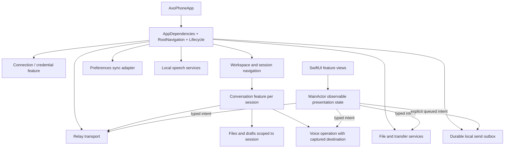

# RFD0006 - Axo: iOS application architecture and experience

- Feature Name: `axo-ios-app-architecture`
- Status: Proposal
- Start Date: 2026-10-09
- Updated: 2026-10-09
- Document Type: Proposal

## Summary

Build Axo iOS as a small, feature-oriented SwiftUI app with explicit state, service, navigation, and persistence ownership. `AxoPhoneApp` is the composition root; feature-scoped observable models own UI state on `MainActor`; focused async services own networking, storage, file transfer, and speech work; SwiftUI views render state and send typed user intents. Use native `NavigationSplitView` adaptation for the workspace/session panel, built-in controls for settings, and concise system-aware navigation/symbol animations for a polished feel. Keep chat bounded and smooth with paginated recent/older/latest transcript windows, stable row identities, `ScrollView` + `LazyVStack`, and anchor-preserving navigation; lazy view creation is not pagination or memory management. Preserve drafts offline, and add an explicit durable **Queue to send when connected** outbox only after relay-side idempotency/reconciliation is designed. Use iCloud key-value sync for opt-in, non-sensitive preferences initially; do not sync credentials, full transcripts, files, or execution queues by default. Measure the whole app on physical devices before increasing limits or adopting lower-level UI technology.

This proposal covers the whole iPhone app—architecture, feature organization, navigation, animation, controls/settings, theme, auth, files/attachments, voice, offline behavior, iCloud recovery, lifecycle, testing, accessibility, and performance—with long chats as a central workload, not the only one.

## Motivation

Axo iOS is more than a transcript renderer. It connects to a Mac/Pi session, authenticates with Cloudflare Access, sends prompts, stages and shares images/files, records and transcribes voice locally, presents tool output, and exposes settings. Workspaces and sessions will add navigation and per-session state. Users also expect the app to feel native: a natural panel gesture, satisfying icon feedback and transitions, good settings controls, a theme switcher, and draft recovery when connectivity drops.

The current phone prototype already has important safety/performance choices: Keychain-backed Access credentials, explicit file publication consent, staged local attachment drafts, no offline prompt queue, bounded history and file caches, branch-aware request fencing, direct Back to bottom, and local voice transcription. But the app root directly constructs one `ConversationView`, which coordinates connection, voice, composer, modal, picker, history, and lifecycle state. `ConversationClient` and `SessionFilesClient` are `@MainActor` observable owners that also perform synchronous decoding/accounting or file operations in parts of their workflows. Static inspection identifies seams to profile and modularize; it does **not** prove user-visible jank.

There is no single Apple-mandated MVVM/Clean architecture for a SwiftUI app. Apple's guidance supplies state-flow, navigation, concurrency, HIG, and performance tools. This RFD synthesizes those into a proportionate design for Axo, and distinguishes current contracts from proposed product changes.

This proposal complements rather than replaces:

- [RFD0002: shared session files](RFD0002-shared-session-files.md), which owns transcript paging, attachment/file behavior, and currently rejects offline prompts.
- [RFD0003: workspaces, sessions, splits, and search](RFD0003-workspaces-sessions-and-search.md), which owns workspace/session identity, host authority, and future phone navigation/routing.
- [RFD0005: native workbench feature set](RFD0005-axo-native-workbench-feature-set.md), which adds future features including destination-scoped voice. Keep its contracts coordinated with this RFD.

**Important:** the durable offline prompt outbox proposed here changes RFD0002/RFD0003's current no-offline-command-queue invariant. It is a proposal requiring a coordinated protocol/design decision, not authorization to silently change that behavior.

## Goals

- Give every important state value one clear owner and lifetime.
- Keep views focused on rendering and user intent rather than transport, disk I/O, hashing, auth persistence, or multi-step workflows.
- Make workspace/session navigation feel native and easy to discover, including system back/edge gestures.
- Use motion and reusable UI components consistently, accessibly, and with restraint.
- Preserve composer drafts while offline; offer explicit deferred delivery with durable, visible, destination-bound semantics.
- Define what belongs in app preferences, local persistence, Keychain, file caches, temporary storage, and iCloud.
- Keep the transcript bounded, responsive, and under Pi's authority.
- Prevent asynchronous completion from a voice/file/history/upload task from targeting whichever session happens to be selected later.
- Provide deterministic tests without user credentials, private real transcripts, microphone use, or paid model calls.
- Preserve existing privacy and provide explicit approval gates for any new cloud storage/content sync.

## Non-goals

- Replacing Pi as transcript/execution authority or backing up full conversation history to Axo's relay/CloudKit.
- Syncing Access tokens, project paths, live runtimes, terminal output, or all shared-file bytes through iCloud.
- Silently queueing every failed prompt, replaying uncertain work, or promising background execution without supported implementation.
- Implementing workspace/session navigation or relay protocol changes inside this architecture RFD.
- Rewriting the phone app in UIKit or adopting a third-party architecture framework.
- Creating a custom whole-screen swipe recognizer or custom animation engine before validating native SwiftUI behavior.
- Creating a package per feature, a universal generic design-system framework, or a local transcript database without a product requirement.
- Claiming the current app is slow or setting arbitrary release performance thresholds without device measurements.

## Guide-level explanation

### Mental model

| Owner | Owns | Does not own |
| --- | --- | --- |
| App composition root | Production dependencies, shared preferences, lifecycle policy, and root navigation construction | Every feature's transient state or every network operation's result |
| Navigation/catalog feature | Selected workspace/session, routes, and stable destination identity | Pi transcript contents or process ownership |
| Conversation feature | One session's bounded transcript window, scroll intent, question, and prompt UI state | Durable transcript history, file bytes, or global selection |
| Shared-files feature | Scoped local drafts, inventory pages, upload/download state, and preview requests | Pi history or implicit permission to publish |
| Offline outbox | Explicitly deferred prompt intent, local staged media references, idempotency IDs, and recoverable status | A second transcript or authority to retarget execution |
| Voice feature | Identified recording/transcription operation, temporary audio, and captured destination | Current global selection at callback time or implicit prompt submission |
| Infrastructure services | Relay, HTTP transfers, Keychain, disk work, CloudKit/KVS, and local speech integration | SwiftUI navigation/presentation decisions |
| SwiftUI views | Rendering, accessibility, local presentation state, and typed user actions | Long-lived service ownership or unscoped asynchronous callbacks |

A user opens Axo and sees a native workspace/session navigation surface. On iPhone, the sidebar adapts to a navigation stack: selecting a session shows its conversation; the system back button/edge gesture returns to the sidebar. A visible toolbar control offers the same navigation for discoverability. Tapping Search gives the SF Symbol concise feedback and transitions into a typed Search route. Axo settings use native forms and controls. The user can choose System, Light, or Dark appearance and opt in to syncing that small preference through iCloud.

A user writes or stages a photo without a network. The draft remains local. While offline, the composer replaces ordinary Send with **Queue to send when connected**. Tapping that clearly labeled action is the explicit intent: Axo persists the prompt, attachment manifest, exact destination, and stable command ID before showing it as queued. The outbox separately reports whether it is waiting for internet, waiting for the Mac host, uploading attachments, dispatching, accepted, or uncertain. It does not claim that internet reachability means the Mac/Pi is ready. A lost acknowledgment is reconciled by command ID; it is never blindly resent.

### App structure

Keep current module boundaries and group iOS files by responsibility rather than creating a package for every screen:

```text
apple/
  AxoCore/                 # shared IDs/domain values, validated protocol, pure state logic
  AxoVoice/                # voice protocols and platform-neutral operation semantics
  AxoPhone/
    App/                   # composition root, dependencies, root navigation/lifecycle
    Features/
      Connection/          # Access login, relay endpoint/status
      Workspaces/          # future catalog/navigation, coordinated with RFD0003
      Conversation/        # bounded history, composer, transcript rows, question flow
      Attachments/         # pick/stage/publish, outbox media, inventory, previews
      Voice/               # iOS capture/transcription UI and adapters
      Search/              # future explicitly scoped search experience
      Settings/            # theme and Axo product preferences
    SharedUI/              # semantic design tokens and repeated accessible components
  AxoPhoneUITests/
```

These folders are a responsibility map, not an instruction to split every directory into a module. `AxoCore` remains free of SwiftUI/UIKit and owns reusable contracts where that benefits the phone, Mac, or tests. `AxoVoice` shares voice protocols/domain behavior; AxoPhone owns iOS UI and adapters. Keep components feature-local until repeated behavior/meaning proves a shared component is useful.

### Dependency and state flow



- `AxoPhoneApp` creates production dependencies and injects them into the app shell/feature factories. Preview/UI-test configurations provide deterministic fakes. Initializers are cheap: they do not open sockets, read whole files, download speech assets, or start the microphone.
- Use `@State` to own an observable model at the stable view/scope that creates it; pass explicit references or bindings to child views. Use environment injection for genuinely app-wide dependencies, not a hidden global service locator. Keep read dependencies narrow so high-frequency transcript changes do not invalidate navigation/settings.
- The root owns a small `RootNavigationModel` and `AppLifecycleCoordinator`, not a global object containing transcript, file, voice, auth, socket, outbox, and every screen's UI state. Each active session has an explicit feature owner.
- Inject focused protocols/factories where substitution is needed for tests. Do not protocolize every value by habit; concrete types remain clearer when there is no alternative implementation or useful test seam.

### Navigation panel, gestures, and feature routes

Use `NavigationSplitView` with a leading sidebar containing the workspace/session hierarchy and a detail column for the selected session. SwiftUI documents that split columns collapse into a navigation stack at narrow sizes such as iPhone. That supplies the expected platform navigation model: a selected conversation is the top screen, and the native back/edge-swipe reveals the prior sidebar/list. Keep a visible navigation/sidebar button in the conversation toolbar as a discoverable alternative. [Apple: NavigationSplitView](https://developer.apple.com/documentation/swiftui/navigationsplitview)

Do not attach a custom right-swipe recognizer across the chat. It can compete with system interactive navigation, text selection, horizontal attachment carousels, and scroll gestures. If testing shows users require a true overlay drawer rather than the native collapsed list, prototype it separately with a narrow edge activation area, explicit button/VoiceOver action, cancellation/escape behavior, and predictable interaction with scroll views. Do not claim the native split view is an overlay drawer; validate the desired feel on real iPhones.

A sidebar suits Axo's hierarchical workspaces and sessions. Do not create one tab per session. A tab bar is a later option only if Axo establishes a few persistent peer areas (for example, Work, Search, Settings) rather than a dynamic workspace tree. Keep route values typed and data-based; navigation state can support restoration/deep links without embedding view objects in the path.

### Motion and visual quality

Use system-supported, interruptible motion to make state change legible, not to delay the action:

- Use `symbolEffect` (such as a short bounce/scale) for focused icon feedback when the state changes.
- Use `matchedTransitionSource` with `NavigationTransition.zoom(sourceID:in:)` for a search destination transition from its invoking control when it looks coherent with the screen.
- Use `matchedGeometryEffect` only when two views genuinely represent the same visual element and must interpolate geometry. It links frames; it does not itself provide fade/rendering transitions. Give insertion/removal an appropriate opacity or other transition and ensure one source for each ID.
- Prefer one clear transition over a chain of delayed scale, blur, and opacity effects. Repeated taps, navigation cancellation, and interactive gestures must remain responsive.
- Read `accessibilityReduceMotion` and substitute reduced movement (for example, a restrained fade) or no decorative effect. Verify VoiceOver focus reaches the new destination and that motion does not make the control's action ambiguous.

For the requested Search interaction, the preferred prototype is: toolbar search icon performs a brief symbol response; selecting Search pushes a typed route with a native zoom from the search icon; the destination's results appear with a restrained opacity transition. The navigation action is immediate and does not await an animation timer. Compare with a simple native push and use whichever feels clearer during repeated real-device testing. [Apple: symbol effects](https://developer.apple.com/documentation/symbols/symboleffect), [zoom navigation](https://developer.apple.com/documentation/swiftui/navigationtransition/zoom(sourceid:in:)), [matched geometry](https://developer.apple.com/documentation/swiftui/view/matchedgeometryeffect(id:in:properties:anchor:issource:)), [Reduce Motion](https://developer.apple.com/documentation/swiftui/environmentvalues/accessibilityreducemotion)

### Shared components, settings, and theme

#### Shared UI system

Build a small semantic visual vocabulary: background/surface/inset/raised surfaces, primary/secondary/destructive/accent roles, typography levels, spacing, and corner radii. Prefer dynamic system/asset colors with light and dark variants. Apply appearance at the app/presentation root; avoid hard-coded colors and per-screen `preferredColorScheme` overrides that make components disagree.

Use platform controls first: `Button`, `Toggle`, `Picker`, `Form`, `NavigationStack`, `NavigationSplitView`, `Label`, standard sheets/confirmation dialogs. Wrap a repeated pattern in a focused component or `ButtonStyle` when it shares behavior/accessibility and not merely a similar screenshot. Keep feature-specific composites (message bubble, tool activity row, attachment card, session row) owned by the feature until a real cross-feature contract emerges. Components must support Dynamic Type, VoiceOver labels/actions, keyboard/contrast where applicable, dark mode, and Reduce Motion.

#### Settings placement and controls

Keep Axo's product preferences in an in-app Settings flow, reachable from stable navigation/header controls. Use `Form` and meaningful `Section` groups; use `Toggle` for independent booleans, labeled `Picker` for a finite mutually-exclusive choice, and a navigation row for a more complex subpage. For many settings, organize by category and add search rather than displaying an undifferentiated wall of toggles. Avoid web-style dropdowns when a native picker/menu/navigation row fits.

The iOS Settings app remains the authority for OS-owned permission/capability switches. Ask for permission in context. If denied and the user requests the feature, explain what is disabled and offer the system-supported Settings deep link; do not mirror OS permission state as an Axo-controlled toggle. A `Settings.bundle` or app-specific Settings page in the OS Settings app is not the default location for Axo workflow preferences.

The theme preference is a typed choice: `system`, `light`, or `dark`, defaulting to `system`. Store it in local preferences and map it to `preferredColorScheme(nil/.light/.dark)` at the app/presentation boundary. Semantic colors continue to adapt to both schemes. If Axo later offers custom palettes beyond system/light/dark, make those tokens explicit and test every shared component in each theme. [Apple: Form](https://developer.apple.com/documentation/swiftui/form), [Picker](https://developer.apple.com/documentation/swiftui/picker), [Settings HIG](https://developer.apple.com/design/human-interface-guidelines/settings/), [open app Settings](https://developer.apple.com/documentation/uikit/uiapplication/opensettingsurlstring), [Color](https://developer.apple.com/documentation/swiftui/color)

### Connection, session lifecycle, and authentication

A connection feature owns endpoint validation, Access login presentation, authentication status, and sign-in/out intent. An `AccessCredentialStore` alone persists/reads the Cloudflare cookie from Keychain (`WhenUnlockedThisDeviceOnly`). `UserDefaults` is for non-secret local preferences only. iCloud identity is not Cloudflare/Axo authentication.

An app-scoped relay transport owns the WebSocket, heartbeat, retry/backoff, frame-size admission, and protocol decoding. In the current single-conversation slice it serves that conversation feature. When RFD0003 session navigation arrives, route events/commands by explicit conversation/session identity; do not open a socket per visible row or broadcast into “currently selected” state.

Model meaningful connection states explicitly, such as disconnected, connecting, online-with-snapshot, host-offline, auth-expired, protocol-incompatible, and retryable failure. HTTP transfers share auth policy but have separate request/transfer IDs. Signed upload URLs are short-lived capabilities; they never become draft metadata, transcript payload, log content, or the Access cookie.

On logout, stop the connection and subscriptions, clear the device credential, and require sign-in before sending. Do not silently discard a queued outbox or attach it to a later identity: pause it under the original account/workbench identity and offer an explicit review/delete/re-auth path. On iCloud account change, stop CloudKit sync for the prior account, clear/repartition sync-engine state as documented, and never transfer content to the new account implicitly.

Safe read/upload operations can retry according to their idempotency contract. A prompt's uncertain dispatch is not automatically retried unless a server-side receipt/status lookup proves it was not accepted. Errors are typed at boundaries and translated at the feature edge; raw tokens, response bodies, signed URLs, and provider diagnostics are not indiscriminately surfaced or logged.

### Chat and transcript architecture

Pi remains the canonical transcript and active-branch authority. The iPhone owns a bounded, disposable presentation window:

- Request one bounded recent snapshot on open/reconnect. Keep RFD0002's 20-block recent target, 200-message/256-KiB decoded-history ceiling, demand-loaded pages, view fencing, visible Back to bottom, and separate tool-output paging as current starting contracts.
- Render rich variable-height rows in `ScrollView` + `LazyVStack`. `LazyVStack` creates views on demand; it does not paginate remote records, avoid decoding data, or bound retained model memory. Keep count and byte budgets independently of the view container.
- Keep stable Pi row identity across page merges/live updates; never key rows by array index or regenerate IDs per snapshot.
- Track following-latest, reading-history, and fetch availability separately. Older-page loading is user demand, not a consequence of `hasEarlierMessages`; page arrival cannot recursively fetch the whole transcript. Prepend older rows while preserving the semantic visible message/anchor. New output cannot yank a history reader to bottom.
- Back to bottom jumps to cached latest or requests one bounded recent snapshot, never traversing intervening pages. Failure preserves the old visible range.
- Keep attachment bytes/previews and full tool output outside the transcript budget. Load them on open/expand/visibility demand with independent cache limits.
- Decode/validate bounded relay frames and do byte accounting off the main actor where needed. Publish a page or affected-row update in a small main-actor transition. Avoid full-history projection, repeated O(n) scans per row, and reparsing every historical Markdown block for one streaming update.

The code currently applies WebSocket decoding/state merge and history accounting in a main-actor `ConversationClient`; this should be profiled before moving. A bounded 200-message array can be entirely adequate. Optimize only the trace-identified hot path. Apple recommends keeping app-owned main-thread work below roughly 5 ms for fluid frame updates and profiling hitches on real devices; this is a diagnostic target, not a guarantee that total frame rendering always fits in 5 ms. [Apple: performant scroll stacks](https://developer.apple.com/documentation/swiftui/creating-performant-scrollable-stacks), [responsiveness](https://developer.apple.com/documentation/xcode/improving-app-responsiveness)

### Attachments and shared files

Give the shared-files feature a UI-facing session-scoped draft/inventory owner and focused I/O services:

- Draft state owns destination, source file identity, consent, progress/error, and inventory cursors.
- Transfer service owns authenticated HTTP, upload authorization validation, request idempotency, recovery, and progress events.
- File service owns security-scoped access, source copying, hashing, checksum validation, atomic installation, and bounded cache eviction.
- Preview features own lazy text/image/PDF presentation and bounded pixel/byte decoding.

A late photo picker/upload/open callback remains bound to its original session/file/request identity; it cannot publish into the newly selected session. Selecting a file is not publication consent. Upload readiness is not prompt submission. The current RFD0002 privacy and retention contract remains authoritative.

Do not perform large synchronous copies, hashing, image decode, or content checks on `MainActor`. A `Task {}` created in actor-isolated UI code may inherit that actor; use a correctly isolated asynchronous service/actor boundary, not a cosmetic task wrapper. Publish only compact progress changes. Verify with Instruments: current static inspection found file copy/hash/checksum/persistence operations in a main-actor file client, but did not measure a hitch.

### Offline drafts and deferred-send outbox

#### Decision proposed

Support offline composing and local media staging. When offline, replace ordinary Send with a clearly labeled **Queue to send when connected** action. Activating it is explicit consent to deferred delivery; persist the exact prompt, session/conversation target, generated command ID, attachment manifest, and local attachment bytes before reporting “Queued.” Do not silently turn an already-failed or outcome-uncertain online send into a new queued execution.

This is a new remote-execution capability, unlike a local unsent draft. It requires an amendment/coordinated protocol design for RFD0002/RFD0003 before implementation.

#### Local state and lifecycle

Use a small single-writer SQLite outbox for durable prompt state and file references, with attachment bytes staged as private files under Application Support. SQLite is for this operation journal, not a second transcript database. Store stable command ID, relay/workbench/account scope, Axo session and Pi conversation destination, creation/order, prompt text, attachment IDs/hashes/local paths, and state. Apply state changes transactionally. Enforce count/byte quotas and expiration/review policy; let users inspect, edit or discard commands that have not been dispatched. Do not store Access cookies or signed upload URLs in the outbox.

Before acknowledging “Queued,” durably write both the prompt intent and all staged attachment references/bytes. If the app exits, relaunch on the same installation restores the local queue and draft attachments. This does not promise delivery while the app is suspended. On launch/foreground, resume eligible work after authentication and destination validation. A device restore/reinstall must never silently re-arm a restored remote command: bind queue state to a device-local installation identity and, if that identity is missing or changed, hold restored entries for review/reconfirmation before dispatch. Decide whether local source files are excluded from device backup or restored only as paused drafts; they are not CloudKit-synced by this proposal. A future background URLSession implementation is a separate feature requiring expiring-capability renewal, background callbacks, privacy, cellular policy, and crash recovery.

#### Delivery state machine

```text
localDraft
  -- explicit Queue to send --> queued
  --> waitingForInternet
  --> waitingForHost (internet/auth okay, Mac unavailable)
  --> uploadingAttachments (only with publication consent)
  --> readyToDispatch
  --> dispatching(commandID)
  --> acceptedByPi

Any active state may become pausedNeedsAuthentication, failedNeedsAction, cancelled, or uncertain.
```

- Network path status is only a retry/UI hint. A successful authenticated relay exchange is required, and host presence/snapshot is separately required before delivery.
- Queueing captures its exact conversation/session. If that destination is deleted, remapped, or has a stale view/generation, pause for user action instead of retargeting.
- Reuse stable, idempotent upload reservations for staged images/files. Upload is permitted only under the user's explicit consent; photo staging can remain local while offline.
- Send each command with one stable command ID. The relay/Mac/Pi path needs durable deduplication plus a receipt/status query that can distinguish “not accepted” from “accepted but acknowledgement lost.”
- If the connection disappears before dispatch, wait and resume safely. If dispatch outcome is unknown, enter `uncertain` and reconcile by ID; if the existing public interfaces cannot prove status, stop for explicit user review. Never blindly replay an uncertain prompt.
- “Accepted by Pi” means the defined host/Pi submission acknowledgment, not that model execution completed successfully. Preserve this distinction in UI.
- Auth expiry pauses delivery. Logout pauses queued work; it never sends under another identity. Offer explicit recovery/delete after reauthentication.

Internet reconnection and Mac host reconnection are different conditions and display states. A queue must not claim “sending” merely because `NWPathMonitor` reports a path. The system is eventually consistent and may require foreground return. [Apple: NWPathMonitor](https://developer.apple.com/documentation/network/nwpathmonitor), [URLSession](https://developer.apple.com/documentation/foundation/urlsession), [RFD0002](RFD0002-shared-session-files.md), [RFD0003](RFD0003-workspaces-sessions-and-search.md)

### Local persistence, SwiftData, and iCloud

These are distinct responsibilities:

| Technology | Role | Axo proposal |
| --- | --- | --- |
| `UserDefaults` / `@AppStorage` | Simple local device preferences | Keep local defaults and immediate use; never secrets |
| Keychain | Credentials | Cloudflare Access token stays device-only (`WhenUnlockedThisDeviceOnly`); never sync it via app cloud data |
| Protected Application Support | Local durable user drafts/outbox/staged attachment files | Retain only under explicit local quota/lifecycle policy; eligible for recovery after ordinary app relaunch, not app reinstall by itself |
| Caches directory / memory image cache | Re-fetchable remote file bytes and thumbnails | Bounded, checksum-verified, evictable; not authoritative |
| SwiftData | Local model persistence, optionally integrated with CloudKit | Not required for current transcript or small settings; consider for substantial local model graphs only if its schema/sync semantics fit |
| `NSUbiquitousKeyValueStore` | Small values synced among a person's devices through iCloud | Proposed opt-in initial sync for non-sensitive preferences only |
| CloudKit private DB / `CKSyncEngine` | Structured user-owned data synchronized across devices | Future option for explicitly approved, larger structured recovery data; not prompt dispatch or app-local persistence substitute |

#### Initial iCloud scope

Propose syncing only small, non-sensitive preferences (theme, selected display preferences, perhaps notification choices) with `NSUbiquitousKeyValueStore`, behind an iCloud-sync preference/account availability check. Keep app usable when iCloud is signed out or unavailable; local values remain available. Apple documents KVS as asynchronous and limited to 1024 keys, 1 MB total values, and 1 MB per value, so it is suitable for settings, not a document store. Define stable keys and reconcile external-change/account notifications without overwriting unrelated local state.

Keep out of iCloud by default:

- Cloudflare Access cookie, service credentials, signed upload URLs, relay origin secrets.
- Full Pi transcript, prompts, tool outputs, images, files, or voice recordings.
- Pending command outbox and live session/process state.
- Mac-owned workspace catalog records, project paths, or filesystem metadata.

Cloudflare Access identity and Apple iCloud account are independent. CloudKit availability does not authenticate a relay session. Axo's current cloud/file contract is not end-to-end encrypted; syncing user content to Apple would be a new data holder/retention disclosure and needs explicit product/privacy approval. A restored queued prompt must never auto-execute merely because it reappeared from iCloud.

#### When to use CloudKit/SwiftData

Use CloudKit private records if Axo later has substantial structured user-owned data to restore across devices and reinstallation, beyond KVS limits. A local store remains necessary; CloudKit is a sync service, not the app's offline database. `CKSyncEngine` can manage scheduled fetching/sending, but the app must persist its opaque engine state, provide pending record changes, handle account changes/conflicts, and configure CloudKit/remote notification entitlements. Sync timing is conditional and can be indeterminate. Do not use it to deliver prompts.

SwiftData's CloudKit integration can sync compatible local models, but it has CloudKit schema constraints (including optional relationship requirements), asynchronous change propagation, account/entitlement setup, and additive production schema evolution. Use SwiftData with CloudKit only if its model constraints and eventual consistency fit the feature. Do not have SwiftData auto-sync and a separate `CKSyncEngine` both own the same records. Core Data is not required merely because the app is native; choose it only for a concrete capability/migration requirement. [Apple: CloudKit](https://developer.apple.com/documentation/cloudkit), [CKSyncEngine](https://developer.apple.com/documentation/cloudkit/cksyncengine-5sie5), [NSUbiquitousKeyValueStore](https://developer.apple.com/documentation/foundation/nsubiquitouskeyvaluestore), [SwiftData sync](https://developer.apple.com/documentation/swiftdata/syncing-model-data-across-a-persons-devices)

### Voice and app lifecycle

Keep microphone capture and transcription behind existing `VoiceRecording` and `LocalSpeechTranscribing` boundaries. The phone voice feature owns an identified operation and explicit states: permission, preparing, recording, transcribing, draft-ready, cancelled, failed. Delete temporary audio after success/cancellation/interruption. Keep the present one-operation-at-a-time phone interaction unless UX/resource testing justifies concurrency. For future session navigation, capture a typed destination (conversation/session ID and operation ID) at recording start; completion never queries the new global selection.

A single lifecycle owner observes scene phase and asks services to apply explicit foreground/background policies. Preserve current foreground-only behavior—disconnect relay and cancel voice—unless a feature is deliberately designed for background execution. Ordinary `Task` values are not a background guarantee. If background uploads become a requirement, use supported background `URLSession` and implement durable progress/reconciliation; use BackgroundTasks only for eligible scheduled work, not to keep a live chat connected. [Apple: ScenePhase](https://developer.apple.com/documentation/swiftui/scenephase), [BackgroundTasks](https://developer.apple.com/documentation/backgroundtasks)

## Types and validation boundaries

Keep external JSON as untrusted wire DTOs; validate at the protocol boundary and map to domain values. Keep serialized string formats where compatibility requires them, but use named internal IDs when it prevents mixing workspace, Axo session, Pi conversation, message, file, request, outbox command, CloudKit record, and voice-operation identities.

Use explicit enums for related states rather than unrelated booleans, for example:

- `AppRoute`: workspace list / conversation(sessionID) / search / file detail(fileID) / settings.
- `RelayState`: disconnected / connecting / online / hostOffline / authExpired / incompatible / retryableFailure.
- `PromptDelivery`: draft / queued / dispatching / acceptedByPi / uncertain / failedNeedsAction.
- `AttachmentTransfer`: localDraft / consentRequired / waiting / uploading / ready / failed / deleting.
- `VoiceOperationState`: permission / preparing / recording / transcribing / resultDraft / cancelled / failed.
- `ThemePreference`: system / light / dark.

Names are examples, not frozen API. Keep state transitions small/testable and map technical errors to user-facing messages at the feature edge.

## Performance, accessibility, and observability

Apple's responsiveness guidance says main-thread work affects both input latency and frame delivery; it suggests roughly less than 5 ms of app-owned main-thread work for fluid frame updates and notes that interaction delays around 100 ms become noticeable. Total frame budget depends on display refresh/system work. Use SwiftUI/Animation Hitches instruments and Time Profiler on real devices, including the oldest supported iPhone. A simulator, debug build, successful compile, or `LazyVStack` alone is not proof of smoothness. [Apple: Improving app responsiveness](https://developer.apple.com/documentation/xcode/improving-app-responsiveness)

Build synthetic end-to-end fixtures for:

- Large transcript with short/long Markdown, public thinking, tool rows, streamed updates, delayed images, backward paging, session switching, and composer typing.
- Sidebar opening/back gestures while the transcript is scrolled, horizontal image carousels, sheet/navigation transitions, and Reduce Motion.
- Offline internet vs online internet/Mac-offline vs auth-expired vs online host; restart with queued local drafts and staged images; duplicate/lost acknowledgements and upload responses.
- Theme changes across System/Light/Dark, dynamic type, VoiceOver, settings validation, OS permission denial and Settings handoff.
- CloudKit/KVS unavailable, iCloud sign-out/account change, stale preference updates, sync after reinstall, and production-like schema evolution using synthetic data.
- File hash/copy/thumbnail work concurrent with animation/scroll; voice preparation/cancel/background interruption.

Track first useful render, main-thread work, hitch/frame distribution, memory and decoded page/window size, file/thumbnail cache cost, outbox age/state/count/bytes, queue reconciliation outcomes, and CloudKit sync errors/lag. Diagnostics contain operation kind, duration, counts/bytes, and result category—not prompts, filenames, paths, Access cookies, signed URLs, transcript snippets, or media contents. Establish numerical release thresholds from baselines rather than inventing them now.

## Testing strategy

Treat implementation as an existing-project change: preserve Axo's current models/navigation and deployment target, inspect actual schemes/targets, and use a CLI-first `xcodebuild` loop. After each slice, run the narrowest build/test that proves the touched contract, then expand to broader builds and UI checks as needed. Use XcodeBuildMCP when available for simulator launch, interaction, logs, and screenshots; record the exact scheme, simulator, and checks, and distinguish code review from runtime/profile evidence. Apply focused SwiftUI skills for specialized pattern, refactor, performance, or debugging work rather than making them a prerequisite for every change.

- **Pure/domain tests:** route mapping, preference merge, state transitions, typed target capture, protocol validation, page cursor/view fencing, outbox transition/idempotency rules, limits, deletion/retention policy, voice cancellation.
- **Infrastructure tests:** injected URLSession, fake relay/host and temporary directories; test lost acknowledgements, duplicate uploads, auth expiry, invalid checksums, local disk errors, crash/relaunch recovery, CloudKit account changes and stale KVS notifications.
- **UI tests:** native sidebar/back interaction, toolbar fallback, animations under Reduce Motion, settings controls/theme, accessibility, draft/offline queue states, attachment consent, voice, keyboard and scene transitions.
- **Integration tests:** deterministic local Pi/relay fixtures; no live account, real private session, production CloudKit records, microphone, or paid provider.
- **Performance tests:** optimized physical devices; transcript scroll/typing/live update, sidebar/navigation/motion, image handling, file transfer progress, cold start and memory. Archive traces and compare same-device/build workloads.

Test both success and cancellation/selection-change/background-interruption paths. Retain the current AxoCore and iOS UI suites. CloudKit development/production schema migration deserves a release gate before enabling user data sync.

## Invariants

- Pi remains the transcript authority; phone transcript state is bounded and disposable.
- Each mutable feature state has one owner and a declared lifetime; views are not network/process owners.
- Every async operation captures destination/request/generation; stale work cannot cross sessions or identities.
- The native sidebar/system back gesture remains available; no global custom swipe blocks text selection, horizontal media rows, or platform navigation.
- Motion is short, interruptible, meaningful, and respects Reduce Motion.
- Settings controls are native and accessible; app preferences are distinct from OS-managed permissions.
- Cloudflare Access secrets stay device-only; iCloud identity is not relay authentication.
- iCloud sync is opt-in and scoped; no transcript/media/command outbox is synced without a separately approved privacy/encryption design.
- Local offline drafts are not equivalent to queued remote execution. Queueing is explicit, durable, destination-bound, bounded, visible, and idempotent.
- Internet reachability is not host availability; a dispatch acknowledgment is not model completion.
- A possibly accepted command is never blindly replayed. Lost outcomes require durable receipt reconciliation or explicit user action.
- Outbox state restored under a different installation or account is paused for explicit review; it cannot auto-execute merely because a backup was restored.
- Transcript, file, image, local outbox, CloudKit, and temporary audio have separate persistence/quotas/cleanup semantics.
- Main-actor work remains presentation-sized; file/network/decode/hash/image tasks do not block interaction.
- Background behavior is explicit and supported; no foreground task is represented as guaranteed background work.

## Rollout and acceptance criteria

This is a proposal, not authorization to rewrite every current type or change the no-queue contract immediately.

1. **Experience prototype:** build an isolated phone navigation prototype with `NavigationSplitView`, compact list/detail flow, toolbar entry, system edge-back, VoiceOver, and Reduced Motion. Compare it with an overlay drawer only if necessary. Prototype search icon feedback and native zoom/opacity options.
2. **Composition and component seam:** introduce `AppDependencies` and deterministic launch configurations; establish theme tokens and in-app settings using native controls. Preserve existing user preferences and Keychain behavior.
3. **Profile the app:** create synthetic chat/file/voice fixtures and capture main-thread/hitch/memory baselines before moving code or increasing limits. Offload measurable sync work using explicit concurrency boundaries.
4. **Offline outbox protocol decision:** amend/coordinate RFD0002 and RFD0003 to define explicit queue intent, server command IDs, durable idempotency/receipt lookup, destination validation, attachment recovery, auth/logout behavior, quotas, retention, and failure UX. Do not implement remote auto-send until that contract passes failure-injection tests.
5. **Local outbox implementation:** after acceptance, implement transactional queue journal and staged media, UI states/actions, foreground reconciliation, and safe retry/uncertain handling.
6. **iCloud preference sync:** enable iCloud capability only after choosing the preference keys and account-change semantics. Test no-account local mode, quota handling, propagation, and reinstall recovery. Keep user content out of CloudKit until separate privacy approval.
7. **Feature integration:** phase workspace/session navigation per RFD0003; ensure separate session state/drafts and a global cache budget. Add user content sync only with its own RFD/privacy decision.
8. **Release validation:** run unit/UI/integration/performance suites on supported device matrix, verify voiceover/theme/reduce motion, outbox recovery, account/logout cleanup, and CloudKit schema review.

Acceptance scenarios:

- Open a workspace/session sidebar; select a conversation; swipe from the leading edge using native navigation to return to the list; repeat with attachments, keyboard, VoiceOver and reduced motion. A toolbar action also reaches the list. No custom recognizer steals scroll or back behavior.
- Tap Search repeatedly; icon feedback and route transition remain responsive/interruption-safe; search content appears with the agreed fade/zoom. With Reduce Motion enabled, the app uses restrained motion while preserving clear focus and destination.
- Open Settings: theme has System/Light/Dark; settings use accessible native Form/Section/Toggle/Picker controls; permissions are explained and OS-owned changes link to system Settings. Theme looks correct in all screens and sheets.
- Reuse a component across at least two features and verify semantic colors, large text, VoiceOver, contrast, and both appearances. Feature-specific components remain local where semantics differ.
- Enter offline mode; draft text and chosen images survive ordinary process termination/relaunch within defined local limits. Ordinary Send is truthful; explicit Queue action creates a durable visible record. Restore connectivity with host offline, then host online: transition states are accurate and sends reach only the captured destination.
- Lose the dispatch acknowledgment after Pi receives a command; the queue reconciles by stable command ID and does not duplicate. If status cannot be proven, it pauses as uncertain and asks the user. Restart/crash during each upload/dispatch transition; never lose an acknowledged queue entry or claim a remote send before the receipt. Restore a device backup under a changed installation identity and verify every queued item pauses for explicit review.
- Expire auth or logout while queued: no prompt is sent under a different user; content is retained or deleted only under the explicit recovery choice. Session deletion/rebinding pauses delivery.
- Reinstall on the same iCloud account: opt-in theme/display preferences recover; no Access credentials, transcript, image, or outbox unexpectedly appears from CloudKit. With iCloud disabled/no account, local settings and app usage still work.
- A synthetic long conversation receives only bounded pages; older-page demand preserves the anchor, live output does not move a reader, and Back to bottom does not fetch every gap. Large file/hash/thumbnail work causes no unacceptable UI hitch on the oldest supported phone.
- CloudKit preference writes are delayed/out of order/account-changed and quota failures are handled; an iCloud sync event never triggers a prompt or session operation.
- Run all existing AxoCore/iOS tests plus offline/CloudKit/sync UI fixtures and physical-device Instruments traces. No performance claim is accepted solely on architectural pattern usage.

## Drawbacks

- Native split navigation may feel like pushing back to a list rather than the exact overlay drawer design imagined; a prototype/user test is required before choosing custom behavior.
- Motion polish can increase complexity and accessibility risk if too many transitions compete; the proposal intentionally prioritizes native, restrained effects.
- Feature ownership, dependency injection, SQLite outbox state and actor boundaries create more explicit types and cancellation paths than the prototype.
- A durable offline outbox turns local text into future remote execution. It increases privacy/retention risk and requires robust relay/Pi idempotency, receipt reconciliation, ordering and UX before release.
- KVS/CloudKit sync is eventually consistent and dependent on iCloud/account/system conditions. It cannot provide immediate recovery or guarantee queue dispatch.
- Excluding prompts/media/outbox from iCloud means those drafts may not recover after uninstall/device loss; syncing them requires an explicit data protection/product decision.
- Keeping no full phone transcript database means older evicted history requires refetch and may be unavailable offline.
- Fine-grained component/model state alone does not guarantee smoothness; continuous performance validation across devices remains necessary.

## Rationale and alternatives

### Proposed native SwiftUI ownership and experience model

It uses Apple's native navigation, controls, animation, accessibility, data-flow, and concurrency capabilities while giving each Axo feature a clear owner. It keeps sensitive and authoritative data in its intended system and makes the user's offline-send intent explicit. It avoids both a monolithic view and a speculative architecture framework.

### Custom overlay drawer and global swipe

An overlay can reveal the panel without navigating away, but a global swipe conflicts with system navigation and horizontal/vertical chat gestures. Use only if usability testing shows compact `NavigationSplitView` does not meet the product need; keep gesture activation edge-scoped and provide non-gesture access.

### Always-visible tabs for every workspace/session

This can make a few peer destinations quick to reach but does not scale to Axo's hierarchy and would confuse a dynamic catalog with fixed app sections. Use the sidebar/list for work hierarchy; consider a small tab bar only for true top-level app areas.

### Fully custom animation choreography

Manually sequencing icon scale, overlay expansion, blur, and screen fade can match a mockup precisely, but is fragile under interruption, accessibility motion preferences, and navigation changes. Prefer SwiftUI's symbol and navigation transitions, then add limited matched geometry only for a demonstrated visual relationship.

### Settings only in iOS Settings

This hides Axo product choices away from the active workflow and makes permissions/preferences appear interchangeable. Keep Axo controls in app; send the user to system Settings only for OS-owned permissions or capabilities. A Settings.bundle may be reconsidered for rare, simple preferences, not as the primary product settings UI.

### No offline queue

This is today's safe contract and remains simpler; offline drafts can still be preserved. It does not satisfy the requested eventual delivery behavior. The proposed explicit outbox is accepted only after durable command identity and duplicate-safe reconciliation are specified.

### CloudKit for all user content

It might restore drafts and histories across reinstalls, but extends the trust/retention surface, conflicts with Mac/Pi authority, depends on iCloud sync timing, and may duplicate Cloudflare storage. Start with small preferences only. Sensitive content sync needs a separate consent/encryption/ownership design.

### SwiftData auto-sync for everything

This is convenient when a CloudKit-compatible local model is the desired source, but sync is eventual and its schema constraints do not make it a reliable command-delivery engine. Do not apply it to Axo's Pi transcript, Mac-owned workspace catalog, or execution queue without a separate ownership migration.

### Eager transcript in a LazyVStack

The views may be lazy while every message is still transferred, decoded, retained, and diffed. Rejected for unbounded conversations.

### `UICollectionView` now

Explicit reuse/layout may be useful if the bounded SwiftUI design fails measured goals, but adds custom hosting, diffing, accessibility, animation, and anchor complexity. Keep it as a benchmarked fallback.

### Do nothing / keep all workflows in `ConversationView`

The prototype already contains useful bounded-history, consent, and auth behaviors. Doing nothing avoids refactoring but leaves no app-wide owner for settings/navigation/offline behavior as features grow. Implement incrementally without changing user-visible contracts until each phase is validated.

## Prior art and research

- Apple SwiftUI docs describe `NavigationSplitView` collapsing into a stack on iPhone; the HIG positions sidebars as leading-edge navigation among app areas. This supports a native session panel and system back gesture rather than a custom global swipe.
- Apple provides symbol effects, matched geometry, and zoom navigation transitions, with distinct roles. Reduce Motion is a system preference that the app can read. Use the native tools as short feedback/transition behavior, not as a timed delay around navigation.
- Apple's `Form`, `Picker`, theme, and state APIs supply native settings patterns; the recommendation to keep Axo preferences in-app and OS permissions in Settings is Axo's explicit product policy.
- Apple distinguishes SwiftData local model persistence, CloudKit record synchronization, `CKSyncEngine`, and the small ubiquitous key-value store. KVS's 1-MB total/1024-key limits fit small preferences. CloudKit sync is conditional/eventual and needs app-managed state; neither is an offline Pi command transport.
- Apple's responsiveness guide describes main-thread frame/hang tradeoffs and recommends Instruments/real-device testing. No Axo performance trace was run during this research.
- Axo baseline: `apple/AxoPhone/`, `apple/AxoCore/Sources/AxoCore/`, `apple/AxoVoice/Sources/AxoVoice/`, and RFD0002/RFD0003/RFD0005. The private research record maps Apple references and records the scope extension: [`personal/axo/ios-app-architecture`](https://github.com/leostera/ai-research/tree/main/personal/axo/ios-app-architecture).
- OpenAI's [Build for iOS use case](https://learn.chatgpt.com/use-cases/native-ios-apps#leverage-skills) and its [Build iOS Apps plugin](https://github.com/openai/plugins/tree/main/plugins/build-ios-apps) provide useful agent-workflow guidance: treat Axo as an existing project, reuse its models/navigation, prefer CLI-first `xcodebuild`, validate each slice narrowly, and use XcodeBuildMCP when deeper simulator/screenshot interaction is useful. Apply specialized SwiftUI pattern/refactor/performance/debugging skills selectively; these skills inform implementation workflow, not Axo's architecture or protocol decisions. The plugin's Liquid Glass guidance is for iOS 26+ and does not change this app's current iOS 18 deployment-target baseline.

## Unresolved questions

### Before acceptance

- Does the compact `NavigationSplitView` interaction match the intended drawer feel, or is a true overlay essential after testing?
- What outbox expiration, per-session ordering, and user review/discard controls should ship for deferred prompts and media?
- What is the oldest supported iPhone, and what numeric UI hitch/memory targets gate release?
- Are prompts/images allowed to be recoverable from iCloud, or should only non-sensitive preferences sync? The current proposal excludes user content.
- Which Application Support files should be excluded from device backup, and how will a restored queue be identified and held for review instead of auto-dispatched?
- Are background uploads required, or is foreground retry/reconciliation sufficient?

### During implementation

- Which few service protocols provide useful deterministic test seams without overabstracting the app?
- Which current synchronous main-actor paths are actual hot spots on a supported device?
- What exact CloudKit sync preference keys and concurrent-update reconciliation policy should ship?
- Should any structured user-owned records exceed KVS and justify a CKSyncEngine/SwiftData evaluation?
- What reduced-motion transition and sidebar accessibility behavior pass device/VoiceOver testing?
- What Cloudflare relay/Pi status endpoint and durable idempotency receipt can safely reconcile accepted-but-unacknowledged commands?

### Out of scope

- Cloud transcript archive, multi-user collaboration, E2EE protocol, or a full offline transcript database.
- Syncing Mac execution state, project filesystem paths, or workspace authority into iCloud.
- Mac app/window architecture, relay internals, R2 provisioning, or changing Pi's extension ownership.
