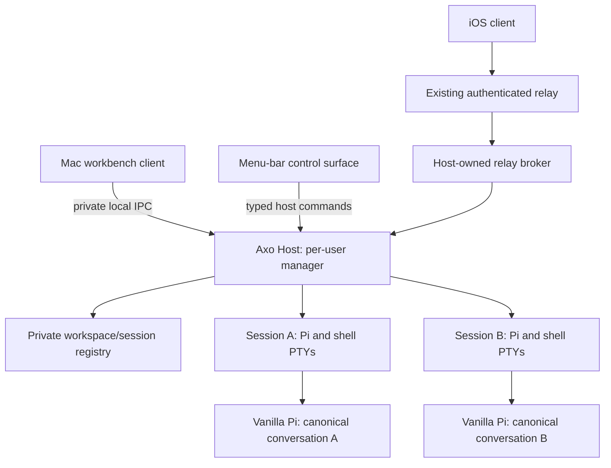

# RFD0007 - Axo: Mac session manager and independent clients

- Feature Name: `axo-mac-session-manager`
- Status: Proposal
- Start Date: 2026-10-09
- Updated: 2026-10-09
- Document Type: Proposal

## Summary

Ship two logical roles on the Mac: a per-user background session manager, implemented by **`axod`** (the **Axo Host** role), and the native workbench client. The host owns local workspace/session mutations, Pi and shell processes, terminal lifetimes, runtime admission, and the relay connection; the workbench owns terminal rendering and window-local presentation. Closing or quitting the workbench detaches its views without stopping work. Pi remains vanilla and authoritative for execution and history. Design the host for multiple explicitly addressed sessions from the beginning, but implement it in gated slices: establish the host boundary, prove one real terminal can detach/reconnect independently of the workbench, then move the existing multi-session model behind that boundary and validate concurrent sessions and phone use. This is a proposal, not an implemented availability guarantee or authorization to restart live processes, register a login item, or deploy cloud execution.

## Motivation

The user identifies two categories: session managers and clients. The Mac distribution ships both; the phone is a client. Those roles must have independent lifetimes, even when distributed in one app bundle.

Today, retaining hidden terminal surfaces preserves processes across navigation and window hiding, but the workbench process still owns those resources. A relay-facing child broker alone cannot make Pi survive the workbench's termination. Phone creation must also stop depending on a workbench controller being alive to handle workspace mutations.

Concrete requirements are to quit/reopen the workbench without losing an in-progress Pi turn, use the phone while no Mac window is open, and run several independent conversations and ordinary shells without an ambient selected-session execution target. This needs a host ownership change, not a new sidebar.

### Relationship to existing RFDs

- [RFD0001](RFD0001-axo-continuous-agent-workspaces.md) supplies the longer-term persistent-host direction. This proposal narrows it to one Mac and the existing interactive Pi TUI.
- [RFD0002](RFD0002-shared-session-files.md) retains Pi history authority, immutable files, and bounded phone history. This proposal changes no R2 ownership, upload consent, deletion fence, or retention policy.
- [RFD0003](RFD0003-workspaces-sessions-and-search.md) supplies the workspace/session/pane identities, addressed broker/relay, phone state scoping, and incomplete non-search foundation. Its current scope explicitly excludes post-quit background continuity. This RFD proposes extending that lifetime boundary, not replacing its multi-session product model or declaring it complete.
- [RFD0004](RFD0004-axo-macos-application-architecture.md) separates windows from shared session resources but keeps those resources app-owned. This proposal retains its window/command/native-UI principles while splitting process ownership from frontend surface ownership.
- [RFD0006](RFD0006-axo-ios-app-architecture.md) remains the phone architecture proposal. Its offline outbox is not accepted or enabled here.

Acceptance of this RFD requires coordinated amendments to RFD0003/RFD0004's lifetime, startup, pane-resource, and quit contracts. Until then, their current behavior remains the baseline. Search, FFF, and the palette remain deferred until the coordinated non-search foundation is validated.

### Current code checkpoint

Inspection on 2026-10-09 finds durable IDs/layouts in `apple/AxoCore/Sources/AxoCore/WorkspaceStore.swift`, retained terminal views and launch policy in `apple/AxoMac/WorkspaceController.swift`, and command launch through Ghostty surface configuration in `apple/AxoMac/TerminalView.swift`.

Concurrent, uncommitted work introduces `apple/AxoMac/BridgeHostProcess.swift`, `bridge/host-broker.ts`, and addressed phone/catalog routing. In that inspected slice the native controller still starts the broker and handles forwarded workspace mutations. These are useful integration seams, not validated background-host delivery. Uncommitted code may change; this RFD must not be read as an implementation snapshot of those files.

### Active implementation and separate application lane

The user has authorized implementation and hardening in the Rust [`axod`](../../axod/README.md) crate rather than further POCs. Its first slice supplies direct PTY ownership, explicitly addressed generation-fenced socket commands, attachment leases, bounded byte backlog/output, durable launch receipts, and fail-closed recovery. It does **not** yet supply terminal-state reconstruction, Ghostty attachment, Pi admission, the production workspace registry, or relay ownership. Synthetic daemon tests are not evidence of real Pi/TUI or app acceptance.

A separate agent continues the **current** Mac app's relay/iOS compatibility work with its existing app-owned process model. These lanes remain independent. Only after `axod` is completed and hardened will a coordinated Mac refactor hand ownership to it. There is no current daemon dependency, launch-policy change, registry migration, packaging addition, or authorization to disturb live sessions. The existing lifetime/startup policy remains the baseline; the other policy proposals in this RFD remain proposals.

## Goals

- Make process/session ownership independent of the workbench executable and its windows.
- Support multiple sessions in the host model from the first interface and tests.
- Retain the native Ghostty frontend, real interactive Pi TUI, and public installable Axo extension.
- Allow addressed phone use and creation with no workbench window or process running.
- Provide menu-bar host status and explicit controls, with optional per-user login startup.
- Preserve existing identities, Pi files, layout, cwd validation, drafts, and immutable file contracts.
- Make frontend disconnect, child exit, host crash, and explicit stop distinguishable and testable.

## Non-goals

- Cloud execution, Pi Durable, Sandboxes, Artifacts, global catalog authority, or cross-host migration.
- Root/system boot execution, multi-user access, or availability while the Mac sleeps, shuts down, or its user logs out.
- Replacing Pi's CLI/TUI with a custom harness, patching Pi, or deriving structured identities from terminal text.
- Additional managed agents per session, arbitrary remote shell access, or a raw terminal on the phone.
- Restoring live processes across host/OS termination or guaranteeing exact terminal scrollback recovery.
- Automatic prompt replay, offline command queues, search, or broad UI/framework rewrites.

## Guide-level explanation

### Mental model

A **host** manages work; a **client** presents and addresses it. One Mac host can have zero or more attached clients and zero or more running sessions. A session can exist durably without a live runtime. A running session does not require a visible terminal renderer.

The menu-bar surface is an operational client of the same host command boundary. It may be packaged with the background application; that does not grant it a second registry or execution owner. Exact executable/helper layout is an implementation decision.

### Example: leave work running

1. Start a session explicitly. The host records/validates its destination, starts vanilla Pi, and admits the actual extension binding.
2. The workbench attaches its terminal renderer. The session becomes ready only after admission, not because a renderer or PTY exists.
3. Submit a normal user request. Pi runs it and owns its transcript.
4. Quit the workbench. Its attachment ends; the host continues draining terminal output and retains Pi and sibling shells.
5. Use the phone through the host-owned broker, or reopen the workbench and attach to the same runtime. Neither operation replays the request or starts another writer.

### User-visible lifecycle

| Action | Proposed result |
| --- | --- |
| Open/restore workbench | Connect and show records; do not launch saved panes incidentally |
| Explicitly open/start a stopped session | Start through the host; a frontend may combine this with a deliberate user activation action |
| Select an already-running session | Attach/change viewport without replacing its processes |
| Close window or quit workbench | Detach presentation; leave work running |
| Create from phone while host is online | Commit identity through the host; start only as specified by the creation intent |
| Stop session/pane | Confirm as required, revalidate exact target, stop only its owned processes |
| Stop Axo Host | Separate explicit action; confirm if live work will stop |
| Host unavailable | Show unavailable/stale observations; do not invent execution, queue work, or retarget |

The menu-bar surface offers Open Workbench, host/relay status, running-session summary, startup preference, and a clearly distinct Stop Axo Host action. Workbench quit is not service stop. Stopping the host intentionally must not trigger a supervisor restart loop.

**Proposed startup policy:** load records but do not automatically launch the last selected session or all saved panes. Restore view selection independently. This would change RFD0003's selected-at-startup launch policy and requires explicit acceptance; it is not an assertion that that change has already been approved or implemented. Starting the host at login is optional and requires user consent.

## Reference-level explanation

### Ownership and boundaries

| Owner | Owns | Does not own |
| --- | --- | --- |
| Local host | Registry writes, session/pane processes and PTYs, admission, launch/stop, broker supervision | Window selection, GPU surfaces, Pi's agent loop |
| Pi | Model/tools, queues, active conversation/branch, authoritative JSONL | Axo workspace catalog or frontend lifetime |
| Workbench | Ghostty renderer/attachment, input/IME, window-local selection/focus, presentation | Managed Pi/shell launch authority or registry writes |
| Relay broker | Explicit local registrations, authenticated multiplexing and routing | Another independent workspace store or agent harness |
| Menu-bar surface | Status and typed operational intent | Separate lifecycle/storage rules |

Reuse the registry format, `WorkspaceStore` invariants, and existing broker contracts rather than creating competing catalogs. Rust cannot directly import the Swift package: either port registry operations against shared compatibility fixtures or use a narrow host-owned native adapter. Choose that seam before moving persistence; there is still only one mutating authority. One host is the local single writer. Separate window presentation persistence from shared work records; legacy global selection fields may seed a viewport but never choose a late command destination.

Propose a Rust host for PTY/process/IPC ownership, with Swift/AppKit/SwiftUI retaining the native client and menu-bar integration. The host may initially supervise the existing Node broker internally instead of rewriting the protocol bridge simultaneously. Language and process count do not change the logical authority. Moving a broker subprocess out of the workbench is insufficient unless registry mutation and actual Pi/shell ownership move too.

### Host interface

Define a small versioned, destination-aware interface before migrating owners. Representative logical operations, not frozen APIs:

- Read bounded catalog/status; subscribe from a revision and reconcile gaps.
- Create/rename/duplicate/archive workspace or session with stable command identity and expected revision where applicable.
- Start/stop a session or pane using an explicit approved launch/directory intent.
- Attach/detach a terminal using session, pane, runtime generation, and attachment identity.
- Send terminal input or resize only under a current interactive attachment lease.
- Route structured Pi requests through the admitted public extension binding.

All state-bearing replies identify host generation, target, correlation, and revision/generation as applicable. A create retry with the same ID and arguments returns its durable result; conflicting reuse fails. Metadata commit precedes launch, with no transaction held across launch, confirmation, or network I/O. Failure leaves the same retryable record, not a duplicate.

A private Unix socket fits the existing broker direction; authenticated native IPC is another option. Use a capability/version handshake, restrictive filesystem permissions, same-user checks, bounded framing, and explicit client roles. Do not expose an unauthenticated localhost execution server. Local IPC compatibility is distinct from the phone wire protocol; do not gratuitously redesign that protocol during extraction.

### Terminal ownership and attachment spike

Detach/reconnect is an established terminal-server pattern, not an existential feasibility question. Axo will implement it inside its own session manager, **not delegate ownership to tmux, screen, or Zellij**. The spike selects and validates Axo's integration boundaries and terminal fidelity.

The current Ghostty surface starts its command. One candidate is a small transport-only attach program launched by the frontend surface, connecting to a host-owned PTY. That program is not a replacement Pi CLI or another agent loop. Direct adoption of an existing PTY through the pinned Ghostty embedding has not been established; implementing the attachment bridge is expected engineering work, not a reason to abandon independent ownership.

Separate the **host child** from any **frontend attachment child**. Freeing a surface or losing the attach program cannot terminate the managed Pi/shell. Conversely, an attach program being alive is not evidence that Pi is ready or even running.

The gate must demonstrate:

- Headless Pi startup/admission and phone use with no renderer, including terminal feature-query behavior.
- Real TUI input, Unicode/IME, resize, signals, clipboard/paste boundaries, and Kitty/image behavior.
- Detach/reconnect during a running turn and during ordinary shell/editor use, without creating another Pi/shell.
- Continuous PTY draining with no attached renderer; slow/disconnected consumers cannot block a child indefinitely.
- Truthful reconstruction of visible terminal state. A bounded raw byte ring or text extraction alone is not a complete VT-state snapshot or scrollback recovery strategy.

Start with one interactive attachment per pane; a second receives an explicit already-attached result or a confirmed transfer. The lease owner controls input and terminal size. Same-pane simultaneous mirrors remain unpromised. Structured phone requests remain separately addressed Pi operations, not a phone keyboard attachment.

Use the spike to resolve renderer attachment and terminal-state reconstruction before production cutover. Do not simulate continuity by opening the JSONL in a second Pi or by retaining a hidden workbench. A basic process/byte-stream proof need not establish all image, IME, VT-state, and recovery behavior in one increment.

### Status, questions, and notifications

Keep host reachability, runtime lifecycle, Pi activity, and frontend attachment distinct. Suggested lifecycle values include stopped, starting, admitted, exited, failed, and recovery-required. Pi activity is separately idle, working, or attention. Detachment is not stopped.

Preserve gray for stopped/unavailable, a bounded initial spinner for readiness, green only for an admitted ready Pi, and hammer/alert from actual public lifecycle observations. Missing/expired facts cannot assert green or spin forever. Fold broker admission and observations into one coherent host projection rather than introducing another competing status authority.

Axo-owned questions remain pending when no client can answer; the host never fabricates approval. Arbitrary other extensions' UI waits remain a public-API coverage gap. Notification episodes and destination checks remain explicit and private. Clients report viewing presence with expiring attachment identities so a crashed frontend cannot suppress notifications indefinitely. A stale notification click neither restarts work nor retargets a replacement runtime.

### Failure and recovery

| Event | Contract |
| --- | --- |
| Client disconnect/crash | Release its attachment/input lease; keep host-owned children and registry intact |
| Pi/shell exit | Preserve record/history; report actual exit; explicit user intent governs restart |
| Broker/relay reconnect | Revalidate bindings and subscriptions; never replay an uncertain prompt |
| Host crash/restart | Change host generation; inspect actual child fate before admitting/restarting anything |
| Orphaned/uncertain writer | Show recovery-required and block a replacement writer until safely resolved |
| Missing directory | Explicit repair/Retry; never choose a fallback or repeatedly launch from rendering |
| Sleep/wake | Report reachability honestly and revalidate connections; no always-on guarantee |
| Intentional host stop | Defined child shutdown and supervisor behavior; no accidental reactivation |

A PID, terminal title, or timestamp alone is not proof of conversation ownership. A supervisor restarting the host does not prove its old children survived or died. Until verified orphan recovery exists, fail closed rather than launch a duplicate. Supervision may restore the service; it must not automatically resume prompts or old shell commands. Unmanaged external Pi writers remain outside broker exclusion guarantees.

### Resource bounds, security, and observability

Carry forward RFD0003's proposed admission ceilings of 32 managed Pi runtimes and 128 live panes, not measured capacity claims. Renderer/attachment counts need separate limits now that panes can be headless. For the spike, propose at most 256 KiB disposable transport/backlog per pane and 16 MiB aggregate; enforce whichever limit is reached first. These are not promises of complete terminal restoration and exclude separately measured renderer/VT-state memory. Reject excess admission explicitly; never evict running work to hide capacity failure.

Retain existing registry, history, control-frame, cache, and file bounds. Slow consumers have bounded queues and explicit disconnection/resynchronization. Terminal bytes remain local; do not add them to phone WebSocket frames or diagnostic logs. Directory access uses host-approved intents, not arbitrary phone paths or shell strings. Shared checkouts are not isolated merely because sessions are independent.

The manager is per-user, never root. Same-user capabilities defend routing but do not sandbox malicious local agent code. Public Pi/extension configuration and credentials retain their existing privacy boundaries. Use metadata-only diagnostics for lifecycle, admission, stale-target rejection, attachment lag, capacity, and recovery; never log prompts, paths, terminal bytes, environment secrets, signed URLs, or clipboard contents.

### Compatibility, packaging, and migration

Preserve workspace/session/pane IDs, legacy encodings, private registry permissions, Pi JSONL paths, and conversation-owned files. No transcript rewrite or implicit attachment copy accompanies the extraction. Keep the workbench's existing native layout/input code wherever possible; this is not a SwiftUI scene rewrite prerequisite.

Ship helper/service components inside the signed Mac deliverable and validate per-user startup registration against the deployment target. Do not silently register login startup while packaging. The current development bundle is checkout-bound and uses a local Node installation; this RFD does not pretend those dependencies have become standalone distribution assets.

Migrate only through a controlled handoff: stop new legacy admission, obtain explicit consent to end old owned runtimes, verify release of ownership, then let the host reopen the same histories without replay. Do not transfer a live Ghostty surface/process between executables by assumption. An in-progress turn must not be terminated merely to install the proposal.

Rollback stops new service admission and requires the same ownership handoff before enabling the legacy process owner. Version mismatches fail with an actionable upgrade/recovery message; clients cannot bypass the host by launching Pi themselves. Data and history remain recoverable even if the new attachment transport is disabled.

## Implementation sequencing and validation

### Recommendation: one coordinated foundation, gated slices

Do **not** finish a single-session background manager and then add identity/routing. Do **not** finish every new multi-session feature tied to frontend ownership and then perform a second wholesale migration. Establish a multi-session host contract now, prove the hardest one-session lifetime boundary, and integrate the existing foundation behind it.

| Slice | Work and gate |
| --- | --- |
| 1. Boundary and characterization | Define typed host operations and ownership assertions; use an in-process adapter temporarily. Test at least two explicit session destinations and stale-command rejection immediately. |
| 2. Independent terminal proof | One real vanilla Pi and ordinary shell under a host prototype; quit/relaunch the test frontend, reconnect, preserve ongoing work, and prove headless startup. No production handoff until this passes. |
| 3. Multi-session ownership extraction | Move registry mutations, session/pane launch/stop, and broker supervision behind the host; validate two projects, at least three sessions, sibling shells, and bounded resources. |
| 4. No-window phone integration | Reuse addressed relay/catalog and scoped phone state; create and use a session while the workbench executable is absent. Verify concurrent subscriptions and generation fencing. |
| 5. Operations and delivery | Package helper, menu-bar controls, opt-in startup, explicit shutdown, crash/orphan recovery, compatible upgrade/rollback, and user-operated acceptance. |

Existing RFD0003 identity, catalog, protocol, and phone-scoping work can proceed alongside slices 1–2 because those contracts survive the host extraction. Route new Mac mutations through the boundary rather than adding more UI-owned launch rules. The terminal-attachment proof is a dependency for shipping independent lifetimes, not a reason to stop all multi-session work. Maintain one active owner per registry/process set throughout; transitional adapters are not concurrent owners.

Acceptance combines RFD0003's non-search scenarios with:

- Start a real Pi turn, quit the workbench, operate from the phone, reopen, and prove the same admitted runtime continued with no extra user message or writer.
- Create/use a session from the phone with no workbench process and no dependency on another Pi's idle state.
- Run two projects/three sessions with shells producing output; switch and detach clients without stopping siblings or misrouting callbacks.
- Reject old host/runtime/attachment generations for input, answers, stop, notifications, and resize; confirmations retain captured targets.
- Test full client disconnect, slow output consumer, hidden-pane output, input-owner transfer, and headless terminal feature negotiation.
- Crash the broker and host separately, including an uncertain/orphaned Pi case; never duplicate a writer or replay a prompt.
- Distinguish workbench quit from service stop, and test startup preference denial/disable, logout, sleep/wake, upgrade, and rollback.
- Retain Core/Ghostty/TypeScript/native and phone tests. Repackage and verify `dist/Axo.app` for delivered Mac/bridge changes. Packaging is not permission for live restart or physical phone installation; synthetic results do not establish live/device acceptance.

The user separately authorized an isolated POC, not a production cutover. Writing this RFD does not authorize startup registration, deployment, or live process handoff.

### Isolated POC checkpoint

[`poc/mac-session-manager`](../../poc/mac-session-manager/README.md) contains an independent Rust host that directly allocates native macOS PTYs, plus a disposable Python terminal client. It does not invoke tmux or another multiplexer. The host continues draining output without a client, has one interactive attachment per terminal, validates input/resize ownership, and bounds byte backlog and outbound queues.

Initial validation: two Rust protocol tests, eight isolated real-process integration tests, formatting, and Clippy with warnings denied. Tests cover frontend process termination/reconnect to the same child PID, concurrent addressed terminals, Unicode input, kernel terminal resize, Ctrl-C isolation, bounded headless output, slow-client disconnection, invalid creation, and refusal to replace an existing host socket. PIDs establish fixture process continuity, not Pi conversation identity.

This checkpoint does **not** establish Ghostty integration, Pi lifecycle admission, exact VT-state replay, durable registry migration, comprehensive descendant/orphan recovery, notifications, signed helper delivery, or phone/live acceptance. The POC is not part of `dist/Axo.app` and does not alter the shipped application.

## Drawbacks

- IPC, PTYs, input leases, terminal-state reconstruction, helper packaging, and orphan handling are substantially more complex than retaining views.
- Current Ghostty launch/input integration may need a transport adapter; feature negotiation, images, accessibility, and reconnect can regress even if basic text works.
- A background service can retain expensive sessions after the workbench closes; explicit visibility, stop controls, and resource measurements are essential.
- Concurrent multi-session and ownership work increases coordination cost. A narrow host contract and feasibility gate reduce, but do not eliminate, rework.
- Manager independence does not provide process checkpointing, cloud availability, checkout isolation, or exclusion of unmanaged writers.

## Rationale and alternatives

### Manager-aware multi-session foundation, with a terminal proof first

Recommended because identity/routing and process lifetime are separate dimensions. Model all destinations correctly from day one, while testing the risky terminal transport with a small real workload before moving all owners.

### Complete RFD0003 entirely first, then add the service

This is a valid lower-risk product sequence if renderer integration takes longer or product scope must remain narrow. It delivers useful multi-session navigation sooner, but leaves workbench quit as a stop boundary and may duplicate controller/lifecycle migration effort. Do not describe that release as service-backed continuity.

### Build a single-session manager first

It simplifies the initial demonstration but encourages selected/default-runtime shortcuts and creates another later protocol redesign. A one-session **test workload** is appropriate; a single-session **architecture** is not.

### Move everything at once

A full simultaneous frontend/service/relay/phone rewrite obscures whether failures come from attachment, routing, state scoping, or recovery, and complicates rollback. Prefer independently testable slices over a big-bang cutover.

### Keep a hidden workbench or detach only the broker

Keeping the app alive can preserve current processes and is the simplest temporary behavior. It does not establish independent client lifetime. A detached broker still depends on the UI if it forwards creation there or the UI owns Pi's PTY.

### Delegate ownership to an existing terminal multiplexer

Tmux, screen, and Zellij demonstrate the established owner/client pattern. The user explicitly chose to build ownership into Axo's session manager, not make one of those programs its runtime backend. Study their lifecycle, terminal-state, and backpressure designs; do not introduce a multiplexer dependency or infer Pi identity from terminal labels.

### Do nothing

Continue with app-owned sessions and clearly document quit behavior. This avoids service complexity but cannot satisfy phone operation independent of the workbench executable.

## Prior art

- RFD0001 supplies the host/client direction; RFD0003 supplies stable multi-session identity and routing; RFD0004 supplies view-independent ownership inside one process. Combine their useful boundaries without conflating in-process retention with service independence.
- `WorkspaceStore` already keeps private work metadata separate from Pi history; moving its owner need not invent another transcript store.
- The current Ghostty adapter shows why process launch and renderer lifetime must be separated. Existing split primitives/MIT provenance remain unchanged; no new split geometry engine is proposed.
- [Zellij](https://github.com/zellij-org/zellij/tree/333d7898a840314e41d3cc9d2a264a1b9732bb7b) is Rust, with explicit detach versus kill instructions and bounded slow-client buffering. Study the [server lifecycle](https://github.com/zellij-org/zellij/blob/333d7898a840314e41d3cc9d2a264a1b9732bb7b/zellij-server/src/lib.rs) and [client-output boundary](https://github.com/zellij-org/zellij/blob/333d7898a840314e41d3cc9d2a264a1b9732bb7b/zellij-server/src/os_input_output.rs). Its workspace declares MIT; no source was copied into the POC.
- [cmux](https://github.com/manaflow-ai/cmux/tree/1308c8e3466a9e97325c0a16b1a14261926c8282) has a Swift/AppKit frontend and Rust `cmux-tui`/PTY components. Its [PTY abstraction](https://github.com/manaflow-ai/cmux/blob/1308c8e3466a9e97325c0a16b1a14261926c8282/cmux-tui/crates/cmux-pty/src/lib.rs) and [terminal snapshot/replay protocol](https://github.com/manaflow-ai/cmux/blob/1308c8e3466a9e97325c0a16b1a14261926c8282/cmux-tui/crates/cmux-remote-protocol/src/rpc.rs) are relevant. Its local persistence profile uses tmux; that backend is not selected for Axo. Licensing is component-specific: the root declares GPL-3.0-or-later with BUSL server exceptions, while the Rust workspace manifest declares MIT. Resolve applicable file-level grants before any reuse; this inspection copied no implementation.
- Per-user macOS background-service facilities, including Apple's [SMAppService](https://developer.apple.com/documentation/servicemanagement/smappservice), are candidates for supported opt-in startup. Exact registration, bundle layout, and shutdown behavior require platform validation before selection.

## Unresolved questions

### Before acceptance

- Accept workbench quit leaving sessions running, with separately labeled service shutdown?
- Accept the proposed cold-start policy of restoring records/selection without automatic selected-session launch?
- Confirm Rust for the host implementation and the compatibility strategy for Swift-owned registry operations. The isolated POC is already Rust; the production storage/language seam remains a proposal.
- What minimum manager-crash/orphan recovery must pass before background continuity ships? No unsupported recovery guarantee is acceptable.
- Confirm the coordinated sequencing and amendments to RFD0003/RFD0004 rather than treating both old and new process owners as valid simultaneously.

### During implementation

- Native helper versus broker responsibilities, supported IPC framing, executable layout, signing, and opt-in startup mechanism.
- Ghostty attachment/terminal-state reconstruction, input-lease transfer, resize policy, and measured global buffer/renderer limits.
- Exact host generation/revision handshake and compatible broker restart behavior.
- Manager-owned notification delivery and frontend viewing-presence leases, without widening private notification text.
- Controlled legacy cutover and rollback UX, including ongoing-turn deferral and honest missing-directory failures.

### Out of scope

- Cloud managers/executors, Mac/cloud migration, replicated authoritative catalogs, Pi Durable compatibility, Artifacts workspaces, and cloud spending/retention policy.
- Search/palette/FFF, offline outboxes, multi-user collaboration, process snapshots, and additional managed agents per session.

## Future possibilities

A stable local host interface can later support a distinct cloud host while the Mac and phone remain clients. That requires separate execution authority, credential/privacy, filesystem synchronization, cost, and migration decisions. Nothing here automatically moves a disconnected Mac session to the cloud or back again.
