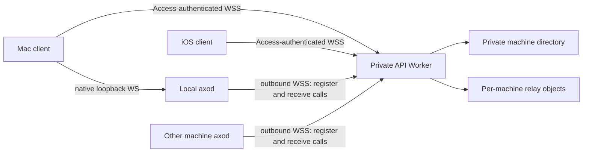

# RFD0008 - Axo: private multi-machine control plane

- Feature Name: `axo-private-control-plane`
- Status: Proposal
- Start Date: 2026-10-09
- Updated: 2026-10-10
- Document Type: Proposal

## Summary

Build the next iteration of the private relay at `bridge.axo.leostera.dev`: a Cloudflare Access-protected TypeScript control plane in `sites/api.axo.leostera.dev/` that discovers multiple authenticated `axod` machines and routes explicitly addressed commands to them. Use a shared JSON-RPC 2.0 daemon contract in `protocol/`, with native loopback WebSockets for local Mac access (credential-free at the current implementation checkpoint) and Access-protected outbound WSS connections from daemons to the service. Machines become discoverable through authenticated registration, without product accounts, account ownership tables, pairing, or explicit enrollment approval. `axod` owns local work and Pi remains authoritative for agent execution/history. The selected Mac direction is an Axod-only app in newly built bundles; it starts with fresh Axod state and does not import legacy workspace records or adopt existing processes. Unsupported Mac features may be absent until Axod capabilities replace them. The already-running app and sessions remain untouched. The new app will register the main Axo app as a user-level login item on first launch; this does not register an `axod` service. This is not authorization to deploy, change DNS/Access policies, migrate existing storage, or restart live work.

## Motivation

The existing relay connects a private phone client experience to one Mac workbench. The inspected source can already support multiple phone sockets, but admits only one host broker and stores one replicated catalog. Moving execution into `axod` makes several independently running machines available, and the Mac should be a client of either its local daemon or another daemon through the relay.

That needs machine discovery and explicit routing, not a public account system. The user narrowed the immediate scope: keep Cloudflare Access, let an authorized daemon register itself, and make its machine available to authorized clients. The earlier account/enrollment discussion is deferred, not an implementation requirement for this release.

A shared contract should let local and remote commands have the same meaning. It must not make the cloud an executor, turn a successful transport write into confirmed Pi execution, or let a disconnected remote command run on the local machine instead.

### Relationship to existing RFDs

- [RFD0001](RFD0001-axo-continuous-agent-workspaces.md) supplies the host/client direction. Its product accounts, GitHub login, encrypted offline inbox and broader future-host ambitions are not selected here. This private release has no offline execution queue and makes no E2EE claim.
- [RFD0002](RFD0002-shared-session-files.md) retains immutable files, explicit publication consent, direct signed transfers, deletion fences and bounded history. A new hostname/machine namespace cannot silently reset or duplicate that storage.
- [RFD0003](RFD0003-workspaces-sessions-and-search.md) supplies independent session identities and addressed routing. Multi-machine catalog keys extend that namespace; the existing non-search foundation and compatibility work remain necessary.
- [RFD0006](RFD0006-axo-ios-app-architecture.md) remains the native phone direction. Login/paging may discover machines, but accounts, offline outboxes and raw terminal access are not added.
- [RFD0007](RFD0007-mac-session-manager.md) supplies daemon/workbench separation. This RFD proposes replacing the eventual ad hoc local control envelope with shared JSON-RPC/WebSocket adapters; it does not accelerate Mac ownership handoff or accept RFD0007's daemon-service startup policy proposals. The separate main-app login-item behavior is recorded in the Axod-only Mac selection below.

### Current checkpoint, not production evidence

Source inspected on 2026-10-09 at checkout `1bcb3d1` with concurrent uncommitted changes:

- [`service/src/access.ts`](../../service/src/access.ts) validates Access JWTs and separates one configured human identity from a configured host service-client identity. Its principal currently carries role/expiry, not machine identity.
- [`service/src/index.ts`](../../service/src/index.ts) routes WebSockets and files to `Relay.getByName("single-workbench")`, admitting one host and up to four phones. It already uses WebSocket hibernation, expiry handling and bounded pending command IDs.
- `service/src/catalog.ts` is concurrent, untracked work implementing a singleton replicated catalog; [`shared/protocol.ts`](../../shared/protocol.ts) uses custom type-tagged messages, not JSON-RPC.
- [`axod`](../../axod/README.md) has standalone PTY ownership, generation/attachment fences and durable launch receipts, but currently uses a private Unix socket/custom envelope. Its [invariant map](../../axod/INVARIANTS.md) identifies unresolved descendant/operational limits. It is not the current Mac app's process owner or relay connection.

The proposed `sites/api.axo.leostera.dev/` and `protocol/` directories do not exist at this checkpoint. Uncommitted source may change and does not establish the deployed relay's exact behavior. One host plus several phones is the accurate source baseline, even though this iteration follows the original one-client/one-server prototype.

### First implementation slice (2026-10-09)

The directories now exist and the isolated vertical slice is implemented:

- [`protocol/`](../../protocol/README.md) is the proper private `@axo/protocol` JavaScript package: compiled ESM/declarations, typed method maps, JSON Schema, domain validators and shared Rust/TypeScript fixtures. The user selected `json-rpc-2.0` rather than another hand-maintained TypeScript RPC framework.
- [`sites/api.axo.leostera.dev/`](../../sites/api.axo.leostera.dev/README.md) implements Access-validated discovery, a bounded directory and per-machine hibernating relays. Local service methods dispatch through the library server; SQLite correlation/leases survive hibernation rather than being replaced by the library's ephemeral client map.
- `axod` optionally opens an authenticated outbound WebSocket from a private configuration file. The dummy client traverses the actual local Worker network endpoint to two real daemon/PTY owners, including retries, cold restart and cloud-loss behavior.

This slice implements runtime metadata and operator-approved launch profiles, **not** session/Pi/native/file parity. Private Unix IPC remains local; authenticated loopback WebSocket, real vanilla Pi admission/control, richer catalogs/subscriptions and operational hardening remain gates. No new-hostname DNS/Access provisioning, deployment, production smoke test or current application cutover has occurred. The source/deployment distinctions above remain historical evidence, not rewritten claims.

### Approved Cloudflare canary (2026-10-09)

The user subsequently approved new-hostname Access provisioning, deployment and an isolated deployed connectivity test. `axo-api` is deployed at `api.axo.leostera.dev` with separate reusable human/service policies and a dedicated 24-hour test daemon credential. The exported SQLite classes are now `AxoHostDirectory` and `AxoHostRelay`; Vite bundles focused modules through a thin entry point. Invocation logs, metadata-only application events and 100% canary trace sampling are configured.

A real human application JWT passed the deployed Worker and returned HTTP 200 discovery. That diagnostic used explicit DNS resolution because the local OS cached a negative record; it is **not** full normal-path acceptance. Ordinary system-DNS daemon/client connectivity is still pending propagation/cache expiry. No custom DNS resolver or address override was added to the product. The current native app, legacy relay and file authority remain untouched. See the [API README](../../sites/api.axo.leostera.dev/README.md) for current scope and credential expiry.

### 2026-10-10 — local WebSocket and shared-route parity

The user requested the Mac-to-daemon JSON-RPC WebSocket, removal of the old Unix transport, and explicitly no local credentials/application-auth machinery. `axod serve` now publishes a private, atomic boot-fenced `local-endpoint.json`; numeric loopback/exact Host/path/no-Origin guards restrict browser access, but are not OS-user authentication. UUIDs remain routing identities, never credentials. Access is only the existing cloud edge gate, not an application account/user-management system.

Local and relayed runtime methods invoke the identical dispatcher, approved profiles, manager and journal. Local-only profiles need no cloud credentials; conflicting local/cloud policies fail before startup. The fleet test exercises local launch and remote observation/reconciliation, plus local RPC after test cloud shutdown. A current release daemon also passed local launch -> live `api.axo.leostera.dev` -> remote receipt/runtime identity with one real PTY and progress after both clients quit. The Unix listener/envelope/cache are deleted; process regressions now exercise JSON-RPC or the transport-independent manager, without pretending terminal input is exposed by the new profile.

This checkpoint unblocks native RPC/bootstrap work for the implemented methods. Pi session start/history/prompts/subscriptions and native terminal data/rendering remain separate follow-up capabilities. The live native/legacy/file owners remain unchanged.

### 2026-10-10 — normal-path deployed route validated

Ordinary system DNS became available. The isolated release daemon registered through real Access service-token WSS and the authenticated client listed it through the deployed Worker. One approved fixture launch reached a real PTY; confirmed-receipt reconciliation preserved one process, client disconnect left local progress running, and client reconnect recovered the same runtime. Human credentials were rejected on the daemon route. A cold daemon restart preserved machine identity, changed the source generation, rejected stale-source reads, preserved historical runtime references and launched no work automatically.

Live testing exposed a missing Rustls crypto-provider selection, the initial provider's lack of P-521 certificate support, and a Darwin networking descriptor inherited by the child. The daemon now selects the standard AWS-LC provider and closes the inherited nonstandard descriptor table before exec; focused regression tests cover provider/algorithm configuration and an intentionally inheritable descriptor. Final live admission uses native trust and normal DNS, without resolver/address/CA-file overrides or disabled verification.

Cloud-outage/local-progress evidence remains the isolated real-Worker/two-daemon shutdown test, not a deployed Worker outage. This checkpoint completes the approved supervised fixture connectivity test, not Pi/session, native/physical-phone or unattended operational readiness. The existing app, relay and file authority remain unchanged.

### 2026-10-10 — Axod-only Mac bundle direction

The user selected an Axod-only Mac app for newly built bundles and accepted temporary loss of features not yet supported by Axod. The new bundle uses the separate private `~/Library/Application Support/Axo/Axod` state directory, launches only the bundled daemon, and does not use the legacy Mac workspace/bridge execution path. It must not import the legacy registry or Pi histories, adopt historical PIDs, or claim generic runtime metadata is Pi readiness. This changes new-bundle behavior only: it does not migrate or stop existing sessions and does not authorize restarting the currently running app. Cloud file authority and iOS remain separate.

## Boundary with application capability parity

The implemented transport checkpoint is a foundation, not application protocol parity: local/cloud JSON-RPC, machine discovery and the narrow runtime profile are available. [RFD0009 — protocol capability parity and native adoption](RFD0009-protocol-capability-parity.md) now owns the capability matrix, legacy-behavior inventory, Pi/session contracts and per-capability native replacement gates. This RFD retains machine routing/lease/failure/privacy policy and its unfinished operational requirements; it is not marked wholly implemented merely because the transport slice passed. Neither document authorizes a live owner or file-authority cutover.

## Goals

- Discover multiple authenticated machines in one private deployment without an account/enrollment product.
- Invoke the same typed daemon control operations locally or through the service.
- Give Mac and iOS clients bounded machine/session discovery and explicit destination routing.
- Keep local execution usable through cloud outages; keep daemon connectivity independent of workbench windows.
- Preserve command identity, generation fences, truthful outcomes and one local execution authority.
- Test the new service and standalone daemon independently before native application cutover.

## Non-goals

- Public multi-tenancy, accounts, billing, OAuth-provider replacement, team permissions or device-key enrollment.
- Anonymous daemon registration or trusting a machine UUID as authentication.
- Cloud execution, automatic failover, cross-machine session migration, backup or filesystem synchronization.
- Offline prompt/command queues, automatic replay, another agent harness or private Pi APIs.
- A raw phone terminal, full remote Ghostty terminal streaming, audio transport, search or a new file-upload design.
- Immediate relocation/deletion of `service/`, current-client rewrites, live host handoff, DNS changes or deployment.

## Guide-level explanation

### Mental model and repository boundaries

```text
axod/                         Rust execution owner and daemon RPC dispatcher
sites/api.axo.leostera.dev/    TypeScript/Cloudflare private discovery and relay
protocol/                     Shared RPC specification, schemas and fixtures
apple/                        Native Mac and iOS clients
service/                      Existing relay retained during coexistence
```

These are ownership boundaries, not a requirement to share runtime code across languages. The shared contract belongs to neither Rust nor TypeScript alone.



The arrows into the API are connection initiation. Once connected, messages travel in both directions. No inbound public Mac port, router port-forwarding, Tunnel or separate cloud executor is required.

### Automatic authenticated registration

1. An operator configures a trusted daemon with the relay URL and Cloudflare Access host credentials using existing private configuration practices.
2. `axod` loads or generates its stable `machineId`; each daemon start gets a fresh `hostGeneration`.
3. It opens an authenticated outbound WSS connection, negotiates the application protocol and registers its machine identity, approved display label and supported capabilities.
4. The service validates the daemon role, registration and duplicate-connection rules, then records the machine and establishes a connection lease.
5. Authorized Mac/iOS clients can discover the machine immediately. Reachable means a current lease, not an admitted Pi runtime.

There is **no** account creation, pairing code, user approval queue, public-key enrollment ceremony or product enrollment endpoint. Credential configuration is still necessary: removing enrollment does not remove authentication. Recommended operator practice is a distinct Access service token per host; shared credentials are a weaker private convenience, not hardware identity.

Opening or closing the Mac app is not required to register an already-configured cloud daemon. The Axod-only Mac app registers itself as the main app login item through `SMAppService` on first launch; at login, macOS opens Axo and Axo starts its bundled local daemon. This is user-level app startup, not an `axod` LaunchAgent/LaunchDaemon or pre-login boot service. macOS may require approval in System Settings. Cloud daemon credentials remain a separate operational concern.

### Example: choose work on another machine

The Mac client lists registered machines and their presence. It selects a session on Machine B, captures that machine/session/runtime destination, and calls the service using the same daemon method it would use against local Machine A. The relay authenticates and forwards to B; B checks its own identity and admitted binding before executing.

If B is offline, the call is rejected without an offline queue. If B disconnects after forwarding, the result may be uncertain. The client does not resend a prompt under a new ID or run it on A. Reading a cached catalog/history never starts B's runtime.

A local session instead uses the native loopback connection, intentionally credential-free at the current development checkpoint. Loss of cloud authentication or network access does not stop local processes or revoke local interaction rights. Cloud logout is not implicitly host shutdown.

## Reference-level explanation

### Authority and identity

| Concept | Meaning and owner |
| --- | --- |
| Private deployment namespace | Operator-configured service boundary; not a client-supplied account selector |
| Access principal | Server-verified credential identity, role and expiry |
| `machineId` | Generated durable daemon-installation UUID; not a hardware serial, hostname or authentication token |
| `hostGeneration` | Fresh UUID per daemon lifetime; cannot certify old child fate |
| Relay connection lease | Service-issued identity/expiry for one admitted machine connection |
| Workspace/session/pane IDs | Durable local work identities, namespaced by machine for discovery/routing |
| Runtime/attachment IDs | Live daemon binding and local input-owner fences |
| RPC request ID | Connection-scoped response correlation, not durable execution identity |
| `commandId` | Logical mutation identity used for argument conflict detection and reconciliation |

The service owns authenticated registration/discovery and current route leases. `axod` owns workspace mutations, runtime admission, process/PTY ownership and command reconciliation. Pi owns tools/models/queues and canonical conversation/branch history. A replicated catalog or service response never becomes another execution authority.

A cloned installation must receive a fresh machine ID before joining as a different host. Duplicate labels are allowed; duplicate live machine identities are not. Pi conversation IDs remain binding details and are not substitutes for machine-scoped Axo session identities.

### Access roles, not accounts

Reuse Cloudflare Access for the private API hostname. The Worker independently verifies JWT signature, issuer, audience, expiry and configured role policy before accepting requests; an assertion header by itself is not trusted. Authorization uses verified claims, never a client-declared role.

- **Client role:** approved human Access identities using Mac or iOS. The wire role is client, not phone-specific.
- **Daemon role:** approved Access service-client identities. A human login does not grant machine publication rights; a daemon token does not grant unrestricted client discovery/control rights.

Persist the non-secret daemon credential identity bound by first authorized registration. A different principal cannot take over that machine ID by naming it. Credential changes require an explicit operator procedure; no product enrollment is introduced. Distinct service tokens permit independent credential revocation through Access. If several machines share one credential, the service cannot distinguish their authority cryptographically; the duplicate-ID/lease rules still apply, but compromise/revocation affects that shared trust boundary.

All authorized human clients share this private namespace. This is intentionally **not** per-user machine ownership or RBAC. Future multi-tenancy needs a separate decision and partitioning/security migration, not an `accountId` field added to request parameters.

Credential expiry/revocation invalidates cloud routes, not local sessions. Recheck expiry on frames and dispatch, cap leases by credential expiry, and use alarms to expire idle connections. Access token revocation visibility must be tested; a JWT's cached validity does not imply immediate revocation detection. Never embed service-token secrets in client binaries or put them in URLs/logs.

### Shared JSON-RPC contract and transport adapters

Use [JSON-RPC 2.0](https://www.jsonrpc.org/specification): standard requests, exactly one result/error per response, correlated IDs, standard error codes, notifications without responses and bounded batch processing. Axo method names use `axo.`, not the reserved `rpc.` prefix. JSON-RPC protocol version and application capability/version negotiation are separate.

`protocol/` contains the normative method/schema definitions and language-neutral conformance fixtures, packaged as `@axo/protocol` for JavaScript/TypeScript consumers. Rust, TypeScript and later Swift consumers must agree on encoding, errors, destinations and limits. Use the selected `json-rpc-2.0` library for TypeScript client/server machinery, with typed method definitions and runtime domain guards in `@axo/protocol`; do not disguise the old custom envelope as JSON-RPC. Keep tested bounded adapters for its inspected singleton-batch/null-client-ID quirks, and disable its default exception logger. Rust retains its own conformance-tested implementation of the shared wire contract. Transport-client/server roles are independent of JSON-RPC roles: a daemon opens the outbound WebSocket and handles incoming calls on it.

Historical illustrative method families, not frozen APIs. [RFD0009](RFD0009-protocol-capability-parity.md#proposed-canonical-naming-catalogue) now defines the desired application taxonomy: work sessions are separate from `axo.chat.*`, and internal coordination belongs under `axo._.*`. The illustrative names below and prototype spellings elsewhere are historical design/implementation context, not a backwards-compatibility requirement or aliases to retain:

| Family | Availability |
| --- | --- |
| `axo.protocol.negotiate` | Local daemon and service connections |
| `axo.machine.register`, `axo.machine.heartbeat` | Authenticated daemon-to-service only; registration, not enrollment |
| `axo.machine.list` | Authorized client-to-service discovery |
| `axo.session.list`, `axo.session.create`, `axo.session.prompt`, `axo.runtime.stop` | Shared daemon semantics, subject to local/remote method policy and implementation readiness |
| `axo.observe.subscribe`, `axo.observe.unsubscribe`, event notifications | Bounded structured observation with explicit machine/session scope |
| Native terminal attach/input/resize and local configuration | Local-only; not forwarded through the cloud |

For example, this proposed stop call has the same daemon parameters on either route:

```json
{
  "jsonrpc": "2.0",
  "id": "client-call-42",
  "method": "axo.runtime.stop",
  "params": {
    "commandId": "11111111-1111-4111-8111-111111111111",
    "target": {
      "machineId": "22222222-2222-4222-8222-222222222222",
      "hostGeneration": "33333333-3333-4333-8333-333333333333",
      "sessionId": "44444444-4444-4444-8444-444444444444",
      "paneId": "55555555-5555-4555-8555-555555555555",
      "runtimeGeneration": "66666666-6666-4666-8666-666666666666"
    }
  }
}
```

The successful result describes a termination request disposition, not confirmed process-tree exit or goal completion. The daemon's later observation supplies actual lifecycle facts.

Methods define named parameter objects and reject invalid domain values at their owning boundary. Mutations require a response-bearing call and durable command identity; valid notifications receive no JSON-RPC response but cannot invoke execution mutations. Events carry subscription identity, source generation and sequence/revision. Unknown methods, stale destinations, argument conflicts and unknown outcomes have distinct typed errors. Do not put prompts, paths or credentials in error details.

Local transport is now credential-free loopback WebSocket at the user's explicit request, replacing the Unix adapter. Bind only numeric loopback; validate exact Host/path/upgrade and reject all Origin headers. Private, boot-fenced discovery contains endpoint and machine/host identity only. Browser restrictions and private discovery are not OS-user authorization; ports and UUIDs are not credentials. Local WS is an intentional development boundary, not hardened multi-user isolation. Public links use Access-protected WSS; no application account/auth platform is introduced.

The same dispatcher receives a trusted caller context with local/relayed method policy; a request parameter cannot claim to be local. Shared control RPC does not promise remote Ghostty terminal rendering or turn the private relay into arbitrary remote shell execution. Remote creation uses approved workspace/directory intents, not caller-supplied shell strings or arbitrary paths.

### Private directory and per-machine relays

Recommend a SQLite-backed directory Durable Object for this private deployment, and one SQLite-backed relay Durable Object per machine within it. The directory coordinates bounded registration/discovery; each relay coordinates exactly one machine's connection, catalog and pending requests. This is not one global object for future public accounts.

Use the existing [WebSocket Hibernation API](https://developers.cloudflare.com/durable-objects/best-practices/websockets/) pattern. Authenticate at the Worker and pass trusted context through internal calls. Connection attachments store bounded identity/lease/subscription metadata, not credentials or command bodies. Durable storage owns registration, principal binding and catalog revisions; attachments only survive while their sockets survive.

Registration is an idempotent state machine, not an assumed cross-object transaction:

1. The authenticated machine relay reserves a provisional connection generation and validates registration.
2. It idempotently records directory membership/principal binding, respecting directory capacity/conflict rules.
3. After that await, it revalidates socket, credential expiry and provisional generation before admitting the active route.
4. Only a committed active route can forward commands. A directory row left by interrupted registration remains discoverable as offline, not falsely online.

A client may keep a directory discovery connection plus explicitly selected per-machine control connections. Directory presence is a projection; forwarding always rechecks the authoritative machine relay's current lease. Directory failure during registration fails admission; established local processes are unaffected.

Initial presence proposal: heartbeat every 10 seconds, lease at most 30 seconds and never beyond Access expiry, using service receipt time rather than daemon wall-clock claims. Socket existence alone is insufficient. Peer close marks unavailable promptly; missed heartbeat or auth expiry marks unavailable by the lease deadline. These values are starting policy, not proven network guarantees.

A second connection for an unexpired active machine lease is rejected. After expiry/close, a fresh connection obtains a fresh relay lease even within the same daemon lifetime. Old sockets/responses/catalog writes are rejected by lease identity. Registration does not prove an old daemon's children died and never authorizes automatic duplicate Pi admission.

### Catalogs, subscriptions and client routing

A machine registration publishes only its generated ID, approved display label, protocol capabilities and presence metadata. Machine existence, reachability, runtime state and Pi readiness remain separate facts.

Published workspace/session catalogs remain daemon-owned projections. Key revisions/cursors by machine and catalog source epoch, not one global scalar. On a fresh daemon generation, old catalog rows remain explicitly stale until a fresh compatible publication establishes the new source. Reject stale/conflicting publications; never let one machine replace another's catalog or namespace.

Client page/observation reads are demand-driven. Cursors bind machine, epoch and revision; invalidated cursors receive an explicit reconciliation result rather than silently appending mixed pages. A session name or matching UUID on another machine does not merge histories. Subscriptions bind explicit destinations; UI selection is not late execution authority.

The client chooses local versus relayed transport from the captured machine destination. It revalidates after waits and never falls back to another host. Cloud registration, listing machines, receiving catalog pages, reconnecting or restoring a view cannot launch saved sessions.

### Correlation, mutation outcomes and failures

JSON-RPC IDs are connection-scoped. Each relay hop assigns its own bounded forwarding ID and records the original client connection/ID, machine lease and destination. A reply from another socket, machine or lease cannot complete it. Do not forward colliding client IDs as one shared global key. Correlation metadata is bounded, expires and can be restored across hibernation; it contains route/ID/deadline facts, not command bodies. Persist/reserve it before forwarding, then revalidate the connection lease after any storage await. Lost client connections leave an unknown-outcome reconciliation path, never a cloud replay queue.

Logical mutation `commandId` remains stable across transport reconciliation. The daemon detects conflicting arguments and records actual disposition; the relay does not implement a second command executor. Prompt reconciliation still depends on the public Pi/extension contract and durable submission evidence. No JSON-RPC library creates exactly-once external effects.

| Event | Required behavior |
| --- | --- |
| Machine offline before dispatch | Reject, disclose nothing queued, preserve client draft/intent |
| Disconnect/timeout after forwarding | Unknown outcome unless reconciled; never blindly replay or claim rejection |
| Client disconnect | Release subscription/correlation state; do not cancel already accepted daemon work |
| Daemon reconnect | Fresh route lease; no prompt replay; old pending calls do not bind to a replacement connection |
| Daemon restart | Fresh host generation; local recovery policy applies before runtime admission |
| Credential expiry/revocation | Deny cloud operations and update presence; local work continues |
| Slow client | Bounded queues, disconnect/resynchronize; do not block children indefinitely |
| Protocol mismatch | Fail before mutation with actionable upgrade information |

Use a finite control-call deadline (initial proposal: 10 seconds). A long-running Pi turn is observed separately, not held as an RPC response until completion. Timeout does not cancel work and does not license a new mutation ID. Read/reconciliation operations can identify known accepted, known rejected or uncertain results without launching work.

### Bounds and lifecycle policy

Initial proposed ceilings, not measured service capacity:

- 16 registered machine records; reject excess rather than evict machines or running work.
- 32 directory client connections and eight client control connections plus one admitted daemon per machine relay.
- 50 records per metadata page; at most 100 workspaces/1000 sessions per machine, preserving current catalog bounds.
- 64 KiB serialized control frames, including batch contents; at most eight calls per batch.
- 32 outstanding calls per client connection and 128 per machine relay; bounded response queues by both count and bytes.
- 30 logical inbound calls/second per connection, including batch members; coalesce observation updates and bound subscriptions.

Set exact outbound byte/subscription ceilings before implementation acceptance; no unbounded channel or unlimited event replay is acceptable. History/tool output pages must satisfy encoded byte limits as well as record counts, rather than inherit a larger legacy frame accidentally. Local terminal attachment may have its own explicitly negotiated bounded profile, but terminal bytes do not enter cloud frames.

Registered offline machines remain listed until explicit operator forget/removal, subject to the fixed machine-record ceiling. Lease/auth expiry is not record deletion. Registration alone publishes machine metadata, not session titles or history. Session-catalog publication remains an explicit configuration/consent decision. Retention/removal of published catalogs must be accepted before live enablement; bounded replicas are not cloud backups. Forgetting a machine does not stop local work or delete Pi history/files, and cannot be used to release a live writer fence silently. Forgetting is not credential revocation: an authorized daemon can register again until its Access authority is disabled.

### Files, privacy and observability

This remains private but **not end-to-end encrypted** merely because Access and WSS are present. The service can see approved machine/session metadata and relayed structured payloads. Access privacy is not employer approval for restricted content.

Do not upload hardware serials, absolute directory paths, environment secrets, unsolicited full histories, audio or terminal bytes as discovery data. Do not log tokens, prompts, transcripts, paths, signed URLs or clipboard/file contents. Metadata-only diagnostics may record protocol version, lifecycle/disposition, rejection category, bounded latency and anonymized correlation; never log entire frames.

Machine scoping must extend to file authorization, not just WebSocket dispatch. Existing conversation IDs, immutable originals, R2 keys, upload consent, direct signed transfers and permanent deletion fences must survive migration. A new machine selector cannot let a daemon read/materialize another machine's files unintentionally. Do not duplicate existing `FileIndex`/R2 ownership into newly named relay objects or deploy a second authority over the same keys. The first new service slice leaves file routes on the existing service; file authority/namespace cutover is a separate validation gate before native-client migration enables attachments on the new API.

## Invariants

- Only a verified Access daemon principal can register/publish; only an authorized client can discover/control.
- A registration UUID is a routing identity, never proof of machine ownership or credential possession.
- Each machine has at most one active relay lease; every dispatch/reply/publication is fenced to it.
- Every operation captures machine/session/runtime identity before asynchronous work and revalidates after waits.
- Local and relayed calls use the same daemon semantics, not identical privileges.
- Read-only discovery, paging and reconnect do not execute work.
- Access/socket acceptance, RPC result and actual execution disposition are distinct.
- Uncertain outcomes cannot be automatically replayed, retargeted or reported as confirmed failure/success.
- `axod` is the local writer; Pi is the agent/history authority; the service holds projections/routes only.
- Cloud loss/revocation never implicitly terminates local sessions.
- Current compatibility work keeps its current owner until an explicit, ongoing-turn-safe handoff.

## Compatibility, rollout and validation

Keep `service/`, its deployment at `bridge.axo.leostera.dev`, and the concurrent Mac/relay/iOS lane intact. Create the new API and protocol directories independently; do not mechanically move the old Worker or replace `shared/protocol.ts` underneath current clients. The new hostname is an intended destination, not a DNS or Access policy change performed by writing this document.

Development/deployment follows the project's TypeScript/Cloudflare **`cf` CLI** direction. Reuse installed runtime-test tooling where appropriate; current relay tests use Miniflare. No unrelated testing-framework migration is required. An API hostname transition must validate the appropriate Access audience/policy, native login/cookie flow, WSS routes and file authority explicitly; changing a URL alone is not migration.

Recommended gated slices:

1. **Contract:** shared JSON-RPC/domain fixtures, method policies and version negotiation, including standard malformed-request/notification/batch tests.
2. **Standalone local adapter:** native loopback WebSocket invokes the existing daemon dispatcher/runtime manager; native UI remains untouched.
3. **Private service:** authenticated registration/discovery and per-machine relay, exercised by two isolated daemon clients and an authorized client.
4. **Route parity:** the same operation reaches the same daemon handler locally or remotely; wrong machine/generation/principal/response cannot cross routes.
5. **Daemon capabilities:** registry compatibility, real vanilla Pi admission, prompt/history/status and recovery, with no-window structured client tests. Preserve the existing daemon's hardening gates.
6. **Operational cutover:** after daemon completion/hardening, coordinate Mac client ownership, phone endpoint migration, file authority, Access/DNS, signed packaging and rollback. Obtain separate deployment/live-handoff consent.

Acceptance includes:

- Two registered daemons appear automatically after valid registration, with no enrollment UI or account row. A third invalid/expired role cannot appear or publish.
- A Mac-style test client invokes one daemon locally and another via the private service; iOS-style structured calls route identically.
- Two clients reuse the same JSON-RPC ID without crossed responses; a forged/stale daemon response cannot complete either call.
- Duplicate live machine IDs are rejected; credential mismatch, expiry, missed heartbeats and stale leases fail closed.
- Machine catalogs with equal revision numbers remain independent; reconnect/epoch changes cannot mix pages or retarget subscriptions.
- DO hibernation/recreation preserves durable registrations and safe connection restoration; directory/relay partial registration never produces an active phantom route.
- Disconnect immediately before/after forwarding, timeout, slow consumers and queue exhaustion never duplicate execution or lose the explicit uncertainty state.
- Local work continues when cloud credentials expire or the service is unavailable; neither cloud logout nor client quit stops it.
- Browser-origin/Host attacks, malformed frames, oversized batches and schema drift are rejected without execution.
- Before file cutover, verify wrong-machine access denial, old immutable originals/metadata visibility, deletion races/fences and rollback with one file authority.

These are future acceptance criteria, not tests claimed to have passed. Isolated fixtures do not establish provider/Pi, real native UI, physical phone or notification acceptance.

Rollback first stops new API admission and fences its routes. Restore legacy clients/owner only through the same controlled local ownership and file-authority handoff; never enable two writers to recover connectivity. No history, session IDs or attachment originals are rewritten as part of transport rollback.

## Drawbacks

- Machine discovery, per-machine coordination, Access credential lifecycle and two transports add complexity to a useful small relay.
- Shared schemas need cross-language compatibility discipline; JSON-RPC alone does not solve domain authorization, backpressure or idempotency.
- A private namespace grants broad control to its allowed human identities; it is unsuitable for public/team multi-tenancy.
- Automatic registration exposes metadata when configured; labels, catalog publication and retention still need explicit privacy decisions.
- Lease expiry can temporarily show a healthy machine unavailable. Conversely, connectivity does not prove Pi readiness or old-writer death.
- Coexisting service versions and R2 authority require careful migration; API hostname changes can break Access login and file routing.
- Existing `axod` process/terminal recovery and feature-fidelity gaps remain blockers for production client ownership.

## Rationale and alternatives

### Private evolution of the existing relay

Recommended: preserve the working Access trust boundary and outbound connection model, add machine identity/leases, and standardize daemon commands. Private deployment is a meaningful coordination boundary without prematurely inventing product accounts.

### One private relay object for all machines

The smallest code change could extend the existing singleton to several hosts. It reduces registration coordination complexity and is viable for a very small private release. Separate directory/per-machine objects better isolate catalog revisions, pending calls and limits, and make explicit routing easier to test. Choose the simpler atom if implementation evidence supports it, but preserve all identity/failure invariants; the object split is not a claim of measured scale.

### Build accounts and explicit enrollment now

Accounts and device-specific keys enable stronger ownership/revocation and future multi-tenancy, but add login, key management and product policy unrelated to the current private need. The user explicitly deferred them. Operator-configured Access credentials remain required.

### Keep separate custom local/remote protocols

This retains current adapters cheaply but duplicates method/error semantics and makes local/remote client routing harder. A common typed contract reduces that drift. Protocol unification does not require premature native-client migration.

### Keep Unix IPC or use gRPC

A Unix socket could carry JSON-RPC and offers useful filesystem/same-user admission. It is orthogonal to standardizing the message contract, but the selected direction is native loopback WebSocket to align with remote connections and native client tooling. gRPC offers schemas/tooling, but adds another streaming/runtime stack without a demonstrated need here. Compare maintained-library support before committing to a codec.

### Expose each daemon directly on the network

Avoids the relay hop but requires inbound reachability, certificate/discovery and firewall policy, and broadens the local execution attack surface. Outbound WSS retains the existing private relay model without opening Mac ports.

### Do nothing

Keep one private workbench and the existing adapters. Useful compatibility work continues, but multiple daemon machines cannot be discovered/routed through a shared client contract.

## Prior art

- Existing `service/` demonstrates Access role checks, accepted WebSocket hibernation, catalog replication and addressed routing. Preserve these strengths while removing the singleton-host assumption.
- `axod` demonstrates direct PTY ownership, typed runtime/attachment generations and durable receipt reconciliation. Its terminal bytes and private journal are not substitutes for machine discovery or Pi admission.
- The [JSON-RPC 2.0 specification](https://www.jsonrpc.org/specification) defines transport-independent correlation/errors/notifications/batches and permits implementations to occupy both request/response roles. It does not define authentication or exactly-once execution.
- Cloudflare's [Durable Object WebSocket guidance](https://developers.cloudflare.com/durable-objects/best-practices/websockets/) supports server-side hibernation and bounded serialized connection attachments. Daemon-initiated outbound connections arrive as accepted service-side sockets; a healthy attachment is not a durable registration after disconnect.
- RFD0007 separates execution lifetime from presentation; RFD0002 separates immutable file transfer from conversational control. Neither should be weakened to make routing look uniform.

## Unresolved questions

### Before implementation acceptance

- Confirm the directory/per-machine DO split versus a deliberately bounded single private coordinator.
- Validate credential-free local bootstrap/Host/Origin behavior with actual native clients and disclose its lack of OS-user authentication. Local credentials remain deferred; no authentication/enrollment scaffolding is selected.
- Confirm approved Access human/daemon identities, per-host service-token provisioning and observed expiry/revocation semantics for the intended hostname. No account/enrollment product is needed.
- Accept metadata publication/retention/removal policy, exact outbound/subscription byte limits, and the no-queue/unknown-outcome contract before live enablement.
- Define the separate file-authority migration gate; new routing must not imply a fresh file namespace or duplicate existing writers.

### During implementation

- Maintained JSON-RPC library choice, canonical schema tooling, Rust/TypeScript/Swift compatibility fixtures and reserved application error codes.
- Exact endpoint/method names, registration state storage, lease renewal/alarm strategy and bounded retry/backoff.
- Catalog source epochs/cursors, subscription gap reconciliation and service-only metadata diagnostics.
- Existing Node broker supervision versus Rust port, preserving public Pi extension APIs.

### Out of scope

- Product accounts, team permissions, enrollment/key recovery, billing, public multi-tenancy and E2EE redesign.
- Cloud executors, remote terminal rendering, host migration, offline outboxes, full transcript backup and search.

## Future possibilities

A later RFD can introduce account-owned machine namespaces and stronger per-device keys/enrollment. Generated machine IDs and explicit daemon contracts leave room for that without pretending the current private credential model already provides it. That evolution must revisit authorization, persisted bindings, file ownership and metadata privacy; it is not enabled by adding an account selector to this protocol.
