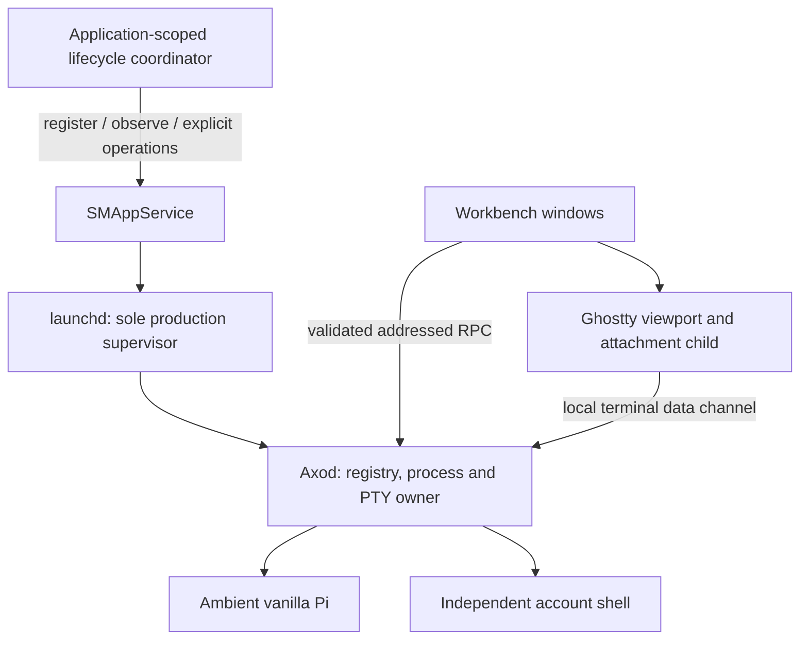

# RFD0010 - Axo: macOS daemon lifecycle and recovery

- Feature Name: `axo-macos-daemon-lifecycle-and-recovery`
- Status: Proposal
- Start Date: 2026-10-11
- Updated: 2026-10-11
- Document Type: Proposal

## Summary

Make `launchd` the sole production supervisor of Axod through a per-user `SMAppService` LaunchAgent. Replace window/coordinator-driven launching and opportunistic registration repair with one application-scoped lifecycle coordinator and explicit, independently observed service, daemon, connection, execution, and presentation states. Ordinary connection attempts never unregister, replace, or restart the helper. Compatible frontend updates leave existing work alone; execution-engine updates require a durable, proven idle handoff. Preserve fail-closed crash recovery without claiming that a journal restores PTYs, and make unavailable screen recovery distinct from uncertain execution ownership. Require real installed-app ServiceManagement and terminal-continuity acceptance before claiming the lifecycle works. This proposal authorizes no implementation, service registration, live restart, state reset, or process handoff.

## Motivation

A user can have an enabled background item, a failed launchd job, an independently launched helper, and a terminal view that cannot attach—all at once. A single “connected” flag hides these distinctions. Reopening the app, creating another session, or clearing saved state may appear to help while leaving the underlying ownership and supervision defects intact.

Two observed failure classes illustrate the problem:

- **Screen recovery unavailable:** Pi can be admitted and running under the current daemon, but the viewport refuses an incomplete raw output backlog. Normal Pi startup can exceed that backlog before attachment.
- **Runtime recovery required:** a new daemon epoch has read an earlier nonterminal execution record but does not own its former process/PTY handles. Restoring a record or saved PID cannot restore those resources.

Users need to know whether work is still running, whether opening a window is safe, whether an update will stop anything, and what an explicit recovery action actually does. Contributors need one lifecycle owner rather than several cooperating launch/repair paths. Operators need meaningful startup errors instead of silent repeated launch failures.

### Current behavior and evidence boundary

The source baseline for this proposal is `3c69fa8`. Relevant code is:

- [`AxodWorkbenchCoordinator.swift`](../../apple/AxoMacAxod/AxodWorkbenchCoordinator.swift): service/login registration, connection, ownerless registration repair, helper replacement, and UI state. `ConnectionState` has starting/connected/disconnected/failed cases; lifecycle restrictions are also represented by separate flags and messages.
- [`AxodBundledDaemon.swift`](../../apple/AxoMacAxod/AxodBundledDaemon.swift): direct `Process()` cold-start fallback after an owner-absence check. The helper reacquires the daemon lock; normal frontend quit does not terminate it.
- [`dev.leostera.axo.axod.plist`](../../apple/AxoMacAxod/dev.leostera.axo.axod.plist): bundled LaunchAgent with `RunAtLoad`, unconditional `KeepAlive`, a throttle interval, and stdout/stderr directed to `/dev/null`.
- [`AxodDaemonUpgrade.swift`](../../apple/AxoMacAxod/AxodDaemonUpgrade.swift), [`AxodDaemonUpgradePlan.swift`](../../apple/AxoMacAxod/AxodDaemonUpgradePlan.swift), and [`runtime.rs`](../../axod/src/runtime.rs): compatibility selection, captured handoff intents, admission freeze, and completion-based quiescence.
- [`user_service.rs`](../../axod/src/user_service.rs) and [`server.rs`](../../axod/src/server.rs): per-user configuration, account-shell capture, endpoint serving, termination handling, and owned-runtime shutdown.
- [`journal.rs`](../../axod/src/journal.rs): exclusive owner lock and conversion of earlier nonterminal records to recovery-required on opening a new daemon.
- [`terminal.rs`](../../axod/src/terminal.rs) and [`terminal_frontend.rs`](../../axod/src/terminal_frontend.rs): 8 KiB raw backlog and refusal to present a truncated stream as a recovered terminal screen.

The lock prevents two daemons from owning the same state directory, but it does not make an app-launched helper launchd-supervised. ServiceManagement registration and direct launching are different ownership paths. Both currently suppress startup stderr. An observed launchd failure alongside a live owner is consistent with those paths competing; without an exit diagnostic it does not establish the exact cause.

Isolated packaged tests exercise useful product behavior but use direct helper launching and skip normal ServiceManagement lifecycle operations. They do not establish background-item approval, launchd supervision, normal helper updates, or representative installed-user Pi screen recovery.

### Relationship to existing RFDs

- [RFD0007](RFD0007-mac-session-manager.md) establishes independent host/client lifetimes and fail-closed orphan handling. This proposal specifies the macOS supervision boundary while retaining its prohibition on automatic execution replay and its lack of process-restoration guarantees.
- [RFD0008](RFD0008-private-multi-machine-control-plane.md) owns local/remote routing. This proposal does not replace its transport or make cloud reachability a prerequisite for local work.
- [RFD0009](RFD0009-protocol-capability-parity.md) separates work, chat, runtime, and observation authority. This proposal requires lifecycle capabilities to remain explicit; it does not freeze illustrative new method names or introduce aliases.
- [RFD0004](RFD0004-axo-macos-application-architecture.md) supplies native window/presentation principles. Shared service management moves outside individual workbench coordinators; window selection and terminal views remain presentation owners.

These documents contain historical checkpoints. This RFD's source-grounded description is not a claim that their earlier implementation inventories describe the current app.

## Goals

- One production launch supervisor and one application-scoped lifecycle coordinator.
- Predictable opening, approval, reconnect, quitting, service stopping, and helper updating.
- Explicit distinctions between registration, daemon readiness, connection health, runtime ownership, Pi admission, and terminal presentation.
- Preserve accepted execution, original intents/receipts, canonical histories, drafts, credentials, and preferences unless an explicit scoped operation changes them.
- Actionable recovery without automatic replay, historical PID signaling, or synthetic terminal reconstruction.
- Privacy-safe diagnostics and acceptance against the real macOS service path.

## Non-goals

- Root/system LaunchDaemons, multi-user hosting, or guaranteed operation across logout, reboot, sleep, or power loss.
- Transparent survival of an Axod crash by transferring PTYs or introducing per-runtime worker services in this change.
- A full terminal-state implementation, unbounded scrollback, or support promises for every VT/image feature. Screen reconstruction has a separate design and acceptance gate.
- A transport migration to XPC/Mach services, new account/authentication machinery, or remote service administration.
- Bundling Pi, private Pi APIs, another execution engine, or automatic installation/upgrades of ambient Pi.
- Background-state reset on failure, arbitrary process cleanup, or a second authoritative transcript/catalog.

## Guide-level explanation

### Mental model

**macOS supervises Axod; Axod owns executions; clients own presentation.**



`SMAppService.mainApp` controls opening the frontend at login. The LaunchAgent registration controls the background host. They are separate preferences; enabling the host must not silently opt the frontend into login startup.

The lifecycle coordinator observes facts and carries explicit setup/stop/update intent. It does not start Pi, allocate PTYs, own a second registry, or turn window restoration into execution intent.

### Example: first opening

1. The user explicitly opens the installed app. The coordinator observes service registration and offers required setup/approval without bypassing a denied background item.
2. Once enabled, launchd starts Axod. The app waits for a validated current endpoint and protocol/status handshake within a bounded deadline.
3. Axod opens its private storage, holds the exclusive owner lock, establishes its epoch and listeners, and reports capabilities. Missing Pi is an admission-specific problem, not grounds to take catalog/shell service offline.
4. The workbench reads complete authoritative catalogs and settles applicable startup fences. Only an authoritative empty app launch may submit the existing create-if-empty intent.
5. The created session is selected immediately. Its independent shell starts before waiting for Pi readiness. Service launch alone does not create a session.
6. A late or failed viewport attach affects presentation, not execution admission. It never starts another Pi to obtain a fresh screen.

### Example: quit and reopen

Quitting the frontend discards unsent in-memory text and releases presentation/input leases. RFD0012 and the subsequent removal of durable drafts supersede the earlier draft-save requirement. It neither unregisters nor stops the host. Axod continues draining PTYs without a renderer. Reopening validates the same live runtime and attaches to it without replaying work. Complete screen reconstruction is required for this experience; a raw backlog is not sufficient.

If Axod itself restarted, the app instead shows interrupted/uncertain executions. A restored sidebar row is not a running-process claim. The user can inspect preserved history, create separately addressed new work where safe, or enter the explicit recovery flow.

### Example: update

A frontend-compatible update connects to the current helper and leaves its executions intact. An engine-incompatible update is offered as a separate operation. If any execution or original intent prevents proving idle ownership, replacement remains deferred. The app does not unregister the helper merely because a newer bundle exists or a connection times out.

## Reference-level explanation

### Lifecycle ownership

Introduce a single application-scoped lifecycle coordinator with serialized transitions. It is shared by every window and is not reconstructed during navigation. Its platform adapter owns `SMAppService` operations; its connection adapter owns negotiation and bounded discovery. Workbench coordinators receive observations and submit explicit user intent, not process-launch or registration instructions from view lifecycle callbacks.

Capture operation identity, service label, bundle identity/location, source machine/epoch, expected helper compatibility, and any required revision before effects. Revalidate captured authority after every await. Cancellation or a superseding window must not abandon an already-dispatched destructive operation or mint a replacement intent.

The daemon owner lock remains authoritative for state-directory ownership. It is a safety fence, not a process adoption mechanism. A failed lock acquisition means another owner exists; it is not a reason to kill a discovered PID or delete the lock.

### Independent state models

Avoid a single enum containing every combination. Preserve explicit source identities and observation freshness across these independent models:

| Model | States and transition authority |
| --- | --- |
| Service registration | Not registered, enabled, requires approval, not found, unknown/error; observed through ServiceManagement. Registration-operation outcome is separate from registration status. |
| Daemon availability | Unavailable, starting, ready, quiescing, startup failed, unknown; readiness requires current endpoint/epoch and protocol/status observations. Disconnection alone changes knowledge, not actual process state. |
| Control connection | Disconnected, connecting, negotiating, connected, reconnecting, failed; owned by the connection adapter. |
| Runtime execution | Durably prepared, starting, running, stopping, exited, failed, recovery-required; transitions require daemon-owned evidence. A prepared intent is not proof of spawn. |
| Pi admission | Independently validated admission/readiness and public Pi binding; a running process is not an admitted Pi. |
| Terminal presentation | Detached, attaching, live, attachment failed, screen recovery unavailable; owned by the exact viewport/attachment identity. |
| Service operation | None, captured, dispatched/unknown, settled; stop, repair, and update operations retain their original captured intent and outcome. |

Conceptual daemon flow:

```text
Unavailable -> Starting -> Ready -> Quiescing -> Unavailable
                  |
                  +-> Startup failed

Ready observation -> connection lost -> availability unknown
launchd restarts exited helper -> Starting -> Ready with a new epoch
```

“Enabled” means eligible to run, not running. “Connected” means a negotiated channel, not that every capability or runtime is usable. “Recovery-required” means ownership/completion is unresolved, not that a saved process is definitely alive or dead.

### Registration and production startup

- Use the bundled per-user LaunchAgent through `SMAppService.agent(plistName:)`, with its plist under `Contents/Library/LaunchAgents` and executable selected through `BundleProgram`.
- Retain a persistent host policy for Axo's background executions/relay. `RunAtLoad` and `KeepAlive` must have one supervisor; no app-launched production fallback competes for the same root. launchd owns restart/throttling.
- Initial registration occurs through explicit setup consent. Frontend-at-login remains separately opt-in. User denial/disable is respected; direct launching cannot bypass it.
- The helper stays in the foreground under launchd, without daemonizing or launching a second detached manager. PTY children are executions, not another daemon supervisor.
- Normal connect/reconnect performs reads and connection negotiation only. It never calls unregister/register as an opportunistic repair.
- Missing registration, approval, moved bundle, unsafe storage, and configuration errors have distinct remedies. An explicit repair operation must identify the registration being repaired and prove that removal cannot stop uncertain work.
- Debug/disposable fixtures may retain an injected direct launcher. Its success is labeled component acceptance, never launchd acceptance.

Use a proposed 10-second interactive readiness deadline. Connection-only retry uses bounded exponential backoff with jitter, capped at 5 seconds, then presents an actionable failure after the deadline. Retry does not launch processes, rewrite configuration, repeatedly register, or replay commands. Late valid readiness may update the observation; it must not trigger a duplicate empty-startup command.

A readiness observation includes the machine/epoch, helper protocol/capabilities, build identity, and storage/admission health. Local readiness does not require cloud connectivity or universal Pi availability. A storage-fenced host may expose supported reads while refusing mutation; it is not represented as unrestricted ready.

### Compatibility and updates

Select supported operations from explicit protocol/capability negotiation rather than assuming that a matching app version provides every feature. Source-derived compatible-version declarations may remain a conservative supplement, not a replacement for negotiation. Unsupported operations fail specifically; compatible work should not be globally disabled by an unrelated historical update hint.

An update is a captured lifecycle operation, not part of every connection:

1. Preserve the original update intent durably before any freeze/removal effect. Preferences may carry a hint, not the sole authoritative destructive-operation record.
2. Ask the exact daemon to freeze new admission only after proving every relevant execution completed and no prepared/unknown intent or storage fence invalidates the proof. “No owned live handles” alone is insufficient when historical completion is uncertain.
3. Observe the original quiescence outcome. A missing/unknown reply permits exact reconciliation only.
4. Under that authority, unregister the captured service, verify exclusive owner release, and register the intended signed bundle through ServiceManagement.
5. Validate the new endpoint, epoch, capabilities, and build before settling the original operation. Preserve unresolved intent if any boundary is unknown.

ServiceManagement operations are not transactional with daemon RPC. “Already registered,” timeout, cancellation, or an enabled status alone cannot prove that the intended replacement happened. Reconcile actual registration and daemon observations; do not automatically repeat destructive effects. The durable operation store must survive the old daemon's exit, use the project's private atomic/no-follow I/O rules, and remain separate from canonical Pi history.

### Stop, disable, and repair

Frontend quit is not host stop. Provide separately labeled operational actions whose confirmations explain that owned Pi/shell commands may stop.

An intentional stop/disable must suppress automatic reactivation through ServiceManagement; sending a signal to a `KeepAlive` job and calling that “stopped” would invite restart. Capture and persist the operation before effects, fence new admission, stop only exactly owned runtimes, and observe completion. If completion remains uncertain, preserve that evidence and report partial/unknown outcome rather than declaring a clean stop.

`SMAppService.unregister()` may terminate the running agent. Therefore it is reached only under proven quiescence or explicit, scoped user consent acknowledging an execution-affecting shutdown. It is never a connection-retry tool. No stop/repair path signals historical runtime PIDs or treats disappearance of a process group as completion proof.

The user or OS can independently disable/terminate a service. Handle termination by bounded shutdown of exactly owned resources and durable observations where possible; if the deadline or persistence fails, the next daemon retains recovery-required state. Unexpected termination can still interrupt work. This proposal does not promise otherwise.

`launchctl bootout` removes a launchd job but does not itself unregister the ServiceManagement background item. An app-supported repair/reset flow must report those outcomes separately. Reset is distinct from restart: it requires explicit scope, preserves a recoverable archive, and never runs automatically on an error.

### Crash recovery and terminal recovery

A new daemon epoch invalidates old execution/input authority. Historical nonterminal records remain recovery-required unless a separately designed ownership/completion protocol supplies stronger evidence. Saved PIDs, socket refusal, titles, timestamps, and arbitrary absence checks are not that protocol.

Recovery UX distinguishes:

- **View unavailable, owned runtime running:** preserve execution and offer read-only status plus supported same-runtime attachment recovery. No relaunch or hidden input/redraw command is sent to Pi to simulate recovery.
- **Historical execution uncertain:** preserve original receipts, drafts, records, and history; offer inspection and explicit scoped resolution. A new writer against the same canonical binding remains blocked until ownership is resolved. Creating independent work uses fresh identities and does not settle the old execution.
- **Proven exited/failed execution:** explicit user intent may start a new runtime with the appropriate fresh/exact-resume history contract. Restoration and reconnect do not do this automatically.

Do not “fix” screen recovery by increasing the raw ring, replaying a partial ANSI stream, or rendering transcript text as terminal state. A separate terminal design must define bounded authoritative VT state, atomic snapshot-to-live offsets, resize behavior, input leases, feature-query handling, and truthful unsupported-feature behavior. Renderer absence cannot block daemon PTY draining indefinitely.

This lifecycle proposal can improve error reporting and supervision before that terminal implementation exists, but release claims of usable detach/reopen remain gated on it. Surviving an Axod crash through independent execution workers is a separate future architecture, not an implicit part of screen recovery.

### Invariants

- launchd is the only production launcher; the state root has one daemon writer.
- View/window lifecycle never starts, stops, clones, repairs, or upgrades executions/services.
- Service registration, daemon readiness, Pi admission, and viewport health cannot substitute for one another.
- Endpoint files and registration status are observations, not liveness/completion authority.
- Original intents and receipts are retained across unknown outcomes; reconnect never resends uncertain execution.
- Stop/update authority is captured before effects and revalidated across asynchronous boundaries.
- Compatible frontend changes do not restart the helper or block unrelated supported work.
- Private data, immutable receipts, canonical history paths, and credential boundaries survive migration.
- Ambient interactive vanilla Pi remains the only agent/history writer; Rust orchestrates processes through the existing public boundary.
- Existing queue, framing, delivery pacing, storage, draft, and surface-cache bounds remain unchanged.

### Security, privacy, and observability

Keep per-user, least-privilege execution and private owned directories/files. Do not move user projects or credentials into a root service. Respect background-item approval and sandbox/TCC denials; no diagnostic path bypasses them.

The current local WebSocket has browser guards and private discovery, not OS-user/application authentication. Validating endpoint identity and negotiation must not be described as authenticating a local caller. This proposal does not change that trust model or weaken remote Access/routing policy. Any future authenticated Mach/XPC boundary needs its own explicit security contract.

Use privacy-safe, bounded lifecycle logging from both the native coordinator and Rust helper, including before endpoint publication. Preserve startup failure category, exit reason when known, service operation/source identity, daemon epoch, lock contention, compatibility decision, and recovery transition. Use unified logging or a private bounded/rotated fallback when the platform logger is unavailable. Do not let `/dev/null` be the only destination for actionable startup failures.

Do not log prompts, terminal bytes, tokens, credentials, argv/environment payloads, clipboard contents, or sensitive directory paths. Diagnostics distinguish observed exit from inferred cause; expose “unknown” when evidence is absent. A support export is explicit and metadata-only.

### Compatibility and migration

Preserve existing machine/workspace/session/pane identities, history locations, drafts, receipts, and user settings. This change does not import legacy registries, reset a live profile, or reinterpret unknown pending commands as rejected.

An already-running app-launched helper cannot be adopted by launchd merely by registering a label. Migration keeps that owner connected and disables competing launch attempts where safely authorized. Transfer supervision only after durable idle authority or explicit scoped shutdown consent; otherwise defer. Distinguish the registered job from the actual owner before any unregister operation.

Remove the production direct-launch path only when the installed-service gate passes. Retain it solely through explicit fixture injection, not a shipped hidden fallback. Rollback retains the same single-owner and quiescence rules; it must not revive the removed competing supervisor or rewrite unresolved operation evidence.

### Rollout and acceptance

These are design gates, not a mutable implementation ledger:

1. Establish the application-scoped state models and privacy-safe diagnostics without replacing a live owner.
2. Validate launchd-only startup/approval/reconnect in an isolated macOS user account or VM using the actual production bundle/service path.
3. Gate service repair, stop, and compatible/incompatible update transitions on their durable authority and failure tests.
4. Complete the independently specified terminal recovery gate before claiming normal Pi detach/reopen usability.

Required acceptance includes:

| Scenario | Required result |
| --- | --- |
| Fresh installed-profile app launch | One launchd-supervised helper; one selected session only after authoritative empty-app checks; shell and admitted Pi available without Refresh or another session. |
| Approval denied or background item disabled | Actionable setup state; no direct-launch bypass and no execution replay. |
| Concurrent windows/frontends | One registered service owner and no competing process launcher; window-local selection remains independent. |
| Slow launch, missing executable, malformed config, unsafe storage, lock contention | Distinct bounded failure with retained diagnostic reason; no repeated destructive registration repair. |
| Frontend quit/crash and reopen during work | Same daemon/runtime and no additional Pi writer/message; unsent text intentionally discarded, original receipts retained; actual viewport restored under the terminal gate. |
| Representative ambient Pi startup output beyond 8 KiB | Real TUI attaches correctly without disabling installed behavior to shrink output; no false success based only on admission. |
| Helper crash/restart | New epoch; no prompt/start replay or historical PID signal; uncertain prior executions displayed truthfully. |
| Compatible frontend update during a Pi turn | Existing runtime continues; supported commands remain usable; no service unregister. |
| Incompatible helper update with active/prepared/uncertain work | Replacement deferred; original operation and actionable state preserved. |
| Failure/cancellation before and after quiesce, unregister, register, and endpoint publication | Exact original reconciliation, no duplicate side effects, no false settled update. |
| Explicit stop/disable, then app reopen | No KeepAlive-driven accidental reactivation of a disabled service; prior uncertainty is not erased. |
| Login/logout, sleep/wake, moved bundle, cloud outage | Lifecycle-specific state and safe revalidation; no always-on or transparent-survival claim. |

Rust continues to own disposable process/model/filesystem assertions; XCTest performs actual UI actions. Real ServiceManagement testing uses an explicitly owned test account/VM or separate operator consent, not a reset of the user's profile. Approval or automation denial requires assistance, not bypass. Model fixtures may make responses deterministic but must not replace the real terminal/service path. Existing same-bundle frontend safety guards remain in force.

## Drawbacks

- Removing the direct fallback exposes service setup failures immediately and may make startup appear slower. That is preferable to an apparently working but unsupervised helper.
- ServiceManagement approval, bundle-location behavior, and signed-package testing require macOS integration work beyond unit fixtures.
- Serialized durable lifecycle operations add storage and cancellation complexity. They do not make platform operations transactional.
- Deferring updates while completion is uncertain can inconvenience users; it preserves ownership safety rather than offering a misleading force-retry.
- Crash recovery remains limited. This proposal deliberately does not deliver process checkpointing or surviving PTY workers.
- Terminal reconstruction remains significant separate engineering; clean lifecycle states alone cannot make a broken viewport usable.

## Rationale and alternatives

### launchd-only persistent per-user agent

Selected because Axo intentionally owns work after frontend quit and may serve remote clients without a window. It uses the supported macOS service API and keeps one supervisor. Persistence is a product choice, not a claim that all macOS helpers should run continuously.

### Keep both launch paths and improve locking

The simplest local patch is better contention diagnostics and slower fallback timing. It still cannot make a directly launched process launchd-supervised and leaves two actors competing after crashes, updates, and registration changes. The lock remains valuable, but cannot solve supervision ownership.

### App-owned helper only

Simpler for foreground-only products. It either makes background continuity dependent on an unsupervised process or changes quit behavior to stop work. Neither meets Axo's selected host/client boundary.

### On-demand Mach/XPC service

Apple recommends on-demand launch where appropriate. A launchd Mach service could improve local activation and caller identity. It is not required to resolve this lifecycle issue, and an app-scoped short-lived XPC service is not automatically a suitable owner for persistent Pi jobs. Preserve the current addressed RPC plane while fixing supervision; assess transport changes separately.

### Independently supervised execution workers

Could keep PTY/process ownership alive when the Axod coordinator restarts. It adds worker admission, durable leases, fd/output ownership, reaping, reconciliation, signing, and upgrade contracts. Defer it rather than imply a journal already supplies those guarantees.

### System LaunchDaemon or external multiplexer

A root/system daemon introduces privilege, user-session, and credential problems without a requirement. Delegating execution ownership to tmux/screen/Zellij conflicts with the chosen Axo manager direction. Their recovery designs remain useful prior art, not selected dependencies.

### Do nothing

Keep the current lock/fallback/repair behavior and fail-closed messages. This preserves some safety but leaves normal startup dependent on competing supervisors, weak diagnostics, and incomplete recovery acceptance. Manual reset becomes a recurring workaround rather than a designed operation.

## Prior art

- Apple's [SMAppService](https://developer.apple.com/documentation/servicemanagement/smappservice) is the macOS 13+ API for bundled helpers. [Agent initialization](https://developer.apple.com/documentation/servicemanagement/smappservice/agent(plistname:)) locates the plist in the calling app's `Contents/Library/LaunchAgents`.
- Apple's [registration status](https://developer.apple.com/documentation/servicemanagement/smappservice/status-swift.enum) describes eligibility/approval, not process liveness. [Register](https://developer.apple.com/documentation/servicemanagement/smappservice/register()) bootstraps an agent subject to approval; [unregister](https://developer.apple.com/documentation/servicemanagement/smappservice/unregister()) may terminate a running agent. These distinctions constrain repair and update ordering.
- Apple's archived [Creating Launch Daemons and Agents](https://developer.apple.com/library/archive/documentation/MacOSX/Conceptual/BPSystemStartup/Chapters/CreatingLaunchdJobs.html) recommends on-demand launch and keeping supervised processes in the foreground. Its lifecycle guidance is useful; its older installation instructions do not replace current ServiceManagement APIs.
- RFD0007's host/client and recovery contracts remain the foundation. Existing daemon generation fences and immutable receipts show that uncertainty can be retained without replay; they do not demonstrate PTY restoration.

Apple references were consulted on 2026-10-11. Source facts, proposed contracts, and unproven normal-profile behavior are intentionally distinguished.

## Unresolved questions

### Before acceptance

- Accept launchd as the sole production launcher, with no direct fallback when registration/readiness fails?
- Accept a persistent per-user host and separately opt-in frontend-at-login, with explicit setup/approval?
- Confirm that this iteration promises frontend-independent execution but not transparent survival of an Axod crash?
- Confirm the release dependency on a separate bounded VT-screen recovery design and acceptance gate?

### During implementation

- Exact lifecycle-operation store schema/location and ownership, including incomplete platform-effect reconciliation and bounded retention without discarding unresolved records.
- Capability/build identity fields, readiness/error categories, and their cross-language result contracts.
- Privacy-safe Rust logging integration, fallback retention budgets, and startup failure categorization.
- ServiceManagement behavior for signed updates, moved bundles, disabled background items, and cancellation on the supported macOS version.
- Operator-assisted test-account/VM workflow for normal service approval and crash/update acceptance.

### Out of scope

- Independent execution workers, complete crash-survival guarantees, and operating-system process checkpointing.
- Full VT/image/scrollback design, Mach/XPC transport migration, cloud executors, and remote service administration.

## Future possibilities

A later worker-ownership design can separate Axod coordination from stable per-execution PTY owners. A later local IPC design can use Mach activation and authenticated callers while retaining the public addressed RPC domain. Neither is necessary to approve the single-supervisor and truthful-lifecycle contract, and neither is silently introduced by this proposal.
