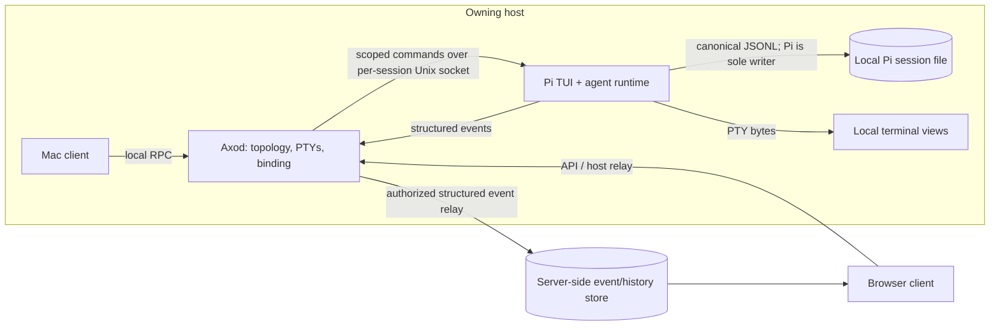
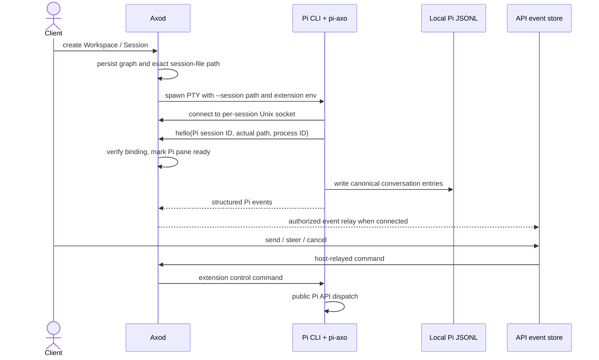
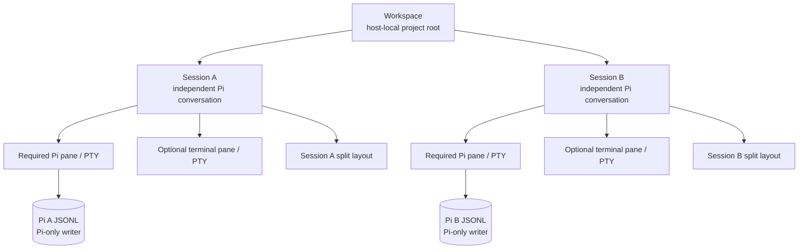

# RFD0014 - Axo: workspaces and agent-led sessions

- Feature Name: `axo-workspaces-and-agent-led-sessions`
- Status: Proposal
- Author: leostera
- Start Date: 2026-10-17
- Updated: 2026-10-17
- Document Type: Proposal

## Summary

I propose making a host-local project Workspace the owner of multiple independent agent-led Axo Sessions, while retaining Workspace-less terminal Sessions rooted at `$HOME`. Axod always keeps at least one standalone home Session open and at least one Session in each open Workspace. Each Workspace Session has exactly one interactive Pi agent pane, zero or one optional terminal pane, its own persisted layout, and an exact Pi conversation binding. Axod owns the Pi PTY, supplies Pi with its session-file location, and relays structured Pi events to the connected API for durable server-side viewing by the owning account; sharing beyond that owner is undecided. Client commands travel back through Axod into Pi's session stream. Pi remains the writer of its canonical local conversation file; server-side event storage is a separate copy/projection. Terminal bytes are not persisted. This proposal changes the local data model, daemon lifecycle, shared contracts, Mac UI, remote event storage, and browser Workbench; it does not change Cloudflare Access policy.

## Motivation

Axo currently treats a session as a set of generic shells. `crates/axo-server/src/session.rs` creates one shell in the daemon's home directory, stores open sessions/shells and an optional shell-ID layout in SQLite, and restores replacement shells on daemon startup. It has no Workspace grouping, pane role, or Pi conversation binding. `packages/axo-api/src/v1.ts` likewise publishes shell IDs and layout without Workspace or Pane roles.

That model does not match how I work: I open a project, start an agent in one pane and a terminal beside it, and sometimes create multiple independent agent-led sessions in the same project. Closing one agent means that particular line of work is done; it should not close other sessions in the Workspace.

Some shared TypeScript state contracts already sketch Workspace, Session, and Pi/terminal roles in `packages/axo-api/src/state-contracts.ts`. They are not yet enforced by the current Axod session implementation, and they do not yet encode Workspace-less home Sessions alongside Workspace agent Sessions.

## Goals

- Model a project root as a host-owned Workspace that can contain multiple Sessions.
- Make each new Session start with one Pi agent PTY and optionally one terminal PTY. When present, Pi is on the left and the terminal is on the right.
- Give each Workspace Session its own stable Pi conversation binding, even when several Sessions share a Workspace root; retain standalone terminal Sessions rooted at `$HOME`.
- Let users add or remove the optional terminal pane without changing another Session's state.
- Restore the desired Workspace/Session/Pane graph and Pi conversation after daemon restart without replaying prompts or shell input.
- Keep the Mac app and browser Workbench as clients of Axod-owned session state.
- Keep project paths and Pi's canonical session file local to the owning host; relay structured Pi events to server-side storage when connected, without persisting terminal bytes.

## Non-goals

- Replacing Pi's interactive TUI with an Axo-authored chat UI or adopting Pi RPC mode as the initial agent presentation.
- Reimplementing Pi history, branching, compaction, model selection, or tool execution inside Axod.
- Automatically retrying a prompt, tool call, or unfinished agent turn after restart.
- Synchronizing project files across hosts or allowing the server to write Pi's canonical session file.
- Persisting terminal output or shell command history as session recovery data.
- Changing production Cloudflare Access controls, adding Cloudflare Sandbox hosts, or making the cloud an execution owner.
- Automatically converting legacy shell-only sessions into Pi-backed Workspaces, or treating a missing Pi history file as permission to create a new conversation.

## Guide-level explanation

### Mental model

A Workspace is a project on one host. A Workspace Session is one independent agent-led thread inside that project. A Workspace-less Session is a standalone terminal rooted at the user's home directory. A Pane is a stable, role-bearing surface backed by a PTY.

```text
Workspace (host-local project root)
  Session A
    Pi agent pane  |  optional terminal pane
    Session A layout and Pi conversation
  Session B
    Pi agent pane  |  optional terminal pane
    Session B layout and a different Pi conversation

Workspace-less Sessions
  Session 1 (terminal rooted at $HOME)
  Session 2 (terminal rooted at $HOME)
```

A new Workspace creates its first Session. **New Session** within a Workspace creates another Pi-backed Session using the same project root but a different Pi conversation. A terminal PTY is optional; when present, the default layout is a rightward split with the agent first/left and the terminal second/right. Without it, the layout contains only the Pi pane. Each Workspace Session owns its layout; changing one does not affect its siblings.

The sidebar separates **Workspaces** (each with its Workspace Sessions) from **Sessions** (standalone terminal Sessions rooted at `$HOME`). Creating a Workspace uses ⌘N. ⌘T creates a Session in the selected Workspace when a Workspace Session is active; otherwise it creates a standalone terminal Session rooted at `$HOME`. Session rows are compact: they show a Pi-chosen title and emoji, plus a live ready/working/needs-attention indicator, not the current working-directory path. On the first user request, Pi sets the title and emoji in that same turn. Axod maintains at least one standalone Session rooted at `$HOME` and repairs any open Workspace that lacks a Session. Closing or reaping the last standalone Session immediately creates a replacement in `$HOME`; closing the last Session in a Workspace creates a replacement in that same Workspace. This preserves the standalone-Session and per-Workspace Session invariants independently.

Closing an agent through Axo closes that Workspace Session and any terminal pane, but leaves the Workspace and its other Sessions intact. The Pi conversation file remains available. Removing the optional terminal pane leaves the Pi-backed Session open.

### Example: two sessions in one project

1. The user creates a Workspace for `/projects/axo`. Axod creates the Workspace and its first Session as one logical operation.
2. Axod materializes the Pi agent and, if requested by the creation policy, an optional terminal in that project root; the graph and layout are persisted together.
3. The user chooses **New Session** in the Axo Workspace. One protocol operation creates the second Pi-backed Session with a different Pi session binding and may include its optional terminal, both rooted at `/projects/axo`.
4. The two Pi conversations are independent. A daemon restart restores each against its own exact Pi session file; it never chooses the most recent conversation for that directory.
5. Closing Session A's agent closes Session A only. Session B and the Workspace remain open.

## Reference-level explanation

### Architecture and boundaries

- **Axod (Rust):** authoritative Workspace/Session/Pane state, Pi and terminal PTY ownership, exact Pi session-file selection, process supervision, structured event bridging, API relay/replay, and local RPC.
- **Pi CLI and `packages/pi-axo`:** Pi's interactive TUI, agent runtime, and canonical JSONL conversation history. The first-party Pi extension emits structured events and accepts commands from Axod; Axod does not scrape terminal output or write Pi's JSONL file directly.
- **Shared contracts (`packages/axo-api`):** validated Workspace/Session/Pane, Pi event, command, cursor, and observation records, schema fixtures, and compatibility negotiation.
- **Mac app:** Workspace/project selection, Session navigation, pane layout and terminal presentation, and user input. It submits protocol commands; it does not orchestrate Pi startup or bind Pi afterward.
- **Relay and browser Workbench:** discover, observe, and control host-owned Sessions through Axod. Project paths and terminal bytes remain local; structured Pi events use a separate durable server-side event/history path.

The initial Pi surface remains the real interactive `pi` CLI in an Axod-owned PTY. The command defaults to `pi` and can be configured, including arguments, in **Settings → Agent → Default Agent**. Axod stores it in daemon metadata and tokenizes shell-style quoting without invoking a shell; bare executable names resolve against Axod's LaunchAgent `PATH`, and explicit paths must be absolute. Axod owns the session and extension arguments, and rejects direct overrides of its managed Pi session selection or interactive mode. Configuration changes apply to newly launched agent panes. Axod starts the configured command in the Workspace root with `--session <absolute-path>` and supplies that exact path through the launch environment. Pi accepts a new, not-yet-created path and chooses its own Pi session ID; `session_start` reports the actual ID and path, which the first-party extension verifies before Axod marks the agent pane materialized. Pi alone creates and writes the JSONL file after meaningful interaction. The extension packaged at `packages/pi-axo` starts a per-session Unix-domain socket during extension initialization, binds only after verifying Pi's actual path, forwards structured lifecycle/message/tool events, and accepts send/steer/follow-up/cancel commands from Axod through Pi's public APIs. Remote clients submit commands to the API, which forwards them over the existing host relay to Axod. The extension must never append raw transcript JSON from outside Pi; question/answer UI control is not in bridge v1. Pi `--mode rpc` is a distinct JSONL-stdio mode, not a second channel that can share the interactive TUI's PTY; use it only if Axo later replaces the Pi TUI with its own presentation.



The local socket is scoped to one expected Pi process/session binding. Axod validates the extension's reported Pi session ID, exact file path, Axo Session/Pane IDs, and managed process identity before accepting events or sending commands. Terminal bytes never cross the host boundary. For Workspace creation, Axod first opens the selected path using the user's normal filesystem permissions. If macOS requires a scoped extension for that folder, the Mac app opportunistically sends a security-scoped bookmark over local RPC; Axod resolves and holds it while the Workspace is open, and stores it locally to restore access after daemon restart. Ordinary accessible folders do not require a bookmark.



### Data model and interfaces



Conceptual records (exact SQLite names and wire names are implementation details):

- `Workspace`: stable ID, owning host, local root directory, display metadata, lifecycle, and references to its Sessions.
- `Session`: stable ID, nullable Workspace ID, lifecycle, Pi-chosen title/emoji display metadata, transient readiness/activity, Pane records, and layout. Workspace Sessions also have one Pi binding.
- `Pane`: stable pane ID, Session ID, closed role (`pi` or `terminal`), desired lifecycle, and role-specific launch/runtime metadata. A Workspace-less Session has one terminal pane and no Pi pane; a Workspace Session has one required Pi pane and at most one optional terminal pane.
- `Pi binding`: exact Pi session ID and canonical session-file location, stored only on the owning host for Workspace Sessions. Pi alone writes the local JSONL file; structured events are separately relayed to the API and stored for remote observation by the owning account.
- `Layout`: a bounded split tree whose leaves reference pane IDs. Every present Pane occurs exactly once; it is not inferred from pane creation order.

Required open-Session invariants:

1. At least one standalone Workspace-less Session is always open, and every open Workspace always has at least one Session. Workspace-less Sessions have exactly one terminal pane and no Pi pane; Workspace Sessions have exactly one present Pi pane and zero or one present terminal pane.
2. Every present pane has one PTY; an open Workspace Session has one or two present panes.
3. Pane IDs are unique and all layout leaves refer to panes in that Session exactly once.
4. Each Workspace Session's Pi binding is distinct, including within one Workspace. A host's path is not an identity for a Pi conversation.
5. Workspace root paths and Pi history paths are local-only. Account/relay control snapshots may publish labels, role-bearing pane IDs, layout, and bounded status, but never paths. Pi conversation content travels only through the separately authorized event/history channel; terminal bytes never do.

Workspace creation and its first Session are accepted as one backend graph operation; a follow-up client request must not be required to launch Pi or attach its conversation to the Session. Creating a Session in an existing Workspace is likewise one protocol operation: Axod creates the Pi pane and binding, optionally creates the terminal pane, persists the layout/operation, and starts the owned Pi PTY. The client submits intent and renders the returned graph/readiness; it does not sequence process startup or link Pi afterward. Once connected, Axod forwards structured Pi events to the API, which persists them for remote viewing by the owning account; sharing beyond that owner is undecided. Readiness may be `materializing` or `blocked`; partial startup must not be reported as ready.

### Pi session continuity and control

Pi supports explicit session selection with `--session <path>`. Axod allocates and persists the exact absolute JSONL path before launch, then passes it through `--session` on both initial creation and resume. A Pi 1.3.0 probe confirmed a new path can be selected while the JSONL file remains absent until meaningful interaction; Pi reports its generated session ID and exact path at `session_start`. Axod verifies both before marking the pane materialized. It must not use `--continue` as a Workspace-level selector: multiple Axo Sessions may share a working directory. After a binding has been committed, a missing file is an error/blocked state—not permission to silently create a fresh conversation.

Pi's interactive `/resume` and `/fork` flows must not switch or fork a transcript behind Axod. Treat them as requests for Axod: a resume request names the selected file, which Axod checks against a host-wide single-owner registry and the Workspace's allowed Pi-session directory. If the file already belongs to a live Axo Session, focus that Session instead of opening a second writer; otherwise Axod can create/reopen the owning Session and launch Pi against that exact path. A fork request includes the source binding and selected entry/position; Axod creates a new Session and a distinct Pi history, leaving the source Session intact. Do not fork while the source turn is mutating history unless Pi provides a stable snapshot/fork boundary. In both cases, cancel Pi's direct session switch until Axod has accepted and persisted the operation. The current extension blocks these built-in flows; forwarding resume/fork intent to Axod is follow-up work.

A restart recreates the Pi PTY against the same exact local session file using Pi's explicit `--session <path>` option and recreates any optional terminal PTY; it does not restore the terminal screen or active process execution. A new terminal starts in the Workspace root; `cd` state and shell input are not recovered. Pi's local transcript is the recovery source, not a prompt replay. The server-side event copy supports remote observation by the owning account but must not become a second writer to Pi's file. When API connectivity returns, Axod must be able to reconcile any event gap from Pi's durable history without resubmitting agent work.

Pi and Axod must not concurrently write one conversation. Before starting a replacement Pi process, Axod must establish that the previous writer is gone or that an explicit ownership/fencing mechanism makes replacement safe. If daemon-crash recovery cannot prove this, the Session is blocked pending reconciliation; it must not start a second Pi writer. The recovery spike and acceptance tests must determine whether Axod's current PTY/process-group ownership is sufficient or needs a dedicated process/writer lease.

### Lifecycle and failure semantics

- **Create Workspace:** validate and canonicalize a user-selected directory; atomically persist the Workspace and first Session, including its Pi pane/binding and optional terminal pane, before materialization.
- **Create Session:** one protocol operation allocates a unique Pi session-file path under the host's private Axo state directory, persists the independent Session and binding, optional terminal pane, and layout, then launches Pi with that exact path.
- **Add/remove terminal:** add the optional terminal pane at the Workspace root and update layout; a Session may have at most one terminal, and removing it leaves the Pi Session intact.
- **Close agent in Axo:** archive/close that Session, terminate its owned panes, and preserve the Pi conversation file. Sibling Sessions and the Workspace remain unchanged.
- **Unexpected Pi exit:** do not treat process exit as explicit Session closure. Reconcile the exact saved Pi binding only after writer ownership is safe. The behavior of a user entering Pi's own `/quit` command is an unresolved interaction detail.
- **Daemon restart:** restore Workspace/Session/Panes/layout, recreate the Axod-owned Pi and optional terminal PTYs, and resume Pi by its exact saved binding. Never duplicate a possibly-live Pi writer or replay work when previous ownership is uncertain. Reconcile the API event cursor from Pi's durable local history after reconnect.
- **Pi missing or invalid:** mark the agent pane/Session blocked with a bounded reason. Do not silently substitute a shell or new Pi conversation.
- **Terminal bytes:** remain transient. A daemon restart creates a fresh terminal screen; no cloud or local database transcript of terminal output is implied. Structured Pi events are a separate stream and may be durably stored by the API.

### Invariants

- Axod is the only authority for desired session topology and local PTY ownership; the frontend does not sequence shell and Pi startup.
- Pi remains the only writer of the canonical local conversation file. Axod relays structured Pi events; the API stores a separate durable event/history copy for remote use.
- Every Workspace Session has exactly one Pi pane and at most one optional terminal pane. Workspace-less home Sessions contain exactly one terminal pane and no Pi pane.
- Every Session has one exact Pi history binding; missing evidence never means “continue latest” or “create a new chat.”
- Restart never resubmits prompts, tool calls, or shell input.
- A replacement Pi writer starts only after old-writer termination/ownership is proven.
- Absolute project paths, provider credentials, and terminal input/output are never put in control metadata or logs. Pi event content is persisted only through the dedicated, authorized event/history channel; for this developer-only phase it is stored without redaction and retained indefinitely, while sharing beyond the owning account remains undecided.
- Closing one Session never closes sibling Sessions in the same Workspace.

### Compatibility and migration

The current Axod SQLite schema is version 3 and stores shell-only sessions plus shell-ID layout. Current `axo.session.*`/`axo.shell.*` RPC and `packages/axo-api/src/v1.ts` host snapshots do not represent Workspaces or Pane roles. This is a coordinated model transition, not a UI-only change.

For the current developer-only rollout, use a clean cutover: legacy shell-only rows and PTYs do not need to be preserved or converted into Workspaces. Do not silently merge them based only on equal current directories. After cutover, Axod maintains one or more Workspace-less `$HOME` terminal Sessions (creating one at startup or after the last one closes/exits) and at least one Session in every open Workspace. If Axo is prepared for users beyond the developers, revisit backup and migration needs before that rollout. Workspace creation and Workspace Session creation use the new graph API; standalone home Sessions remain a local Axod-owned session kind.

### Security, privacy, and observability

The Pi executable and extension run with the user's local permissions and can access the Workspace and the user's Pi configuration. Axod must resolve `pi` safely in the LaunchAgent environment, pass arguments without shell-string interpolation, set the expected user home and Workspace working directory, and honor Pi's project-trust behavior rather than automatically approving project resources.

The Workspace path and Pi session-file path remain host-local and are excluded from remote snapshots. Provider credentials remain in Pi's existing user-managed credential storage. Structured logs may record opaque Workspace/Session/Pane IDs, lifecycle, readiness, and bounded failure categories; they must not include paths, prompts, transcripts, terminal data, or credentials. For this developer-only phase, Pi event content is treated as consented for durable server storage, with zero redaction and indefinite retention, including prompts, responses, thinking, tool data, images, and file contents. The store is scoped to one Session and account; cross-account sharing behavior remains undecided and must not be enabled by inference. Terminal bytes remain excluded. These are development defaults, not a final product privacy policy.

### Rollout and validation

Implement in dependency order:

1. **Resolve behavior and recovery:** decide Pi `/quit` versus Axo close behavior and the hard-crash writer-ownership guarantee. The current developer-only cutover does not require migration of legacy shell-only sessions. Pi 1.3.0's `--session <path>` behavior and extension binding were smoke-tested; still validate global Pi resolution and abrupt daemon termination before committing to automatic restart semantics.
2. **Schema-first domain:** refine `packages/axo-api/src/state-contracts.ts` and `packages/axo-api/src/v1.ts`, add canonical JSON schemas/fixtures, and validate exactly-one-Pi, zero-or-one-terminal, same-Workspace membership, and layout-leaf invariants. Keep host-local paths out of remote schemas.
3. **Axod persistence/materializer and Pi extension:** migrate SQLite transactionally; implement Workspace/Session/Pane lifecycle, safe Pi binding, process supervision, readiness, restart, and local RPC; integrate the `packages/pi-axo` event/control adapter. Test the bridge with a fake Axod endpoint and verify that Axod remains the sole PTY/process owner.
4. **Mac workbench:** make Workspace/project selection primary, show multiple Sessions per Workspace, create the default agent-left/terminal-right pair, and route explicit close/add/remove actions through backend operations.
5. **Relay and browser Workbench:** publish role-bearing Workspace/Session/Pane metadata without paths; relay ordered, idempotent Pi events to durable account-scoped storage; support remote observation and commands routed through Axod; and preserve account ownership and relay bounds.
6. **Acceptance and rollout:** run Rust/Bazel unit and restart tests, package/daemon integration tests, Pi CLI/extension tests, Mac UI tests, and browser acceptance. Exercise graceful and forced daemon restart with idle and active Pi turns; prove no duplicate writer and no replay. Deploy web changes after their validation and leave Cloudflare Access settings unchanged. Package the Mac app after validated Mac changes; packaging does not imply launch or install.

Rollback must preserve both Axod database contents and Pi history files. It must not re-enable old client choreography in a way that creates duplicate sessions or Pi writers.

## Drawbacks

- Workspace/Session/Pane semantics require coordinated changes across the Rust daemon, shared schemas, native UI, relay, and browser Workbench.
- Multiple sessions in one directory make implicit Pi `--continue` behavior unsafe; Axod must maintain exact Pi bindings.
- Restart recovery is more than respawning a process: Axod must prove exclusive writer ownership and distinguish desired Session closure from unexpected process exit.
- A host-local root path cannot be used by another host; remote clients can observe stored Pi events and submit commands through Axod, but do not thereby gain access to project files. Cross-account sharing of stored event content is intentionally undecided.
- The clean development cutover intentionally does not preserve legacy shell-only rows or PTYs; this tradeoff must be revisited before a rollout beyond the developers.

## Rationale and alternatives

### Proposed design

A host-scoped Workspace groups a project's local root and multiple independent agent-led Sessions, while standalone terminal Sessions remain available from `$HOME`. Each Workspace Session owns its agent PTY, optional terminal PTY, layout, and exact Pi conversation. Axod is the process and protocol bridge: clients ask it to create/control the Session, and its Pi extension channel carries structured events in both directions. This matches the user's workflow while preventing two Workspace Sessions in one directory from sharing whichever Pi session happens to be most recent.

### Keep sessions as arbitrary shell groups

This is the smallest code change, but it leaves project identity, agent role, conversation ownership, and session close behavior implicit. It does not provide safe Pi resume or multiple independent sessions within one project.

### Use Pi RPC mode and build an Axo chat UI

Pi RPC provides structured commands and events, but it replaces Pi's interactive TUI with an Axo-owned presentation layer. That is not necessary to get stable project sessions or limited structured control and would significantly broaden the initial implementation.

### Do nothing

Axo continues to restore generic shells and layouts but cannot guarantee an agent pane, associate a Pi conversation with an Axo Session, or group multiple independent sessions under one project.

## Prior art

- The shared Axo state contracts in `packages/axo-api/src/state-contracts.ts` already model workspaces, sessions, pane roles, Pi bindings, history cursors, and chat operations. This proposal makes Pi process ownership, event relay, and server-side event storage explicit; the existing contracts are not yet implemented by Axod or the API store.
- The current terminal backend in `crates/axo-server/src/session.rs` owns shell PTYs and layouts, but generic shell IDs do not yet express Pi agent identity, exact file binding, or a Pi event channel.
- Pi's public [CLI session options](https://github.com/earendil-works/pi/blob/main/packages/coding-agent/docs/cli.md#sessions) support explicit session selection, [Extensions](https://github.com/earendil-works/pi/blob/main/packages/coding-agent/docs/extensions.md) expose event and send APIs, and [RPC mode](https://github.com/earendil-works/pi/blob/main/packages/coding-agent/docs/rpc.md) supplies bidirectional JSONL control instead of the interactive TUI. Keep the TUI by using an extension-to-Axod bridge; do not write session files directly.

## Unresolved questions

### Before acceptance

- No user-facing migration is planned for this developer-only cutover; revisit legacy-session migration before external rollout.
- What is the required guarantee for forced daemon termination when a Pi process may outlive Axod? Which owner/lease mechanism proves a prior writer is gone before resume?
- Does invoking Pi's `/quit` close/archive the Axo Session, or is closing the agent exclusively an Axo workbench action?

### During implementation

- Exact SQLite tables and transactional migration from schema version 3.
- Validate the configurable agent command resolver and LaunchAgent PATH behavior for the supported developer environments.
- How Axod obtains and durably verifies the canonical Pi session ID/file on first launch before recording the binding.
- The extension-to-Axod transport is a per-session Unix-domain socket created by the Pi extension in a private directory; Axod connects to it. The same-UID threat model, first-peer authorization, and process/session fencing need an explicit decision. Bridge v1 supports send, steer, follow-up, and cancel; remote answers to Pi's interactive UI questions are not implemented.
- For the developer-only phase, store full-fidelity Pi events with all-consented input, zero redaction, and indefinite retention. Pi events can contain prompts, model responses, thinking, tool arguments/results, images, and file content. Sharing beyond the owning account remains undecided; define authorization before enabling it.
- How Axod replays Pi events missed while the API is disconnected, including stable cursors, deduplication, and backpressure limits.
- Workspace/session naming, rename precedence, and whether session working directories may differ from the Workspace root.

### Out of scope

- Sharing Workspace files between hosts, cross-account/team authorization, automatic git worktree creation, and persistent terminal scrollback. The initial API exposes event history only to the owning account; cross-account sharing is undecided, and terminal bytes are not persisted.
- Replaying an in-progress model turn or shell command after a crash.
- Replacing Pi's interactive TUI with a custom Axo chat application.

## Future possibilities

The sidebar now reflects Pi's canonical session title, an Axo-specific emoji saved in the Pi session, and activity derived from the exact managed Pi bridge: connected/idle is ready, an active agent turn is working, and a blocking Pi UI prompt needs attention. Starting or disconnected Pi is shown as an unavailable/starting neutral state rather than being reported as ready. These details do not change the distinction between Workspace agent Sessions and Workspace-less home terminal Sessions.
