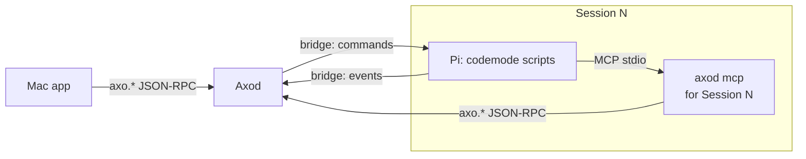

# RFD0015 - Axo: Sessions as Axo protocol clients

- Feature Name: `axo-sessions-as-protocol-clients`
- Status: Implemented
- Author: leostera
- Start Date: 2026-10-27
- Updated: 2026-10-27
- Document Type: Proposal

## Summary

I propose that the Pi agent running in each Axo Session becomes a client of Axod through MCP. A new `axod mcp` subcommand is a stdio MCP server that exposes Axod's local protocol as MCP tools. The pi-axo extension registers it for its Session with `pi.registerMcpServer`, using `codemode` exposure, so Pi calls Axod by writing codemode scripts (`await tools.mcp__axo__session_catalog({})`) instead of through Pi tools Axo would have to build and maintain. The MCP server knows which Session it serves, so "my Session" works and Axod can attribute agent prompts and stop runaway chains of agents prompting each other. Axo is a closed, trusted system, so there is no authentication. Axod gains a few methods agents need: a catalog of open and archived Sessions with their transcript paths, so Pi can search and read conversations with ordinary Unix tools; a local prompt method, including prompting the agent's own Session; and typing into and reading panes as plain text.

## Motivation

An agent in an Axo Session sees one PTY and nothing else. It cannot see that other Sessions exist, find out what they are about, look up what another conversation decided, start a Session for a side task, or send a message to another pane. The person has to do all of that by hand, copying between panes.

What exists today, verified in the code:

- **Local protocol:** `crates/axo-protocol/src/rpc.rs` defines `axo.session.*`, `axo.workspace.*`, `axo.shell.*`, `axo.terminal.*`, `axo.config.*` and `axo.relay.*` on `axod.sock`. The socket is mode `0600` with no other authentication (`crates/axo-server/src/lib.rs`), and the Mac app is its only intended client. `axo.session.list` returns each open Session's `sessionUuid` and `piSessionFile`, the path of its transcript, but leaves out archived Sessions. There is no local equivalent of `axo.remote.session.prompt`.
- **Pi bridge:** Axod and Pi already talk over a per-Session Unix socket, but in the opposite direction. The pi-axo extension listens on it and Axod connects (`packages/pi-axo/src/bridge-server.ts`, `crates/axo-pi/src/connection.rs`). Axod sends commands (`send` with `steer`/`followUp`, `cancel`, `shutdown`, `shutdownIfIdle`), and Pi can only emit events (`axo.session.metadata`, `session.import.requested`). Pi cannot ask Axod a question and get an answer.
- **Pi's environment:** Axod starts Pi with `AXO_SESSION_ID`, `AXO_PANE_ID`, `AXO_PI_SESSION_FILE`, `AXO_PI_BRIDGE_SOCKET` and `AXO_PI_BRIDGE_TOKEN` (`crates/axo-pi/src/launch.rs`). Pi does not know where `axod.sock` or the `axod` executable is.
- **Transcripts:** each Session's Pi conversation is a JSONL file Pi writes under Axod's private directory (`<server-dir>/pi-sessions/<workspace-id>/<uuid>.jsonl`). Axod stores its path as `pi_session_file` and never writes it.
- **Pi's MCP and codemode:** Pi connects MCP servers registered by extensions (`pi.registerMcpServer`). Tools of a server with `codemode` exposure are not declared to the model but are callable from codemode scripts as `tools.mcp__<server>__<tool>`, and Pi turns codemode on when such a server connects. Scripts can chain and filter calls, so only the result reaches the model.

Use cases:

1. "What did we decide about the relay reconnect backoff?" The agent lists Sessions, gets their transcript paths, and runs `rg` over them.
2. "Spin off a Session to investigate the flaky test and report back." The agent creates a Session in its Workspace, prompts it, and later reads its transcript.
3. "Run the dev server in my terminal pane and tell me when it's up." The agent types into its own terminal pane and reads its screen.
4. "Remind yourself to re-run the benchmarks after the build finishes." The agent queues a follow-up message to its own Session.

## Goals

- One protocol: agents use Axod's `axo.*` methods. The MCP server is a translation, not a second API.
- No Pi-level tools to build per capability: a new Axod method becomes available to agents by adding it to the MCP server.
- Pi can find and read any local Session's conversation, open or archived, with the tools it already has.
- Pi can create Sessions, prompt any Session including its own, send input to panes, and read pane screens.
- Axod knows which Session sent each agent prompt, and agents prompting agents cannot run away.

## Non-goals

- Authentication, permission scopes or approvals. Axo is a closed, trusted system: everything runs as the same user on the person's own Mac.
- A search engine in Axod. Pi searches transcripts itself.
- Sessions on other Macs. See [Future possibilities](#future-possibilities).
- Agents other than Pi for now. `axod mcp` is ordinary MCP, but only pi-axo registers it and gives it a Session.
- Scheduled or timed messages (`at 5pm`, cron). Queuing a follow-up message is in scope.
- Replacing the existing bridge. It keeps carrying Pi lifecycle, Pi events and Axod's commands to Pi.

## Guide-level explanation

### Mental model

Each Pi gets its own Axo MCP server: a small `axod mcp` process that Pi starts, which turns MCP tool calls into calls on `axod.sock`. It is started knowing which Session it belongs to.



Axod adds two variables to Pi's environment, next to the `AXO_SESSION_ID` it already sets:

```text
AXO_SOCKET=/Users/me/Library/Application Support/Axo/run/axod.sock
AXOD=/Applications/Axo.app/Contents/Helpers/axod
```

On load, pi-axo registers the server:

```ts
pi.registerMcpServer("axo", {
  command: process.env.AXOD,
  args: ["mcp"],
  env: { AXO_SOCKET: process.env.AXO_SOCKET, AXO_SESSION_ID: process.env.AXO_SESSION_ID },
  exposure: "codemode",
  description: "Axo: list and create Sessions, read their transcripts, prompt them, and drive their panes.",
});
```

### Using it

Pi writes codemode scripts. Searching is two steps: find the files, then use Pi's own tools on them.

```js
const { structuredContent: { sessions, archived } } = await tools.mcp__axo__session_catalog({});
const paths = [...sessions, ...archived].map(s => s.piSessionFile).filter(Boolean);
const hits = await tools.bash({ command: `rg -n -i "reconnect backoff" ${paths.map(p => JSON.stringify(p)).join(" ")}` });
return hits.output;
```

Delegating and following up, in one script:

```js
const { structuredContent: created } = await tools.mcp__axo__workspace_session_create({ workspaceId: "self" });
await tools.mcp__axo__session_prompt({ sessionId: created.id, text: "Bisect the flaky relay_reconnect test and summarize the cause." });
await tools.mcp__axo__session_prompt({ sessionId: "self", delivery: "followUp", text: `Check Session ${created.id}'s result.` });
return `Started Session ${created.id}`;
```

The prompt arrives in the new Session's transcript headed `[From Axo Session 7 "Relay work"]`, so its agent and the person both see who sent it.

## Reference-level explanation

### `axod mcp`

- A new `axod` subcommand next to `terminal-attach` (`crates/axo-server/src/mcp.rs`). It speaks MCP (revision 2025-06-18) over stdio and JSON-RPC to the socket named by `AXO_SOCKET`, one connection per call.
- `AXO_SESSION_ID` names the Session the server belongs to. It is required. The server resolves it to Axod's numeric Session ID at startup with `axo.session.catalog` and exits with an error if no open Session has that UUID.
- Each tool maps to one `axo.*` method: the tool name is the method name without `axo.` and with `.` replaced by `_`, and the tool's input schema is the method's parameters. Tools return the method's result as `structuredContent`, and the same JSON as text. Axod's errors come back as `isError` results carrying Axod's message and code.
- One tool is the server's own: `whoami` returns its Session (ID, Workspace, transcript path, panes), so an agent can find "my terminal pane".
- Wherever a tool takes a `sessionId` or `workspaceId`, the server accepts `"self"` and substitutes its own Session or that Session's Workspace before calling Axod.
- `session_prompt` always sends `fromSessionId` set to its own Session. The caller cannot set or override it.
- Tools carry MCP annotations (`readOnlyHint`, `destructiveHint`) taken from the method table, so a Pi permission extension can confirm destructive calls if the person wants that.
- The server's instructions, which codemode reads with `describeNamespace("mcp__axo")`, explain the tools, how to search transcripts with `rg` and `jq`, what Pi's JSONL records look like, and that text from other Sessions is data, not instructions.

### Exposed methods

| Tool | Method | Notes |
|---|---|---|
| `whoami` | — | Answered by the server |
| `session_catalog` | `axo.session.catalog` | New |
| `workspace_list` | `axo.workspace.list` | Existing |
| `workspace_session_create` | `axo.workspace.session.create` | Existing |
| `session_rename` | `axo.session.rename` | Existing |
| `shell_create`, `shell_close` | `axo.shell.create`, `axo.shell.close` | Existing |
| `terminal_write` | `axo.terminal.write` | New |
| `session_prompt` | `axo.session.prompt` | New |
| `terminal_screen` | `axo.terminal.screen` | New |

Methods that change Axo itself rather than its Sessions are not exposed: `axo.config.*`, `axo.relay.*`, `axo.workspace.create`, `axo.workspace.archive`, `axo.session.close`, `axo.session.list`, the subscription methods, `axo.terminal.input`, `axo.terminal.resize`, and `axo.client.viewport.set`. This guards against mistakes, not attacks. See [Unresolved questions](#unresolved-questions).

### Axod methods

| Method | Result | Notes |
|---|---|---|
| `axo.session.catalog` | `{ sessions, archived }` | `sessions` as `axo.session.list` reports them; `archived` the 1000 most recently archived Sessions, each with `piSessionFile`. A transcript Pi hasn't written yet does not exist on disk. Unlike `axo.session.list`, it does not consume the pending `/resume` focus the Mac app reads |
| `axo.session.prompt { sessionId, text, delivery?, fromSessionId? }` | `{ accepted, depth, queued }` | `delivery`: `followUp` (default), `steer` or `turn` (only if idle). `queued` when Pi is still starting and the prompt waits for its bridge |
| `axo.terminal.write { sessionId, shellId, text }` | `{ accepted }` | Text typed into a pane outside its input sequence, which belongs to the one client typing in it (`axo.terminal.input`). Control characters act as keys |
| `axo.terminal.screen { sessionId, shellId, lines? }` | `{ text, truncated }` | The last `lines` (default 200, at most 10000) of screen and scrollback, as plain text from Axod's headless terminal (axo-vt) |

`axo.session.prompt` sends the bridge's structured `send` command on the Pi's bridge worker connection (pi-axo's bridge serves one Axod connection at a time and closes any other), so delivery is confirmed and never mixes with what the person is typing. A prompt for a Pi that is still starting waits (up to 8) and is sent when its bridge binds. The remote prompt path (`axo.remote.session.prompt`) moved to the same mechanism with `steer` delivery, so `axo.session.prompt` is now its local counterpart in the parity table. `axo.terminal.screen` is planned remotely; `axo.session.catalog` and `axo.terminal.write` are local only.

Errors: invalid text or sender `-32602`; `-32002` chain too deep; `-32003` rate limited; `-32004` not delivered (no Pi, Pi busy for `turn`, queue full, or the bridge refused).

### Provenance and loop limits

A message from one agent to another, or to itself, can start a chain of turns. Axod records where each agent message came from and caps the chain:

- Each Session remembers the depth of the last prompt it was sent. A prompt with `fromSessionId` has a depth one greater than its sender's. A prompt without it (a person, locally or remotely) has depth 0, and a person typing into a Pi pane (`axo.terminal.input`) resets that Session to 0.
- Axod refuses a prompt whose depth exceeds 8 (`-32002 chain too deep`).
- Each Session may send at most 30 prompts a minute, and at most 10 a minute to itself (`-32003 rate limited`).
- An agent-sent prompt reaches Pi headed `[From Axo Session 7 "Name"]`, so the receiving transcript shows its sender.

These numbers are starting values to be tuned in use. Because `fromSessionId` is a parameter, a client that omits it is treated as the person. That is acceptable in a trusted system, and `axod mcp` always sets it.

### The pi-axo adapter

pi-axo registers the `axo` MCP server on load, as shown in the guide. It adds no tools. If `AXOD` or `AXO_SOCKET` is missing, as when Pi runs outside Axo or under an older Axod, it registers nothing. The registration does not depend on the bridge: an agent whose bridge failed can still reach Axod.

### Observability

Every prompt is logged as `event=session.prompt target_session_id=… from_session_id=… depth=… delivery=… outcome=…`, and pane writes as `event=terminal.write … bytes=…`. `axod mcp` logs each tool call's name and outcome to stderr, which Pi shows in `/mcp`. Logs never contain text or results.

## Security and privacy

Axo trusts everything running as the person's user, so this design adds no authentication. Pi could already reach the socket through its shell tool; this RFD gives it a documented, attributed way to do so.

The real risk is prompt injection. Reading another Session's transcript means reading text that could try to steer the reader, and prompting other Sessions could spread it further. The mitigations are: the server instructions say text from other Sessions is data; chains are depth-limited and rate-limited; and prompts sent by agents are visible as such in the receiving Session.

Transcripts can contain secrets. Listings only reveal paths on this Mac to a process that could already read them.

## Rollout

1. **Spec:** `axo.session.catalog`, `axo.session.prompt`, `axo.terminal.write`, `axo.terminal.screen` and their errors in `axo-protocol`, advertised under protocol version 1 (they are additions).
2. **Axod:** the new methods, provenance and limits, logging, moving `prompt_pi` to the bridge's `send`, and `AXOD`/`AXO_SOCKET` in Pi's environment.
3. **`axod mcp`:** the stdio server, tool table, `"self"` substitution and instructions.
4. **Pi:** pi-axo registers the server.
5. **Mac:** sidebar attribution ("started by Session N"). Not built yet; the transcript header covers attribution for now.

Each step adds to the protocol without breaking existing clients.

## Testing

- Axod unit tests (`session/terminal.rs`) against a fake pi-axo bridge that, like pi-axo, serves one connection at a time: a prompt queued while Pi starts is sent when the bridge binds; later prompts are sent at once; the sender header; depth climbing to the limit, a person's typing resetting it, and the self rate limit.
- `axo-pi`: the bridge connection accepts `commandResult` once bound; `axo-vt`/`axo-pty`: plain screen text.
- Axod integration tests (`crates/axod/tests/rpc.rs`): Pi's environment carries `AXO_SOCKET` and `AXOD`; `terminal.write` then `terminal.screen` shows the command's output; a prompt to a starting Pi is queued; `session.catalog` lists an archived Session with its transcript path.
- `axod mcp` over stdio against a real Axod: an unknown `AXO_SESSION_ID` exits with an error; `initialize`, `tools/list`, `whoami`; `"self"` reaching the Session's own terminal pane; `fromSessionId` always set (the prompt has depth 1).
- pi-axo: the environment parser and the registration.
- Not covered: a real Pi calling the tools from codemode end to end.

## Drawbacks

- **Codemode required.** Pi must have codemode to use the tools. Pi turns it on when the server connects, but a person who disabled automatic codemode gets no Axo tools.
- **An extra process per Pi.** Each Session runs one small `axod mcp` process.
- **Raw transcripts are an interface.** Agents read Pi's JSONL format directly, so a format change in Pi can break the agent's queries. Pi's session format is documented, which limits this.
- **Agents talking to agents.** Chains of agent prompts are hard to follow and debug, and can cost money. The limits blunt this but don't remove it.

## Rationale and alternatives

### Pi extension tools

Implement `axo_list_sessions`, `axo_prompt_session` and so on as Pi tools in pi-axo. Each capability then needs a hand-written tool, all of them are declared to the model on every turn, they cannot be chained without a model round-trip per call, and only Pi gets them. MCP with codemode exposure costs no declared tools, lets one script chain many calls, and works for any MCP-capable agent later.

### `direct` MCP exposure

Expose the tools as declared tools instead of codemode. It's simpler for the model to call one tool, but every tool's schema is sent on every turn, and multi-step work like "find the files, then search them" takes a model round-trip per step. A frequently used tool can be promoted with `toolExposure` later if that proves worthwhile.

### A search method in Axod

Index transcripts in Axod and offer `axo.session.search` and `axo.session.history`. This gives structured results and works across Macs through the cloud, but it builds a search engine Pi doesn't need: Pi already has `rg` and `jq`, and transcripts are local files. It can be added later alongside transcript paths.

### A request channel on the existing bridge

Let Pi send requests over the bridge Axod already connects to. This avoids the extra process, but it creates a second, Pi-only API alongside the protocol. Rejected.

### Do nothing

Pi can already reach `axod.sock` through its shell tool if it finds the path, anonymously and without limits. Doing nothing keeps that and gives a well-behaved agent nothing to use.

## Prior art

- RFD0014 established Axod as the sole owner of Session topology and Pi as the sole writer of transcripts. This RFD keeps both: agents read transcripts but never write them, and act through Axod. RFD0014's standalone home Sessions have since been replaced by a Home Workspace, so every Session has a Workspace.
- tmux exposes its whole control surface to any process in a pane (`tmux send-keys`, `capture-pane`, `new-session`) through `$TMUX`, without identity or limits. This RFD takes that reach and adds a caller Session and loop limits.
- Pi's [MCP](https://github.com/earendil-works/pi/blob/main/packages/coding-agent/docs/mcp.md) and [codemode](https://github.com/earendil-works/pi/blob/main/packages/coding-agent/docs/codemode.md) documentation describes extension-registered servers, exposure modes, and scripts calling MCP tools.

## Unresolved questions

### Open

- Is the list of methods kept from agents right, or should agents be able to close Sessions and archive Workspaces too?
- Should the bridge eventually become a single connection that Pi dials into Axod, carrying events and commands, so Pi has one link to Axod instead of two?
- The exact depth and rate limits, once used.

### Settled during implementation

- `turn` delivery to a working Pi is refused (`-32004`), not queued; `followUp` is the default.
- The server instructions describe Pi's `message` records and give one `rg` and one `jq` example.
- Archived Sessions come from a separate `axo.session.catalog`, because `axo.session.list` consumes the Mac app's pending `/resume` focus.
- Agents type into panes with a new unsequenced `axo.terminal.write`: `axo.terminal.input`'s sequence belongs to the one client typing into the pane.

### Out of scope

- Timed and scheduled messages.
- Searching terminal scrollback.

## Future possibilities

- **Other agents:** Claude Code, Codex or a script in a terminal pane could run the same `axod mcp`, once terminal panes get `AXO_SESSION_ID`, `AXO_SOCKET` and `AXOD`.
- **Other Macs:** `axod mcp` keeps asking its own Axod, which forwards requests about Sessions on other Macs to the cloud API using its host credential. The API relays them to the owning Axod, or answers reads from its stored Pi history when that Mac is offline. Since there are no local files for those Sessions, reading them would need a method like `axo.session.history` or a transcript download from the API.
- **An `axo` command line** speaking the same protocol, locally against Axod or remotely through the API.
- `axo.session.prompt { at }` and recurring wake-ups, so an agent can check back on long work.
- Agents subscribing to events (`axo.session.subscribe`) to react when another Session finishes or needs attention.
- A search method in Axod if `rg` over files stops being enough.
