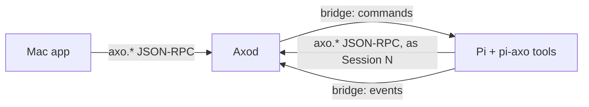

# RFD0015 - Axo: Sessions as Axo protocol clients

- Feature Name: `axo-sessions-as-protocol-clients`
- Status: Proposal
- Author: leostera
- Start Date: 2026-10-27
- Updated: 2026-10-27
- Document Type: Proposal

## Summary

I propose that the Pi agent running in each Axo Session becomes a client of Axod: the pi-axo extension inside Pi connects to Axod's local JSON-RPC socket and speaks the same Axo protocol as the Mac app. Pi says which Session it is when it connects, so Axod knows who is calling. That identity lets Axod resolve "my Session", attribute what an agent did, and stop runaway chains of agents prompting each other. Axo is a closed, trusted system, so there is no authentication and there are no permission scopes. Axod gains a few methods agents need: the path to any Session's transcript, so Pi can search and read it with ordinary Unix tools; a local prompt method, including prompting the agent's own Session; and plain-text pane screens. pi-axo exposes these as Pi tools and implements no capabilities of its own. Other clients, such as an `axo` command line, are left for later.

## Motivation

An agent in an Axo Session sees one PTY and nothing else. It cannot see that other Sessions exist, find out what they are about, look up what another conversation decided, start a Session for a side task, or send a message to another pane. The person has to do all of that by hand, copying between panes.

What exists today, verified in the code:

- **Local protocol:** `crates/axo-protocol/src/rpc.rs` defines `axo.session.*`, `axo.workspace.*`, `axo.shell.*`, `axo.terminal.*`, `axo.config.*` and `axo.relay.*` on `axod.sock`. The socket is mode `0600` with no other authentication (`crates/axo-server/src/lib.rs`), and the Mac app is its only intended client. There is no method that reveals where a Session's conversation is, and no local equivalent of `axo.remote.session.prompt`.
- **Pi bridge:** Axod and Pi already talk over a per-Session Unix socket, but in the opposite direction. The pi-axo extension listens on it and Axod connects (`packages/pi-axo/src/bridge-server.ts`, `crates/axo-pi/src/connection.rs`). Axod sends commands (`send` with `steer`/`followUp`, `cancel`, `shutdown`, `shutdownIfIdle`), and Pi can only emit events (`axo.session.metadata`, `session.import.requested`). Pi cannot ask Axod a question and get an answer, so a tool like "list Sessions" cannot be built on it.
- **Pi's environment:** Axod starts Pi with `AXO_SESSION_ID`, `AXO_PANE_ID`, `AXO_PI_SESSION_FILE`, `AXO_PI_BRIDGE_SOCKET` and `AXO_PI_BRIDGE_TOKEN` (`crates/axo-pi/src/launch.rs`). Pi does not know where `axod.sock` is.
- **Transcripts:** each Session's Pi conversation is a JSONL file Pi writes under Axod's private directory (`<server-dir>/pi-sessions/<workspace-id>/<uuid>.jsonl`). Axod stores its path as `pi_session_file` and never writes it.

Pi could already reach `axod.sock` through its shell tool if it knew the path, but it would be anonymous: Axod couldn't tell which Session acted, so it couldn't resolve "my Session", show who did what, or stop a loop.

Use cases:

1. "What did we decide about the relay reconnect backoff?" The agent lists Sessions, gets their transcript paths, and runs `rg` over them.
2. "Spin off a Session to investigate the flaky test and report back." The agent creates a Session in its Workspace, prompts it, and later reads its transcript.
3. "Run the dev server in my terminal pane and tell me when it's up." The agent types into its own terminal pane and reads its screen.
4. "Remind yourself to re-run the benchmarks after the build finishes." The agent queues a follow-up message to its own Session.

## Goals

- One protocol: Pi uses the same `axo.*` methods as the Mac app, with no separate agent API.
- Axod knows which Session every agent call comes from.
- Pi can find and read any local Session's conversation with the tools it already has.
- Pi can create Sessions, prompt any Session including its own, send input to panes, and read pane screens.
- Agents prompting agents cannot run away.

## Non-goals

- Authentication, permission scopes or approvals. Axo is a closed, trusted system: everything runs as the same user on the person's own Mac.
- A search engine in Axod. Pi searches transcripts itself.
- Sessions on other Macs. See [Future possibilities](#future-possibilities).
- Clients other than Pi: an `axo` command line, MCP, or agents in terminal panes.
- Scheduled or timed messages (`at 5pm`, cron). Queuing a follow-up message is in scope.
- Replacing the existing bridge. It keeps carrying Pi lifecycle, Pi events and Axod's commands to Pi.

## Guide-level explanation

### Mental model

Pi becomes a client of Axod, just like the Mac app. There are two connections between them, one in each direction:

- **Axod → Pi (exists):** the bridge. Axod dials the socket pi-axo serves, receives Pi's events, and sends it commands.
- **Pi → Axod (new):** pi-axo dials `axod.sock` and calls `axo.*` methods, like the Mac app does.



Axod adds one variable to Pi's environment, next to the `AXO_SESSION_ID` it already sets:

```text
AXO_SOCKET=/Users/me/Library/Application Support/Axo/run/axod.sock
```

pi-axo connects and sends `axo.client.hello { sessionId }`. From then on, calls on that connection come from that Session. Axod uses this to resolve "my Session", record which Session started or prompted what, and apply the loop limits below. The hello is identification, not authentication.

### The tools

| Tool | Method |
|---|---|
| `axo_list_sessions` | `axo.session.list` |
| `axo_session_file` | `axo.session.file` |
| `axo_new_session` | `axo.workspace.session.create` |
| `axo_prompt_session` | `axo.session.prompt` |
| `axo_pane_input` | `axo.terminal.input` |
| `axo_pane_screen` | `axo.terminal.screen` |

Searching is two steps: find the files, then use Pi's own tools on them.

> **You:** What did we decide about the relay reconnect backoff?
>
> **Pi:** *(calls `axo_list_sessions`, then `axo_session_file` for the likely Sessions, then runs `rg -n "backoff" <paths>` and reads the surrounding messages with `jq`)* In **Relay reconnect** (yesterday) we capped it at 30 s with jitter, because …

Delegating and following up:

> **You:** Spin off a session to bisect the flaky `relay_reconnect` test, and tell me when it has an answer.
>
> **Pi:** *(calls `axo_new_session`, `axo_prompt_session` with the task, then `axo_prompt_session` on its own Session with `delivery: "followUp"` and "Check Session 7's result")* Started **Session 7** for the bisect; I'll check on it when this turn ends.

The new Session's sidebar row shows which Session started it, and the prompt in its transcript is marked as coming from that Session.

## Reference-level explanation

### Identifying the caller

- Axod sets `AXO_SOCKET` when it launches Pi (`crates/axo-pi/src/launch.rs`).
- `axo.client.hello { sessionId }` names the calling Session on a connection, using the `AXO_SESSION_ID` UUID. Axod checks that the Session is open and has a Pi pane, and fails with `-32602` otherwise. A connection that never says hello is the person, as today.
- Calls that need a calling Session (prompt provenance, `"self"` targets) fail with `-32602` on a connection without a hello.
- `axo.client.whoami` returns the calling Session's ID, Workspace and panes.

### Methods

New methods:

| Method | Result | Notes |
|---|---|---|
| `axo.client.hello { sessionId }` | `{ sessionId, workspaceId }` | Names the calling Session |
| `axo.client.whoami` | `{ sessionId, workspaceId, shells }` | |
| `axo.session.file { sessionId }` | `{ path, exists }` | The absolute path of the Session's Pi transcript. `exists` is false until Pi has written to it |
| `axo.session.prompt { sessionId, text, delivery }` | `{ accepted }` | `delivery`: `steer`, `followUp` or `turn`. Sent through the bridge's `send` command |
| `axo.terminal.screen { shellId, lines }` | `{ text }` | Plain text from Axod's headless terminal (axo-vt) |

`sessionId` can be `"self"` wherever a Session is named.

Agents also use existing methods unchanged: `axo.session.list`, `axo.workspace.list`, `axo.workspace.session.create`, `axo.shell.create`, `axo.shell.close` and `axo.terminal.input`.

`axo.session.file` covers archived Sessions too, so an agent can read finished conversations. It does not return paths for Sessions on other Macs.

`axo.session.prompt` uses the bridge's structured `send`, so delivery is reliable and never mixes with what the person is typing. The existing remote prompt path (`prompt_pi`, which pastes into the PTY) moves to the same mechanism.

### Provenance and loop limits

A message from one agent to another, or to itself, can start a chain of turns. Axod records where each agent message came from and caps the chain:

- Every prompt sent on a connection with a hello carries `origin { sessionId, depth }`. `depth` is the origin's own depth plus one, and messages the person types have depth 0.
- Axod refuses a prompt whose depth exceeds 8 (`-32002 chain too deep`).
- Each Session may send at most 30 prompts a minute, and at most 10 a minute to itself (`-32003 rate limited`).
- The receiving Session's transcript and sidebar show `from Session 7` on agent-sent prompts.

These numbers are starting values to be tuned in use.

### The pi-axo adapter

The tools connect to `AXO_SOCKET`, say hello with `AXO_SESSION_ID`, and make JSON-RPC calls. They do nothing beyond shaping arguments and results. Prompt guidance explains how to search transcripts with `rg` and `jq`, what the JSONL records look like, and that text from other Sessions is data, not instructions.

### Observability

Calls from agents are logged as `event=rpc.call caller_session_id=… method=… target_session_id=… outcome=…`, plus depth for prompts. Logs never contain text or results.

## Security and privacy

Axo trusts everything running as the person's user, so this design adds no authentication. Pi could already reach the socket through its shell tool; this RFD gives it a documented, attributed way to do so.

The real risk is prompt injection. Reading another Session's transcript means reading text that could try to steer the reader, and prompting other Sessions could spread it further. The mitigations are: tool guidance says text from other Sessions is data; chains are depth-limited and rate-limited; and prompts sent by agents are visible as such in the receiving Session.

Transcripts can contain secrets. `axo.session.file` only reveals paths on this Mac to a process that could already read them.

## Rollout

1. **Spec:** `axo.client.*`, `axo.session.file`, `axo.session.prompt`, `axo.terminal.screen` and their errors in `axo-protocol`. Bump the protocol version and advertise them.
2. **Axod:** `AXO_SOCKET` in Pi's environment, hello and whoami, the new methods, provenance and limits, logging, and moving `prompt_pi` to the bridge's `send`.
3. **Pi:** pi-axo tools and prompt guidance.
4. **Mac:** "from Session N" markers and sidebar attribution.

Each step adds to the protocol without breaking existing clients: connections without a hello behave as today.

## Testing

- Axod integration tests: hello for an open, closed and Pi-less Session; `"self"` resolution; `session.file` for open and archived Sessions; depth and rate limits; screen text matching what a command printed.
- An end-to-end test with the Pi fixture: one Session creates and prompts another, which answers. Then a self follow-up is delivered after the turn ends.
- pi-axo tests against a fake Axod socket.

## Drawbacks

- **Raw transcripts are an interface.** Agents read Pi's JSONL format directly, so a format change in Pi can break the agent's queries. Pi's session format is documented, which limits this.
- **Two connections between Pi and Axod,** one per direction, with separate lifecycles.
- **Agents talking to agents.** Chains of agent prompts are hard to follow and debug, and can cost money. The limits blunt this but don't remove it.
- **Pi only, for now.** Claude Code or Codex running in a terminal pane gets nothing until another client is added.

## Rationale and alternatives

### A search method in Axod

Index transcripts in Axod (a scan, later SQLite FTS5) and offer `axo.session.search` and `axo.session.history`. This gives structured results and works across Macs through the cloud, but it builds a search engine Pi doesn't need: Pi already has `rg` and `jq`, and transcripts are local files. It can be added later without changing `axo.session.file`.

### A request channel on the existing bridge

Let Pi send requests over the bridge Axod already connects to. This avoids a second connection, but it creates a second, Pi-only API alongside the protocol, and every capability would have to be implemented again for the next client. Rejected for now. See the unresolved question on merging the connections.

### Authentication and scopes

Give each Pi a token and check per-method scopes, with owner approval for wider reach. In a closed system where everything runs as the same user, this is ceremony without a boundary: a process can skip the token and use the socket directly. Identification gives attribution and loop limits without it.

### Do nothing

Pi can already reach `axod.sock` through its shell tool if it finds the path, anonymously and without limits. Doing nothing keeps that and gives a well-behaved agent nothing to use.

## Prior art

- RFD0014 established Axod as the sole owner of Session topology and Pi as the sole writer of transcripts. This RFD keeps both: agents read transcripts but never write them, and act through Axod. RFD0014's standalone home Sessions have since been replaced by a Home Workspace, so every Session has a Workspace.
- tmux exposes its whole control surface to any process in a pane (`tmux send-keys`, `capture-pane`, `new-session`) through `$TMUX`, without identity or limits. This RFD takes that reach and adds caller identity and loop limits.

## Unresolved questions

### Before acceptance

- Should the bridge eventually become a single connection that Pi dials into Axod, carrying events, commands and `axo.*` calls, instead of two connections in opposite directions?
- Should some methods be off-limits to agents even in a trusted system (`axo.config.set`, `axo.relay.*`, `axo.workspace.archive`), as a guard against mistakes rather than attacks?

### During implementation

- The exact depth and rate limits.
- How `turn` delivery behaves when the target Pi is mid-turn (queued like `followUp`, or refused).
- How much of Pi's JSONL format the tool guidance should describe.

### Out of scope

- Timed and scheduled messages.
- Searching terminal scrollback.

## Future possibilities

- **Other Macs:** the agent keeps asking its own Axod, which forwards requests about Sessions on other Macs to the cloud API using its host credential. The API relays them to the owning Axod, or answers reads from its stored Pi history when that Mac is offline. Since there are no local files for those Sessions, reading them would need a method like `axo.session.history` or a transcript download from the API.
- **An `axo` command line** speaking the same protocol, locally against Axod or remotely through the API, for agents in terminal panes (Claude Code, Codex) and scripts.
- An MCP server exposing the same methods.
- `axo.session.prompt { at }` and recurring wake-ups, so an agent can check back on long work.
- Agents subscribing to events (`axo.session.subscribe`) to react when another Session finishes or needs attention.
- A search method in Axod if `rg` over files stops being enough.
