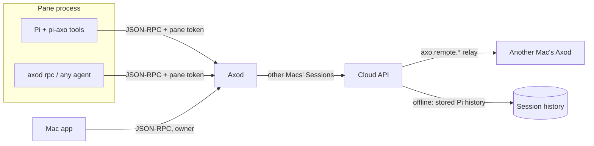

# RFD0015 - Axo: Sessions as Axo protocol clients

- Feature Name: `axo-sessions-as-protocol-clients`
- Status: Proposal
- Author: leostera
- Start Date: 2026-10-27
- Updated: 2026-10-27
- Document Type: Proposal

## Summary

I propose that every program running in an Axo pane, Pi included, can speak the Axo protocol to Axod as an identified, scoped client. Axod issues each pane a credential at spawn and accepts it on its existing local JSON-RPC socket. Calls made with it carry a *pane principal* that Axod checks against per-method scopes, attributes in logs and UI, and protects with loop limits. The protocol stays the single source of capabilities. Axod gains the read methods agents need (list, read and search Sessions) and a local prompt method, including prompting the caller's own Session. The Pi extension, an `axod rpc` command line, and a later MCP server are thin adapters over that one protocol, never places where capabilities are implemented. Requests that name Sessions on another Mac are routed by Axod to the cloud API, which implements the same methods by relaying to the owning Axod or by answering from its stored Pi history. This lets an agent control its harness: start Sessions, find and read other conversations, send messages to panes, and queue messages to itself.

## Motivation

An agent in an Axo Session sees one PTY and nothing else. It cannot see that other Sessions exist, find out what they are about, look up what another conversation decided, start a Session for a side task, or send a message to another pane. The person has to do all of that by hand, copying between panes.

The capability already exists, but without any rules. `crates/axo-server/src/lib.rs` binds `axod.sock` with mode `0600` and no further authentication, so any process running as the user, including every agent inside a pane, can already call every `axo.*` method: list Sessions, type into any PTY, archive Workspaces, change the agent command. Nothing records which Session did it, nothing limits it, and nothing documents it for agents. An agent that finds the socket gets full owner powers anonymously.

What exists today, verified in the code:

- **Local protocol:** `crates/axo-protocol/src/rpc.rs` defines `axo.session.*`, `axo.workspace.*`, `axo.shell.*`, `axo.terminal.*`, `axo.config.*` and `axo.relay.*`. There is no method to read or search a conversation, and no local equivalent of `axo.remote.session.prompt`.
- **Pi bridge:** `packages/pi-axo` runs a per-Session bridge *server* that Axod connects to. Pi only emits events (`axo.session.metadata`, `session.import.requested`), and Axod sends `send` (with `steer`/`followUp`), `cancel`, `shutdown` and `shutdownIfIdle`. Pi has no way to ask Axod a question and get an answer, so a tool like "list Sessions" cannot be built on it today.
- **Pane environment:** Pi panes receive `AXO_SESSION_ID`, `AXO_PANE_ID`, `AXO_PI_SESSION_FILE`, `AXO_PI_BRIDGE_SOCKET` and `AXO_PI_BRIDGE_TOKEN` (`crates/axo-pi/src/launch.rs`). Terminal panes receive no `AXO_*` variables at all (`crates/axo-server/src/session/spawn.rs`).
- **Remote:** `packages/axo-api/src/v1.ts` defines `axo.remote.*`, which the cloud relays to the owning Axod (`crates/axo-server/src/session/handlers.rs`). The API worker stores each Session's Pi events in a Durable Object (`packages/axo-api-worker/src/session-history.ts`).

Use cases:

1. "What did we decide about the relay reconnect backoff?" The agent searches this Mac's Sessions and reads the matching messages.
2. "Spin off a Session to investigate the flaky test and report back." The agent creates a Session in its Workspace, prompts it, and later reads its result.
3. "Run the dev server in my terminal pane and tell me when it's up." The agent types into its own terminal pane and reads its screen.
4. "Remind yourself to re-run the benchmarks after the build finishes." The agent queues a follow-up message to its own Session.
5. "Which of my Sessions on the studio Mac are waiting for me?" The agent lists Sessions on another Mac through the cloud.

## Goals

- One protocol: agents use the same `axo.*` methods as the Mac app, with no separate agent API.
- Every pane gets an identity Axod can attribute, scope and revoke.
- Read access: list Sessions, read a Session's conversation page by page, search conversations.
- Control: create Sessions, prompt any Session (including the caller's own), send input to panes, read pane screens.
- The same methods work across Macs, with each request routed to whoever owns the Session.
- Any agent can use it: Pi through extension tools, and Claude Code, Codex or a script through a command line or MCP.

## Non-goals

- A security sandbox between programs running as the same Unix user. See [Security and privacy](#security-and-privacy).
- New Pi bridge record types for introspection. The bridge keeps its current job: Pi lifecycle, Pi events and Pi commands.
- Searching terminal scrollback. Search covers Pi conversations.
- Scheduled or timed messages (`at 5pm`, cron). Queuing a follow-up message is in scope; timers are a future possibility.
- Sharing Sessions between accounts.

## Guide-level explanation

### Mental model

Axod has two kinds of client:

- **Owner:** the person, through the Mac app, phone or web. Owners can do everything, as today.
- **Pane:** a program running inside an Axo pane. A pane client is tied to one pane and one Session, and can only use the methods its scopes allow.

Every pane is started with three variables:

```text
AXO_SOCKET=/Users/me/Library/Application Support/Axo/run/axod.sock
AXO_PANE_TOKEN=<opaque, per pane>
AXO_SESSION_ID=<this Session's UUID>
```

A pane client opens the socket, sends `axo.client.authenticate` with its token, and from then on every call on that connection is made as *that pane*. `axo.client.whoami` says which Session, pane, Workspace and Mac that is, and which scopes the pane holds.



### Using it from Pi

The pi-axo extension adds tools that turn into protocol calls:

| Tool | Method |
|---|---|
| `axo_list_sessions` | `axo.session.list` |
| `axo_search_sessions` | `axo.session.search` |
| `axo_read_session` | `axo.session.history` |
| `axo_new_session` | `axo.workspace.session.create` |
| `axo_prompt_session` | `axo.session.prompt` |
| `axo_pane_input` / `axo_pane_screen` | `axo.terminal.input` / `axo.terminal.screen` |

A conversation might go:

> **You:** Spin off a session to bisect the flaky `relay_reconnect` test, and tell me when it has an answer.
>
> **Pi:** *(calls `axo_new_session`, then `axo_prompt_session` with the task, then `axo_prompt_session` on its own Session with `delivery: "followUp"` and the text "Check Session 7's result")* Started **Session 7** for the bisect; I'll check on it when this turn ends.

The new Session's sidebar row shows that it was started by the asking Session, and the prompt in its transcript is marked as coming from that Session.

### Using it from anything else

`axod rpc` is a generic client for scripts and other agents. It reads `AXO_SOCKET` and `AXO_PANE_TOKEN` and prints JSON:

```console
$ axod rpc axo.client.whoami
{"sessionId":"…","paneId":"…","workspaceId":"…","scopes":["read:host","control:workspace"]}
$ axod rpc axo.session.search '{"query":"reconnect backoff","scope":"host"}'
{"hits":[{"sessionId":42,"title":"Relay reconnect","messageId":"…","snippet":"…capped at 30 s…"}]}
```

Claude Code or Codex running in a terminal pane can call it from their shell tool. A later `axod mcp` exposes the same methods as MCP tools, using the same token.

### What a pane may do by default

| Scope | Grants | Default |
|---|---|---|
| `read:host` | List Sessions and Workspaces on this Mac; read and search their conversations | Granted |
| `control:self` | Prompt its own Session; input to and read the screens of its own Session's panes; open and close its own terminal panes | Granted |
| `control:workspace` | Create Sessions in its Workspace; prompt them; input to their panes | Granted |
| `control:host` | The same for Sessions in other Workspaces | Asks the owner |
| `read:account` | Read and search Sessions on the person's other Macs | Asks the owner |

Some methods are never available to panes: `axo.config.set`, `axo.relay.*`, `axo.workspace.archive`, `axo.workspace.create`, and closing another Session.

## Reference-level explanation

### Principals and credentials

- Axod creates a 256-bit random pane token when it spawns any pane, Pi or terminal. It keeps only a hash in memory, mapped to `(session_id, pane_id, runtime_id)`.
- The token reaches the pane through `AXO_PANE_TOKEN`, alongside `AXO_SOCKET` and `AXO_SESSION_ID`, which terminal panes gain too.
- A token is revoked when its pane closes or its process is replaced (Pi restart, Axod restart). Tokens are never stored on disk; panes restored after a restart get new ones.
- `axo.client.authenticate { token }` binds a connection to a pane principal and fails with `-32001` for an unknown or revoked token. A connection that never authenticates stays an owner connection, so the Mac app keeps working unchanged. See the unresolved question on making that boundary real.
- If a pane closes, calls on connections bound to its token fail with `-32001` from then on.

### Methods

New methods. Each existing method also gets a required scope.

| Method | Scope | Notes |
|---|---|---|
| `axo.client.authenticate` | none | Binds the connection to a pane principal |
| `axo.client.whoami` | none | Returns the principal's Session, pane, Workspace, Mac and scopes |
| `axo.session.history { sessionId, before?, limit }` | `read:host` | Pages of Pi messages, newest first, from the Pi transcript |
| `axo.session.search { query, scope, limit }` | `read:host` or `read:account` | Returns matches with a snippet, Session, message ID and time |
| `axo.session.prompt { sessionId, text, delivery }` | `control:*` by target | `delivery`: `steer`, `followUp` or `turn`. Sent through the Pi bridge's `send` command |
| `axo.terminal.screen { shellId, lines }` | `control:*` by target | Plain text from Axod's headless terminal (axo-vt) |

Scope by target: `self` if the target Session is the caller's own, `workspace` if it is in the caller's Workspace, `host` otherwise. `axo.session.list` and `axo.workspace.list` need `read:host`.

`axo.session.prompt` uses the bridge's structured `send` so delivery is reliable and never mixes with what the person is typing. The existing remote prompt path (`prompt_pi`, which pastes into the PTY) moves to the same mechanism.

Results that contain conversation or screen content carry `"trust": "untrusted"`. The tool descriptions in every adapter tell the agent to treat that content as data, not instructions.

### Provenance and loop limits

A message from one agent to another, or to itself, can start a chain of turns. Axod records where each agent message came from and caps the chain:

- Every prompt a pane sends carries `origin { sessionId, depth }`. `depth` is the origin's own depth plus one, and messages the person types have depth 0.
- Axod refuses a prompt whose depth exceeds 8 (`-32002 chain too deep`).
- Each Session may send at most 30 prompts a minute, and at most 10 a minute to itself (`-32003 rate limited`).
- The receiving Session's transcript and sidebar show `from Session 7` on agent-sent prompts.

These numbers are starting values to be tuned in use.

### Search

- **Corpus:** local search reads the Pi transcripts Axod already tracks (`pi_session_file` per Session): user and assistant text and tool results, but not thinking.
- **First version:** a bounded scan run by an Axod worker, limited in bytes and time per call, returning the best matches by simple term frequency.
- **Later:** an SQLite FTS5 table fed from the Pi events Axod already receives over the bridge, rebuilt from transcripts when missing. The method's contract stays the same.

Search never runs while holding the catalog lock.

### Routing across Macs

- Requests that need `read:account`, or name a `target` host other than this Mac, go to the cloud API. Axod authenticates with its host credential and passes the pane principal along.
- The API implements the same read methods as `axo.remote.session.list`, `.history` and `.search`. For an online Mac it relays to that Mac's Axod. For an offline one it answers `history` and `search` from its stored Pi events and marks results `"source": "history"`.
- The API checks that the caller's Mac and the target belong to the same account.
- Control methods aimed at another Mac are relayed only when that Mac is online. They are never queued in the cloud.

### Adapters

- **pi-axo:** the tools read `AXO_SOCKET` and `AXO_PANE_TOKEN` and make JSON-RPC calls. They have no logic beyond shaping arguments and results. Prompt guidance explains scopes and untrusted content. Tools needing a scope the pane lacks call `ctx.ui.confirm` only after Axod answers with "needs owner".
- **`axod rpc <method> [json]`:** a new `axod` subcommand next to `terminal-attach`.
- **`axod mcp` (later):** a stdio MCP server exposing the methods with scope `control:*` or `read:*` as tools.

### Owner confirmation

When a pane calls a method that needs a scope it doesn't hold, Axod replies `-32004 needs owner` with a request ID and publishes `client.approval.requested`. The Mac app shows which Session asks, what for, and **Allow once / Allow for this Session / Deny**. On approval, the pane retries with the request ID. Approvals live in memory and end with the pane.

### Observability

Every pane-principal call is logged as `event=rpc.call principal=pane session_id=… pane_id=… method=… scope=… outcome=…`, together with depth and target for prompts. Logs never contain text, queries or results.

## Security and privacy

This design does not create a security boundary between programs running as the same user. A pane process can read `axod.sock` like any other user process, and while unauthenticated connections are owners, it can skip the token and get full access. On macOS, another process running as the same user may also be able to read a pane's environment, token included.

What the design does provide:

- **Guard rails for well-behaved but fallible agents.** An agent following its tools stays within its scopes, and a confused or prompt-injected agent is stopped from archiving Workspaces, changing settings or flooding other Sessions.
- **Attribution.** Every agent action is linked to a Session, in logs and in the UI.
- **A place to enforce later.** Once owner connections authenticate too (see [Unresolved questions](#unresolved-questions)), the same scopes become a real boundary without changing the protocol.

Cross-Session reading creates a new path for prompt injection: text in one conversation can try to steer whichever agent reads it, and prompting can spread it further. The defenses are: content is marked untrusted; by default control reaches only the caller's own Workspace; chains are depth-limited and rate-limited; and agent-sent prompts are visible as such.

Transcripts and screens can contain secrets. By default read access covers this Mac only. Reading other Macs needs owner approval, and conversation content leaves the Mac only to the person's own account, as RFD0014 already allows.

## Rollout

1. **Spec:** pane principal, scopes, error codes, and the new method schemas in `axo-protocol` and `packages/axo-api`. Bump the protocol version and advertise the new methods.
2. **Axod, local:** pane tokens and environment, `authenticate` and `whoami`, scope checks on all methods, `history`, `search` (scan), `prompt` through the bridge, `terminal.screen`, provenance and limits, logging.
3. **Adapters:** pi-axo tools and `axod rpc`.
4. **Mac:** approval sheet, "from Session N" markers, sidebar attribution.
5. **Cross-Mac:** `axo.remote.session.history` and `.search` in the API and the relay, routing in Axod.
6. **Later:** `axod mcp`, FTS5 index.

Every step adds to the protocol without breaking existing clients: unauthenticated connections behave as today.

## Testing

- Axod integration tests: each method under each scope; revocation on pane close and restart; depth and rate limits; untrusted marking.
- An end-to-end test with the Pi fixture: one Session creates and prompts another, which answers. Then a self follow-up is delivered after the turn ends.
- API tests for cross-account refusal and offline history answers.

## Drawbacks

- **Larger surface.** Every method needs a scope decision, and the protocol now has two kinds of client.
- **Guard rails, not a sandbox.** People may read scopes as security they don't provide. The documentation and UI have to be clear about that.
- **Agents talking to agents.** Chains of agent prompts are hard to follow and debug, and can cost money. The limits blunt this but don't remove it.
- **Two implementations.** The read methods exist in Axod and in the cloud API and must stay in step.

## Rationale and alternatives

### Curated tools over the Pi bridge

Add a request channel to the bridge and implement list, search and prompt as bridge records. This is quick for Pi, but it creates a second, Pi-only API alongside the protocol. Claude Code or a script in a terminal pane gets nothing, and every capability would be implemented twice. Rejected.

### MCP as the primary interface

Implement capabilities in an MCP server. MCP is a good adapter, but making it the source of truth puts Axo's capabilities behind a protocol Axo's own clients don't speak, and still leaves identity unsolved. MCP stays an adapter over the protocol.

### A separate socket per pane

Give each pane its own socket that implies its identity, with no token. It needs no credential in the environment, but it multiplies listeners and paths and adds lifecycle work for little gain while the user boundary is the same either way. It's worth reconsidering if tokens in the environment turn out to be a real problem.

### Do nothing

Agents that discover `axod.sock` already have full, anonymous, unlimited access. Doing nothing keeps that and gives well-behaved agents nothing to use.

## Prior art

- RFD0014 established Axod as the sole owner of Session topology and Pi as the sole writer of transcripts. This RFD keeps both: agents read transcripts through Axod and act through Axod. RFD0014's standalone home Sessions have since been replaced by a Home Workspace, so every Session now has a Workspace, which keeps the `workspace` scope simple.
- tmux exposes its whole control surface through the client protocol to any process in a pane (`tmux send-keys`, `capture-pane`, `new-session`), with no identity or limits. This RFD takes the reach and adds identity, scopes and attribution.
- Unix capability tokens in the environment (`SSH_AUTH_SOCK`, `GPG_AGENT_INFO`, `DBUS_SESSION_BUS_ADDRESS`) show a familiar way of handing a child process access to an agent, along with its known weakness that same-user processes can read it.

## Unresolved questions

### Before acceptance

- Should owner connections authenticate too, for example with a credential held by the Mac app, so that scopes become a real boundary? That changes how the Mac app connects to Axod.
- Default grants: should `control:workspace` be granted by default, or ask the first time?
- Should terminal panes get tokens by default, or only when the person turns it on per Workspace?

### During implementation

- The exact depth and rate limits.
- Paging and cursors for `axo.session.history`, and how they match the cloud's stored-event cursors.
- How `turn` delivery behaves when the target Pi is mid-turn (queued like `followUp`, or refused).
- What "the best matches" means for the first search version.

### Out of scope

- Timed and scheduled messages.
- Sharing between accounts.
- Searching terminal scrollback.

## Future possibilities

- `axo.session.prompt { at }` and recurring wake-ups, so an agent can check back on long work.
- Agents subscribing to events (`axo.session.subscribe`) to react when another Session finishes or needs attention.
- Workspace-level policies set by the person, such as "Sessions here may control each other freely".
- Clients on a phone or the web acting as a pane principal for a remote agent.
