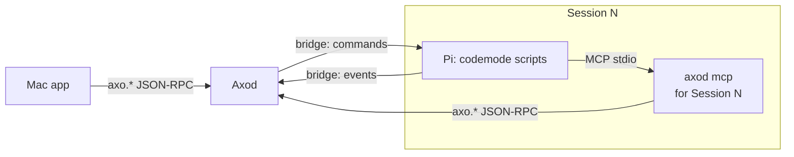

# RFD0015 - Axo: Sessions as Axo protocol clients

- Feature Name: `axo-sessions-as-protocol-clients`
- Status: Proposal
- Author: leostera
- Start Date: 2026-10-27
- Updated: 2026-10-27
- Document Type: Proposal

## Summary

I propose that the Pi agent running in each Axo Session becomes a client of Axod through MCP. A new `axod mcp` subcommand is a stdio MCP server that exposes Axod's local protocol as MCP tools. The pi-axo extension registers it for its Session with `pi.registerMcpServer`, using `codemode` exposure, so Pi calls Axod by writing codemode scripts (`await tools.mcp__axo__session_list({})`) instead of through Pi tools Axo would have to build and maintain. The MCP server knows which Session it serves, so "my Session" works and Axod can attribute agent prompts and stop runaway chains of agents prompting each other. Axo is a closed, trusted system, so there is no authentication. Session listings already include each Session's transcript path, so Pi can search and read conversations with ordinary Unix tools; Axod adds archived Sessions to the listing on request, a local prompt method (including prompting the agent's own Session), and plain-text pane screens.

## Motivation

An agent in an Axo Session sees one PTY and nothing else. It cannot see that other Sessions exist, find out what they are about, look up what another conversation decided, start a Session for a side task, or send a message to another pane. The person has to do all of that by hand, copying between panes.

What exists today, verified in the code:

- **Local protocol:** `crates/axo-protocol/src/rpc.rs` defines `axo.session.*`, `axo.workspace.*`, `axo.shell.*`, `axo.terminal.*`, `axo.config.*` and `axo.relay.*` on `axod.sock`. The socket is mode `0600` with no other authentication (`crates/axo-server/src/lib.rs`), and the Mac app is its only intended client. `axo.session.list` returns each open Session's `sessionUuid` and `piSessionFile`, the path of its transcript, but leaves out archived Sessions. There is no local equivalent of `axo.remote.session.prompt`.
- **Pi bridge:** Axod and Pi already talk over a per-Session Unix socket, but in the opposite direction. The pi-axo extension listens on it and Axod connects (`packages/pi-axo/src/bridge-server.ts`, `crates/axo-pi/src/connection.rs`). Axod sends commands (`send` with `steer`/`followUp`, `cancel`, `shutdown`, `shutdownIfIdle`), and Pi can only emit events (`axo.session.metadata`, `session.import.requested`). Pi cannot ask Axod a question and get an answer.
- **Pi's environment:** Axod starts Pi with `AXO_SESSION_ID`, `AXO_PANE_ID`, `AXO_PI_SESSION_FILE`, `AXO_PI_BRIDGE_SOCKET` and `AXO_PI_BRIDGE_TOKEN` (`crates/axo-pi/src/launch.rs`). Pi does not know where `axod.sock` or the `axod` executable is.
- **Transcripts:** each Session's Pi conversation is a JSONL file Pi writes under Axod's private directory (`<server-dir>/pi-sessions/<workspace-id>/<uuid>.jsonl`). Axod stores its path as `pi_session_file` and never writes it.
- **Pi's MCP and codemode:** Pi connects MCP servers registered by extensions (`pi.registerMcpServer`). Tools of a server with `codemode` exposure are not declared to the model but are callable from codemode scripts as `tools.mcp__<server>__<tool>`, and Pi turns codemode on when such a server connects. Scripts can chain and filter calls, so only the result reaches the model.

Use cases:

1. "What did we decide about the relay reconnect backoff?" The agent lists Sessions, gets their transcript paths, and runs `rg` over them.
2. "Spin off a Session to investigate the flaky test and report back." The agent creates a Session in its Workspace, prompts it, and later reads its transcript.
3. "Run the dev server in my terminal pane and tell me when it's up." The agent types into its own terminal pane and reads its screen.
4. "Remind yourself to re-run the benchmarks after the build finishes." The agent queues a follow-up message to its own Session.

## Goals

- One protocol: agents use Axod's `axo.*` methods. The MCP server is a translation, not a second API.
- No Pi-level tools to build per capability: a new Axod method becomes available to agents by adding it to the MCP server.
- Pi can find and read any local Session's conversation, open or archived, with the tools it already has.
- Pi can create Sessions, prompt any Session including its own, send input to panes, and read pane screens.
- Axod knows which Session sent each agent prompt, and agents prompting agents cannot run away.

## Non-goals

- Authentication, permission scopes or approvals. Axo is a closed, trusted system: everything runs as the same user on the person's own Mac.
- A search engine in Axod. Pi searches transcripts itself.
- Sessions on other Macs. See [Future possibilities](#future-possibilities).
- Agents other than Pi for now. `axod mcp` is ordinary MCP, but only pi-axo registers it and gives it a Session.
- Scheduled or timed messages (`at 5pm`, cron). Queuing a follow-up message is in scope.
- Replacing the existing bridge. It keeps carrying Pi lifecycle, Pi events and Axod's commands to Pi.

## Guide-level explanation

### Mental model

Each Pi gets its own Axo MCP server: a small `axod mcp` process that Pi starts, which turns MCP tool calls into calls on `axod.sock`. It is started knowing which Session it belongs to.



Axod adds two variables to Pi's environment, next to the `AXO_SESSION_ID` it already sets:

```text
AXO_SOCKET=/Users/me/Library/Application Support/Axo/run/axod.sock
AXOD=/Applications/Axo.app/Contents/Helpers/axod
```

On load, pi-axo registers the server:

```ts
pi.registerMcpServer("axo", {
  command: process.env.AXOD,
  args: ["mcp"],
  env: { AXO_SOCKET: process.env.AXO_SOCKET, AXO_SESSION_ID: process.env.AXO_SESSION_ID },
  exposure: "codemode",
  description: "Axo: list and create Sessions, read their transcripts, prompt them, and drive their panes.",
});
```

### Using it

Pi writes codemode scripts. Searching is two steps: find the files, then use Pi's own tools on them.

```js
const { structuredContent: { sessions } } = await tools.mcp__axo__session_list({ archived: true });
const paths = sessions.map(s => s.piSessionFile).filter(Boolean);
const hits = await tools.bash({ command: `rg -n -i "reconnect backoff" ${paths.map(p => JSON.stringify(p)).join(" ")}` });
return hits.output;
```

Delegating and following up, in one script:

```js
const { structuredContent: created } = await tools.mcp__axo__workspace_session_create({ workspaceId: "self" });
await tools.mcp__axo__session_prompt({ sessionId: created.id, text: "Bisect the flaky relay_reconnect test and summarize the cause." });
await tools.mcp__axo__session_prompt({ sessionId: "self", delivery: "followUp", text: `Check Session ${created.id}'s result.` });
return `Started Session ${created.id}`;
```

The new Session's sidebar row shows which Session started it, and the prompt in its transcript is marked as coming from that Session.

## Reference-level explanation

### `axod mcp`

- A new `axod` subcommand next to `terminal-attach`. It speaks MCP over stdio and JSON-RPC to the socket named by `AXO_SOCKET`, opening one connection and keeping it for the life of the process.
- `AXO_SESSION_ID` names the Session the server belongs to. It is required. The server resolves it to Axod's numeric Session ID at startup with `axo.session.list` and exits with an error if no open Session has that UUID.
- Each tool maps to one `axo.*` method: the tool name is the method name without `axo.` and with `.` replaced by `_`, and the tool's input schema is the method's parameter schema. Tools return the method's result as `structuredContent`, and the same JSON as text.
- Wherever a tool takes a `sessionId` or `workspaceId`, the server accepts `"self"` and substitutes its own Session or that Session's Workspace before calling Axod.
- `session_prompt` always sends `from` set to its own Session. The caller cannot set or override it.
- Tools carry MCP annotations (`readOnlyHint`, `destructiveHint`) taken from the method table, so a Pi permission extension can confirm destructive calls if the person wants that.
- The server's instructions, which codemode reads with `describeNamespace("mcp__axo")`, explain the tools, how to search transcripts with `rg` and `jq`, what Pi's JSONL records look like, and that text from other Sessions is data, not instructions.

### Exposed methods

| Tool | Method | Notes |
|---|---|---|
| `session_list` | `axo.session.list` | Existing, plus `archived` |
| `workspace_list` | `axo.workspace.list` | Existing |
| `workspace_session_create` | `axo.workspace.session.create` | Existing |
| `session_rename` | `axo.session.rename` | Existing |
| `shell_create`, `shell_close` | `axo.shell.create`, `axo.shell.close` | Existing |
| `terminal_input` | `axo.terminal.input` | Existing |
| `session_prompt` | `axo.session.prompt` | New |
| `terminal_screen` | `axo.terminal.screen` | New |

Methods that change Axo itself rather than its Sessions are not exposed: `axo.config.*`, `axo.relay.*`, `axo.workspace.create`, `axo.workspace.archive`, `axo.session.close`, the subscription methods, and `axo.client.viewport.set`. This guards against mistakes, not attacks. See [Unresolved questions](#unresolved-questions).

### Axod methods

| Method | Result | Notes |
|---|---|---|
| `axo.session.list { archived? }` | `{ sessions }` | Existing. With `archived: true`, archived Sessions are listed too, marked `"state": "archived"`, with their `piSessionFile`. A transcript Pi hasn't written yet does not exist on disk |
| `axo.session.prompt { sessionId, text, delivery, from? }` | `{ accepted }` | `delivery`: `steer`, `followUp` or `turn`. Sent through the bridge's `send` command. `from` names the sending Session |
| `axo.terminal.screen { shellId, lines }` | `{ text }` | Plain text from Axod's headless terminal (axo-vt) |

`axo.session.prompt` uses the bridge's structured `send`, so delivery is reliable and never mixes with what the person is typing. The existing remote prompt path (`prompt_pi`, which pastes into the PTY) moves to the same mechanism.

### Provenance and loop limits

A message from one agent to another, or to itself, can start a chain of turns. Axod records where each agent message came from and caps the chain:

- A prompt with `from` has a depth one greater than the depth of the prompt that started the sender's current turn. Messages the person types have depth 0, and so does a prompt without `from`.
- Axod refuses a prompt whose depth exceeds 8 (`-32002 chain too deep`).
- Each Session may send at most 30 prompts a minute, and at most 10 a minute to itself (`-32003 rate limited`).
- The receiving Session's transcript and sidebar show `from Session 7` on agent-sent prompts.

These numbers are starting values to be tuned in use. Because `from` is a parameter, a client that omits it is treated as the person. That is acceptable in a trusted system, and `axod mcp` always sets it.

### The pi-axo adapter

pi-axo registers the `axo` MCP server on load, as shown in the guide. It adds no tools. If `AXOD` or `AXO_SOCKET` is missing, as when Pi runs outside Axo, it registers nothing.

### Observability

Prompts with `from` are logged as `event=session.prompt from_session_id=… target_session_id=… depth=… outcome=…`. `axod mcp` logs tool calls to stderr, which Pi shows in `/mcp`. Logs never contain text or results.

## Security and privacy

Axo trusts everything running as the person's user, so this design adds no authentication. Pi could already reach the socket through its shell tool; this RFD gives it a documented, attributed way to do so.

The real risk is prompt injection. Reading another Session's transcript means reading text that could try to steer the reader, and prompting other Sessions could spread it further. The mitigations are: the server instructions say text from other Sessions is data; chains are depth-limited and rate-limited; and prompts sent by agents are visible as such in the receiving Session.

Transcripts can contain secrets. Listings only reveal paths on this Mac to a process that could already read them.

## Rollout

1. **Spec:** `archived` on `axo.session.list`, `axo.session.prompt`, `axo.terminal.screen` and their errors in `axo-protocol`. Bump the protocol version and advertise them.
2. **Axod:** the new methods, provenance and limits, logging, moving `prompt_pi` to the bridge's `send`, and `AXOD`/`AXO_SOCKET` in Pi's environment.
3. **`axod mcp`:** the stdio server, tool table, `"self"` substitution and instructions.
4. **Pi:** pi-axo registers the server.
5. **Mac:** "from Session N" markers and sidebar attribution.

Each step adds to the protocol without breaking existing clients.

## Testing

- Axod integration tests: `session.list` with and without archived Sessions; prompt delivery; depth and rate limits; screen text matching what a command printed.
- `axod mcp` tests over stdio: the tool list matches the method table; `"self"` resolution; `from` is always set; an unknown `AXO_SESSION_ID` exits with an error.
- An end-to-end test with the Pi fixture: one Session creates and prompts another, which answers. Then a self follow-up is delivered after the turn ends.

## Drawbacks

- **Codemode required.** Pi must have codemode to use the tools. Pi turns it on when the server connects, but a person who disabled automatic codemode gets no Axo tools.
- **An extra process per Pi.** Each Session runs one small `axod mcp` process.
- **Raw transcripts are an interface.** Agents read Pi's JSONL format directly, so a format change in Pi can break the agent's queries. Pi's session format is documented, which limits this.
- **Agents talking to agents.** Chains of agent prompts are hard to follow and debug, and can cost money. The limits blunt this but don't remove it.

## Rationale and alternatives

### Pi extension tools

Implement `axo_list_sessions`, `axo_prompt_session` and so on as Pi tools in pi-axo. Each capability then needs a hand-written tool, all of them are declared to the model on every turn, they cannot be chained without a model round-trip per call, and only Pi gets them. MCP with codemode exposure costs no declared tools, lets one script chain many calls, and works for any MCP-capable agent later.

### `direct` MCP exposure

Expose the tools as declared tools instead of codemode. It's simpler for the model to call one tool, but every tool's schema is sent on every turn, and multi-step work like "find the files, then search them" takes a model round-trip per step. A frequently used tool can be promoted with `toolExposure` later if that proves worthwhile.

### A search method in Axod

Index transcripts in Axod and offer `axo.session.search` and `axo.session.history`. This gives structured results and works across Macs through the cloud, but it builds a search engine Pi doesn't need: Pi already has `rg` and `jq`, and transcripts are local files. It can be added later alongside transcript paths.

### A request channel on the existing bridge

Let Pi send requests over the bridge Axod already connects to. This avoids the extra process, but it creates a second, Pi-only API alongside the protocol. Rejected.

### Do nothing

Pi can already reach `axod.sock` through its shell tool if it finds the path, anonymously and without limits. Doing nothing keeps that and gives a well-behaved agent nothing to use.

## Prior art

- RFD0014 established Axod as the sole owner of Session topology and Pi as the sole writer of transcripts. This RFD keeps both: agents read transcripts but never write them, and act through Axod. RFD0014's standalone home Sessions have since been replaced by a Home Workspace, so every Session has a Workspace.
- tmux exposes its whole control surface to any process in a pane (`tmux send-keys`, `capture-pane`, `new-session`) through `$TMUX`, without identity or limits. This RFD takes that reach and adds a caller Session and loop limits.
- Pi's [MCP](https://github.com/earendil-works/pi/blob/main/packages/coding-agent/docs/mcp.md) and [codemode](https://github.com/earendil-works/pi/blob/main/packages/coding-agent/docs/codemode.md) documentation describes extension-registered servers, exposure modes, and scripts calling MCP tools.

## Unresolved questions

### Before acceptance

- Is the list of methods kept from agents right, or should agents be able to close Sessions and archive Workspaces too?
- Should the bridge eventually become a single connection that Pi dials into Axod, carrying events and commands, so Pi has one link to Axod instead of two?

### During implementation

- The exact depth and rate limits.
- How `turn` delivery behaves when the target Pi is mid-turn (queued like `followUp`, or refused).
- How much of Pi's JSONL format the server instructions should describe.

### Out of scope

- Timed and scheduled messages.
- Searching terminal scrollback.

## Future possibilities

- **Other agents:** Claude Code, Codex or a script in a terminal pane could run the same `axod mcp`, once terminal panes get `AXO_SESSION_ID`, `AXO_SOCKET` and `AXOD`.
- **Other Macs:** `axod mcp` keeps asking its own Axod, which forwards requests about Sessions on other Macs to the cloud API using its host credential. The API relays them to the owning Axod, or answers reads from its stored Pi history when that Mac is offline. Since there are no local files for those Sessions, reading them would need a method like `axo.session.history` or a transcript download from the API.
- **An `axo` command line** speaking the same protocol, locally against Axod or remotely through the API.
- `axo.session.prompt { at }` and recurring wake-ups, so an agent can check back on long work.
- Agents subscribing to events (`axo.session.subscribe`) to react when another Session finishes or needs attention.
- A search method in Axod if `rg` over files stops being enough.
