# RFD0018 - Axo: Session sync and client delivery

- Feature Name: `axo-session-sync-and-client-delivery`
- Status: Draft
- Author: leostera
- Start Date: 2026-10-30
- Updated: 2026-10-30
- Document Type: Proposal

## Summary

I propose that a paired Axod continuously uploads every Session's transcript to the cloud, whether or not a client is watching, and that clients read Sessions from the cloud instead of from a live relay of the Mac.

Four components take part:

- **Axod**, on the Mac:
  - holds one socket to `api.axo.leostera.dev`;
  - uploads each Session's Pi transcript line by line, sending each line again until the cloud has committed it;
  - catches up after a sync handshake on every connect.
- **HostDO**, one per host:
  - owns that socket and runs the handshake;
  - keeps the host's index of Sessions;
  - routes records to Session storage and forwards commands to Axod;
  - sends change notices to the clients following the host.
- **SessionDO**, one per Session:
  - stores the transcript durably, as hash-linked records keyed by Pi's entry ids;
  - serves reads, and keeps no subscriber state.
- **ClientDO**, one per connected client (each browser tab or app instance):
  - holds that client's single socket;
  - follows the account's hosts;
  - serves the client windows of each open Session, paced by the client's cursor.

Three rules hold across all of them:

- **Durable and ephemeral data travel apart.** Transcript records are stored. Progress (streaming replies, tool progress, agent status) is sent as snapshots, the newest replaces the older ones, and it is never stored.
- **No transport credits.** Each flow is limited by its own acknowledgements, and nothing closes a socket because a reader is slow.
- **The payload is Pi's own line for now.** Each record is a raw session-file line tagged `pi/3`, hashed in the same shape as ATXF's record hashes, so moving to ATXF later is mechanical.

## Motivation

Prompting from the web app fails with "Delivery capacity". The cause is architectural, not a capacity limit. Today's data flow:

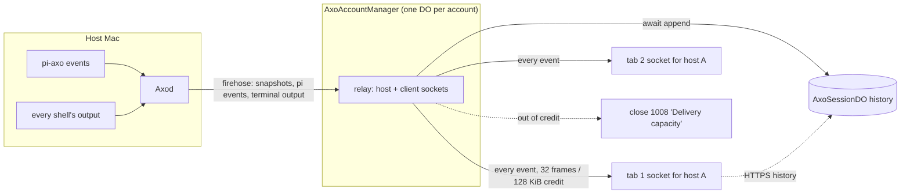

What goes wrong:

- **The relay sends a firehose and has no backpressure.** Axod's relay (`crates/axo-relay/src/relay.rs`, `host_notification`) forwards every local event to the cloud: Session snapshots, Pi events and every `terminal.output` chunk from every shell. `AxoHostRelay.receiveHostEvent` (`packages/axo-api-worker/src/axo-host-relay.ts`) sends each of them to every client subscribed to the host. There is no filter by Session or event type, and the web app throws terminal output away (`packages/axo-web-app/src/chat/workbench.ts`).
- **Client sockets close when credit runs out.** Each client may have at most 32 frames or 128 KiB waiting for acknowledgement (`deliveryCredits`). When `send()` would exceed that, the relay closes the socket with 1008 "Delivery capacity", and any request in flight on it, such as `axo.remote.session.prompt`, fails. Pi's `message.update` sends the whole partial message, thinking included, every 200 ms (`packages/pi-axo/src/events.ts`). That alone can fill the window. RFD0016's transport work stopped closing *host* sockets, but client sockets still behave this way.
- **The cloud copy is incomplete.** Upload is live-only and fire-and-forget. Events produced while Axod is disconnected, or before pairing, never reach the cloud. On reconnect, only snapshots are sent again (`remote_resync_events`). A failed store is logged and dropped. The stored record is also built from extension events trimmed to fit a frame (`fitForHistory`), not from the transcript itself.
- **Live data and history come from different places.** History is read over HTTPS from `AxoSessionDO` (`GET .../sessions/:session/events`). Live events come from the host firehose and never pass through it. The client stitches the two together and removes duplicates, and the boundary between them has races.
- **One DO does everything.** `AxoAccountManager` extends `AxoHostRelay`: one Durable Object per account holds every host socket, every client socket, the account's state, pairing, and Session snapshots. It awaits a Session DO append before it sends each event to clients.
- **Clients connect per host.** The web app opens one socket per host it shows (`RemoteAxoApi.connectHost`), as does the Swift `HostConnection`. A client following several Macs juggles several sockets.

Use cases:

1. Leo starts a long refactor in a Session on the Mac, closes the laptop lid on the train, and reads the Session on his phone. Everything up to the moment the Mac slept is there, and the rest arrives when the Mac wakes.
2. Leo has three browser tabs open on different Sessions. A busy build in a terminal pane, or a long reply streaming in another Session, doesn't affect any of them.
3. Leo pairs a Mac that has months of Sessions. They all appear in the cloud over the following minutes, the most recently active first, without anyone opening them.
4. Leo deletes old Sessions on the Mac to save space. They stay readable in the cloud, marked archived.
5. Leo sends a prompt while the Mac is asleep. He's told immediately that the Mac is offline, and the text stays in the input box.

## Goals

- Once paired, Axod uploads every Session's full transcript, and it keeps uploading new records whether or not any client is connected.
- No record is lost: after any disconnect, crash or restart, the next handshake uploads exactly what's missing.
- The cloud's transcript of a Session is the host's transcript, byte for byte, and any change to it can be detected.
- A client holds one socket, whatever the number of hosts and Sessions it shows.
- A client asks for the window it wants ("the last 10", "older than X", "everything after Y"), and receives nothing it already has.
- A slow or stalled client never disconnects itself or affects anyone else.
- Clients see replies stream in as they are written, without reassembling deltas.
- Clients don't need to know the agent is Pi beyond the payload format tag.

## Non-goals

- **Terminal output in the cloud.** It isn't uploaded or relayed. Clients follow Sessions, not terminals. It can return later as a separate, opt-in, ephemeral stream.
- **Semantic merging of diverged transcripts.** For now the host wins. ATXF's union merge replaces that later (see Future possibilities).
- **Rendering Pi branches.** Storage keeps the tree, because records keep `parentId`, but how clients present branches is later work.
- **Queueing prompts for an offline host.** Sending fails fast.
- **Deleting cloud copies.** Nothing a host does deletes a Session from the cloud. An explicit delete from a client is future work.
- **Several people sharing a Session.** A future "group client" could be one ClientDO that serves several sockets.
- **The agent-neutral format itself.** ATXF is designed separately (`leostera/agent-transcript-exchange-format`).

## Guide-level explanation

### Mental model

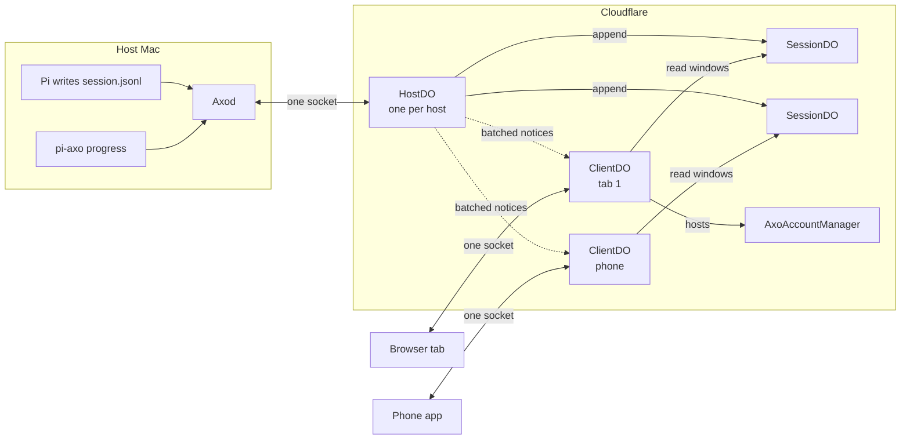

There are two independent halves:

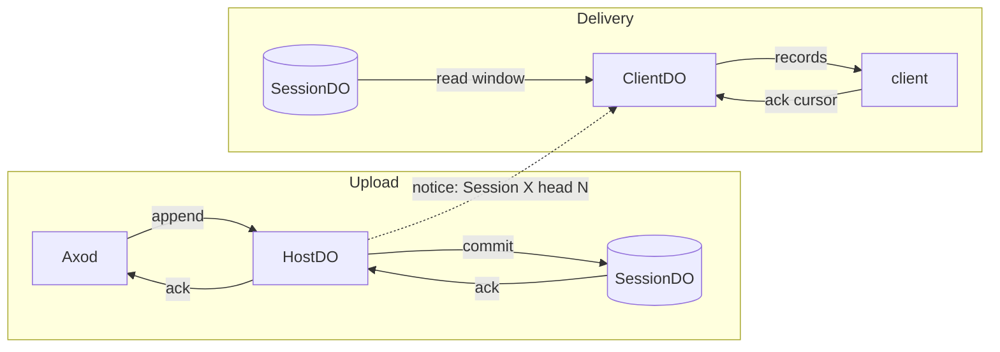

- **Upload:** Axod → HostDO → SessionDO. Axod uploads continuously. The HostDO acknowledges a record only after the SessionDO has committed it, and Axod moves its cursor only on that acknowledgement.
- **Delivery:** SessionDO → ClientDO → client. A ClientDO reads from SessionDOs when its client asks, and when a notice says a Session has new records.

They meet at exactly one point: after a commit, the HostDO sends a small notice ("Session X now goes up to N") to the ClientDOs following that host. A lost notice costs latency, never data, because the ClientDO can always read from its cursor.

Records come in two kinds:

- **Durable records** are lines of the Pi session file. They're uploaded until acknowledged, stored forever and hash-linked, and clients read them by cursor.
- **Ephemeral progress** is a snapshot of the reply being written, a running tool, or the agent's status. It's sent with the newest value winning, held in memory, and never stored or retried. When the durable record for an entry in progress lands, it replaces that entry's snapshot.

### Pairing a Mac with history

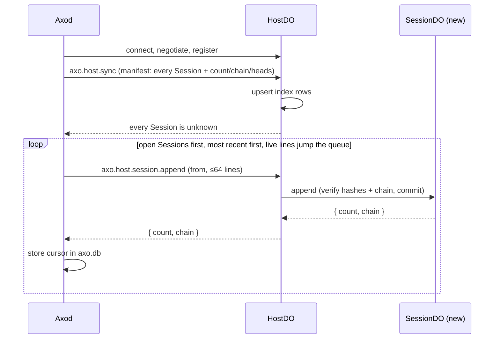

1. Axod connects and sends `axo.host.sync`: a manifest with one row per Session it has, open or archived, giving the Session's metadata and its upload state (`count`, `chain`, `heads`).
2. The HostDO answers with what the cloud holds for each Session. Here, it holds nothing yet.
3. Axod uploads open Sessions first, most recently active first, then archived ones. Within a Session it sends lines in file order with `axo.host.session.append`. New lines in an active Session always go ahead of backfill.
4. Each acknowledged batch moves Axod's per-Session cursor, which is stored in `axo.db`. If Axod restarts, it continues from there.

### Opening the web app

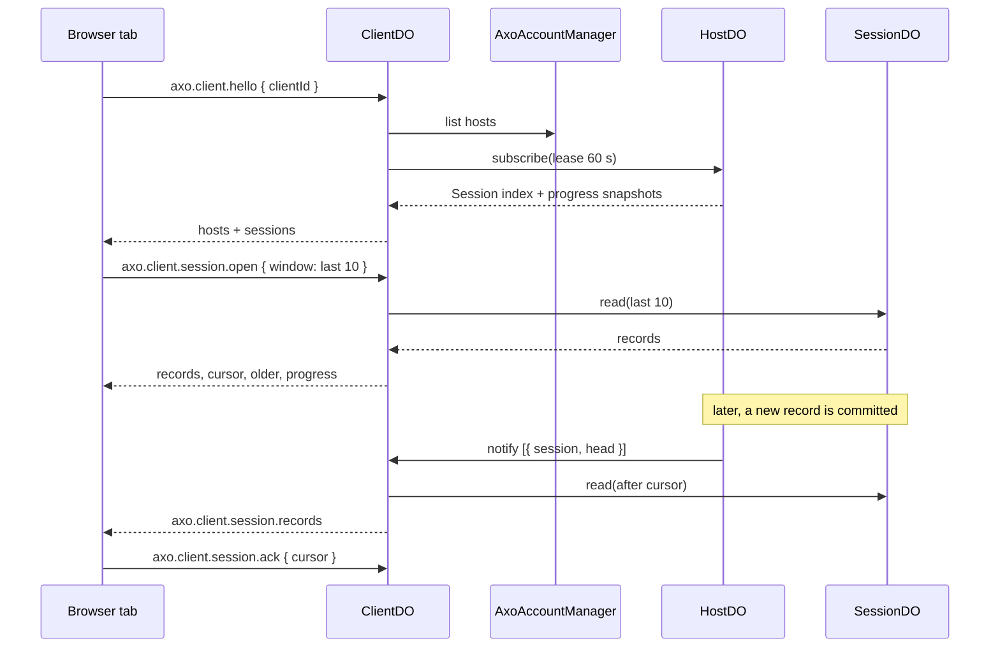

```text
client  → axo.client.hello { protocolVersion: 2, clientId: "tab-7f3a…" }
client  ← { hosts: [{ hostId, label, online }], sessions: [{ hostId, sessionId, title, head, archived, status }] }
client  → axo.client.session.open { sessionId: "9b1e…", window: { last: 10 } }
client  ← { epoch: 1, records: [ …10 records… ], cursor: 418, older: 408, progress: [{ slot: "message", snapshot: {…} }] }
client  ← axo.client.session.progress { sessionId, slot: "message", snapshot: {…} }      (every ~200 ms while a reply streams)
client  ← axo.client.session.records { sessionId, epoch: 1, records: [ …1 record… ], cursor: 419 }
client  → axo.client.session.ack { sessionId, cursor: 419 }
client  → axo.client.session.older { sessionId, before: 408, limit: 20 }                 (scrolling up)
```

A client that already holds part of the Session says so:

```text
client  → axo.client.session.open { sessionId, have: { epoch: 1, cursor: 412 } }
client  ← { epoch: 1, records: [ …records 413–419… ], cursor: 419, … }
```

### Sending a prompt

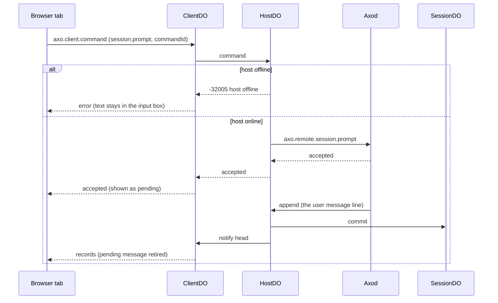

```text
client  → axo.client.command { hostId, method: "axo.remote.session.prompt", params: { sessionId, text, commandId } }
ClientDO → HostDO → Axod → Pi
client  ← { accepted: true }                       (or { error: "host offline" } at once)
… the user's message arrives later as a durable record, through the normal upload …
```

The client shows the prompt as pending until a durable user record with the same text arrives, as the web workbench already does.

## Reference-level explanation

### Components and ownership

| Component | Instances | Owns | Never holds |
|---|---|---|---|
| Axod relay | one per Mac | the socket to the cloud, the per-Session upload cursors in `axo.db`, the uploader and progress threads | client state |
| HostDO | one per host, named by `hostId` | the host socket and its epoch, presence, the host's Session index, the sync handshake, routing to SessionDOs, command forwarding, the subscriber lease table | transcript records, client sockets, connections state (RFD0016) |
| SessionDO | one per Session, named by `(account, host, sessionUuid)` | the durable records, hashes, chain, epoch and the current progress snapshots | sockets, subscribers |
| ClientDO | one per connected client, named by `(account, clientId)` | the client socket, its open Sessions and their cursors, the delivery pacing | records, host state |
| AxoAccountManager | one per account | the account, its hosts and pairing, connections (RFD0016) | sockets |

Session ids are UUIDs (RFD0017). The HostDO replaces today's `AxoHostRelay`/`AxoAccountManager` socket role. `AxoAccountManager` stops extending `AxoHostRelay`.

### Wire framing

Both sockets use the JSON-RPC 2.0 framing and the fragment layer from RFD0016 (`axo.transport.fragment`, `axo.transport.discard`). Fragments carry messages larger than one frame, such as a large Pi tool result. RFD0016's priority classes apply to the host socket: `control` (handshake, replies, commands), then `durable` (appends), then `ephemeral` (progress). `deliveryCredits` and `axo.transport.ack` are removed (see [Flow control](#flow-control)).

### Record identity and hashing (format `pi/3`)

A Session's transcript is the Pi session file: line 0 is the session header, and every later line is one immutable entry. The payload of each record is the **raw line bytes**, without the trailing newline, exactly as Pi wrote them.

- **Identity:** the record's `id` is Pi's entry `id`. The header's identity is the Session itself.
- **Position:** `position` is the line's index in the host's file, counting from 1 after the header. It belongs to the host's copy and is used only as Axod's upload cursor and in the prefix check. It is never an identity.
- **Hashes** follow ATXF §17's shape, with a separate domain prefix so a `pi/3` hash can't be mistaken for an ATXF hash:
  - `D(tag, bytes) = "sha256:" + hex(sha256("axo/pi3/" + tag + "\n" + bytes))`
  - `headerHash = D("transcript", rawHeaderLine)`
  - `contentDigest = D("content", rawLine)`
  - `hash = D("record", JCS({ transcript: headerHash, content: contentDigest, refs }))`, where `refs` has one entry for each reference field the entry has (`parentId`, `firstKeptEntryId`, `fromId`, `targetId`), mapped to the referenced record's hash, or `null`.
  - A line whose references point to an id that isn't an earlier record is invalid, and the upload stops at it (see [Failure semantics](#failure-semantics)).
- **Seal fields**, computed by both sides over the records in file order:
  - `count`: the number of records.
  - `chain`: starts at `headerHash`. Each record folds in as `chain = D("chain", chain + "\n" + hash)`.
  - `heads`: the sorted hashes of records that no other record references.
- Equal `id` with equal `hash` means the same record and the same ancestry. Equal `id` with a different `hash` is a conflict.

`format` is `pi/<sessionVersion>`, from the header's `version` (`pi/3` today). Pi's release version goes into the Session metadata, for display and debugging.

### Upload: the sync handshake

On every connect, after `axo.protocol.negotiate` and host registration:

```ts
// axod → HostDO
"axo.host.sync": {
  hostId, hostGeneration,
  round: number,          // raised on every handshake, across sockets; kept in axo.db
  sessions: Array<{
    sessionId: Uuid,
    metadataVersion: number, // raised on every metadata change; kept in axo.db
    metadata: { title, createdAt, updatedAt, archived, agent: { name: "pi", version } },
    format: "pi/3",
    upload: { count, chain, heads },
  }>,
}
// HostDO → axod
{
  round: number,          // echoes the request's round
  sessions: Array<
    | { sessionId, state: "unknown" }
    | { sessionId, state: "known", epoch, count, chain, heads }
  >,
  serverOnly: Uuid[],     // in the cloud but not in the manifest; informational
}
```

The HostDO upserts every row into its index before replying. Rows absent from the manifest are marked archived ("not on host") and are never deleted. The SessionDO is created on its first append. The HostDO reads each Session's `count`, `chain` and `epoch` from its SessionDO for the reply: the head in the HostDO's index is a cache, refreshed on every handshake, and subscribers are notified when the refresh changes it.

**Rounds.** Each handshake has a `round`. `axo.host.session.chainAt` and `axo.host.session.truncate` carry the round of the handshake that started them, and their replies echo it. Axod acts only on replies of its current round, and the HostDO ignores a manifest from an older round than the last it applied. Without rounds, a reply to a handshake that a timeout replaced, or a manifest delivered late, could be applied after a newer one (found by `specs/session-sync.ts`).

**Metadata versions.** Each Session's metadata has a version that Axod raises on every change. The manifest and `axo.host.session.meta` both carry it, and the HostDO applies a row only if its version is newer than the one it holds. Without versions, an older manifest could undo a newer "deleted on the Mac" (found by `specs/session-sync.ts`).

**Request timeouts.** Every request Axod sends (`sync`, `append`, `chainAt`, `truncate`, `meta`) has a timeout, 10 s to start with. When one fires, Axod starts the handshake again, and its answer says what the cloud holds. Without timeouts, a lost request or reply leaves Axod waiting forever (found by `specs/session-sync.ts`).

Axod classifies each Session, because only Axod can compute a chain at any position of its file:

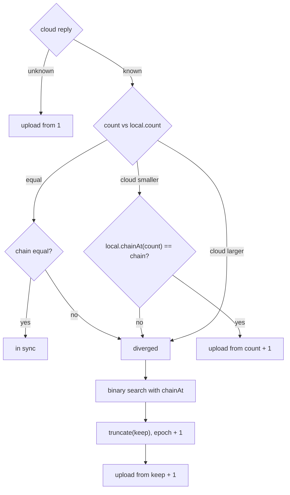

| Cloud reply | Axod's check | Result |
|---|---|---|
| `unknown` | none | upload from position 1 |
| `known`, `count == local.count`, `chain == local.chain` | none | in sync |
| `known`, `count < local.count` | `local.chainAt(count) == chain` | the cloud holds a prefix: upload from `count + 1` |
| `known`, `count > local.count`, or a chain mismatch | none | diverged: find the common prefix |

To find the common prefix, Axod binary-searches with `axo.host.session.chainAt { sessionId, positions: number[] }`, which returns the cloud's chain at each position. Asking for several positions per request keeps it to a few round trips. Before asking for the truncate, Axod lowers its stored cursor to `commonCount`, so it never claims records the cloud is about to delete. Then Axod sends `axo.host.session.truncate { sessionId, round, keep: commonCount, expectedChain }`. The SessionDO checks that its chain at `keep` is `expectedChain` (otherwise Axod syncs again), deletes every record past `keep`, increments `epoch`, and **records the cut** as `{ epoch, keep }`. The HostDO then notifies subscribers that the epoch moved (see [Delivery](#delivery-sessiondo--clientdo--client)). Uploading continues from `keep + 1`. The host is the authority for host-owned Sessions.

Axod stores, per Session, the last `{ position, chain }` the cloud acknowledged. That lets it start uploading straight after boot. When the cloud's reply disagrees with the stored value, **the cloud's reply wins**: Axod rewinds or skips forward to match.

`heads` doesn't take part in the decision while the host wins. It is sent so that later work can detect "same records, different order" and, once ATXF's union merge exists, swap truncation for a merge without changing the wire.

### Upload: appends

```ts
// axod → HostDO, priority "durable"
"axo.host.session.append": {
  sessionId, epoch,
  from: number,                                  // position of the first record
  records: Array<{ id: string | null, line: string, hash: string }>,   // id null only for lines with no Pi id
}
// HostDO → SessionDO.append(...) → HostDO → axod
{ count, chain }
```

- The SessionDO checks that `epoch` matches, recomputes every hash and the chain from its stored state and the raw lines, and commits the batch in one transaction.
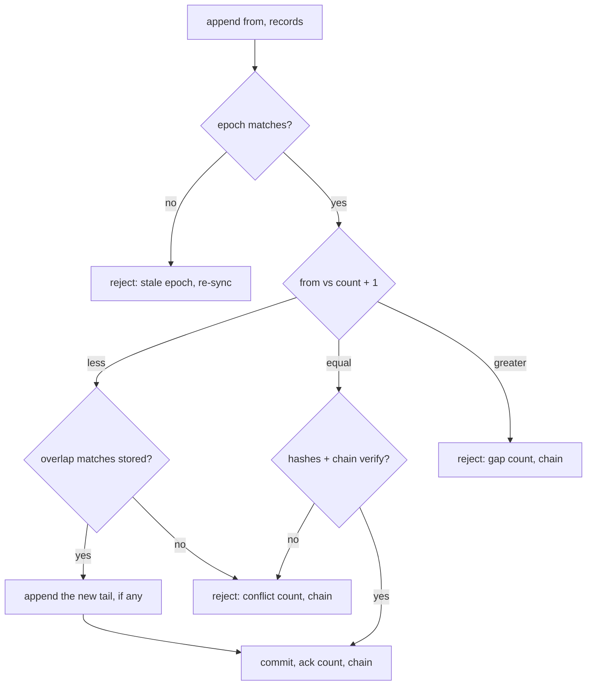

- If `from == count + 1`, the batch is new: it's appended.
- If `from <= count`, the overlapping part must match the stored records exactly (this is a retry), and anything new past `count` is appended. Retries are therefore idempotent.
- If `from > count + 1`, the request is rejected with `gap { count, chain }`. A mismatch is rejected with `conflict { count, chain }`. Either way Axod re-runs the handshake for that Session.
- A batch is at most 64 records or 1 MiB of lines. Axod keeps at most 4 append batches waiting for acknowledgement per Session and 16 in total.
- New lines in an active Session are sent ahead of backfill. Backfill goes through open Sessions most-recently-active first, then archived ones.
- Axod finds new lines by tailing the Session's `piSessionFile` (from its catalog). A last line without a trailing newline isn't complete yet and waits.

After a commit, the HostDO updates the Session's `head` and `updatedAt` in its index and queues a notice.

### Upload: metadata and status

```ts
"axo.host.session.meta":   { sessionId, metadata }          // durable, priority "control", acknowledged
"axo.host.session.status": { sessionId, status: "working" | "idle" | "prompt", at }   // ephemeral notification
```

- `meta` is sent when a Session is created, renamed, archived, unarchived or deleted on the Mac, with the raised `metadataVersion`. A deletion on the Mac is sent as `archived: true`. The cloud never deletes.
- Axod watches each Session's file. A change other than an append (the file shrank, or a line already uploaded changed) starts the handshake for that Session, which finds the divergence.
- `status` comes from pi-axo's `agent.start`, `agent.settled`, `ui.prompt.start` and `ui.prompt.end`. The HostDO keeps the latest status per Session in memory and puts it in notices.

### Ephemeral progress

```ts
// axod → HostDO, priority "ephemeral", notification
"axo.host.session.progress": { sessionId, slot: "message" | string /* toolCallId */, snapshot: unknown | null, at }
```

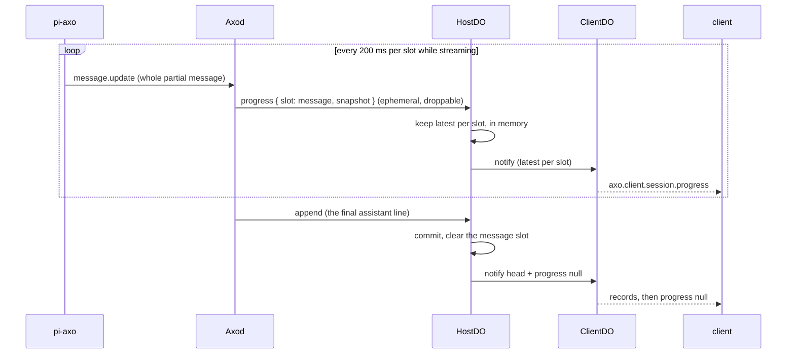

- pi-axo already produces these: `message.update` for the `"message"` slot and `tool.update` per `toolCallId`, throttled to one per slot every 200 ms, with the newest value winning (`ProgressThrottle`). Axod forwards them unchanged. `snapshot: null` clears a slot.
- The HostDO keeps the latest snapshot per `(sessionId, slot)` in memory and forwards it to subscribed ClientDOs with the newest value winning (see [Notices](#notices-hostdo--clientdo)). Snapshots are never written to storage.
- When a durable record lands, it clears the slot it completes: an assistant `message` record clears `"message"`, and a `toolResult` record clears its `toolCallId`.
- If a snapshot is lost, the next one replaces it, so nothing ever retries progress. A HostDO that is evicted loses snapshots in flight. That's acceptable: the next update or the durable record follows.

### Subscribers: the HostDO lease table

```sql
CREATE TABLE subscribers (client_do TEXT PRIMARY KEY, lease_until REAL NOT NULL);
```

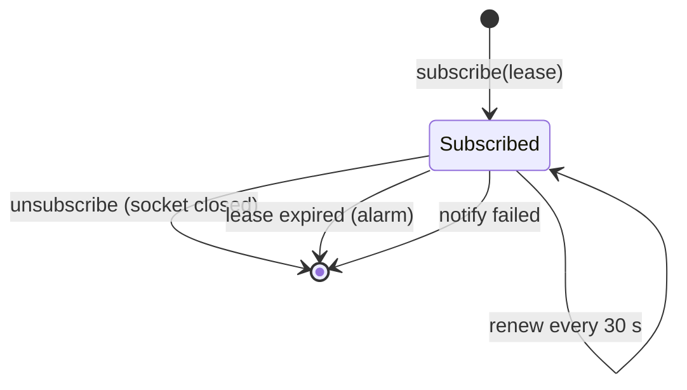

- `HostDO.subscribe(clientDO, leaseMs)` inserts or renews a row and returns the host's current index (Sessions with `head`, metadata and status) plus the current progress snapshots.
- ClientDOs renew every 30 s on a 60 s lease while their socket is open, and call `unsubscribe` when it closes.
- Expired rows are removed by the HostDO's alarm. A failed `notify` call removes its row.
- The table lives in the HostDO's SQLite, so it survives eviction.

### Notices: HostDO → ClientDO

```ts
ClientDO.notify(hostId, notices: Array<
  | { kind: "session", sessionId, head, epoch, metadata, status }
  | { kind: "progress", sessionId, slot, snapshot | null }
  | { kind: "epoch", sessionId, epoch, head }
  | { kind: "presence", online: boolean, hostGeneration }
>)
```

The HostDO batches notices and sends them every 50–100 ms, or at once for `epoch` and `presence`. Within a batch, only the latest notice per `(sessionId, kind, slot)` is kept. Notices carry heads and snapshots, never durable records.

An `epoch` notice says only that the Session was cut back, **not where**. Notices are merged and can be lost, so a ClientDO that missed one truncate, or two, would guess the wrong point. The ClientDO learns where from the SessionDO instead, on its next read (see Reads below). This was found by `specs/client-delivery.ts`: with the cut point carried on notices, a truncate followed by an append left a tab holding a record the cloud had deleted.

### Delivery: SessionDO → ClientDO → client

**Client socket.** `GET /api/v1/account/client?clientId=<id>` upgrades to a WebSocket. The client authenticates with the account session ("change" access, as today's client socket), and the Worker routes to `ClientDO(account, clientId)`. The browser generates `clientId` per tab and keeps it in `sessionStorage`, so a reconnect lands on the same ClientDO while each tab has its own. Native apps generate one per running instance. The ClientDO accepts one socket at a time. A new socket for the same `clientId` replaces the old one.

**Client protocol.**

| Method | Direction | Purpose |
|---|---|---|
| `axo.client.hello { protocolVersion, clientId }` | request | starts the session. The ClientDO lists the account's hosts from `AxoAccountManager`, subscribes to each HostDO, and replies with hosts and their Session indexes |
| `axo.client.hosts` | notification | the host list or presence changed |
| `axo.client.sessions { hostId, sessions }` | notification | Session index changes (head, metadata, status), batched |
| `axo.client.session.open { sessionId, have?: { epoch, cursor }, window?: { last } }` | request | opens a Session. It returns records after `have.cursor` (or the last `window.last`, by default 20), the current `cursor`, the `older` cursor for paging, and the current progress snapshots |
| `axo.client.session.records { sessionId, epoch, records, cursor }` | notification | new durable records past the client's cursor |
| `axo.client.session.ack { sessionId, cursor }` | notification | the client has processed records up to `cursor`. Acknowledgements are cumulative, and the client acknowledges every batch it receives, including one it already holds |
| `axo.client.session.older { sessionId, before, limit }` | request | a page of older records, newest first |
| `axo.client.session.progress { sessionId, slot, snapshot }` | notification | the newest progress snapshot, or `null` to clear |
| `axo.client.session.reset { sessionId, epoch, keep }` | notification | the Session was truncated. The client drops records past `keep` and continues in the new epoch |
| `axo.client.session.close { sessionId }` | notification | stop delivering this Session |
| `axo.client.command { hostId, method, params }` | request | forward a command to the host |

**Records on the client wire:**

```ts
{ cursor: number, id: string | null, format: "pi/3", line: string /* raw Pi line */, hash: string }
```

- `cursor` is the SessionDO's own order: the position of the record in the cloud copy. It is the client's resume point, valid within one `epoch`.
- Clients parse `line` according to `format`. Only the format adapter on the client knows about Pi.

**Pacing.**

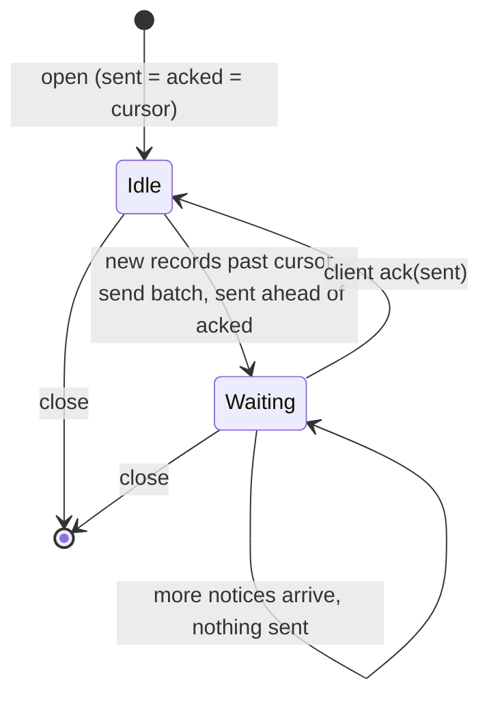

For each open Session, the ClientDO keeps `sent` (the last cursor sent) and `acked` (the last cursor the client acknowledged). It sends a records batch (at most 64 records or 512 KiB) only when `sent == acked`. If a batch is still unacknowledged at the next lease renewal, the ClientDO sends it again. The client ignores records it already holds and acknowledges the batch, so a lost acknowledgement costs one renewal interval, not the Session (found by `specs/client-delivery.ts`). A client that stops acknowledging stops receiving, but its socket stays open and nothing is dropped. Progress keeps at most one pending snapshot per slot, and a newer one replaces it. Index notices are merged in the same way. The ClientDO's memory per client is therefore bounded no matter how fast the host produces.

**Reads.** `SessionDO.read({ after?: cursor, before?: cursor, limit, epoch })` returns records in cursor order. If the reader's epoch is older than the SessionDO's, it returns `reset { epoch, keep }`, where `keep` is the **lowest cut** recorded since the reader's epoch. That's correct however many truncates the reader missed.

Each open or live read carries an id, and the ClientDO applies only the reply to its latest one. Without ids, a reply to a superseded read (say, from a repeated `open`) was applied as current: the ClientDO sent a second batch while one was outstanding, and applied an old reset after a newer window (found by `specs/client-delivery.ts`).

When the HostDO reports a newer epoch than the open Session's, the ClientDO reads with its old epoch at once, even with a batch outstanding, to learn the cut and send `axo.client.session.reset`.

### Commands

`axo.client.command` carries an existing `axo.remote.*` method (`session.prompt`, `session.key`, `session.create`, `session.rename`, `workspace.list`, …) and its params, which include a `commandId` wherever the method mutates something. The ClientDO calls `HostDO.command(...)`, and the HostDO forwards it to Axod at `control` priority and returns Axod's reply.

- **The host is offline** (no socket, or its lease has expired): the call fails at once with `-32005 "host offline"`. Nothing is queued.
- **The socket drops while a command is in flight:** the call fails with `-32004 "may have run; reconcile commandId"`, as today. The client looks at the transcript, where the durable record shows whether the command took effect.
- A command's effect always comes back through the normal upload, never through the command reply.
- Every client request has a timeout (10 s, as `RemoteAxoApi` has today). A command that times out is shown as "may have run", like a dropped socket.

### Flow control

| Flow | What limits it |
|---|---|
| Axod → HostDO, appends | the number of batches waiting for acknowledgement (4 per Session, 16 in total) |
| Axod → HostDO, progress and status | throttling at the source, one per slot per 200 ms. The newest value wins in Axod's ephemeral queue (RFD0016) |
| HostDO ↔ Axod, commands | requests waiting for a reply, per client and per host (today's `pendingPerClient` and `pendingPerMachine`), and timeouts |
| HostDO → ClientDO, notices | batching every 50–100 ms, with the latest value per key |
| ClientDO → client, records | the client's `ack` (one batch outstanding per Session) |
| ClientDO → client, progress and index | the latest value per key, at most one pending each |

`deliveryCredits`, `axo.transport.ack` and the `outgoing` frame accounting are removed from both sockets. The hard caps stay as protection against abuse: inbound frame rate per socket, maximum frame and message size, fragment limits, and the maximum number of pending requests.

### Lifecycle and retention

- A Session appears in the cloud when it first appears in a manifest.
- Archiving, unarchiving and renaming on the Mac are mirrored through `meta`.
- Deleting on the Mac, or disappearing from the manifest, marks the cloud copy archived. **The cloud never deletes because a host did.**
- SessionDOs keep records indefinitely. The SQLite storage limit per Durable Object is far above any transcript.
- Revoking a host (RFD0013) closes its socket and stops uploads. Its Sessions stay readable in the account.

### Failure semantics

The most common failure, a lost acknowledgement, heals through the next handshake:

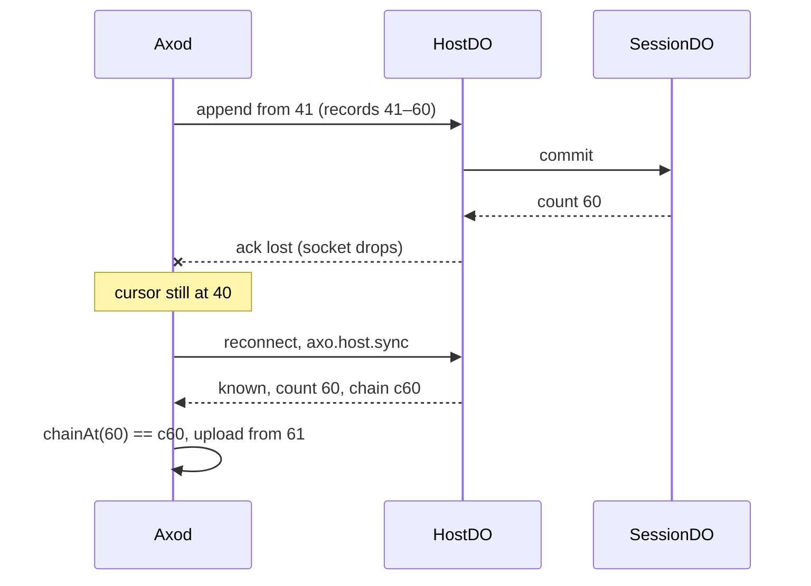

| Failure | Behaviour |
|---|---|
| The socket drops during an append | Axod doesn't move its cursor. On reconnect the handshake reports the cloud's real `count` and upload continues. A batch that had committed is acknowledged again as a retry |
| The acknowledgement is lost but the commit happened | same as above: the retry overlaps, matches, and is acknowledged |
| Axod crashes | on boot it reads its stored cursors, connects, and the handshake corrects any difference |
| `axo.db` is reset | Axod has no cursors, uploads with `from` = the cloud's `count + 1` after the handshake. Nothing is uploaded twice |
| The Pi file is rewritten (format migration, restore) | the chain differs: a divergence. The common prefix is kept, the rest is replaced, `epoch` is incremented, clients reset |
| A line with an unknown reference, or invalid JSON | Axod stops uploading that Session at that line, logs `event=sync.invalid_line`, and retries after the file changes. Other Sessions continue |
| The HostDO is evicted | the socket closes, Axod reconnects, and the handshake resumes. Leases and the index are in SQLite. Progress in memory is lost |
| The ClientDO is evicted | the client reconnects with the same `clientId` and reopens Sessions with `have`. The ClientDO re-subscribes to its hosts |
| A notice is lost | the client's view is stale until the next notice, a reopen, or the lease renewal, which returns the current index |
| A client's acknowledgement is lost | the batch is sent again at the next lease renewal |
| A request from Axod gets no answer | its timeout starts the handshake again |
| An append's commit is lost between the HostDO and the SessionDO | Axod syncs again. The handshake refreshes the HostDO's head from the SessionDO, and subscribers hear it |
| A client stops reading | it stops receiving records. Its socket and the other clients are unaffected |

### Invariants

1. **Upload is complete in the end:** for every Session in a manifest, the cloud's records equal the host file's lines after the handshake and uploads finish, as long as the host stays connected and the file stops changing.
2. **A prefix is never rewritten silently:** the cloud's records at positions `1..n` change only through `truncate`, and every truncate increments `epoch`.
3. **Acknowledged means committed:** Axod moves its cursor only past records the SessionDO has committed.
4. **Appends are idempotent:** re-sending any acknowledged batch changes nothing.
5. **Hashes hold:** every stored record's `hash` and the stored `chain` match the stored raw lines.
6. **No gaps for clients:** within one `epoch`, a client that applies `open`, `records` and `older` responses holds a contiguous run of cursors, with no gaps or duplicates.
7. **Progress never outlives the record it previews:** after the durable record for a slot is committed, the HostDO holds no snapshot for that slot.
8. **Delivery is bounded:** the ClientDO holds at most one outstanding records batch per open Session, and at most one pending snapshot per slot.
9. **A slow reader is never disconnected:** no flow-control condition closes a socket.
10. **The cloud never deletes for the host:** no host message removes a Session or its records, except records past `keep` in a truncate.
11. **Prompts are never stored:** a command to an offline host fails and leaves no state behind.

### Observability

Following `leo-code-observability` conventions and the existing `recordApiEvent` events:

- Axod: `event=sync.handshake sessions=… unknown=… behind=… diverged=…`, `event=sync.append session_id=… from=… records=… outcome=…`, `event=sync.diverged session_id=… keep=…`.
- HostDO: `host_sync`, `session_append { outcome: committed | retry | gap | conflict }`, `session_truncate`, `notice_batch { subscribers, notices }`.
- ClientDO: `client_open`, `client_records { batch, lagMs }`, `client_stalled` (no `ack` for 60 s).
- Logs never contain transcript content.

## Security and privacy

- Transcripts are the account's private data. A SessionDO is named by `(account, host, sessionUuid)` and checks its identity binding on every call, as `AxoSessionDO` does today.
- The HostDO only accepts appends for Sessions of its own host, over a socket authenticated with the host credential (RFD0013).
- The ClientDO only follows hosts that `AxoAccountManager` lists for its account, and only reads SessionDOs of those hosts.
- Hashes prove a transcript is complete and unchanged, not who wrote it. Anyone holding the host credential can upload. Signed seals are future work.
- Uploading every Session, including old archived ones, puts more of the person's history in the cloud than today, where only lasting events produced while connected are stored. Pairing should say so.

## Rollout

This is a cutover. It isn't a compatibility layer: Axo's clients ship with Axod, and the cloud is deployed by the same person.

1. **Specs:** two Feynman models, below, before any code.
2. **Cloud storage:** a new `SessionDO` schema with records, hashes, chain and epoch, keyed by Session UUID (RFD0017). Today's `pi_events` history is discarded, and each Session's history is rebuilt by the first sync.
3. **HostDO:** the socket route moves from `AxoAccountManager` to `HostDO(hostId)`. Handshake, appends, metadata, status, progress, leases, notices, commands. The client fan-out and `axo.host.subscribe` are removed from the relay.
4. **Axod:** the sync handshake replaces the snapshot-only registration. The session-file uploader replaces the `host_notification` firehose. Progress and status go through RFD0016's `RelayChannel` (`Priority::Ephemeral`). Upload cursors are stored in `axo.db`.
5. **ClientDO and the web app:** the client socket and protocol. `RemoteAxoApi` keeps one socket per tab, the workbench opens and closes Sessions by window, and the HTTPS history route and per-host sockets are removed.
6. **Swift:** `HostConnection` is replaced by one client connection.

The protocol version goes to 2, together with RFD0017 if their timing allows. A version mismatch is refused clearly at negotiation.

## Testing

- **Feynman specs:**
  - `specs/session-sync.ts`: Axod, HostDO and SessionDO. The handshake in every state (unknown, prefix, in sync, diverged), lost acknowledgements, reconnects during appends, `axo.db` reset, file rewrite, deletion on the Mac, and concurrent backfill with live appends. Properties: invariants 1–3 and 10, plus "synced once quiet" and "upload completes". Safety holds exhaustively to depth 11 with one fault (12M states). Liveness holds as far as the search reaches. It found request timeouts, handshake rounds and metadata versions.
  - `specs/client-delivery.ts`: HostDO, SessionDO, ClientDO and a browser tab. Open with and without `have`, paging, live records with acknowledgement pacing, a stalled tab, lost notices and acknowledgements, lease expiry, reset after truncate, progress replaced by its durable record, and a prompt to an offline host. Properties: invariants 6–8 and 11, plus "catches up". Safety holds exhaustively to depth 10 with one fault (11M states). It found cut points recorded by the SessionDO, read ids, client request timeouts, resending unacknowledged batches, and refreshing the HostDO's head after a failed commit.
  - Invariants 4, 5 and 9 aren't modelled: idempotence and hashes are checked by unit tests and shared vectors, and nothing in either model can close a socket for flow control.
- **Hash vectors** shared by Rust and TypeScript: header, record, chain and heads for a fixture Pi file, including compaction, branch summaries and labels.
- **Axod:** uploader unit tests against a fake HostDO (retry overlap, gap, conflict, divergence search, partial last line), plus an integration test that pairs against `wrangler dev` and checks that every line arrives.
- **Worker:** SessionDO append, read and truncate. HostDO handshake and leases. ClientDO pacing and reset, using the existing `packages/axo-api-worker/tests` harness.
- **Web:** workbench tests for open, older, ack, reset and progress replacement.

## Drawbacks

- **More moving parts.** Four DO roles and two protocols replace one relay. Each is simpler, but there are more interfaces to keep consistent.
- **Everything is uploaded.** Pairing a Mac with years of Sessions uploads all of them, which costs storage and bandwidth before anyone reads them.
- **The Pi file format is an interface.** Axod depends on Pi appending whole lines, and clients parse Pi lines until ATXF arrives.
- **Host-wins truncation can lose cloud-only history.** If the cloud held records the host no longer has in that order, a divergence replaces them. That's rare and logged, and ATXF's merge removes it later.
- **One extra hop for live updates.** Records reach a client through HostDO → notice → ClientDO → SessionDO read. That's a few milliseconds more than a direct relay.

## Rationale and alternatives

### Keep the relay and tune it

Raise the credit window, filter terminal output and wait instead of closing sockets. This fixes the immediate error, but leaves the cloud copy incomplete, keeps live data and history apart, and keeps one DO per account doing everything.

### Translate in the cloud

Axod uploads raw records and the Worker converts them per agent. Rejected: the Worker would need to know every agent. Translation belongs next to the agent, and later ATXF converters do it.

### Extension events as the durable record

Keep uploading pi-axo's `message.end`/`tool.end` events. They're trimmed to fit frames and exist only while Axod is connected, so they can't be backfilled. The session file is complete and can be replayed.

### Each SessionDO keeps its own subscribers

Every open Session gives the ClientDO a lease on that SessionDO, and the SessionDO notifies directly. It works, but every SessionDO then tracks subscribers. The HostDO already sees every commit for its host, so one lease table per host covers every Session with one subscription per client and host.

### A queue or K2 stream for fan-out

Publish committed records to Cloudflare Queues or a K2 stream and have clients consume them. Queues deliver each message to one consumer, in batches, without guaranteed order. K2 consumers poll, subscriptions are API-managed objects (at most 100 per stream, 20 streams per account), and retention is at most 30 days, so K2 can't be the system of record and would hold a second copy. Both suit background consumers, not a chat that streams a reply as it's written. K2 remains a good outlet after commit (see Future possibilities).

### Transport credits

Keep per-frame credits as the backpressure. They count frames rather than meaning anything, and the only way they could ever react to a slow reader was to drop it. Cursors and commit acknowledgements limit each flow with an acknowledgement that's also the resume point.

### Progress deltas

Send only new text with a counter per entry in progress. That's smaller, but every client must reassemble the deltas and resync on gaps. Snapshots heal themselves and keep clients simple.

### A full Merkle tree, or no hashes

A hash chain plus per-record hashes in ATXF's shape detects tampering and finds the common prefix in `log n` round trips. That's all an append-only log needs. A full Merkle tree adds structure we wouldn't use. Without hashes we couldn't tell a retry from a conflict.

### Queue prompts for offline hosts

This would need an expiry, cancellation, a choice between steer and follow-up on delivery, and a display shared by several tabs. Rejected for now. The `commandId` keeps it possible to add later.

### Do nothing

Prompts keep failing under load, history keeps having holes, and every client keeps juggling sockets per host.

## Prior art

- **RFD0013** defines host pairing and credentials, which the HostDO socket keeps.
- **RFD0016** defines fragments, priority classes and the HostDO / `AxoAccountManager` split for connections. This RFD builds on them and removes credits.
- **RFD0017** makes Session ids UUIDs. This RFD keys SessionDOs and the wire by them.
- **ATXF §17** (`leostera/agent-transcript-exchange-format`, `SPEC.md`) defines record hashes, `chain` and `heads`. The `pi/3` hashes here copy that shape.
- **Git** gives hashes that cover parents, a ref (`chain`) per copy, and fetch negotiation by "what do you have".
- **Kafka-style logs** give cursors as consumer offsets. The SessionDO is the log and each ClientDO is one consumer.
- **Matrix's `/sync`** has clients resume from a `since` token and fetch older events by pagination, which is the same split as `have` and `older` here.

## Unresolved questions

### Before acceptance

- Does the protocol v2 bump land with RFD0017, or does this need v3?
- Is the progress `slot` rule (an assistant `message` record clears `"message"`, a `toolResult` record clears its `toolCallId`) enough for every Pi entry that streams?
- Should pairing ask before uploading archived Sessions, or upload everything as decided?

### During implementation

- The batch sizes, lease times and notice interval above are first guesses. Tune them against real Sessions.
- How Axod discovers `piSessionFile` changes: watching the file, or polling it after Pi's bridge events.
- The exact `D()` byte layout, fixed with shared test vectors.

### Out of scope

- Terminal output in the cloud.
- Merging diverged copies (ATXF).
- Deleting Sessions from the cloud.
- Sessions shared between people.

## Future possibilities

- **ATXF storage and merge:** store ATXF records (converted from `pi/3`, ids preserved), and replace host-wins truncation with ATXF's union merge, so a divergence becomes branches. `heads` is already on the wire for this.
- **K2 after commit:** the SessionDO produces committed records to one account-wide K2 stream for background consumers: ATXF conversion, search indexing, analytics and export. A new consumer replays from `earliest`.
- **Remote Sessions on the Mac:** `serverOnly` in the handshake lets a Mac show Sessions that only the cloud, or another Mac, has.
- **Opt-in terminal streams:** a ClientDO subscribes to one shell's output through the HostDO while a terminal view is open.
- **Signed seals**, to prove which host vouches for a transcript.
- **Group clients:** one ClientDO serving several sockets, for Sessions shared between people.
