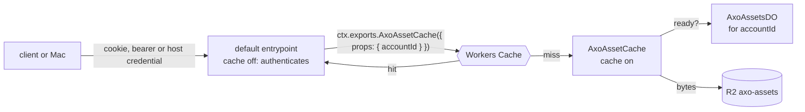

# RFD0030 - Axo: Assets

- Feature Name: `axo-assets`
- Status: Implemented
- Author: leostera
- Start Date: 2026-11-04
- Updated: 2026-11-04
- Document Type: Proposal
- Amends: [RFD0018](RFD0018-session-sync-and-client-delivery.md), [RFD0024](RFD0024-remote-sessions-in-pi.md)

## Summary

An **asset** is a file the account keeps in the cloud: a photo from the phone, a PDF dropped on the web, later a screenshot from a remote computer-use call. Each asset is named by the SHA-256 of its bytes and belongs to one account.

- **Storage:** one `AxoAssetsDO` per account indexes the account's assets. The bytes are in an R2 bucket, `axo-assets`, under the account's prefix.
- **Reading:** every read goes through Workers Cache. A gateway entrypoint authenticates the caller, then asks a cached entrypoint, `AxoAssetCache`, with the account in `ctx.props`. On a hit, neither the cached entrypoint nor the Durable Object runs.
- **First use, attachments:** a person attaches photos and files to a message on the web or iOS. The client uploads them, then sends the prompt naming them. The Mac downloads each one, checks its hash, and gives Pi the images as images and the other files as paths on disk.

Later uses, each in its own change: screenshots from `codemode.<mac>.computerUse`, images in the confirmation cards of RFD0029, and moving the images inside transcripts out to assets.

## Motivation

- **Clients can't send a picture.** A prompt from the web or iOS is text, at most 16,000 bytes. A person away from the Mac can't show the agent a screenshot, a photo of a whiteboard, or a PDF.
- **Big blobs have nowhere to go.** The pieces coming next all carry files: remote computer use returns screenshots, RFD0029's cards show one, an agent may hand the person a file. Today the only places are a 64 KB relay frame, a 1 MB script result, or a transcript line.
- **Images in transcripts are inline base64.** One screenshot makes a multi-megabyte record that every client downloads with the transcript. Share links drop images altogether.

## Guide-level explanation

### Attaching a photo from the phone

Leo is away from his Mac, in a Session on his iPhone. He taps the paperclip, picks a photo of a whiteboard, types *turn this into a TODO list* and sends it.

- **Upload:** the app converts the photo to JPEG, hashes it and uploads it. A small thumbnail shows in the message box with a progress ring. Send waits until every upload has finished.
- **Prompt:** the app sends the prompt with the text and a list of attachments, each one `{ asset: "sha256:…", name, mimeType, size }`.
- **On the Mac:** axod downloads each attachment it doesn't already have to `~/.axo/assets/<hash>/<name>`, checks the bytes against the hash, and passes the prompt to Pi with the photo as an image.
- **Everywhere else:** Pi records the image in its transcript, which syncs as it does today, so the web and the Mac show the photo in the user's message.

A PDF works the same way, except that Pi gets a line instead of an image: *Attached: invoice.pdf (application/pdf, 240 KB), saved at `/Users/leostera/.axo/assets/9f2c…/invoice.pdf`*. The agent reads it from there with its own tools.

### Attaching on the web

The web's message box takes files by a paperclip button, by pasting and by dropping. Each file uploads as soon as it is added and shows as a chip; removing a chip before sending drops the attachment, and the uploaded asset stays in the account (see *Lifecycle*).

## Reference-level explanation

### Naming and limits

- **Name:** `sha256:<64 lowercase hex>`, the hash of the bytes. The same bytes uploaded twice to one account are one asset.
- **Per asset:** at most 100 MiB.
- **Per account:** at most 10 GiB, and at most 10,000 assets. An upload past either limit is refused with `quota`.
- **Per prompt:** at most 8 attachments.
- **Metadata:** a media type (`Content-Type` at upload, checked against an allowlist of common types; anything else is stored as `application/octet-stream`), a display name (1 to 255 bytes, no `/`, no control characters), the size, when it was first uploaded, and by what (a person's sign-in or a Mac).

### Storage: one AxoAssetsDO per account

- **Index:** `AxoAssetsDO`, named by the account id, holds one SQLite table: `assets(hash, size, type, name, created_at, created_by, state, version)`, and the account's running total. `state` is `reserved`, `ready`, `deleting` or `deleted`.
- **Bytes:** R2 bucket `axo-assets`, key `accounts/<accountId>/<hash>`. The prefix is per account on purpose: nothing is shared between accounts, so an upload can't reveal that another account already has the same file.
- **Why its own Durable Object:** the account's directory object already handles sign-in, hosts and connections. Assets have their own load (uploads, listings, quota) and their own storage, so they get their own object, still one per account.

### Uploading

`PUT /api/v1/account/assets/<hash>`, with the bytes as the body, `Content-Type`, `Content-Length` and `X-Axo-Asset-Name`.

1. **Authenticate:** a person (session cookie with the app's `Origin`, or a bearer token) or a Mac (its host credential, as for the host socket). A Mac uses `/api/v1/accounts/<accountId>/hosts/<hostId>/assets/<hash>`, the account-scoped path its sockets use, with `Authorization: Bearer <credential>` and `X-Axo-Credential-Id`.
2. **Reserve:** the account's `AxoAssetsDO` checks the limits and the name, and:
   - returns `exists` if the asset is already `ready`: the upload ends with `200` and nothing is sent to R2, but the asset's `version` goes up, as for any successful upload (see *Deleting*);
   - returns `busy` (`409`) while the asset is `deleting`;
   - or reserves the size against the quota. A reservation counts against the quota from the moment it is made, so uploads in parallel can't overshoot it.
3. **Store:** the Worker streams the body to R2 with `put(key, body, { sha256: hash })`. R2 checks the hash and refuses bytes that don't match, so an asset's bytes always match its name.
4. **Commit:** the Durable Object marks the asset `ready`, or releases the reservation if the store failed. A reservation nobody commits within 10 minutes is released by an alarm. A commit that arrives after its reservation was released fails, and so does the upload: the Worker answers `200` only once the commit has been acknowledged, so an upload answered `200` is always in the account.

`HEAD /api/v1/account/assets/<hash>` answers `200` or `404`, for a client that wants to skip uploading what is already there.

### Reading, through Workers Cache

`GET /api/v1/account/assets/<hash>` returns the bytes, with the asset's `Content-Type`, `Content-Disposition` naming the file, and `ETag: "<hash>"`.

- **The gateway:** the Worker's default entrypoint has caching off, so it runs on every request. It authenticates the caller, then calls the cached entrypoint with a fresh request carrying no cookies or `Authorization`, just the path, and `props: { accountId }`.
- **The cache key holds the account:** `ctx.props` is part of Workers Cache's key, so one account's entries are never served to another, even for the same hash.
- **The cached entrypoint:** `AxoAssetCache` asks the account's `AxoAssetsDO` whether the asset is `ready`, then streams the object from R2 itself, so reads never queue behind the Durable Object. It answers with `Cache-Control: public, max-age=31536000, immutable` and `Cache-Tag: asset-<accountId>-<hash>, assets-<accountId>`. An asset's bytes never change, so a cached copy is only wrong once the asset is deleted.
- **Misses that must not be cached:** a missing asset answers `404` with `Cache-Control: no-store`, so an asset uploaded a moment later isn't hidden behind a cached 404.
- **To the client:** the gateway passes the body on with `Cache-Control: private, max-age=31536000, immutable`, so a browser keeps it and no shared cache does.
- **Nothing served runs script:** uploads of any type outside a short list (PNG, JPEG, GIF, WebP, HEIC, PDF, text, Markdown, CSV, JSON, ZIP) are stored as `application/octet-stream`. Only PNG, JPEG, GIF and WebP are served `inline`; everything else is `attachment`, with `X-Content-Type-Options: nosniff` and `Content-Security-Policy: default-src 'none'; sandbox`.

### Deleting

`POST /api/v1/account/assets/<hash>/delete` with `{ "version": n }`, the version the person's client last saw (a person only).

1. **Only the version that was seen is deleted.** A delete and an upload of the same file can arrive in either order, from one device or two. If the asset has been uploaded again since the client saw it, its version has moved on, and the delete is refused with `409`. Otherwise an older delete could remove a file the person had just attached again.
2. `AxoAssetsDO` marks the asset `deleting` and removes it from the total, deletes the R2 object, and marks it `deleted` once R2 has. Until then an upload of the same hash answers `busy`, because a re-upload committed while the R2 delete is still on its way would lose its bytes to it.
3. It then purges the tag `asset-<accountId>-<hash>`, by calling an RPC method on `AxoAssetCache`: purges are scoped to the entrypoint whose cache they purge, and RPC calls bypass the cache.
4. **A read in flight can bring it back.** A read that got the bytes before the delete can still be storing them in the cache after the purge, and the entry would live for a year. So the Durable Object purges the tag again, from an alarm, 15 minutes after the delete: longer than a read of the largest asset may take. Between the two purges, a deleted asset may still be served to the account that owned it.
5. A browser that already has the file keeps it; it is the person's own copy.

### Attachments on prompts

- **Protocol:** `axo.remote.session.prompt` (RFD0024) takes `attachments?: Attachment[]` (at most 8), where `Attachment = { asset: "sha256:<hex>", name: string, mimeType: string, size: number }`. Text may be empty when there are attachments. The Mac app's local `axo.session.prompt` doesn't take them in this change: on the Mac a file is already on disk.
- **Clients:** a client sends the prompt only after every upload in it has answered `2xx`.
- **axod**, before passing the prompt to Pi:
  - downloads each attachment it doesn't have to `~/.axo/assets/<hash>/<name>` (written to a temporary file and renamed into place), with the Mac's host credential, from the cached `GET`;
  - checks the SHA-256 of the bytes against the name, and refuses the prompt if any attachment is missing (`404`), too large, or doesn't match: the person sees *the attachment could not be fetched*, and Pi gets nothing. A prompt is never delivered with some of its attachments missing.
  - does this on a thread of its own (at most 4 prompts fetching at once), answering the relay's request once Pi has the prompt or with why it was refused (`-32010`), so the relay socket never waits on a download.
- **pi-axo:** the bridge's `send` command takes `attachments: [{ path, asset, mimeType, name, size }]`.
  - `image/png`, `image/jpeg`, `image/gif` and `image/webp` up to 5 MiB become image blocks in `sendUserMessage([{type:"text"}, {type:"image", data, mimeType}])`.
  - Anything else, or a larger image, becomes a text line naming the file, its type, its size and its path, and `axo-asset:sha256:<hex>`, so clients can turn it into a download link. An image sent inline gets a line too, with its path, so the agent can use the file in its tools; clients hide that one, since the image shows itself.
- **Clients send model-friendly images:** iOS converts HEIC to JPEG before upload; the web uploads images as they are.

### Lifecycle

- **This change keeps assets until the person deletes them**, within the account's quota. The web gets `GET /api/v1/account/assets` (newest first, paged), and a delete per asset.
- **Not in this change:** expiry, and counting references from transcripts, share links and archived Sessions so that unreferenced assets go by themselves.

### Logging

- The Worker logs uploads, refusals and deletes with the account, the hash, the size and the caller (person or Mac), never names or contents.
- axod logs `event=assets.fetch hash=… bytes=… outcome=…`.

## Testing

- **`specs/assets/assets.ts` (Feynman):** two accounts, the gateway, Workers Cache, `AxoAssetCache`, `AxoAssetsDO`, R2 and the Mac. Every property held on every path of up to 14 events. They are:
  - no account reads another's asset, from the cache or by uploading other bytes under its name;
  - an object's bytes always hash to its name;
  - an asset `ready` in an index always has its bytes;
  - opening an asset after its upload, with no delete since, never answers 404;
  - once a delete has settled, the cache holds nothing for it;
  - a prompt reaches Pi with all of its attachments or not at all.

  Each of its nine rules is needed. The checker found three flaws in the first draft:
  - a re-upload while the R2 delete was still on its way lost its bytes (fixed by `deleting`);
  - a delete overtaken by a re-upload removed the file just attached (fixed by versioned deletes);
  - a read that outlives both purges would bring a deleted asset back; the design assumes reads end within 15 minutes, and the spec shows that assumption is needed.
- **`specs/assets/asset-quota.ts` (Feynman):** parallel and abandoned uploads. Exhaustive to depth 40: the quota holds, abandoned reservations are released, and an upload answered `200` is kept.
- **Worker tests (`packages/axo-api-worker/tests`):** upload, `exists`, hash mismatch, quota, name and type checks, delete and purge, per-account isolation, and the gateway's authentication for people and Macs.
- **axod tests:** download with hash check, refusal on mismatch or missing, the files on disk, and the bridge's `send` with attachments.
- **pi-axo tests:** images become image blocks; other files become the text line.
- **End to end (`tests/attachments-e2e.test.ts`):** a phone signed in with a token uploads a photo and prompts with it through a real Worker (Miniflare) and a real axod; Pi gets the checked file, and an attachment the account doesn't have refuses the prompt.
- **Clients:** the web's and the phone's models upload at once, hold the message until every file is uploaded, carry the files with it, and give them back to the box if the Mac refuses it.
- **Live:** after deploy, upload from the web, send a prompt with a photo and a PDF to a Session on a real Mac, see Pi get the image, and see a second `GET` served by the cache (`Cf-Cache-Status: HIT`).

## Drawbacks

- **The cloud can read assets,** as it can read transcripts. End-to-end encryption to the account's devices is possible later, and RFD0029's input values must never become assets.
- **Images are stored twice for now:** once as the asset, once inline in Pi's transcript, until transcripts refer to assets.
- **A deleted asset may still be served for up to 15 minutes,** to the account that owned it.
- **Workers Cache is new,** and its per-version cache key means a deploy starts with a cold cache. `crossVersionCache` would keep it warm, since an asset's bytes never change with the code; it is left off until the first deploys have shown the cache working.

## Alternatives

- **Assets over the relay socket:** no new HTTP path, but 64 KB frames, a Durable Object holding whole files in memory, and nothing to cache.
- **Presigned R2 URLs:** clients would talk to R2 directly, but that needs S3 credentials in the Worker and gives up Workers Cache and the per-account check on every read.
- **The Cache API (`caches.default`):** it caches only in the data center that stored the entry, and `cache.delete` purges only there, so a deleted asset would linger elsewhere with no way to purge it.

## Unresolved questions

- **Transcripts:** should axod swap inline images for asset references when it syncs records (RFD0018), and put them back when a transcript comes back from the cloud (RFD0027)? That changes what the cloud's hashes cover.
- **Thumbnails:** should the gateway serve resized images (Images binding) for lists and previews?
- **Share links:** should a shared Session copy its images into a public asset namespace?
- **Quota numbers:** are 100 MiB per asset and 10 GiB per account right?
