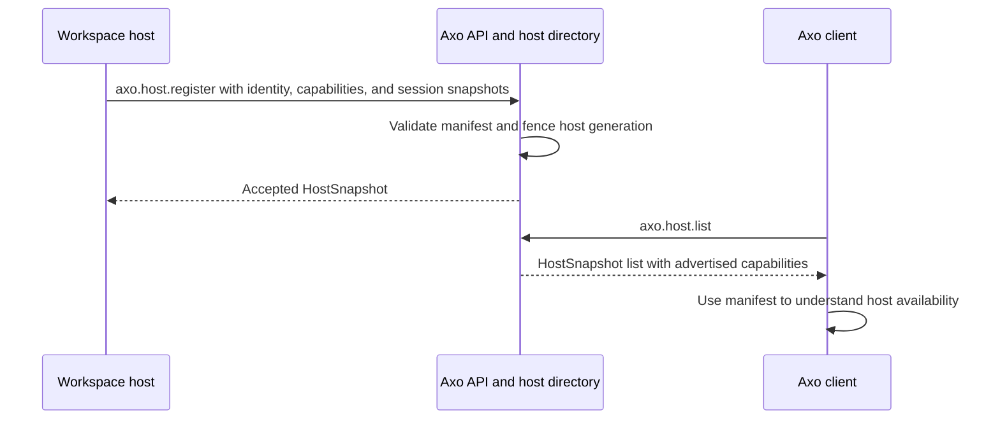
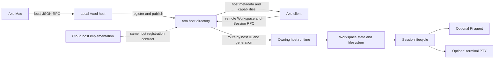
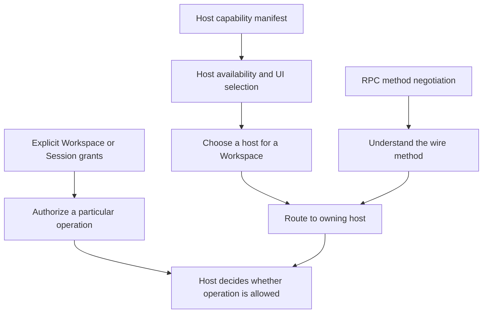

# Axo protocol schemas

This directory is the versioned wire-contract source for Axo clients and relays. Protocol v1 is defined by the JSON Schemas under [`v1/`](v1/): common host/session values, AxoMac↔axod local JSON-RPC, host-scoped remote RPC, and server-to-client events.

## Versioning

- A protocol version is a directory (`v1`, `v2`, …) and is negotiated before a peer uses methods beyond health/discovery.
- Within a version, adding an optional field, method, or event is compatible. Do not change the meaning, requiredness, encoding, or result shape of an existing field/method/event in place.
- Incompatible changes require a new version and an explicit negotiation/migration path. Keep older-version behavior until all supported clients have moved.
- JSON-RPC method names and event `type` values are stable wire identifiers. JSON-RPC IDs correlate replies only; they are not idempotency keys.
- Unix-domain RPC is local AxoMac↔axod. The Cloudflare relay uses the same domain payloads with explicit `HostRef` routing and authenticated transport; transport envelopes do not change the local RPC payload definitions.

## V1 method groups

`local-rpc.schema.json` describes the local AxoMac↔axod request and response shapes. `host-relay.schema.json` describes host registration/heartbeat, fast host/session metadata discovery, remote session controls, and routed calls. `events.schema.json` describes local AxoMac↔axod notifications and host-scoped API events. Local notifications use `axo.session.event`. Axod sends a `HostRelayNotification` named `axo.host.event`, whose params are the host-scoped event; the API fans that out as a `HostNotification` with a per-client `subscriptionId`. Both host event forms carry `hostId` and `hostGeneration`. Host session snapshots use the sanitized `SessionSnapshot` model, never local PTY paths. Event variants are `session.snapshot`, `session.removed`, `shell.activity`, and `terminal.output`; presence changes are `host.presence`. Terminal output and activity are streamed to currently subscribed clients only; they are not written to durable storage. These files are normative; the `$defs` names following `Call`, `Response`, and `Event` are the named request/result/event variants.

| Method | Caller → receiver | Parameters | Result |
| --- | --- | --- | --- |
| `axo.protocol.negotiate` | either peer → peer | `NegotiateCall` | `NegotiateResult` |
| `axo.daemon.health` | AxoMac → axod | empty object | `HealthResult` |
| `axo.session.list` | AxoMac → axod | empty object | `SessionListResult` |
| `axo.session.create` | AxoMac → axod | empty object; Cmd+T action | `SessionCreateResult` |
| `axo.session.close` | AxoMac → axod | session ID | `SessionCloseResult` |
| `axo.session.layout.set` | AxoMac → axod | session ID and validated layout tree | `LayoutSetResult` |
| `axo.shell.create` | AxoMac → axod | session ID | `ShellCreateResult` |
| `axo.shell.close` | AxoMac → axod | session and shell IDs | `ShellCloseResult` |
| `axo.session.subscribe` / `axo.session.events.next` / `axo.session.unsubscribe` | AxoMac → axod | optional session filter / bounded poll / subscription ID | subscription ID / event or timeout / acknowledgement |
| `axo.terminal.input` / `axo.terminal.resize` | AxoMac → axod | session/shell, sequence and base64 bytes / rows and columns | accepted sequence / accepted size |
| `axo.host.register` / `axo.host.heartbeat` | host → API | stable host ID, boot generation, platform label/kind, optional versioned capability manifest, current metadata | accepted host / heartbeat acknowledgement |
| `axo.host.sessions.publish` | axod → API | host reference and full current session snapshot | persistence acknowledgement |
| `axo.host.list` / `axo.host.sessions.list` | web app → API | none / host reference | host summaries / host-scoped snapshots |
| `axo.host.subscribe` / `axo.host.unsubscribe` | web app → API | host reference / subscription ID | subscription ID / acknowledgement |
| `axo.remote.session.create` / `.close` | web app → API → axod | host reference and session parameters | sanitized session result |
| `axo.remote.shell.create` / `.close` | web app → API → axod | host, session, and optional shell IDs | sanitized shell result |
| `axo.remote.session.layout.set` | web app → API → axod | host reference, session ID, layout tree | persistence acknowledgement |
| `axo.remote.terminal.input` / `axo.remote.terminal.resize` | web app → API → axod | host, session, shell IDs, sequence and base64 bytes / rows and columns | accepted sequence / accepted size |

Session and shell IDs are scoped by their host. Every persisted session snapshot includes its `hostId`; every remote action includes both the stable `hostId` and current `hostGeneration`, so a reconnect cannot route to an old process. A host ID is stable for one host installation; the generation changes when that host runtime restarts. `hostKind` is an open slug, not a closed enum, so a future host provider can implement v1 without changing existing records. Snapshot publication replaces that host's current session projection atomically. A missed lease marks the host offline but retains its last snapshot and timestamp.

## Host capabilities

`axo.host.register` may include an optional `capabilities` array. The shared definition is `HostCapabilities` in [`common.schema.json`](v1/common.schema.json), referenced by the registration parameters and by `HostSnapshot`. Each entry is a capability `id` and positive integer `version`; IDs must be unique within a manifest. V1 currently recognizes:

| Capability ID | Advertises support for |
| --- | --- |
| `agent.pi` | Running Pi as the Session's agent |
| `terminal.pty` | Providing terminal sessions backed by a PTY |
| `workspace.filesystem` | Providing filesystem access for a Workspace |

The manifest is optional to preserve compatibility with hosts that have not upgraded. Omitted means **not declared**; `[]` means **declared to provide none**. Capability IDs and versions describe host support; they do not request access to the user's Mac, carry credentials, or grant a Session permission to use a capability. Host-wide support and any future per-Workspace/per-Session grants are separate concepts. RPC method negotiation is also separate: a negotiated method only says that a peer understands a wire operation, not that a host supports or authorizes the underlying capability.

The current local Axod registration advertises the capabilities it implements. A cloud host can use the same manifest and Workspace/Session protocol when its runtime is implemented; advertising a capability alone does not implement cloud execution.

### Registration and discovery

Host identity fences routing, while the manifest describes implementation support:

The dotted cloud edge shows a protocol extension point, not a claim that cloud execution is already available. Workspaces remain owned by their host; the client routes through that host rather than treating local and cloud Workspaces as different protocol types.

### Capability is not authorization

A client must not infer authorization from the manifest or from successful method negotiation. The host remains responsible for enforcing any actual capability grants.

Terminal output and input payloads are base64-encoded bytes. Output is an event stream only and must not be persisted by the relay. Host identity and the latest session/layout metadata are persisted server-side; disconnected hosts retain their last snapshot marked offline/stale. Session snapshots intentionally omit local socket paths and raw terminal output.

## Validation

Schema fixtures under `v1/fixtures/` are the cross-language examples. Keep them valid against the published schemas and run the schema-check command before changing either protocol implementation. Rust and Swift models must match the schemas; the API/web TypeScript package must validate untrusted wire data at runtime, not rely on TypeScript annotations alone.
